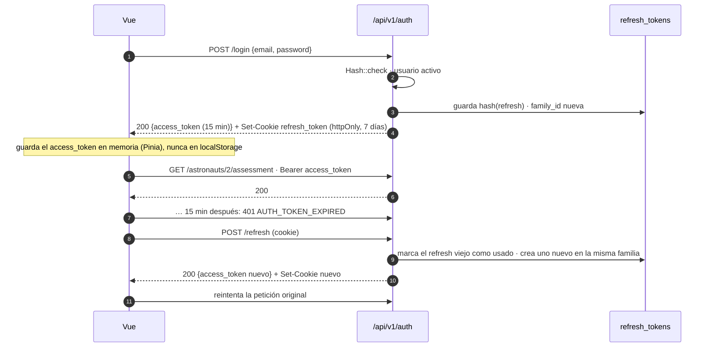
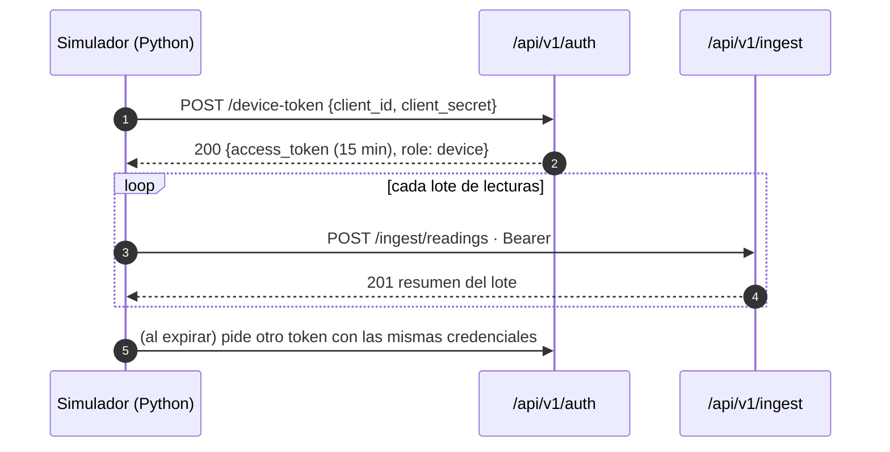

# 🔐 M0 · Identidad y acceso · Backend

> [← Backend](../README.md) · Código: `astrohealth/app/Modules/Identidad/` · Contrato: [API y JSON](../../../../documentacion/arquitectura/01-api-y-json.md#8-autenticación-jwt)

| Estado                    |        Fase        | Responsable |
| ------------------------- | :----------------: | ----------- |
| ✅ Terminado (2026-11-14) | **1** (va primero) | Backend     |

**Qué hace:** decide **quién** llama (persona o máquina) y **qué puede** hacer. Emite y verifica los JWT, rota los _refresh tokens_, define los roles y los permisos, y registra los dispositivos (el simulador). Todos los demás módulos se apoyan en él.

---

## 1. Cómo funciona

### Personas: login + _refresh_ con rotación



**Detección de robo:** si alguien presenta un _refresh token_ **ya usado**, se revoca **toda su familia** (todas las sesiones que salieron de ese login) y responde 401 `AUTH_REFRESH_REUSED`. El usuario legítimo vuelve a iniciar sesión; el ladrón queda fuera.

### Máquinas: _client credentials_



Los dispositivos **no tienen _refresh token_**: cuando el JWT expira, piden otro con sus credenciales. El `client_secret` se guarda **hasheado** y se muestra **una sola vez** al crearlo.

## 2. El JWT

| Tema                     | Valor                                                                                             |
| ------------------------ | ------------------------------------------------------------------------------------------------- |
| Librería                 | [`firebase/php-jwt`](https://github.com/firebase/php-jwt) (PHP puro, sin dependencia de Laravel)  |
| Algoritmo                | `HS256` con `JWT_SECRET` de 256 bits (base64) en `.env`. Solo Laravel firma y verifica            |
| Vida del _access token_  | 15 min (`JWT_TTL=15`)                                                                             |
| Vida del _refresh token_ | 7 días (`JWT_REFRESH_TTL=10080`), opaco (64 bytes aleatorios), se guarda **solo su hash SHA-256** |
| Tolerancia de reloj      | 30 s (`leeway`)                                                                                   |
| Dónde viaja              | `Authorization: Bearer <token>`. El _refresh_, solo en la _cookie_ `refresh_token`                |

**Claims:**

```json
{
    "iss": "https://astrohealth.app",
    "aud": "astrohealth-api",
    "sub": "user:7",
    "typ": "user",
    "role": "astronaut",
    "astronaut_id": 2,
    "mission_id": 1,
    "jti": "9f1c2e7a-4b1d-4c55-9e0a-2f3b8d6c1a77",
    "iat": 1763107200,
    "nbf": 1763107200,
    "exp": 1763108100
}
```

| Claim                         | Para qué                                                                                                                      |
| ----------------------------- | ----------------------------------------------------------------------------------------------------------------------------- |
| `sub`                         | `user:<id>` o `device:<id>`. El _guard_ carga ese actor desde la base **en cada petición**                                    |
| `typ`                         | `user` o `device`                                                                                                             |
| `role`                        | Solo informativo para Vue. **El backend usa el rol de la base**, así un cambio de rol o una desactivación aplica de inmediato |
| `astronaut_id` · `mission_id` | Para las _Policies_ ("¿es suyo?", "¿es de su misión?")                                                                        |
| `jti`                         | Identificador único; permite revocar un token en el _logout_                                                                  |

**Verificación en cada petición** (`JwtGuard`): firma → `exp`/`nbf` → `iss` y `aud` → `jti` no revocado → el actor existe y está activo. Cualquier fallo → 401.

**Cookie del _refresh_:** `HttpOnly`, `Secure` (en producción), `SameSite=Strict`, `Path=/api/v1/auth`. Además, `/refresh` exige que el `Origin` sea el de la app.

## 3. Roles

| `Role`                 | Dónde     | Tipo de actor | Astronauta enlazado                 | Se crea con                                |
| ---------------------- | --------- | ------------- | ----------------------------------- | ------------------------------------------ |
| `astronaut`            | 🚀 Nave   | `user`        | Obligatorio                         | `UserSeeder`                               |
| `crew_medical_officer` | 🚀 Nave   | `user`        | Obligatorio (también es tripulante) | `UserSeeder`                               |
| `flight_surgeon`       | 🌍 Tierra | `user`        | No admite                           | `UserSeeder`                               |
| `admin`                | 🌍 Tierra | `user`        | No admite                           | `UserSeeder`                               |
| `device`               | 🚀 Nave   | `device`      | Opcional (_gateway_ si no tiene)    | `DeviceSeeder` o `identidad:device-create` |

`role` se guarda como **texto** y se lee como el `enum` `Role` de PHP: agregar un rol no exige una migración.

La **matriz de permisos** está en el [índice del backend](../README.md#3-roles-y-permisos) y vive en `config/permissions.php`:

```php
return [
    'crew.read'               => ['admin', 'flight_surgeon', 'crew_medical_officer', 'astronaut'],
    'health.read.any'         => ['admin', 'flight_surgeon', 'crew_medical_officer'],
    'health.read.own'         => ['crew_medical_officer', 'astronaut'],
    'measurements.write.own'  => ['crew_medical_officer', 'astronaut'],
    'measurements.write.crew' => ['crew_medical_officer'],
    'measurements.ingest'     => ['device'],
    'alerts.read'             => ['admin', 'flight_surgeon', 'crew_medical_officer', 'astronaut'],
    'alerts.send'             => ['crew_medical_officer', 'astronaut'],
    'alerts.acknowledge'      => ['admin', 'flight_surgeon'],
    'mission.update'          => ['admin', 'flight_surgeon'],
    'reminders.manage.own'    => ['crew_medical_officer', 'astronaut'],
    'gamification.read'       => ['admin', 'flight_surgeon', 'crew_medical_officer', 'astronaut'],
    'users.manage'            => ['admin'],
    'devices.manage'          => ['admin'],
];
```

`IdentidadServiceProvider` recorre este archivo y define un `Gate` por permiso. Las rutas lo usan con `->middleware('can:measurements.ingest')`. **Nadie escribe `if ($user->role === 'admin')` en otro módulo:** se pregunta por el permiso.

**El Gate de "lo suyo"** — `health.read`, con el id del astronauta de la ruta:

- Con `health.read.own`: solo su propio `astronaut_id`.
- Con `health.read.any`: los tripulantes de **su misión** (la `mission_id` de su token, comparada con `CrewQuery::missionOf()`). Con `missions.manage` (admin): todos.
- Un médico de vuelo sin misión no ve a nadie.

**El Gate de una misión** — `mission.access`: la misión de su token, o todas con `missions.manage`. Lo usa M6 (por nombre, con el `Gate` de Laravel) para listar misiones y para que el médico de vuelo solo cambie el entorno de la suya.

```php
// En cualquier módulo:
Route::get('astronauts/{id}/assessment', …)->middleware('can:health.read,id');
```

Así M2, M3, M4 y M7 protegen sus rutas `/astronauts/{id}/…` con una sola línea y la regla vive en un único lugar.

## 4. Estructura de archivos

```
app/Modules/Identidad/
├── IdentidadServiceProvider.php      # Auth::extend('jwt'), Gates desde config/permissions.php, RateLimiters, bindings
├── routes.php                        # /api/v1/auth/*, /api/v1/users, /api/v1/devices
├── Contratos/
│   ├── Actor.php                     # id(), type(), role(), astronautId(), missionId(), isActive()
│   └── CurrentActor.php              # get(): Actor — lo usan los casos de uso de otros módulos
├── Domain/
│   ├── Enums/Role.php                # admin · flight_surgeon · crew_medical_officer · astronaut · device
│   ├── Enums/ActorType.php           # user · device
│   ├── Enums/ErrorCode.php           # AUTH_* (sección 7)
│   ├── ValueObjects/TokenClaims.php  # Claims tipados, sin dependencia de la librería
│   ├── Reglas/RefreshRotation.php    # válido · expirado · reusado → qué hacer
│   └── Excepciones/                  # InvalidCredentials · UserInactive · RefreshTokenReused · RefreshTokenExpired · InvalidDeviceCredentials
├── Application/
│   ├── Login.php                     # credenciales → TokenPair
│   ├── RefreshSession.php            # rota el refresh; si está reusado, revoca la familia
│   ├── Logout.php                    # revoca la familia + jti a la lista de revocados
│   ├── IssueDeviceToken.php          # client_id + secret → access token
│   ├── GetMe.php                     # actor + lista de permisos
│   ├── CreateUser.php · UpdateUser.php · DeactivateUser.php        (opcional, fase 6)
│   ├── CreateDevice.php · RotateDeviceSecret.php                    (secret visible una sola vez)
│   └── DTOs/Credentials.php · TokenPair.php · DeviceCredentials.php · MeResult.php
├── Infrastructure/
│   ├── Jwt/JwtIssuer.php             # firebase/php-jwt: encode
│   ├── Jwt/JwtVerifier.php           # decode + iss/aud/nbf/exp + leeway
│   ├── Jwt/JwtGuard.php              # implementa Illuminate\Contracts\Auth\Guard
│   ├── Jwt/RevokedTokens.php         # lista de jti revocados en caché hasta su exp + leeway
│   ├── Models/Device.php             # implementa Authenticatable + Actor
│   ├── Models/RefreshToken.php
│   └── Repositorios/                 # UN archivo por operación (Find · Insert · Update · Upsert)
│       ├── User/FindUserRepository.php · UpdateUserRepository.php · UpsertUserRepository.php · UserMapper.php
│       ├── Device/FindDeviceRepository.php · InsertDeviceRepository.php · UpdateDeviceRepository.php · DeviceMapper.php
│       ├── RefreshToken/FindRefreshTokenRepository.php · InsertRefreshTokenRepository.php · UpdateRefreshTokenRepository.php · RefreshTokenMapper.php
│       └── Actor/FindActorRepository.php   # el único que devuelve el modelo: lo necesita el guard
├── Http/
│   ├── Controllers/Api/LoginController.php · RefreshController.php · LogoutController.php · MeController.php
│   ├── Controllers/Api/DeviceTokenController.php
│   ├── Controllers/Api/UserController.php · DeviceController.php
│   ├── Requests/LoginRequest.php · DeviceTokenRequest.php · StoreUserRequest.php · StoreDeviceRequest.php
│   └── Resources/TokenResource.php · MeResource.php · UserResource.php · DeviceResource.php
├── Console/
│   ├── JwtSecretCommand.php          # identidad:jwt-secret → escribe JWT_SECRET en .env
│   └── CreateDeviceCommand.php       # identidad:device-create --mission=1 --name="Simulador" → imprime client_id y secret UNA vez
├── Database/
│   ├── Migrations/                   # role y active en users · devices · refresh_tokens
│   └── Seeders/UserSeeder.php · DeviceSeeder.php
└── Tests/
    ├── Unit/RefreshRotationTest.php · TokenClaimsTest.php · PermissionsMatrixTest.php
    └── Feature/LoginTest.php · RefreshTest.php · LogoutTest.php · DeviceTokenTest.php · GuardTest.php · AuthorizationMatrixTest.php
```

> `App\Models\User` se queda en `app/Models/` (lo espera Laravel) e implementa `Actor`. Su dueño es M0.

**Configuración**

```php
// config/auth.php
'defaults' => ['guard' => 'api'],
'guards'   => ['api' => ['driver' => 'jwt', 'provider' => 'users']],
```

```env
# astrohealth/.env
JWT_SECRET=            # php artisan identidad:jwt-secret
JWT_TTL=15
JWT_REFRESH_TTL=10080
JWT_ISSUER="${APP_URL}"
JWT_AUDIENCE=astrohealth-api
SIMULADOR_CLIENT_ID=sim-ares-1
SIMULADOR_CLIENT_SECRET=   # lo usa DeviceSeeder en local; en producción: identidad:device-create
```

## 5. Datos

| Tabla             | Columnas                                                                                                                                               | Notas                                                                                                                                                                                                                                |
| ----------------- | ------------------------------------------------------------------------------------------------------------------------------------------------------ | ------------------------------------------------------------------------------------------------------------------------------------------------------------------------------------------------------------------------------------ |
| `users` (del kit) | + `role` `string(30)` (`Role` en PHP), + `active` `boolean`, + `astronaut_id` _nullable_, único → `astronauts`, + `mission_id` _nullable_ → `missions` | El enlace usuario ↔ astronauta vive aquí (M0), así M0 no depende de M6 para el _claim_ `astronaut_id`. `mission_id` solo lo tiene el médico de vuelo (regla `RoleAssignment::missionFor`); los tripulantes la toman de su astronauta |
| `devices`         | `id`, `mission_id` → `missions`, `astronaut_id` _nullable_ → `astronauts`, `name`, `client_id` (único), `secret_hash`, `active`, `last_seen_at`        | Con `astronaut_id = null`, el dispositivo es un _**gateway**_: envía lecturas de cualquier astronauta de **su** misión                                                                                                               |
| `refresh_tokens`  | `id`, `user_id`, `family_id` (uuid), `token_hash` (único, sha256), `expires_at`, `used_at`, `revoked_at`, `created_at`, `user_agent`, `ip`             | Índice `(family_id)`. Una limpieza diaria borra los vencidos                                                                                                                                                                         |

**`UserSeeder`** (solo local; contraseña `password`):

| Correo                                                | Rol                    | Astronauta                 |
| ----------------------------------------------------- | ---------------------- | -------------------------- |
| `admin@astrohealth.test`                              | `admin`                | —                          |
| `tierra@astrohealth.test`                             | `flight_surgeon`       | — (sigue la misión Ares-1) |
| `astro1@astrohealth.test` … `astro3@astrohealth.test` | `astronaut`            | 1 … 3                      |
| `cmo@astrohealth.test`                                | `crew_medical_officer` | 4                          |

**`DeviceSeeder`:** el _gateway_ `Simulador Ares-1` (misión 1, sin astronauta fijo) con `SIMULADOR_CLIENT_ID` y `SIMULADOR_CLIENT_SECRET` del `.env`.

## 6. Endpoints

| Método | Ruta                              | Acceso                                                                      | Caso de uso        | Respuesta                                                           |
| ------ | --------------------------------- | --------------------------------------------------------------------------- | ------------------ | ------------------------------------------------------------------- |
| POST   | `/api/v1/auth/login`              | Público · `throttle:api-login` (5/min por correo+IP)                        | `Login`            | 200 token + perfil + _cookie_                                       |
| POST   | `/api/v1/auth/refresh`            | _Cookie_ `refresh_token` · `throttle:api-refresh` (30/min) · `VerifyOrigin` | `RefreshSession`   | 200 token + _cookie_ nueva                                          |
| POST   | `/api/v1/auth/logout`             | `auth:api`                                                                  | `Logout`           | 204 + borra la _cookie_                                             |
| GET    | `/api/v1/auth/me`                 | `auth:api`                                                                  | `GetMe`            | 200 perfil + permisos                                               |
| POST   | `/api/v1/auth/device-token`       | Público · `throttle:api-device` (10/min por IP)                             | `IssueDeviceToken` | 200 token + perfil                                                  |
| GET    | `/api/v1/users`                   | `can:users.manage`                                                          | `ListUsers`        | 200 lista con nombre de tripulante, cargo y misión (de M6)          |
| POST   | `/api/v1/users`                   | `can:users.manage`                                                          | `CreateUser`       | 201 la persona (sin contraseña conocida: `identidad:user-password`) |
| PATCH  | `/api/v1/users/{user}`            | `can:users.manage`                                                          | `UpdateUser`       | 200 (el correo no cambia; nadie se quita su rol de admin)           |
| PATCH  | `/api/v1/users/{user}/active`     | `can:users.manage`                                                          | `SetUserActive`    | 200 (desactivar revoca sus _refresh tokens_)                        |
| GET    | `/api/v1/devices`                 | `can:devices.manage`                                                        | `ListDevices`      | 200 lista, nunca el secreto                                         |
| POST   | `/api/v1/devices`                 | `can:devices.manage`                                                        | `AddDevice`        | 201 `{ device, client_secret }`: el secreto UNA vez                 |
| PATCH  | `/api/v1/devices/{device}/active` | `can:devices.manage`                                                        | `SetDeviceActive`  | 200                                                                 |

**`POST /api/v1/auth/login`** (respuesta real, probada en vivo el 2026-11-14)

```json
{ "email": "astro2@astrohealth.test", "password": "password" }
```

```json
{
    "data": {
        "access_token": "eyJ0eXAiOiJKV1QiLCJhbGciOiJIUzI1NiJ9…",
        "token_type": "Bearer",
        "expires_in": 900,
        "actor": {
            "type": "user",
            "id": 4,
            "name": "Kenji Mori",
            "email": "astro2@astrohealth.test",
            "role": "astronaut",
            "role_label": "Astronauta",
            "location": "space",
            "astronaut_id": 2,
            "mission_id": 1,
            "permissions": [
                "crew.read",
                "health.read.own",
                "measurements.write.own",
                "alerts.read",
                "alerts.send",
                "reminders.manage.own",
                "gamification.read"
            ]
        }
    },
    "message": "ok"
}
```

\+ encabezado `Set-Cookie: refresh_token=…; path=/api/v1/auth; httponly; samesite=strict` (y `secure` en producción). **El _refresh token_ nunca va en el JSON.**

**`GET /api/v1/auth/me`** → `data` es el mismo objeto `actor`. Vue lo usa para mostrar u ocultar botones. **Ocultar no es proteger:** el backend vuelve a comprobar todo.

**`POST /api/v1/auth/device-token`** → la misma forma, con `"actor": {"type": "device", "role": "device", "name": "Simulador Ares-1", "mission_id": 1, "permissions": ["measurements.ingest"], …}`. Sin _cookie_.

## 7. Códigos de error

| Código                                             | HTTP | Cuándo                                                                                                    | Mensaje                                                           |
| -------------------------------------------------- | :--: | --------------------------------------------------------------------------------------------------------- | ----------------------------------------------------------------- |
| `VALIDATION_FAILED`                                | 422  | Falta el correo o la contraseña, o el correo no tiene formato                                             | Por campo, en español ("El correo no tiene un formato válido.")   |
| `AUTH_INVALID_CREDENTIALS`                         | 401  | Correo o contraseña incorrectos (no se dice cuál)                                                         | "Credenciales inválidas."                                         |
| `AUTH_USER_INACTIVE`                               | 403  | La contraseña es correcta pero el usuario está desactivado                                                | "Tu usuario está desactivado."                                    |
| `AUTH_USER_WITHOUT_ROLE`                           | 403  | El usuario no tiene rol (p. ej. lo creó un administrador sin asignárselo)                                 | "Tu usuario no tiene un rol asignado. Pide uno al administrador." |
| `AUTH_INVALID_ROLE_ASSIGNMENT`                     | 422  | El rol y el enlace con el astronauta no cuadran (datos mal cargados)                                      | El detalle de la regla                                            |
| `UNAUTHENTICATED`                                  | 401  | No viene `Authorization: Bearer`                                                                          | "Inicia sesión para continuar."                                   |
| `AUTH_TOKEN_INVALID`                               | 401  | Firma, `iss`, `aud`, algoritmo o formato inválidos; `jti` revocado; el actor ya no existe o está inactivo | "Sesión no válida. Inicia sesión de nuevo."                       |
| `AUTH_TOKEN_EXPIRED`                               | 401  | `exp` vencido (más de 30 s) → Vue llama a `/refresh`                                                      | "La sesión expiró."                                               |
| `AUTH_REFRESH_INVALID`                             | 401  | Sin _cookie_, o _refresh_ inexistente, vencido o revocado                                                 | "Inicia sesión de nuevo."                                         |
| `AUTH_REFRESH_REUSED`                              | 401  | _Refresh_ ya usado → se revocó toda la familia                                                            | "Inicia sesión de nuevo."                                         |
| `AUTH_ORIGIN_NOT_ALLOWED`                          | 403  | `/refresh` llamado desde otro `Origin`                                                                    | "Origen no permitido."                                            |
| `AUTH_DEVICE_INVALID`                              | 401  | `client_id` o secreto incorrectos, o dispositivo inactivo                                                 | "Credenciales de dispositivo inválidas."                          |
| `AUTH_EMAIL_TAKEN`                                 | 422  | Ya hay un usuario con ese correo (campo `email`)                                                          | "Ya hay un usuario con ese correo."                               |
| `AUTH_MISSION_REQUIRED`                            | 422  | Médico de vuelo sin misión (campo `mission_id`)                                                           | "El médico de vuelo debe seguir una misión."                      |
| `AUTH_UNKNOWN_MISSION`                             | 422  | La misión no existe en M6 (campo `mission_id`)                                                            | "La misión no existe."                                            |
| `AUTH_UNKNOWN_ASTRONAUT`                           | 422  | El tripulante no existe en M6 (campo `astronaut_id`)                                                      | "El tripulante no existe."                                        |
| `AUTH_ASTRONAUT_TAKEN`                             | 422  | El tripulante ya tiene otro usuario (campo `astronaut_id`)                                                | "Ese tripulante ya tiene otro usuario."                           |
| `AUTH_ASTRONAUT_NOT_IN_MISSION`                    | 422  | El dispositivo se asigna a un tripulante de otra misión (campo `astronaut_id`)                            | "Ese tripulante no es de la misión."                              |
| `AUTH_CLIENT_ID_TAKEN` · `AUTH_WEAK_DEVICE_SECRET` | 422  | Solo por consola: `client_id` repetido o secreto de menos de 32 caracteres                                | El detalle                                                        |
| `AUTH_OWN_ACCESS_LOCKED`                           | 409  | El admin intenta quitarse su rol o desactivarse                                                           | "No puedes quitarte tu propio acceso de administrador."           |
| `AUTH_USER_NOT_FOUND` · `AUTH_DEVICE_NOT_FOUND`    | 404  | El id no existe                                                                                           | "El usuario no existe." · "El dispositivo no existe."             |
| `FORBIDDEN`                                        | 403  | El rol no tiene el permiso, o el recurso no es suyo                                                       | "No tienes permiso para esta acción."                             |
| `TOO_MANY_REQUESTS`                                | 429  | Superó el límite (con `Retry-After`)                                                                      | "Demasiados intentos. Espera un momento."                         |

## 8. Seguridad, punto por punto

| Riesgo                                                          | Defensa                                                                                                                                    | Probado en                          |
| --------------------------------------------------------------- | ------------------------------------------------------------------------------------------------------------------------------------------ | ----------------------------------- |
| Robo del _access token_                                         | Vida de 15 min, en memoria del navegador, revocable por `jti` (_logout_)                                                                   | `RefreshAndLogoutTest`              |
| Robo del _refresh token_                                        | _Cookie_ `HttpOnly` + `SameSite=Strict` + `Path=/api/v1/auth`; rotación en cada uso; reuso → revoca la familia; en la base solo su SHA-256 | `RefreshAndLogoutTest`, `LoginTest` |
| Dos `/refresh` a la vez con el mismo token                      | `SELECT … FOR UPDATE` dentro de la transacción                                                                                             | — (diseño)                          |
| Fuerza bruta en el login                                        | `throttle:api-login` 5/min por correo+IP; mensaje genérico; _hash_ falso si el correo no existe (mismo tiempo)                             | `LoginTest`                         |
| Saber qué correos existen                                       | Misma respuesta exacta para correo inexistente y clave mala                                                                                | `LoginTest`                         |
| Cambio de rol o desactivación                                   | El _guard_ lee rol y `active` de la base en cada petición                                                                                  | `GuardTest`, `DeviceTokenTest`      |
| `alg: none`, `HS512`, payload alterado, otro emisor o audiencia | `JwtVerifier`: solo `HS256` + `iss` + `aud`                                                                                                | `JwtTest`                           |
| Secreto débil o ausente                                         | `JwtConfig` exige 256 bits; sin secreto no firma                                                                                           | `JwtTest`                           |
| CSRF sobre `/refresh`                                           | `SameSite=Strict` + `VerifyOrigin`                                                                                                         | `RefreshAndLogoutTest`              |
| Secreto del dispositivo filtrado                                | Se guarda con `bcrypt`; `active = false` corta su token al instante                                                                        | `DeviceTokenTest`                   |
| Secretos en el repositorio                                      | `JWT_SECRET` y `SIMULADOR_CLIENT_SECRET` solo en `.env`; `phpunit.xml` usa valores **solo de prueba**                                      | —                                   |

## 9. Pruebas

**82 pruebas del módulo** (más las 55 que ya existían): **137 en verde sobre MySQL**, Pint ✅, PHPStan nivel 7 con 0 errores.

| Prueba                    | Tipo    | Verifica                                                                                                                                                                                                                             |
| ------------------------- | ------- | ------------------------------------------------------------------------------------------------------------------------------------------------------------------------------------------------------------------------------------ |
| `RoleTest`                | Unit    | Dónde vive cada rol, quién exige astronauta, etiquetas en español                                                                                                                                                                    |
| `RoleAssignmentTest`      | Unit    | Las 9 combinaciones válidas e inválidas de rol + astronauta; solo el médico de vuelo guarda misión, y es obligatoria                                                                                                                 |
| `RefreshRotationTest`     | Unit    | Rotar · reuso → revocar familia · revocado o vencido → rechazar                                                                                                                                                                      |
| `TokenClaimsTest`         | Unit    | Ida y vuelta de los _claims_; `sub` ≠ `typ`, rol desconocido o `exp` faltante → error                                                                                                                                                |
| `PermissionMatrixTest`    | Unit    | La matriz real: roles válidos, ningún permiso vacío, reglas clave                                                                                                                                                                    |
| `UsersTableTest`          | Feature | Columnas en MySQL, `role` como `enum`, `astronaut_id` único, `nullOnDelete`, `expires_at` es `DATETIME`                                                                                                                              |
| `JwtTest`                 | Feature | Firmar/verificar, payload alterado, `alg: none`, `HS512`, `aud` e `iss` ajenos, basura, vencido con y sin tolerancia, secreto ausente o corto                                                                                        |
| `LoginTest`               | Feature | Login correcto (JSON, _cookie_, `last_login_at`), misma respuesta para correo inexistente y clave mala, inactivo, sin rol, validación en español, _throttle_                                                                         |
| `GuardTest`               | Feature | Sin token, válido, malformado, vencido, desactivado y borrado después del login, cambio de rol al instante, varias peticiones seguidas                                                                                               |
| `RefreshAndLogoutTest`    | Feature | Rotación, **reuso → familia revocada**, sin _cookie_, vencido, `Origin` ajeno y propio, _logout_ mata _access_ y _refresh_                                                                                                           |
| `DeviceTokenTest`         | Feature | Token de máquina con solo `measurements.ingest`, sin _cookie_, secreto hasheado, credenciales malas, inactivo                                                                                                                        |
| `AuthorizationMatrixTest` | Feature | **5 roles × 14 permisos** responden 200/403 exactamente como la matriz; `health.read` para cada rol                                                                                                                                  |
| `UsersApiTest`            | Feature | Lista con nombres de M6, crear (correo en minúsculas, médico con misión, tripulante enlazado), errores 422 por campo, editar sin cambiar el correo, el admin no se bloquea a sí mismo (409), desactivar cierra sesiones, 401/403/404 |
| `DevicesApiTest`          | Feature | Lista sin secreto, crear devuelve el secreto una vez y sirve para `/device-token`, tripulante de otra misión, desactivado no obtiene token, 401/403/404                                                                              |
| `SeedersTest`             | Feature | Un usuario por rol enlazado a la tripulación, sin duplicar al repetir, y todos pueden autenticarse                                                                                                                                   |

**Ayudas para otras pruebas** (`Identidad/Tests/Support/InteractsWithJwt.php`):

```php
$user  = $this->userWithRole(Role::Astronaut);          // crea misión + astronauta + usuario
$token = $this->tokenFor($user);                         // JWT firmado de verdad
$this->getJson('/api/v1/auth/me', $this->bearer($token))->assertOk();

[$device, $secret] = $this->device();                    // dispositivo + secreto en texto plano
```

## 10. Avance

- [x] `composer require firebase/php-jwt` (7.2) y `config/jwt.php`
- [x] `identidad:jwt-secret`
- [x] Migraciones: `users` (`role`, `active`, `astronaut_id`, `last_login_at`) · `devices` · `refresh_tokens` (con `down()` probado)
- [x] `JwtConfig` · `JwtIssuer` · `JwtVerifier` · `JwtGuard` · `RevokedTokens`
- [x] `Login` · `RefreshSession` (con detección de reuso) · `Logout` · `GetMe`
- [x] `IssueDeviceToken` · `CreateDevice` · `identidad:device-create`
- [x] Gates desde `config/permissions.php` + `health.read` · _rate limiters_
- [x] `UserSeeder` · `DeviceSeeder` (y `MissionSeeder` de M6)
- [x] Ayudas de prueba `InteractsWithJwt`
- [x] Pruebas de la sección 9 en verde
- [x] Gestión de usuarios y dispositivos por API (F0 del plan del backend, `documentacion/PLAN_BACKEND.md`): `ListUsers` · `CreateUser` · `UpdateUser` · `SetUserActive` · `ListDevices` · `AddDevice` · `SetDeviceActive`; la pantalla de Usuarios ya los usa
- [x] `users.mission_id` para el médico de vuelo (su token trae su misión) · `identidad:user-password <correo>`
- [x] Fortify quitado: el acceso es solo por la API con JWT (login de Vue en `/acceso`)

## 10 bis. Acceso rápido (sin contraseña)

El reto pide que la app no exija login. La pantalla de acceso muestra a las personas activas (`GET /api/v1/auth/quick-access`: id, nombre, rol; sin correo) y se entra eligiendo una (`POST /api/v1/auth/quick-access {user_id}`). La sesión es la **misma** del login normal: JWT y _refresh token_ en la cookie, así que los permisos y los Gates no cambian. Una persona desactivada o sin rol no puede entrar (404 `AUTH_QUICK_ACCESS_OFF`). El correo y la contraseña siguen como opción.

Se apaga con `QUICK_ACCESS=false` en `.env` (`config/identidad.php`); entonces ambas rutas responden 404 y la pantalla muestra solo el formulario. Pruebas: `QuickAccessTest`.

## 11. Cómo quedó hecho

### Las 4 capas, archivo por archivo

| Capa                            | Archivos                                                                                                                                                                                                                                                                                                             |
| ------------------------------- | -------------------------------------------------------------------------------------------------------------------------------------------------------------------------------------------------------------------------------------------------------------------------------------------------------------------- |
| **Domain**                      | `Enums/` Role · Location · ActorType · ErrorCode · RotationDecision — `Entidades/` UserAccount · DeviceAccount · StoredRefreshToken — `Reglas/` RoleAssignment · RefreshRotation — `ValueObjects/` TokenClaims · PermissionMatrix · ActorIdentity — `Excepciones/` 10 errores de negocio                             |
| **Application** (Service)       | Login · RefreshSession · Logout · GetMe · IssueDeviceToken · CreateDevice — `Servicios/` TokenFactory · SessionIssuer · ActorProfiles · ActorIdentityLoader · DummyHash — `DTOs/` Credentials · DeviceCredentials · AccessToken · ActorProfile · SessionResult · DeviceTokenResult · NewDevice                       |
| **Infrastructure** (Repository) | `Jwt/` JwtConfig · JwtIssuer · JwtVerifier · JwtGuard · RevokedTokens · MissingJwtSecret — `Models/` Device · RefreshToken — `Repositorios/` un archivo por operación: `User/` Find · Update · Upsert — `Device/` Find · Insert · Update — `RefreshToken/` Find · Insert · Update — `Actor/` Find — AuthCurrentActor |
| **Http** (API)                  | `routes.php` — `Controllers/Api/` LoginController · RefreshController · LogoutController · MeController · DeviceTokenController (uno por acción) — `Requests/` LoginRequest · DeviceTokenRequest — `Resources/` TokenResource · ActorResource — `Middleware/` VerifyOrigin — RefreshCookie                           |
| Contratos                       | Actor · CurrentActor                                                                                                                                                                                                                                                                                                 |
| Base de datos                   | 3 migraciones · UserSeeder · DeviceSeeder                                                                                                                                                                                                                                                                            |
| Fuera del módulo                | `App\Models\User` (implementa `Actor`) · `config/jwt.php` · `config/permissions.php` · `config/identidad.php` · `config/auth.php` (_guard_ `api`) · `bootstrap/providers.php` · `DatabaseSeeder`                                                                                                                     |

### Decisiones técnicas

- **Sin token → `UNAUTHENTICATED`** (general). Con token malo → el `AUTH_*` exacto. El _guard_ lanza el error de M0; `auth:api` cubre el caso sin token.
- **El _guard_ recarga al actor en cada petición:** cuesta una consulta por petición, pero un cambio de rol o una desactivación aplica al instante, sin esperar a que venza el token.
- **`role` es `VARCHAR(30)` + `enum` de PHP:** agregar un rol no exige una migración. Es _nullable_ por si un administrador crea un usuario antes de darle rol; un usuario sin rol no entra a la API.
- **El enlace usuario ↔ astronauta vive en `users.astronaut_id`** (M0), así M0 no depende de M6 para los _claims_. La misión se pide a M6 por `CrewQuery`.
- **Fechas `DATETIME` en `refresh_tokens` y `devices`:** en MariaDB 10.4 la primera columna `TIMESTAMP NOT NULL` recibiría `ON UPDATE CURRENT_TIMESTAMP` (una prueba lo vigila).
- **`astronauts.crew_role`** (y no `role`) para el cargo a bordo: así no se confunde con el rol de acceso.
- **`DummyHash`:** cuando el correo o el `client_id` no existen se compara contra un _hash_ falso, para que la respuesta tarde lo mismo.
- **Un repositorio por operación** (`Find…`, `Insert…`, `Update…`, `Upsert…`), agrupados por tabla. Devuelven **entidades de `Domain/Entidades`**, nunca modelos Eloquent: Application no conoce Eloquent. La conversión la hace el `…Mapper` de cada tabla. La única excepción es `FindActorRepository`, que devuelve el modelo porque el _guard_ y los Gates de Laravel necesitan un `Authenticatable`; solo lo usa `JwtGuard`.
- **`ActorIdentity`** (Domain) es lo que Application usa para firmar tokens y armar el perfil, sea persona o máquina.
- **La revocación dura `exp + leeway`:** el verificador acepta 30 s de tolerancia después del `exp`, así que el `jti` revocado se recuerda ese tiempo extra (prueba `test_a_logged_out_token_stays_dead_during_the_clock_leeway`).
- **Los limitadores se llaman `api-login`, `api-refresh` y `api-device`:** dicen a qué ruta de la API pertenecen.
- **JSON sin escapes** (`JSON_UNESCAPED_UNICODE`): "inválidas" y no "inválidas".
- **Mensajes de validación en español** dentro de cada `FormRequest`: el proyecto no tiene la carpeta `lang/es`.

### Diferencias con el diseño original de este documento

| Antes                                                            | Ahora                                                                               | Por qué                                                |
| ---------------------------------------------------------------- | ----------------------------------------------------------------------------------- | ------------------------------------------------------ |
| `AUTH_TOKEN_MISSING`                                             | `UNAUTHENTICATED`                                                                   | Es el que produce `auth:api`; el general ya lo explica |
| El JSON traía `user` / `device`                                  | Trae `actor` (mismo formato para persona y máquina)                                 | Vue y el simulador leen lo mismo                       |
| `throttle:login`, `throttle:device`                              | `throttle:api-login`, `api-refresh`, `api-device`                                   | Fortify ya usa `login`                                 |
| `actingAsRole()` en `TestCase`                                   | `InteractsWithJwt` en el módulo                                                     | Firma tokens reales; no toca `TestCase`                |
| Nuevos                                                           | `AUTH_USER_WITHOUT_ROLE`, `AUTH_ORIGIN_NOT_ALLOWED`, `AUTH_INVALID_ROLE_ASSIGNMENT` | Casos que aparecieron al construir                     |
| `UserRepository` · `DeviceRepository` · `RefreshTokenRepository` | Un repositorio por operación, que devuelve entidades                                | Separación de responsabilidades (ARCHITECTURE §6 y §8) |
| `AuthController` con 4 acciones                                  | `LoginController` · `RefreshController` · `LogoutController` · `MeController`       | Un controlador por acción                              |

### Cómo probarlo

```powershell
php artisan migrate:fresh --seed          # misión, 6 usuarios (uno por rol) y el simulador
php artisan test --filter=Identidad       # las 82 pruebas del módulo

# A mano (con composer run dev encendido):
curl -s -X POST http://localhost:8000/api/v1/auth/login -H "Content-Type: application/json" -d "{\"email\":\"astro2@astrohealth.test\",\"password\":\"password\"}"
curl -s http://localhost:8000/api/v1/auth/me -H "Authorization: Bearer <access_token>"
```

| Usuario de prueba (contraseña `password`, solo local) | Rol                      | Dónde     |
| ----------------------------------------------------- | ------------------------ | --------- |
| `admin@astrohealth.test`                              | Administrador            | 🌍 Tierra |
| `tierra@astrohealth.test`                             | Médico en Tierra         | 🌍 Tierra |
| `astro1@` · `astro2@` · `astro3@astrohealth.test`     | Astronauta               | 🚀 Nave   |
| `cmo@astrohealth.test`                                | Médico de la tripulación | 🚀 Nave   |

> 📝 **Documentar siempre:** este documento se actualiza en el mismo _pull request_ que cambia el código.
