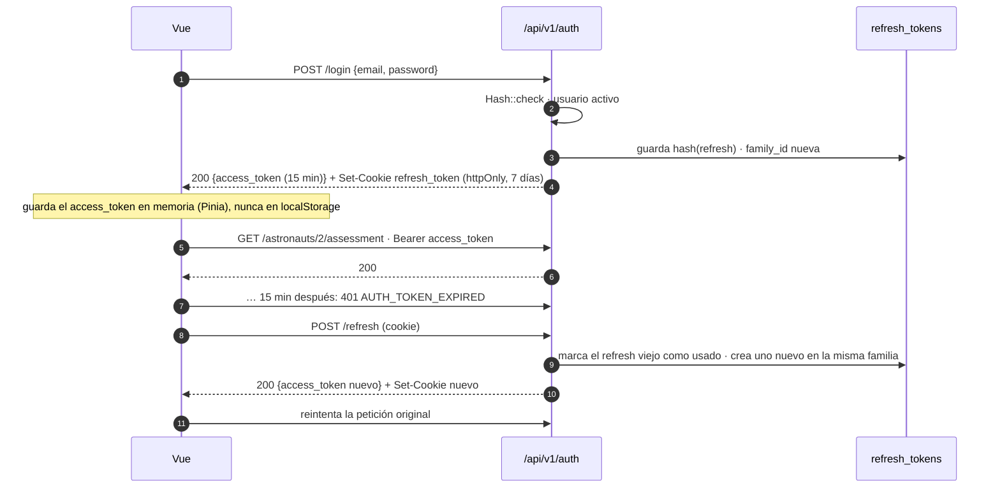
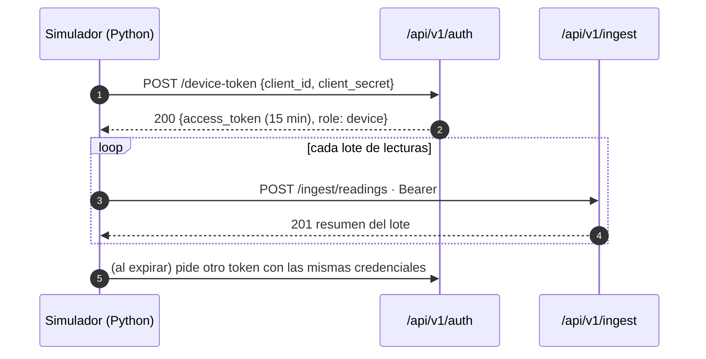

# 🔐 M0 · Identidad y acceso · Backend

> [← Backend](../README.md) · Código: `astrohealth/app/Modules/Identidad/` · Contrato: [API y JSON](../../../../documentacion/arquitectura/01-api-y-json.md#8-autenticación-jwt)

| Estado | Fase | Responsable |
|---|:---:|---|
| ⬜ Sin empezar | **1** (va primero) | Backend |

> 🛠️ **¿Por dónde empezar?** [Plan de trabajo paso a paso](plan-de-trabajo.md).

**Qué hace:** decide **quién** llama (persona o máquina) y **qué puede** hacer. Emite y verifica los JWT, rota los *refresh tokens*, define los roles y los permisos, y registra los dispositivos (el simulador). Todos los demás módulos se apoyan en él.

---

## 1. Cómo funciona

### Personas: login + *refresh* con rotación



**Detección de robo:** si alguien presenta un *refresh token* **ya usado**, se revoca **toda su familia** (todas las sesiones que salieron de ese login) y responde 401 `AUTH_REFRESH_REUSED`. El usuario legítimo vuelve a iniciar sesión; el ladrón queda fuera.

### Máquinas: *client credentials*



Los dispositivos **no tienen *refresh token***: cuando el JWT expira, piden otro con sus credenciales. El `client_secret` se guarda **hasheado** y se muestra **una sola vez** al crearlo.

## 2. El JWT

| Tema | Valor |
|---|---|
| Librería | [`firebase/php-jwt`](https://github.com/firebase/php-jwt) (PHP puro, sin dependencia de Laravel) |
| Algoritmo | `HS256` con `JWT_SECRET` de 256 bits (base64) en `.env`. Solo Laravel firma y verifica |
| Vida del *access token* | 15 min (`JWT_TTL=15`) |
| Vida del *refresh token* | 7 días (`JWT_REFRESH_TTL=10080`), opaco (64 bytes aleatorios), se guarda **solo su hash SHA-256** |
| Tolerancia de reloj | 30 s (`leeway`) |
| Dónde viaja | `Authorization: Bearer <token>`. El *refresh*, solo en la *cookie* `refresh_token` |

**Claims:**

```json
{
  "iss": "https://astrohealth.app",
  "aud": "astrohealth-api",
  "sub": "user:7",
  "typ": "user",
  "role": "astronaut",
  "astronaut_id": 2,
  "mission_id": 1,
  "jti": "9f1c2e7a-4b1d-4c55-9e0a-2f3b8d6c1a77",
  "iat": 1763107200,
  "nbf": 1763107200,
  "exp": 1763108100
}
```

| Claim | Para qué |
|---|---|
| `sub` | `user:<id>` o `device:<id>`. El *guard* carga ese actor desde la base **en cada petición** |
| `typ` | `user` o `device` |
| `role` | Solo informativo para Vue. **El backend usa el rol de la base**, así un cambio de rol o una desactivación aplica de inmediato |
| `astronaut_id` · `mission_id` | Para las *Policies* ("¿es suyo?", "¿es de su misión?") |
| `jti` | Identificador único; permite revocar un token en el *logout* |

**Verificación en cada petición** (`JwtGuard`): firma → `exp`/`nbf` → `iss` y `aud` → `jti` no revocado → el actor existe y está activo. Cualquier fallo → 401.

**Cookie del *refresh*:** `HttpOnly`, `Secure` (en producción), `SameSite=Strict`, `Path=/api/v1/auth`. Además, `/refresh` exige que el `Origin` sea el de la app.

## 3. Roles

| `Role` | Dónde | Tipo de actor | Astronauta enlazado | Se crea con |
|---|---|---|---|---|
| `astronaut` | 🚀 Nave | `user` | Obligatorio | `UserSeeder` |
| `crew_medical_officer` | 🚀 Nave | `user` | Obligatorio (también es tripulante) | `UserSeeder` |
| `flight_surgeon` | 🌍 Tierra | `user` | No admite | `UserSeeder` |
| `admin` | 🌍 Tierra | `user` | No admite | `UserSeeder` |
| `device` | 🚀 Nave | `device` | Opcional (*gateway* si no tiene) | `DeviceSeeder` o `identidad:device-create` |

`role` se guarda como **texto** y se lee como el `enum` `Role` de PHP: agregar un rol no exige una migración.

La **matriz de permisos** está en el [índice del backend](../README.md#3-roles-y-permisos) y vive en `config/permissions.php`:

```php
return [
    'crew.read'               => ['admin', 'flight_surgeon', 'crew_medical_officer', 'astronaut'],
    'health.read.any'         => ['admin', 'flight_surgeon', 'crew_medical_officer'],
    'health.read.own'         => ['crew_medical_officer', 'astronaut'],
    'measurements.write.own'  => ['crew_medical_officer', 'astronaut'],
    'measurements.write.crew' => ['crew_medical_officer'],
    'measurements.ingest'     => ['device'],
    'alerts.read'             => ['admin', 'flight_surgeon', 'crew_medical_officer', 'astronaut'],
    'alerts.send'             => ['crew_medical_officer', 'astronaut'],
    'alerts.acknowledge'      => ['admin', 'flight_surgeon'],
    'mission.update'          => ['admin', 'flight_surgeon'],
    'reminders.manage.own'    => ['crew_medical_officer', 'astronaut'],
    'gamification.read'       => ['admin', 'flight_surgeon', 'crew_medical_officer', 'astronaut'],
    'users.manage'            => ['admin'],
    'devices.manage'          => ['admin'],
];
```

`IdentidadServiceProvider` recorre este archivo y define un `Gate` por permiso. Las rutas lo usan con `->middleware('can:measurements.ingest')`. **Nadie escribe `if ($user->role === 'admin')` en otro módulo:** se pregunta por el permiso.

**El Gate de "lo suyo"** — `health.read`, con el id del astronauta de la ruta:

```php
Gate::define('health.read', fn (Actor $actor, int|string $astronautId): bool =>
    $actor->can('health.read.any')
    || ($actor->can('health.read.own') && $actor->astronautId() === (int) $astronautId));

// En cualquier módulo:
Route::get('astronauts/{id}/assessment', …)->middleware('can:health.read,id');
```

Así M2, M3, M4 y M7 protegen sus rutas `/astronauts/{id}/…` con una sola línea y la regla vive en un único lugar.

## 4. Estructura de archivos

```
app/Modules/Identidad/
├── IdentidadServiceProvider.php      # Auth::extend('jwt'), Gates desde config/permissions.php, RateLimiters, bindings
├── routes.php                        # /api/v1/auth/*, /api/v1/users, /api/v1/devices
├── Contratos/
│   ├── Actor.php                     # id(), type(), role(), astronautId(), missionId(), isActive()
│   └── CurrentActor.php              # get(): Actor — lo usan los casos de uso de otros módulos
├── Domain/
│   ├── Enums/Role.php                # admin · flight_surgeon · crew_medical_officer · astronaut · device
│   ├── Enums/ActorType.php           # user · device
│   ├── Enums/ErrorCode.php           # AUTH_* (sección 7)
│   ├── ValueObjects/TokenClaims.php  # Claims tipados, sin dependencia de la librería
│   ├── Reglas/RefreshRotation.php    # válido · expirado · reusado → qué hacer
│   └── Excepciones/                  # InvalidCredentials · UserInactive · RefreshTokenReused · RefreshTokenExpired · InvalidDeviceCredentials
├── Application/
│   ├── Login.php                     # credenciales → TokenPair
│   ├── RefreshSession.php            # rota el refresh; si está reusado, revoca la familia
│   ├── Logout.php                    # revoca la familia + jti a la lista de revocados
│   ├── IssueDeviceToken.php          # client_id + secret → access token
│   ├── GetMe.php                     # actor + lista de permisos
│   ├── CreateUser.php · UpdateUser.php · DeactivateUser.php        (opcional, fase 6)
│   ├── CreateDevice.php · RotateDeviceSecret.php                    (secret visible una sola vez)
│   └── DTOs/Credentials.php · TokenPair.php · DeviceCredentials.php · MeResult.php
├── Infrastructure/
│   ├── Jwt/JwtIssuer.php             # firebase/php-jwt: encode
│   ├── Jwt/JwtVerifier.php           # decode + iss/aud/nbf/exp + leeway
│   ├── Jwt/JwtGuard.php              # implementa Illuminate\Contracts\Auth\Guard
│   ├── Jwt/RevokedTokens.php         # lista de jti revocados en caché hasta su exp
│   ├── Models/Device.php             # implementa Authenticatable + Actor
│   ├── Models/RefreshToken.php
│   └── Repositorios/UserRepository.php · DeviceRepository.php · RefreshTokenRepository.php
├── Http/
│   ├── Controllers/Api/AuthController.php         # login · refresh · logout · me
│   ├── Controllers/Api/DeviceTokenController.php
│   ├── Controllers/Api/UserController.php · DeviceController.php
│   ├── Requests/LoginRequest.php · DeviceTokenRequest.php · StoreUserRequest.php · StoreDeviceRequest.php
│   └── Resources/TokenResource.php · MeResource.php · UserResource.php · DeviceResource.php
├── Console/
│   ├── JwtSecretCommand.php          # identidad:jwt-secret → escribe JWT_SECRET en .env
│   └── CreateDeviceCommand.php       # identidad:device-create --mission=1 --name="Simulador" → imprime client_id y secret UNA vez
├── Database/
│   ├── Migrations/                   # role y active en users · devices · refresh_tokens
│   └── Seeders/UserSeeder.php · DeviceSeeder.php
└── Tests/
    ├── Unit/RefreshRotationTest.php · TokenClaimsTest.php · PermissionsMatrixTest.php
    └── Feature/LoginTest.php · RefreshTest.php · LogoutTest.php · DeviceTokenTest.php · GuardTest.php · AuthorizationMatrixTest.php
```

> `App\Models\User` se queda en `app/Models/` (lo espera Laravel) e implementa `Actor`. Su dueño es M0.

**Configuración**

```php
// config/auth.php
'defaults' => ['guard' => 'api'],
'guards'   => ['api' => ['driver' => 'jwt', 'provider' => 'users']],
```

```env
# astrohealth/.env
JWT_SECRET=            # php artisan identidad:jwt-secret
JWT_TTL=15
JWT_REFRESH_TTL=10080
JWT_ISSUER="${APP_URL}"
JWT_AUDIENCE=astrohealth-api
SIMULADOR_CLIENT_ID=sim-ares-1
SIMULADOR_CLIENT_SECRET=   # lo usa DeviceSeeder en local; en producción: identidad:device-create
```

## 5. Datos

| Tabla | Columnas | Notas |
|---|---|---|
| `users` (del kit) | + `role` `string(30)` (`Role` en PHP), + `active` `boolean`, + `astronaut_id` *nullable*, único → `astronauts` | El enlace usuario ↔ astronauta vive aquí (M0), así M0 no depende de M6 para el *claim* `astronaut_id` |
| `devices` | `id`, `mission_id` → `missions`, `astronaut_id` *nullable* → `astronauts`, `name`, `client_id` (único), `secret_hash`, `active`, `last_seen_at` | Con `astronaut_id = null`, el dispositivo es un ***gateway***: envía lecturas de cualquier astronauta de **su** misión |
| `refresh_tokens` | `id`, `user_id`, `family_id` (uuid), `token_hash` (único, sha256), `expires_at`, `used_at`, `revoked_at`, `created_at`, `user_agent`, `ip` | Índice `(family_id)`. Una limpieza diaria borra los vencidos |

**`UserSeeder`** (solo local; contraseña `password`):

| Correo | Rol | Astronauta |
|---|---|---|
| `admin@astrohealth.test` | `admin` | — |
| `tierra@astrohealth.test` | `flight_surgeon` | — |
| `astro1@astrohealth.test` … `astro3@astrohealth.test` | `astronaut` | 1 … 3 |
| `cmo@astrohealth.test` | `crew_medical_officer` | 4 |

**`DeviceSeeder`:** el *gateway* `Simulador Ares-1` (misión 1, sin astronauta fijo) con `SIMULADOR_CLIENT_ID` y `SIMULADOR_CLIENT_SECRET` del `.env`.

## 6. Endpoints

| Método | Ruta | Acceso | Caso de uso | Respuesta |
|---|---|---|---|---|
| POST | `/api/v1/auth/login` | Público · `throttle:login` (5/min por correo+IP) | `Login` | 200 token + *cookie* |
| POST | `/api/v1/auth/refresh` | *Cookie* `refresh_token` | `RefreshSession` | 200 token + *cookie* nueva |
| POST | `/api/v1/auth/logout` | `auth:api` | `Logout` | 204 + borra la *cookie* |
| GET | `/api/v1/auth/me` | `auth:api` | `GetMe` | 200 actor + permisos |
| POST | `/api/v1/auth/device-token` | Público · `throttle:device` (10/min por IP) | `IssueDeviceToken` | 200 token |
| GET · POST · PATCH | `/api/v1/users` | `can:users.manage` | `CreateUser`, `UpdateUser`… | Opcional (fase 6) |
| GET · POST | `/api/v1/devices` · POST `/devices/{id}/rotate-secret` | `can:devices.manage` | `CreateDevice`, `RotateDeviceSecret` | Opcional (fase 6) |

**`POST /api/v1/auth/login`**

```json
{ "email": "astro2@astrohealth.test", "password": "password" }
```

```json
{
  "data": {
    "access_token": "eyJhbGciOiJIUzI1NiIsInR5cCI6IkpXVCJ9…",
    "token_type": "Bearer",
    "expires_in": 900,
    "user": { "id": 4, "name": "Astronauta 2", "role": "astronaut", "astronaut_id": 2, "mission_id": 1 }
  },
  "message": "ok"
}
```

**`GET /api/v1/auth/me`** → el mismo `user` + `"permissions": ["crew.read", "health.read.own", "measurements.write.own", …]`. Vue la usa para mostrar u ocultar botones. **Ocultar no es proteger:** el backend vuelve a comprobar todo.

**`POST /api/v1/auth/device-token`**

```json
{ "client_id": "sim-ares-1", "client_secret": "…" }
```

```json
{ "data": { "access_token": "eyJ…", "token_type": "Bearer", "expires_in": 900, "device": { "id": 1, "name": "Simulador Ares-1", "mission_id": 1 } }, "message": "ok" }
```

## 7. Códigos de error

| Código | HTTP | Cuándo | Mensaje |
|---|:---:|---|---|
| `AUTH_INVALID_CREDENTIALS` | 401 | Correo o contraseña incorrectos (no se dice cuál) | "Credenciales inválidas." |
| `AUTH_USER_INACTIVE` | 403 | El usuario está desactivado | "Tu usuario está desactivado." |
| `AUTH_TOKEN_MISSING` | 401 | No viene `Authorization: Bearer` | "Inicia sesión para continuar." |
| `AUTH_TOKEN_INVALID` | 401 | Firma, `iss`, `aud` o formato inválidos, o `jti` revocado | "Sesión no válida." |
| `AUTH_TOKEN_EXPIRED` | 401 | `exp` vencido → Vue llama a `/refresh` | "La sesión expiró." |
| `AUTH_REFRESH_INVALID` | 401 | *Refresh* inexistente, vencido o revocado | "Inicia sesión de nuevo." |
| `AUTH_REFRESH_REUSED` | 401 | *Refresh* ya usado → se revoca la familia | "Inicia sesión de nuevo." |
| `AUTH_DEVICE_INVALID` | 401 | `client_id` o `secret` incorrectos, o dispositivo inactivo | "Credenciales de dispositivo inválidas." |
| `FORBIDDEN` | 403 | El rol no tiene el permiso | "No tienes permiso para esta acción." |
| `TOO_MANY_REQUESTS` | 429 | Superó el límite | "Demasiados intentos. Espera un momento." |

## 8. Seguridad, punto por punto

| Riesgo | Defensa |
|---|---|
| Robo del *access token* | Vida de 15 min, en memoria (no `localStorage`), revocable por `jti` |
| Robo del *refresh token* | *Cookie* `HttpOnly` + `SameSite=Strict`, rotación en cada uso, detección de reuso → revoca la familia |
| Fuerza bruta en el login | `throttle:login` 5/min por correo+IP; mensaje genérico; `Hash::check` contra un *hash* falso si el correo no existe (mismo tiempo de respuesta) |
| Cambio de rol o desactivación | El *guard* lee rol y `active` de la base en cada petición: aplica al instante |
| Secreto del dispositivo filtrado | `RotateDeviceSecret` invalida el anterior; `active = false` lo corta |
| Un dispositivo que escribe datos de otra misión | `IngestPolicy` (M1) compara `mission_id` del token con el del astronauta |
| Algoritmo `none` o cambio de algoritmo | `JwtVerifier` acepta **solo** `HS256` (`new Key($secret, 'HS256')`) |
| Secretos en el repositorio | `JWT_SECRET` y `SIMULADOR_CLIENT_SECRET` solo en `.env` |

## 9. Pruebas

| Prueba | Verifica |
|---|---|
| `LoginTest` | Login correcto (200, token, *cookie*) · contraseña mala (401 genérico) · usuario inactivo (403) · 6.º intento en un minuto (429) |
| `RefreshTest` | Rotación (el viejo queda usado, el nuevo sirve) · reuso → 401 `AUTH_REFRESH_REUSED` **y** toda la familia revocada · vencido → 401 |
| `LogoutTest` | Después del *logout*, el *access token* y el *refresh* ya no sirven |
| `GuardTest` | Token vencido → `AUTH_TOKEN_EXPIRED` · firma alterada · `alg: none` · `aud` ajeno · usuario desactivado después de emitir el token |
| `DeviceTokenTest` | Credenciales buenas y malas · dispositivo inactivo |
| `AuthorizationMatrixTest` | **Recorre `config/permissions.php`**: para cada permiso y cada rol, una ruta representativa responde 2xx o 403 según la matriz |
| `PermissionsMatrixTest` (unit) | Todo permiso usado en un `routes.php` existe en la matriz |

**Ayudas en `tests/TestCase.php`:**

```php
$this->actingAsRole('astronaut', astronautId: 2)->getJson('/api/v1/astronauts/2/assessment')->assertOk();
$this->actingAsRole('astronaut', astronautId: 2)->getJson('/api/v1/astronauts/3/assessment')->assertForbidden();
$this->actingAsDevice(missionId: 1)->postJson('/api/v1/ingest/readings', $lote)->assertCreated();
```

## 10. Avance

- [ ] `composer require firebase/php-jwt` y `config/jwt.php`
- [ ] `identidad:jwt-secret`
- [ ] Migraciones: `users.role` y `users.active` · `devices` · `refresh_tokens`
- [ ] `JwtIssuer` · `JwtVerifier` · `JwtGuard` · `RevokedTokens`
- [ ] `Login` · `RefreshSession` (con detección de reuso) · `Logout` · `GetMe`
- [ ] `IssueDeviceToken` · `identidad:device-create`
- [ ] Gates desde `config/permissions.php` · *rate limiters*
- [ ] `UserSeeder` · `DeviceSeeder`
- [ ] `actingAsRole()` · `actingAsDevice()` en `TestCase`
- [ ] Pruebas de la sección 9 en verde
- [ ] Fortify desactivado (sus rutas de sesión no se usan)

## 11. Cómo quedó hecho

### Decisiones técnicas
_Pendiente._

### Diferencias con este documento
_Pendiente._

### Cómo probarlo a mano

```powershell
curl -s -X POST http://localhost:8000/api/v1/auth/login -H "Content-Type: application/json" -d '{"email":"astro2@astrohealth.test","password":"password"}'
curl -s http://localhost:8000/api/v1/auth/me -H "Authorization: Bearer <token>"
```

> 📝 **Documentar siempre:** este documento se actualiza en el mismo *pull request* que cambia el código.
