# 🛠️ M0 · Plan de trabajo · Autenticación JWT con roles

> [← M0 · Identidad](README.md) · [Backend](../README.md) · Norma: [ARCHITECTURE.md](../../../../documentacion/arquitectura/ARCHITECTURE.md) · JSON: [API y JSON](../../../../documentacion/arquitectura/01-api-y-json.md)

**Objetivo:** que personas y máquinas entren a la API con **JWT**, cada una con su **rol**, sin romper nada de lo que ya funciona. Se construye **por capas** (Domain → Infrastructure → Application → Http), con **una prueba antes de cada pieza** y el **mismo formato JSON** en cada respuesta.

## Punto de partida (medido el 2026-11-14)

| Qué | Estado |
|---|---|
| PHP · Laravel · Composer | 8.4.0 · 13.37.0 · 2.8.6 ✅ |
| `php artisan test` | **40 pruebas en verde** ✅ (es la línea base: nunca puede bajar) |
| Pruebas | SQLite en memoria → **toda migración debe funcionar también en SQLite** |
| Login actual | Fortify (sesión web, registro, 2FA, *passkeys*), con sus pruebas propias |
| Rutas `api` | No hay: las registra cada módulo con `ModuleServiceProvider` |
| `firebase/php-jwt` | No instalado |

## Los roles

**4 roles humanos (2 en la nave, 2 en Tierra) + 1 de máquina.** Decidido el 2026-11-14. Cada uno sabe **dónde está** (nave o Tierra), porque eso decide qué ve y el retraso de la comunicación.

| Rol (`Role`) | Vista | Dónde | Enlazado a un astronauta | En una frase |
|---|---|---|:---:|---|
| `astronaut` | Astronauta | 🚀 Nave | ✅ obligatorio | Ve y registra lo suyo, cumple su rutina, envía sus alertas a Tierra |
| `crew_medical_officer` | Médico de la tripulación (CMO) | 🚀 Nave | ✅ obligatorio (también es tripulante) | Ve y registra a **toda la tripulación a bordo** y envía cualquier alerta a Tierra |
| `flight_surgeon` | Médico en Tierra | 🌍 Tierra | ❌ | Ve a toda la tripulación, **confirma** las alertas y ajusta el entorno |
| `admin` | Administrador | 🌍 Tierra | ❌ | Usuarios, dispositivos y la misión |
| `device` | — (máquina) | 🚀 Nave | — | El simulador o los sensores: **solo** envía lecturas |

> **`role` es texto (`string`) en la base y un `enum` en PHP**, no un `ENUM` de MySQL: agregar un rol mañana no exige una migración, y funciona igual en SQLite.

### Matriz de permisos (versión para la implementación)

| Permiso | `admin` | `flight_surgeon` | `crew_medical_officer` | `astronaut` | `device` |
|---|:---:|:---:|:---:|:---:|:---:|
| `crew.read` | ✅ | ✅ | ✅ | ✅ | |
| `health.read.any` (toda la tripulación) | ✅ | ✅ | ✅ | | |
| `health.read.own` | | | ✅ | ✅ | |
| `measurements.write.own` | | | ✅ | ✅ | |
| `measurements.write.crew` (registrar a otro tripulante) | | | ✅ | | |
| `measurements.ingest` | | | | | ✅ |
| `alerts.read` | ✅ | ✅ | ✅ | ✅ (suyas) | |
| `alerts.send` | | | ✅ (cualquiera) | ✅ (suyas) | |
| `alerts.acknowledge` | ✅ | ✅ | | | |
| `mission.update` | ✅ | ✅ | | | |
| `reminders.manage.own` | | | ✅ | ✅ | |
| `gamification.read` | ✅ | ✅ | ✅ | ✅ | |
| `users.manage` · `devices.manage` | ✅ | | | | |

## Reglas de cada paso (la "definición de terminado")

Ningún paso se da por cerrado sin **todo** esto:

1. ✅ **Prueba primero:** se escribe la prueba del paso, se ve fallar y después se programa.
2. ✅ `php artisan test` → **todas en verde** (las 40 de la línea base + las nuevas).
3. ✅ `vendor/bin/pint --test` → sin cambios de estilo pendientes.
4. ✅ `vendor/bin/phpstan analyse` → sin errores nuevos (Larastan ya está instalado).
5. ✅ Respeta las capas: nada de `DB::` ni Eloquent fuera de `Infrastructure/`; controladores de pocas líneas; JSON solo con `ApiResponse`.
6. ✅ Se marca su casilla en el [avance de M0](README.md#10-avance).
7. ✅ *Commit* con el formato `m0: <qué hace>` en la rama `feature/m0-identidad`.

---

## Los pasos

```mermaid
flowchart LR
    P0["0 · Rama<br/>y línea base"] --> P1["1 · Shared<br/>JSON + errores"]
    P1 --> P2["2 · M6 mínimo<br/>missions · astronauts"]
    P2 --> P3["3 · Migración users<br/>role · active · astronaut_id"]
    P3 --> P4["4 · devices<br/>refresh_tokens"]
    P4 --> P5["5 · Seeders"]
    P5 --> P6["6 · JWT núcleo<br/>emitir y verificar"]
    P6 --> P7["7 · JwtGuard"]
    P7 --> P8["8 · Login + me"]
    P8 --> P9["9 · Refresh + logout"]
    P9 --> P10["10 · Permisos<br/>Gates"]
    P10 --> P11["11 · Dispositivos"]
    P11 --> P12["12 · Cierre"]
```



### Paso 0 · Rama y línea base ✅

| | |
|---|---|
| **Hacer** | Subir a `development` la documentación pendiente. Crear `feature/m0-identidad` desde `development` |
| **Comprobar** | `php artisan test` → 40 en verde |
| **Listo cuando** | La rama existe y la línea base está anotada |

### Paso 1 · Shared: formato JSON y errores ✅

> Terminado el 2026-11-14: 55 pruebas en verde (40 + 15), Pint ✅, PHPStan sin errores nuevos. Detalle en [Shared · cómo quedó hecho](../shared.md#7-cómo-quedó-hecho).

Sin esto, cada respuesta saldría distinta. **Todo lo demás se apoya aquí.**

| Capa | Archivo | Qué hace |
|---|---|---|
| Shared | `app/Shared/Http/ApiResponse.php` | `ok()`, `created()`, `noContent()`, `paginated()` → `{data, message}` |
| Shared | `app/Shared/Http/GeneralCode.php` | Los códigos generales (`VALIDATION_FAILED`, `NOT_FOUND`…) |
| Shared | `app/Shared/Excepciones/BusinessError.php` | La base de los errores de negocio: `code()`, `httpStatus()` |
| Shared | `app/Shared/ModuleServiceProvider.php` | Carga el `routes.php` del módulo con el prefijo `api/v1` y el grupo `api`, y sus migraciones |
| Shared | `app/Shared/Persistencia/Transaction.php` · `DatabaseTransaction.php` | Transacciones sin `DB::` en los casos de uso |
| Config | `bootstrap/app.php` → `withExceptions` | Convierte toda excepción de `api/*` al formato de error ([tabla](../shared.md#3-manejador-de-errores-bootstrapappphp)) |
| Config | `phpunit.xml` | Suma la *testsuite* `Modules` → `app/Modules/*/Tests` |

**Pruebas:** `tests/Feature/Shared/ApiErrorFormatTest.php`. Una ruta de prueba que responde 404, 422, `BusinessError` y 500, y verifica la forma exacta `{data: null, message, error_code, errors}`.

**Listo cuando:** las 40 pruebas + las nuevas pasan y `GET /api/v1/no-existe` responde `{"data":null,"message":"…","error_code":"NOT_FOUND","errors":{}}`.

### Paso 2 · M6 mínimo: `missions` y `astronauts`

`users.astronaut_id` apunta a `astronauts`, así que esa tabla tiene que existir antes.

| Capa | Archivo |
|---|---|
| Módulo | `app/Modules/Entorno/EntornoServiceProvider.php` (registrado en `bootstrap/providers.php`) |
| Database | `Entorno/Database/Migrations/2026_11_15_000100_create_missions_table.php` |
| Database | `Entorno/Database/Migrations/2026_11_15_000200_create_astronauts_table.php` |
| Infrastructure | `Entorno/Infrastructure/Models/Mission.php` · `Astronaut.php` |
| Database | `Entorno/Database/Seeders/MissionSeeder.php` → Ares-1 + 4 astronautas |

**Pruebas:** `Entorno/Tests/Feature/MissionSeederTest.php`. Después del *seeder* hay 1 misión y 4 astronautas.

**Listo cuando:** `php artisan migrate:fresh --seed` funciona en MySQL **y** las pruebas pasan en SQLite.

### Paso 3 · La migración de `users` y el `enum` de roles

> ⚠️ **No se edita** la migración original de `users` (regla P11): se crea una **nueva** que agrega columnas.

```php
// Identidad/Database/Migrations/2026_11_15_000300_add_access_columns_to_users_table.php
Schema::table('users', function (Blueprint $table) {
    $table->string('role', 30)->default('astronaut')->index()->after('email');
    $table->boolean('active')->default(true)->after('role');
    $table->foreignId('astronaut_id')->nullable()->unique()->after('active')
          ->constrained('astronauts')->nullOnDelete();
    $table->timestamp('last_login_at')->nullable();
});
// down(): dropConstrainedForeignId('astronaut_id') y dropColumn(['role', 'active', 'last_login_at'])
```

| Capa | Archivo | Qué hace |
|---|---|---|
| Domain | `Identidad/Domain/Enums/Role.php` | `Admin`, `FlightSurgeon`, `CrewMedicalOfficer`, `Astronaut` · `location(): Location` · `requiresAstronaut(): bool` · `label(): string` ("Médico en Tierra"…) |
| Domain | `Identidad/Domain/Enums/Location.php` | `Space` · `Earth` |
| Domain | `Identidad/Domain/Reglas/RoleAssignment.php` | Un rol de la nave **exige** `astronaut_id`; un rol de Tierra **no lo admite** → `InvalidRoleAssignment` |
| Contratos | `Identidad/Contratos/Actor.php` | `id()`, `type()`, `role()`, `astronautId()`, `missionId()`, `isActive()` |
| Modelo | `app/Models/User.php` | `casts`: `role => Role::class`, `active => bool` · `#[Fillable]` con las columnas nuevas · implementa `Actor` |
| Factory | `database/factories/UserFactory.php` | Estados `->admin()`, `->flightSurgeon()`, `->crewMedicalOfficer($astronaut)`, `->astronaut($astronaut)`, `->inactive()` |

**Pruebas:**

| Prueba | Verifica |
|---|---|
| `Identidad/Tests/Unit/RoleTest.php` | `location()` y `requiresAstronaut()` de cada rol |
| `Identidad/Tests/Unit/RoleAssignmentTest.php` | Astronauta sin `astronaut_id` → error · médico en Tierra con `astronaut_id` → error |
| `Identidad/Tests/Feature/UsersMigrationTest.php` | Las columnas existen, `role` llega como `Role`, `astronaut_id` es único y el `down()` revierte |

**Listo cuando:** las 40 pruebas de Fortify **siguen** en verde (la columna `role` tiene valor por defecto, así el registro de Fortify no se rompe).

### Paso 4 · Tablas `devices` y `refresh_tokens`

| Archivo | Columnas clave |
|---|---|
| `…_000400_create_devices_table.php` | `mission_id` FK · `astronaut_id` *nullable* FK · `name` · `client_id` único · `secret_hash` · `active` · `last_seen_at` |
| `…_000500_create_refresh_tokens_table.php` | `user_id` FK *cascade* · `family_id` uuid, índice · `token_hash` char(64), único · `expires_at` · `used_at` · `revoked_at` · `ip` · `user_agent` · `created_at` |
| `Identidad/Infrastructure/Models/Device.php` | Implementa `Authenticatable` + `Actor` · `secret_hash` oculto |
| `Identidad/Infrastructure/Models/RefreshToken.php` | `$fillable` explícito |

**Pruebas:** `DevicesMigrationTest` y `RefreshTokensMigrationTest`: llaves únicas y *cascades*.

### Paso 5 · Seeders

| *Seeder* | Crea |
|---|---|
| `UserSeeder` | `admin@astrohealth.test` (admin) · `tierra@astrohealth.test` (`flight_surgeon`) · `astro1`–`astro3@astrohealth.test` (`astronaut`, astronautas 1–3) · `cmo@astrohealth.test` (`crew_medical_officer`, astronauta 4). Contraseña `password` **solo** si `app()->isLocal()` |
| `DeviceSeeder` | `Simulador Ares-1` con `SIMULADOR_CLIENT_ID` y `SIMULADOR_CLIENT_SECRET` del `.env`. **Si el secreto no está, no crea nada y avisa** (nunca un secreto inventado) |
| `DatabaseSeeder` | Orden: `MissionSeeder` → `UserSeeder` → `DeviceSeeder` |

**Listo cuando:** `migrate:fresh --seed` deja 6 usuarios con sus roles y el dispositivo, y `UserSeederTest` lo verifica.

### Paso 6 · El núcleo del JWT

```powershell
composer require firebase/php-jwt
php artisan identidad:jwt-secret      # escribe JWT_SECRET (256 bits, base64) en .env
```

| Capa | Archivo | Qué hace |
|---|---|---|
| Config | `config/jwt.php` | `secret`, `algo` = `HS256` (fijo), `ttl` = 15, `refresh_ttl` = 10080, `issuer`, `audience`, `leeway` = 30 |
| Domain | `Identidad/Domain/ValueObjects/TokenClaims.php` | Los *claims* tipados (`sub`, `typ`, `role`, `astronaut_id`, `mission_id`, `jti`, `iat`, `nbf`, `exp`) |
| Infrastructure | `Identidad/Infrastructure/Jwt/JwtIssuer.php` | `issueFor(Actor): IssuedToken` → `JWT::encode(…, 'HS256')` |
| Infrastructure | `Identidad/Infrastructure/Jwt/JwtVerifier.php` | `verify(string): TokenClaims` → `JWT::decode($t, new Key($secret, 'HS256'))` + `iss`, `aud`. Convierte las excepciones de la librería en `TokenExpired` o `TokenInvalid` |
| Console | `Identidad/Console/JwtSecretCommand.php` | Genera el secreto; no lo imprime si ya existe (salvo `--force`) |

**Pruebas (unitarias, sin base de datos):**

| Prueba | Caso |
|---|---|
| `JwtRoundTripTest` | Emitir → verificar → mismos *claims* |
| `JwtTamperTest` | Firma alterada · `alg: none` · `alg: HS512` · `aud` ajeno · `iss` ajeno → `TokenInvalid` |
| `JwtExpiryTest` | Vencido hace 31 s → `TokenExpired` · vencido hace 20 s → válido (por el *leeway*) |
| `JwtSecretTest` | Sin `JWT_SECRET` → error claro al arrancar, nunca un token firmado con una cadena vacía |

### Paso 7 · `JwtGuard`: quién llama

| Capa | Archivo | Qué hace |
|---|---|---|
| Infrastructure | `Identidad/Infrastructure/Jwt/JwtGuard.php` | Implementa `Illuminate\Contracts\Auth\Guard`: lee el `Bearer` → verifica → revisa `jti` revocado → carga el **User o el Device desde la base** → si no existe o no está activo → falla |
| Infrastructure | `Identidad/Infrastructure/Jwt/RevokedTokens.php` | Lista de `jti` revocados en caché hasta su `exp` |
| Provider | `IdentidadServiceProvider` | `Auth::extend('jwt', …)` |
| Config | `config/auth.php` | Agrega `guards.api = ['driver' => 'jwt', 'provider' => 'users']`. **El *guard* por defecto sigue siendo `web`** mientras Fortify sirva las pantallas |
| Shared | Manejador de errores | `AuthenticationException` → 401 con el `AUTH_*` exacto (`TOKEN_MISSING`, `TOKEN_INVALID`, `TOKEN_EXPIRED`) |

**Pruebas:** `GuardTest`, con una ruta de prueba `auth:api`. Sin token · token válido · vencido · firma mala · `jti` revocado · usuario desactivado **después** de emitir el token → 401 con el código correcto.

### Paso 8 · Login y `me`

| Capa | Archivo | Qué hace |
|---|---|---|
| Http | `Identidad/routes.php` | `POST auth/login` (`throttle:login`) · `GET auth/me` (`auth:api`) |
| Http | `Http/Requests/LoginRequest.php` | `email` requerido, formato de correo, máx. 255 · `password` requerido, texto, máx. 255 |
| Application | `Application/Login.php` | `execute(Credentials): LoginResult`. Busca → `Hash::check` (contra un *hash* falso si no existe, para que tarde lo mismo) → activo → emite el *access* + crea el *refresh* → `last_login_at` |
| Application | `Application/GetMe.php` | Actor + lista de permisos de su rol |
| Infrastructure | `Repositorios/UserRepository.php` | `findByEmail()`, `touchLastLogin()` |
| Http | `Http/Controllers/Api/AuthController.php` | `login()` y `me()`, delgados; el *refresh* va en la *cookie* |
| Http | `Http/Resources/TokenResource.php` · `MeResource.php` | La forma exacta de `data` ([ejemplo](README.md#6-endpoints)) |
| Provider | `RateLimiter::for('login', …)` | 5 por minuto por correo+IP |

**Pruebas:** `LoginTest`. Login correcto (200, forma del JSON, *cookie* `HttpOnly` + `SameSite=Strict` + `Path=/api/v1/auth`) · contraseña mala y correo inexistente → **mismo** 401 `AUTH_INVALID_CREDENTIALS` · inactivo → 403 `AUTH_USER_INACTIVE` · 6.º intento → 429 · `me` con cada rol → sus permisos.

### Paso 9 · *Refresh* con rotación y *logout*

| Capa | Archivo | Qué hace |
|---|---|---|
| Domain | `Reglas/RefreshRotation.php` | Según el estado del *refresh* (válido, usado, vencido o revocado) decide: rotar · revocar la familia · rechazar |
| Application | `RefreshSession.php` | En una `Transaction`: marca `used_at`, crea el nuevo en la misma `family_id` y emite un *access* nuevo. Si es un **reuso** → revoca la familia → 401 `AUTH_REFRESH_REUSED` |
| Application | `Logout.php` | Revoca la familia + el `jti` actual a `RevokedTokens` |
| Infrastructure | `Repositorios/RefreshTokenRepository.php` | Guarda **solo** `hash('sha256', $token)`, nunca el token |
| Http | `AuthController::refresh()` · `logout()` | La *cookie* entra y sale; `/refresh` comprueba el `Origin` |
| Console | Programado a diario | `model:prune` de los *refresh* vencidos |

**Pruebas:** `RefreshTest` · `LogoutTest`. Rotación correcta · el viejo ya no sirve · **reuso → toda la familia revocada** (el *refresh* nuevo tampoco sirve) · vencido → 401 · después del *logout*, ni el *access* ni el *refresh* sirven.

### Paso 10 · Permisos: los Gates

| Capa | Archivo | Qué hace |
|---|---|---|
| Config | `config/permissions.php` | La [matriz](#matriz-de-permisos-versión-para-la-implementación), la única fuente |
| Provider | `IdentidadServiceProvider::boot()` | Un `Gate::define()` por permiso + `health.read` (cualquiera o "lo suyo") |
| Contratos | `Contratos/CurrentActor.php` | El actor autenticado, para los casos de uso de otros módulos |

**Pruebas:**

| Prueba | Verifica |
|---|---|
| `PermissionsMatrixTest` (unit) | Cada permiso tiene al menos un rol, y todo rol existe en `Role` |
| `AuthorizationMatrixTest` | **Recorre la matriz entera:** para cada rol y cada permiso, una ruta de prueba con `can:<permiso>` responde 200 o 403 exactamente como dice la tabla |
| `HealthReadGateTest` | Astronauta 2 → astronauta 2 ✅, astronauta 3 ❌ · CMO → todos ✅ · médico en Tierra → todos ✅ |

### Paso 11 · Dispositivos (el simulador)

| Capa | Archivo | Qué hace |
|---|---|---|
| Application | `IssueDeviceToken.php` | `client_id` + `secret` → `Hash::check` → activo → JWT `typ: device` (sin *refresh*) |
| Application | `CreateDevice.php` · `RotateDeviceSecret.php` | El secreto se genera con `Str::random(48)` y se devuelve **una sola vez** |
| Http | `POST auth/device-token` (`throttle:device`, 10/min) | |
| Console | `identidad:device-create --mission=1 --name="Simulador Ares-1"` | Imprime `client_id` y secreto **una vez** |

**Pruebas:** `DeviceTokenTest`. Credenciales buenas → token con `role: device` · malas → 401 `AUTH_DEVICE_INVALID` · inactivo → 401 · un token de dispositivo en `GET /auth/me` → responde con `typ: device` y sus permisos.

### Paso 12 · Cierre

| Tarea | Detalle |
|---|---|
| Fortify | **Decidir** si se quita el registro público (`Features::registration()`), porque los usuarios los crea el admin. Si se quita, se borra `RegistrationTest` en el mismo *commit* |
| Calidad | `php artisan test` · `pint --test` · `phpstan analyse`, todo en verde |
| Probar a mano | Los `curl` de [M0 · cómo probarlo](README.md#cómo-probarlo-a-mano) |
| Documentación | Avance de M0 en ✅; llenar "Cómo quedó hecho" y "Diferencias" |
| PR | `feature/m0-identidad` → `development` con la [plantilla](../../../../.github/pull_request_template.md) |

---

## Lo que **no** se hace en M0 (para no desviarse)

- El CRUD de usuarios y dispositivos por la API (`/users`, `/devices`): queda para la fase 6. En la demo bastan los *seeders* y el comando.
- La página de login en Vue: la hace el frontend con el [contrato de sesión JWT](../../../../documentacion/arquitectura/03-frontend-vue.md#sesión-con-jwt).
- Quitar Fortify por completo: se hace cuando el login de Vue esté listo.

> 📝 **Documentar siempre:** este plan se actualiza si un paso cambia.
