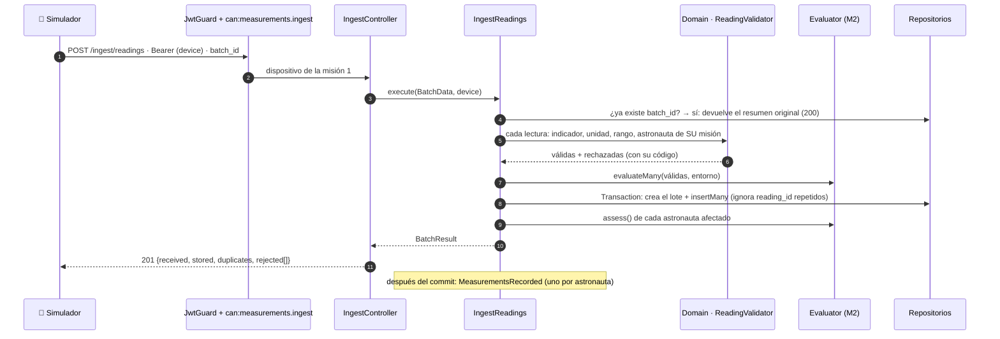

# 🩺 M1 · Registro de indicadores · Backend

> [← Backend](../README.md) · Código: `astrohealth/app/Modules/Registro/` · Qué construir: [ficha de M1](../../../../documentacion/modulos/M1-registro/README.md)

| Estado         | Fase | Responsable |
| -------------- | :--: | ----------- |
| ⬜ Sin empezar |  2   | Backend     |

**Qué hace:** es **la puerta de entrada de los datos de salud**. Recibe las lecturas por dos caminos y las trata igual:

| Camino                 | Quién                                        | Ruta                           | Permiso                  |
| ---------------------- | -------------------------------------------- | ------------------------------ | ------------------------ |
| 🤖 **Ingesta**         | El simulador (máquinas y sensores), en lotes | `POST /api/v1/ingest/readings` | `measurements.ingest`    |
| 🧑‍🚀 **Registro manual** | El astronauta, desde el formulario           | `POST /api/v1/measurements`    | `measurements.write.own` |

En los dos: valida → **evalúa** (semáforo, M2) → guarda con su `source` → actualiza el puntaje → publica `MeasurementsRecorded` (M5 crea alertas, M7 suma puntos).

---

## 1. La ingesta de las máquinas



### El contrato

**`POST /api/v1/ingest/readings`** · `Authorization: Bearer <token de dispositivo>`

```json
{
    "batch_id": "6a1f0c3e-2d4b-4f7a-9c8e-1b2d3e4f5a60",
    "device_time": "2026-11-14T08:00:02Z",
    "readings": [
        {
            "reading_id": "0b7e…01",
            "astronaut_id": 2,
            "indicator": "hr",
            "value": 72,
            "unit": "bpm",
            "measured_at": "2026-11-14T08:00:00Z",
            "source": "simulated_reference"
        },
        {
            "reading_id": "0b7e…02",
            "astronaut_id": 2,
            "indicator": "glucose",
            "value": 96.4,
            "unit": "mg/dL",
            "measured_at": "2026-11-14T08:00:00Z",
            "source": "simulated_calibrated_osdr"
        },
        {
            "reading_id": "0b7e…03",
            "astronaut_id": 3,
            "indicator": "radiation",
            "value": 1.8,
            "unit": "mSv",
            "measured_at": "2026-11-14T08:00:00Z",
            "source": "nasa_donki"
        }
    ]
}
```

**201 · lote nuevo**

```json
{
    "data": {
        "batch_id": "6a1f0c3e-2d4b-4f7a-9c8e-1b2d3e4f5a60",
        "received": 3,
        "stored": 2,
        "duplicates": 0,
        "rejected": [
            {
                "reading_id": "0b7e…03",
                "error_code": "MEASUREMENTS_UNIT_MISMATCH",
                "message": "La unidad de radiation es mSv por día."
            }
        ]
    },
    "message": "ok"
}
```

**200 · lote repetido** (mismo `batch_id`): devuelve **el mismo resumen** de la primera vez y no guarda nada. Así el simulador puede **reintentar sin miedo**.

### Reglas de la ingesta

| Regla                                                                                                            | Dónde                           | Resultado                            |
| ---------------------------------------------------------------------------------------------------------------- | ------------------------------- | ------------------------------------ |
| `batch_id` y `reading_id` son UUID; de 1 a 500 lecturas; tipos correctos                                         | `IngestReadingsRequest`         | 422 para **todo** el lote            |
| El indicador existe en el catálogo                                                                               | `ReadingValidator`              | Esa lectura va a `rejected`          |
| La unidad coincide con la del catálogo                                                                           | `ReadingValidator`              | `MEASUREMENTS_UNIT_MISMATCH`         |
| El valor está en el rango **físicamente posible**                                                                | `ReadingValidator`              | `MEASUREMENTS_OUT_OF_RANGE`          |
| `measured_at` no está más de 5 min en el futuro                                                                  | `ReadingValidator`              | `MEASUREMENTS_FUTURE_TIMESTAMP`      |
| El astronauta es de **la misión del dispositivo** (y, si el dispositivo tiene `astronaut_id`, es ese)            | `IngestPolicy`                  | `MEASUREMENTS_ASTRONAUT_NOT_ALLOWED` |
| `source` es uno de `simulated_reference`, `simulated_calibrated_osdr`, `nasa_donki`, `simulated_event`, `device` | `IngestReadingsRequest`         | 422                                  |
| `reading_id` repetido (en otro lote)                                                                             | Índice único + `insertOrIgnore` | Cuenta en `duplicates`               |
| `batch_id` repetido                                                                                              | Tabla `ingest_batches`          | 200 con el resumen original          |

> **Aceptación parcial:** un error de **forma** rechaza el lote entero (422). Un error de **contenido** rechaza solo esa lectura y el resto se guarda. El simulador nunca pierde un lote completo por una lectura mala.

**Evaluación en lote:** `Evaluator::evaluateMany()` evalúa con las reglas locales de M2 (los mismos umbrales que Python, comprobado por prueba), para no hacer 500 llamadas HTTP. El registro manual (pocas lecturas) sí pasa por Python `/evaluate`.

### Lo que debe hacer el simulador (lado Python)

| Situación                     | Qué hace el simulador                                                               |
| ----------------------------- | ----------------------------------------------------------------------------------- |
| Arranca                       | `POST /auth/device-token` con `client_id` y `client_secret` de `simulador/.env`     |
| `401 AUTH_TOKEN_EXPIRED`      | Pide otro token y **reenvía el mismo lote, con el mismo `batch_id`**                |
| _Timeout_, error de red o 5xx | Reintenta el **mismo** lote con espera creciente (1 s, 2 s, 4 s; máximo 5 intentos) |
| `429`                         | Espera lo que diga `Retry-After`                                                    |
| `422`                         | No reintenta: lo registra en su _log_ (es un error de forma)                        |
| `201` con `rejected`          | Registra las rechazadas; no las reenvía                                             |

```python
# simulador/src/simulador/exporters/astrohealth_api.py (ejemplo mínimo)
async with httpx.AsyncClient(base_url=settings.astrohealth_url, timeout=10) as http:
    token = (await http.post("/auth/device-token", json={
        "client_id": settings.astrohealth_client_id,
        "client_secret": settings.astrohealth_client_secret.get_secret_value(),
    })).json()["data"]["access_token"]

    lote = {"batch_id": str(uuid4()), "device_time": ahora_iso(), "readings": lecturas[:500]}
    r = await http.post("/ingest/readings", json=lote, headers={"Authorization": f"Bearer {token}"})
```

Variables del simulador: `ASTROHEALTH_URL=http://localhost:8000/api/v1`, `ASTROHEALTH_CLIENT_ID`, `ASTROHEALTH_CLIENT_SECRET` (los mismos de `DeviceSeeder`).

## 2. El registro manual

**`POST /api/v1/measurements`** · token de astronauta

```json
{
    "measured_at": "2026-11-14T08:00:00Z",
    "measurements": [
        { "indicator": "bp_sys", "value": 148 },
        { "indicator": "bp_dia", "value": 94 }
    ]
}
```

- El `astronaut_id` sale **del token**, nunca del cuerpo: un astronauta solo puede registrar lo suyo.
- Se guarda con `source: manual` y la respuesta trae cada medición con su `status` y su `body_part` ([ejemplo en la ficha](../../../../documentacion/modulos/M1-registro/README.md#4-api)).

## 3. Estructura de archivos

```
app/Modules/Registro/
├── RegistroServiceProvider.php
├── routes.php                              # ingest/readings · measurements · indicators
├── Contratos/
│   ├── IndicatorCatalog.php                # all() · byCode()
│   └── MeasurementQuery.php                # latestPerIndicator() · series() · daysWithAllIndicators()
├── Domain/
│   ├── Enums/IndicatorCode.php · Source.php · ErrorCode.php
│   ├── Reglas/ReadingValidator.php         # catálogo, unidad, rango posible, futuro → aceptada o código
│   ├── Eventos/MeasurementsRecorded.php    # astronautId + items[{measurementId, indicator, value, status, bodyPart, measuredAt, source}]
│   └── ValueObjects/Reading.php
├── Application/
│   ├── IngestReadings.php                  # el flujo de la sección 1
│   ├── RecordMeasurements.php              # el registro manual
│   ├── ReevaluateLatest.php                # al cambiar el entorno (escucha a M6)
│   ├── ImportMissionFile.php               # plan B sin red: lee un JSON del simulador
│   └── DTOs/BatchData.php · ReadingData.php · MeasurementData.php · BatchResult.php · RecordResult.php
├── Infrastructure/
│   ├── Models/Indicator.php · Measurement.php · IngestBatch.php
│   ├── Repositorios/IndicatorRepository.php        # implementa IndicatorCatalog (con caché)
│   ├── Repositorios/MeasurementRepository.php      # insertMany() (bloques de 500, insertOrIgnore) · implementa MeasurementQuery
│   ├── Repositorios/IngestBatchRepository.php      # findSummary() · create()
│   └── Listeners/OnMissionEnvironmentChanged.php
├── Policies/IngestPolicy.php               # ¿el astronauta es de la misión del dispositivo?
├── Http/
│   ├── Controllers/Api/IngestController.php · MeasurementController.php · IndicatorController.php
│   ├── Requests/IngestReadingsRequest.php · StoreMeasurementsRequest.php
│   └── Resources/BatchResource.php · MeasurementResource.php · IndicatorResource.php
├── Console/ImportMissionFileCommand.php    # registro:import-file ../simulador/data/output/Ares-1_42.json
├── Database/
│   ├── Migrations/                         # indicators · measurements · ingest_batches
│   ├── Seeders/IndicatorSeeder.php
│   └── Factories/MeasurementFactory.php
└── Tests/
    ├── Unit/ReadingValidatorTest.php
    └── Feature/IngestReadingsTest.php · IngestIdempotencyTest.php · IngestAuthorizationTest.php · RecordMeasurementsTest.php · IndicatorsTest.php
```

## 4. Endpoints

| Método | Ruta                      | Permiso                                                            | Caso de uso               | Respuesta              |
| ------ | ------------------------- | ------------------------------------------------------------------ | ------------------------- | ---------------------- |
| POST   | `/api/v1/ingest/readings` | `measurements.ingest` · `throttle:ingest` (60/min por dispositivo) | `IngestReadings`          | 201 · 200 si se repite |
| POST   | `/api/v1/measurements`    | `measurements.write.own`                                           | `RecordMeasurements`      | 201                    |
| GET    | `/api/v1/indicators`      | `crew.read`                                                        | — (repositorio con caché) | 200                    |

## 5. Datos

| Tabla            | Columnas clave                                                                                                                                      | Índices                                                          |
| ---------------- | --------------------------------------------------------------------------------------------------------------------------------------------------- | ---------------------------------------------------------------- |
| `indicators`     | `code`, `name`, `unit`, `body_part`, `min_possible`, `max_possible`, `help_text`, `sort_order`                                                      | `code` único                                                     |
| `measurements`   | `astronaut_id`, `indicator_id`, `value`, `status`, `source`, `measured_at`, **`reading_id`** (uuid, _nullable_), **`ingest_batch_id`** (_nullable_) | `(astronaut_id, indicator_id, measured_at)` · `reading_id` único |
| `ingest_batches` | `batch_id` (uuid, único), `device_id`, `received`, `stored`, `duplicates`, `rejected` (json), `created_at`                                          | `batch_id` único                                                 |

## 6. Contratos y eventos

| Tipo    | Nombre                            | Detalle                                                                     |
| ------- | --------------------------------- | --------------------------------------------------------------------------- |
| Ofrece  | `IndicatorCatalog`                | Lo usan M3, M5 y la validación                                              |
| Ofrece  | `MeasurementQuery`                | Lo usan M3, M4 y M7                                                         |
| Publica | `MeasurementsRecorded`            | **Uno por astronauta** en cada lote. Lo escuchan M5 (alertas) y M7 (puntos) |
| Escucha | `MissionEnvironmentChanged` (M6)  | `ReevaluateLatest`                                                          |
| Usa     | `Evaluator` (M2)                  | `evaluate()`, `evaluateMany()`, `assess()`                                  |
| Usa     | `MissionQuery` · `CrewQuery` (M6) | Entorno, y si el astronauta pertenece a la misión                           |
| Usa     | `CurrentActor` (M0)               | Quién llama: astronauta o dispositivo                                       |

## 7. Códigos de error

| Código                               |               HTTP               | Cuándo                                           |
| ------------------------------------ | :------------------------------: | ------------------------------------------------ |
| `VALIDATION_FAILED`                  |               422                | Forma del lote o del formulario                  |
| `MEASUREMENTS_UNIT_MISMATCH`         |          en `rejected`           | La unidad no es la del catálogo                  |
| `MEASUREMENTS_OUT_OF_RANGE`          | en `rejected` · 422 en el manual | Fuera del rango físicamente posible              |
| `MEASUREMENTS_UNKNOWN_INDICATOR`     |          en `rejected`           | El indicador no existe                           |
| `MEASUREMENTS_FUTURE_TIMESTAMP`      |          en `rejected`           | `measured_at` más de 5 min en el futuro          |
| `MEASUREMENTS_ASTRONAUT_NOT_ALLOWED` |          en `rejected`           | El astronauta no es de la misión del dispositivo |

## 8. Pruebas

| Prueba                        | Verifica                                                                                                                    |
| ----------------------------- | --------------------------------------------------------------------------------------------------------------------------- |
| `IngestReadingsTest`          | Lote válido → 201, guardado con su `status` y su `source` · una lectura mala no tumba el lote · evento por astronauta       |
| `IngestIdempotencyTest`       | Mismo `batch_id` dos veces → 200 con el mismo resumen, sin filas nuevas · mismo `reading_id` en otro lote → `duplicates: 1` |
| `IngestAuthorizationTest`     | Sin token → 401 · token de astronauta → 403 · dispositivo de otra misión → lectura rechazada                                |
| `RecordMeasurementsTest`      | El astronauta registra lo suyo; el `astronaut_id` del cuerpo se ignora · Python apagado → igual guarda (respaldo local)     |
| `ReadingValidatorTest` (unit) | Cada código de rechazo                                                                                                      |
| Carga                         | 500 lecturas en menos de 2 s en local                                                                                       |

## 9. Avance

- [ ] Migraciones `indicators`, `measurements` (+ `reading_id`, `ingest_batch_id`), `ingest_batches`
- [ ] `IndicatorSeeder` (10 indicadores)
- [ ] `ReadingValidator` + `IngestPolicy`
- [ ] `IngestReadings` + `POST /ingest/readings` (idempotente)
- [ ] `RecordMeasurements` + `POST /measurements`
- [ ] `GET /indicators`
- [ ] Evento `MeasurementsRecorded` (después del _commit_)
- [ ] `ReevaluateLatest` + _listener_ de M6
- [ ] `registro:import-file` (plan B)
- [ ] Contratos `IndicatorCatalog` y `MeasurementQuery`
- [ ] Exportador `astrohealth_api.py` en el simulador, probado contra la API
- [ ] Pruebas de la sección 8 en verde

## 10. Cómo quedó hecho

### Decisiones técnicas

_Pendiente._

### Diferencias con este documento

_Pendiente._

### Cómo probarlo a mano

```powershell
php artisan migrate:fresh --seed
# en otra terminal, el simulador enviando lotes:
cd ..\simulador; .venv\Scripts\python scripts\send_to_astrohealth.py --days 30 --seed 42
php artisan tinker --execute "echo App\Modules\Registro\Infrastructure\Models\Measurement::count();"
```

> 📝 **Documentar siempre:** este documento se actualiza en el mismo _pull request_ que cambia el código.
