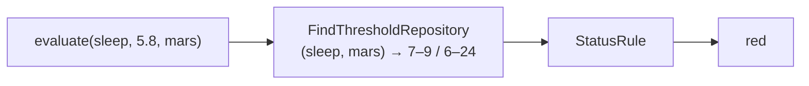

# 🚦 M2 · Motor de evaluación · Backend

> [← Backend](../README.md) · Código: `astrohealth/app/Modules/Evaluacion/` · Qué construir: [ficha de M2](../../../../documentacion/modulos/M2-evaluacion/README.md) · Plan: F2 de `documentacion/PLAN_BACKEND.md`

| Estado               |             Fase             | Responsable |
| -------------------- | :--------------------------: | ----------- |
| ✅ Núcleo hecho (F2) | F2 · F9 (tests psicológicos) | Backend     |

**Qué hace:** decide el **color** de cada lectura, calcula el **puntaje** 0–100, el **estado de cada zona** del cuerpo y la **tendencia** de cada indicador. Es el **único** lugar donde se decide el semáforo (P4, P5).

> **Python ya no evalúa.** La versión 2 del simulador quitó `/evaluate`, `/assess` y `/trends` (`simulador/docs/SIMULADOR.md`): el simulador solo genera y envía lecturas. El motor vive completo en Laravel, con una sola regla. No hay cliente de Python ni respaldo.

---

## 1. Cómo decide



## 2. Las reglas (`Domain/Reglas/`)

| Regla                | Entrada → salida                                                                                                                                 |
| -------------------- | ------------------------------------------------------------------------------------------------------------------------------------------------ |
| `StatusRule`         | `(valor, Threshold)` → `green` dentro del verde · `yellow` dentro del amarillo · `red` fuera. Bordes inclusivos (119 verde, 120 amarillo)        |
| `ScoreRule`          | Último estado por indicador → verde 100 · amarillo 60 · rojo 20, promedio ponderado (`hr`, `bp_sys`, `bp_dia`, `spo2`, `radiation` ×1,5) → 0–100 |
| `OverallStatus`      | Puntaje → desde 80 verde · desde 50 amarillo · si no rojo                                                                                        |
| `BodyStatusRule`     | Estados por zona → el **peor** de cada zona                                                                                                      |
| `TrendRule`          | Últimos 7 valores → pendiente de la regresión lineal → `up` · `down` · `stable`; **aviso** si se aleja del centro del verde 3 veces seguidas     |
| `RadiationThreshold` | Dosis del entorno → verde `0–dosis`, amarillo `0–2×dosis`                                                                                        |
| `Threshold` (VO)     | Valida que el verde quede dentro del amarillo (`EVALUATION_INVALID_THRESHOLD`, con el campo)                                                     |

Los pesos, los cortes, la ventana de la tendencia y los nombres de las zonas viven en **`config/evaluation.php`**; los rangos, en la tabla **`thresholds`**.

## 3. Estructura de archivos

```
app/Modules/Evaluacion/
├── EvaluacionServiceProvider.php           # Evaluator → RuleEvaluator (scoped) · TrendAnalyzer → RuleTrendAnalyzer
├── routes.php                              # thresholds · astronauts/{id}/assessment
├── Contratos/                              # Evaluator · TrendAnalyzer · LatestReading · AssessmentSummary · ThresholdBand · TrendSummary
├── Domain/
│   ├── Entidades/Assessment.php
│   ├── Enums/Status.php · TrendDirection.php · ErrorCode.php
│   ├── Reglas/StatusRule · ScoreRule · OverallStatus · BodyStatusRule · TrendRule · RadiationThreshold
│   ├── ValueObjects/Threshold.php · Trend.php
│   ├── Eventos/ThresholdUpdated.php        # ShouldDispatchAfterCommit
│   └── Excepciones/InvalidThreshold · ThresholdMissing · NoAssessment
├── Application/
│   ├── ListThresholds · UpdateThreshold · GetLatestAssessment
│   └── DTOs/ThresholdData · AssessmentResult
├── Infrastructure/
│   ├── Motor/RuleEvaluator.php             # implementa Evaluator (recuerda los umbrales ya leídos en la petición)
│   ├── Motor/RuleTrendAnalyzer.php         # implementa TrendAnalyzer
│   ├── Configuracion/EvaluationSettings.php    # lee y valida config/evaluation.php
│   ├── Models/Threshold.php · Assessment.php
│   └── Repositorios/Threshold/{Find,Upsert}ThresholdRepository · ThresholdMapper
│                    Assessment/{Find,Insert}AssessmentRepository · AssessmentMapper
├── Http/
│   ├── Controllers/Api/ListThresholds · UpdateThreshold · ShowAssessment
│   ├── Requests/ListThresholdsRequest · UpdateThresholdRequest · EnvironmentField (valida contra config/environments.php)
│   └── Resources/ThresholdResource · AssessmentResource
├── Database/
│   ├── Migrations/                         # thresholds · assessments
│   └── Seeders/ThresholdSeeder.php         # plan §2 × 4 entornos; radiación desde config/environments.php
└── Tests/
    ├── Unit/RulesTest.php
    └── Feature/ThresholdsApiTest.php · EvaluatorTest.php
```

## 4. Endpoints

| Método | Ruta                                          | Permiso              | Respuesta                                                                                                                 |
| ------ | --------------------------------------------- | -------------------- | ------------------------------------------------------------------------------------------------------------------------- |
| GET    | `/api/v1/thresholds?environment=`             | autenticado          | 200 los 10 umbrales del entorno                                                                                           |
| PUT    | `/api/v1/thresholds/{indicator}?environment=` | `guide.manage`       | 200 el umbral · 422 si el verde no queda dentro del amarillo · 404 si el indicador no existe · publica `ThresholdUpdated` |
| GET    | `/api/v1/astronauts/{id}/assessment`          | `can:health.read,id` | 200 puntaje, estado, `body_status`, resumen, `evaluated_at` · 404 `EVALUATION_NO_DATA`                                    |

## 5. Contratos y eventos

| Tipo    | Nombre             | Lo usa                                                                        |
| ------- | ------------------ | ----------------------------------------------------------------------------- |
| Ofrece  | `Evaluator`        | M1 (color al guardar y `assess` después), M4 (`thresholdFor` para las bandas) |
| Ofrece  | `TrendAnalyzer`    | M4                                                                            |
| Publica | `ThresholdUpdated` | M1 (volver a colorear las últimas mediciones; _listener_ en F3)               |
| Usa     | —                  | No depende de ningún módulo (lee `config/environments.php`)                   |

Los contratos hablan en texto (`"green"`, `"down"`…), así M1 y M4 no dependen del `Domain` de M2.

## 6. Códigos de error

| Código                         |   HTTP    | Cuándo                                                                              |
| ------------------------------ | :-------: | ----------------------------------------------------------------------------------- |
| `VALIDATION_FAILED`            |    422    | Falta el entorno o no existe; un límite no es número                                |
| `EVALUATION_INVALID_THRESHOLD` |    422    | El verde no queda dentro del amarillo (con el campo)                                |
| `EVALUATION_THRESHOLD_MISSING` | 404 · 500 | Editar un indicador que no existe (404) · evaluar sin umbral, falta el seeder (500) |
| `EVALUATION_NO_DATA`           |    404    | El astronauta aún no tiene evaluación                                               |

## 7. Pruebas

| Prueba              | Verifica                                                                                                                                                                                                                                             |
| ------------------- | ---------------------------------------------------------------------------------------------------------------------------------------------------------------------------------------------------------------------------------------------------- |
| `RulesTest`         | Bordes del pulso, la presión, el sueño (5,8 h de Kenji → rojo), SpO₂ y temperatura · forma del umbral · radiación por entorno · puntaje (Kenji 90) · cortes · peor por zona · tendencia del sueño que cae · valores estables o que mejoran no avisan |
| `ThresholdsApiTest` | 10 umbrales por entorno · radiación cambia con el entorno · validación · el médico edita y se publica el evento · verde fuera del amarillo → 422 · indicador inexistente → 404 · la tripulación no edita · el seeder no pisa los cambios             |
| `EvaluatorTest`     | Color con los umbrales del entorno · umbral faltante · `assess` guarda puntaje, zonas y resumen · tendencia · la última evaluación la ven el propio astronauta y su médico; otro astronauta → 403; sin datos → 404                                   |

## 8. Avance

- [x] Migraciones `thresholds` y `assessments` + `ThresholdSeeder`
- [x] Reglas de `Domain` con sus pruebas unitarias
- [x] `Evaluator` y `TrendAnalyzer` (motor local, sin Python)
- [x] `GET/PUT /thresholds` y `GET /astronauts/{id}/assessment`
- [x] La Guía de salud usa la API
- [ ] _Listener_ de `ThresholdUpdated` y uso de `assess` desde M1 (F3)
- [ ] Tests psicológicos (F9)

> 📝 **Documentar siempre:** este documento se actualiza en el mismo _pull request_ que cambia el código.
