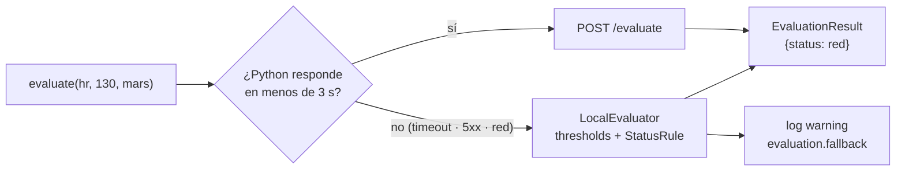

# 🚦 M2 · Motor de evaluación · Backend

> [← Backend](../README.md) · Código: `astrohealth/app/Modules/Evaluacion/` · Qué construir: [ficha de M2](../../../../documentacion/modulos/M2-evaluacion/README.md)

| Estado | Fase | Responsable |
|---|:---:|---|
| ⬜ Sin empezar | 2 (umbrales en la 1) | Backend + simulador |

**Qué hace:** decide el **color** de cada lectura, calcula el **puntaje** 0–100 y el **estado por órgano**, y detecta las **tendencias**. Es el **único** módulo que habla con el motor de Python. Si Python no responde, calcula **lo mismo** con sus reglas locales y nadie se entera.

---

## 1. Cómo decide



| Operación | Python | Respaldo local | La usa |
|---|---|---|---|
| `evaluate()` — una lectura | `POST /evaluate` | `StatusRule` | M1 (registro manual) |
| `evaluateMany()` — un lote | — (siempre local, por velocidad) | `StatusRule` | M1 (ingesta) |
| `assess()` — puntaje + órganos | `POST /assess` | `ScoreRule` + `BodyStatusRule` | M1 (después de guardar) |
| `trend()` — tendencia | `POST /trends` | `TrendRule` | M4 |
| `thresholdFor()` — bandas | — | Tabla `thresholds` | M4 |
| `SpaceWeather::now()` | `GET /space-weather/now` | `null` | M6 |

> **Garantía:** `LocalEvaluatorParityTest` envía los mismos valores a Python (respuestas grabadas) y al respaldo, en todos los bordes (59, 60, 100, 101, 120, 121…). Si difieren, la prueba falla.

## 2. Las reglas (`Domain/Reglas/`)

| Regla | Entrada → salida |
|---|---|
| `StatusRule` | `(valor, Threshold)` → `green` si está en el rango verde · `yellow` si está en la banda amarilla · `red` si no |
| `ScoreRule` | Último estado de cada indicador → verde 100 · amarillo 60 · rojo 20, promedio ponderado (`hr`, `bp_sys`, `bp_dia`, `spo2`, `radiation` ×1.5) → entero 0–100 |
| `OverallStatus` | Puntaje → ≥ 80 verde · 50–79 amarillo · < 50 rojo |
| `BodyStatusRule` | Estados por zona → el **peor**; sin datos → `null` |
| `TrendRule` | Últimos 7 valores → pendiente de la regresión lineal → `up` · `down` · `stable`; `trend_alert` si la distancia al centro del verde crece 3 veces seguidas |
| `RadiationThreshold` | Dosis base del entorno → verde `0–base`, amarilla `0–2×base` |

Los pesos y parámetros viven en `config/evaluation.php`; los umbrales, en la tabla `thresholds`.

## 3. Estructura de archivos

```
app/Modules/Evaluacion/
├── EvaluacionServiceProvider.php           # bind Evaluator/TrendAnalyzer/SpaceWeather → PythonEvaluator
├── routes.php                              # astronauts/{id}/assessment
├── Contratos/
│   ├── Evaluator.php                       # evaluate · evaluateMany · assess · thresholdFor
│   ├── TrendAnalyzer.php                   # trend
│   └── SpaceWeather.php                    # now
├── Domain/
│   ├── Enums/Status.php · TrendDirection.php · ErrorCode.php
│   ├── Reglas/StatusRule.php · ScoreRule.php · OverallStatus.php · BodyStatusRule.php · TrendRule.php · RadiationThreshold.php
│   └── ValueObjects/Threshold.php
├── Application/
│   ├── EvaluationService.php               # (nombre del plan) orquesta: Python o local, y guarda el assessment
│   ├── GetLatestAssessment.php
│   └── DTOs/EvaluationResult.php · AssessmentResult.php · TrendResult.php
├── Infrastructure/
│   ├── Clients/SimuladorClient.php         # Http::baseUrl(SIMULADOR_URL)->timeout(3) · lanza PythonUnavailable
│   ├── Clients/PythonEvaluator.php         # implementa los contratos: Python primero, LocalEvaluator si falla
│   ├── Clients/LocalEvaluator.php          # thresholds + reglas de Domain
│   ├── Models/Threshold.php · Assessment.php
│   └── Repositorios/ThresholdRepository.php (con caché) · AssessmentRepository.php
├── Http/
│   ├── Controllers/Api/AssessmentController.php
│   └── Resources/AssessmentResource.php
├── Database/
│   ├── Migrations/                         # thresholds (indicator_code + environment) · assessments
│   └── Seeders/ThresholdSeeder.php         # plan §2 × 4 entornos; radiación desde config/environments.php
└── Tests/
    ├── Unit/StatusRuleTest.php · ScoreRuleTest.php · TrendRuleTest.php · BodyStatusRuleTest.php
    └── Feature/AssessmentEndpointTest.php · PythonFallbackTest.php · LocalEvaluatorParityTest.php
```

## 4. Endpoints

| Método | Ruta | Permiso | Respuesta |
|---|---|---|---|
| GET | `/api/v1/astronauts/{id}/assessment` | `can:health.read,id` | 200 puntaje, estado, `body_status`, resumen ([ejemplo](../../../../documentacion/modulos/M2-evaluacion/README.md#4-api)) · 404 `EVALUATION_NO_DATA` |

## 5. Conexión con Python

```env
SIMULADOR_URL=http://localhost:8001/api/v1
SIMULADOR_TIMEOUT=3
```

| Regla | Valor |
|---|---|
| *Timeout* | 3 s (`SIMULADOR_TIMEOUT`) |
| Reintentos | **Ninguno** dentro de una petición de usuario (duplicarían la espera) |
| Formato esperado | `{ "data": …, "message": "ok" }` |
| Si Python falla 5 veces en 1 min | Circuito abierto 60 s: va directo al respaldo sin esperar (`Cache` con la cuenta de fallos) |

## 6. Contratos y eventos

| Tipo | Nombre | Lo usa |
|---|---|---|
| Ofrece | `Evaluator` | M1, M4 |
| Ofrece | `TrendAnalyzer` | M4 |
| Ofrece | `SpaceWeather` | M6 |
| Usa | — | No depende de ningún módulo |

## 7. Códigos de error

| Código | HTTP | Cuándo |
|---|:---:|---|
| `EVALUATION_NO_DATA` | 404 | El astronauta aún no tiene evaluación |
| `EVALUATION_THRESHOLD_MISSING` | 500 | Falta un umbral para un indicador y entorno (error de *seeders*) |

## 8. Pruebas

| Prueba | Verifica |
|---|---|
| `StatusRuleTest` | Bordes de los 10 indicadores |
| `ScoreRuleTest` | Fórmula ponderada con casos conocidos |
| `TrendRuleTest` | Sueño 7.5 → 7.1 → 6.8 → 6.5 → `down` + `trend_alert` |
| `PythonFallbackTest` | `Http::fake()` con *timeout* y 500 → mismo resultado + *log* `evaluation.fallback` |
| `LocalEvaluatorParityTest` | Local = Python en todos los bordes |
| `AssessmentEndpointTest` | Astronauta 2 ve lo suyo · ve al 3 → 403 · médico ve a todos · sin datos → 404 |

## 9. Avance

- [ ] Migraciones `thresholds` y `assessments` + `ThresholdSeeder` (fase 1)
- [ ] Reglas de `Domain` con sus pruebas unitarias
- [ ] `SimuladorClient` + `PythonEvaluator` + `LocalEvaluator`
- [ ] Circuito abierto tras fallos seguidos
- [ ] `evaluateMany()` para la ingesta
- [ ] `GET /astronauts/{id}/assessment`
- [ ] Prueba de paridad local = Python
- [ ] Endpoints `/evaluate`, `/assess` y `/trends` del simulador respondiendo con el mismo formato

## 10. Cómo quedó hecho

### Decisiones técnicas
_Pendiente._

### Diferencias con este documento
_Pendiente._

> 📝 **Documentar siempre:** este documento se actualiza en el mismo *pull request* que cambia el código.
