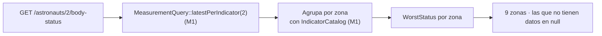

# 🧍 M3 · Cuerpo humano interactivo · Backend

> [← Backend](../README.md) · Código: `astrohealth/app/Modules/Cuerpo/` · Qué construir: [ficha de M3](../../../../documentacion/modulos/M3-cuerpo/README.md)

| Estado | Fase | Responsable |
|---|:---:|---|
| ⬜ Sin empezar | 3 | Backend |

**Qué hace:** le da al cuerpo SVG lo que necesita. El catálogo de las 9 zonas (función y riesgo espacial) y el **estado actual de cada zona** con los valores que lo explican. No evalúa de nuevo: usa los estados que M1 ya guardó.

---

## 1. Cómo arma el estado



## 2. Estructura de archivos

```
app/Modules/Cuerpo/
├── CuerpoServiceProvider.php
├── routes.php                              # body-parts · astronauts/{id}/body-status
├── Domain/
│   ├── Enums/BodyPartCode.php              # heart · brain · eyes · lungs · bones · ear · immune · metabolism · whole_body
│   └── Reglas/WorstStatus.php              # red > yellow > green > null
├── Application/
│   ├── ListBodyParts.php
│   ├── GetBodyStatus.php
│   └── DTOs/BodyPartData.php · ZoneStatus.php
├── Infrastructure/
│   ├── Models/BodyPart.php
│   └── Repositorios/BodyPartRepository.php  # con caché: el catálogo no cambia
├── Http/
│   ├── Controllers/Api/BodyPartController.php · BodyStatusController.php
│   └── Resources/BodyPartResource.php · BodyStatusResource.php
├── Database/
│   ├── Migrations/                         # body_parts
│   └── Seeders/BodyPartSeeder.php          # 9 zonas, textos NASA HRP
└── Tests/
    ├── Unit/WorstStatusTest.php
    └── Feature/BodyPartsTest.php · BodyStatusTest.php
```

## 3. Endpoints

| Método | Ruta | Permiso | Respuesta |
|---|---|---|---|
| GET | `/api/v1/body-parts` | `crew.read` | 200 las 9 zonas con `function_text`, `space_risk_text`, `hrp_hazard` e `indicators` |
| GET | `/api/v1/astronauts/{id}/body-status` | `can:health.read,id` | 200 `{zona: {status, values[]}}` ([ejemplo](../../../../documentacion/modulos/M3-cuerpo/README.md#4-api)) |

## 4. Contratos y eventos

| Tipo | Nombre | Detalle |
|---|---|---|
| Usa | `MeasurementQuery` (M1) | Las últimas mediciones con su estado |
| Usa | `IndicatorCatalog` (M1) | Qué indicador va en qué zona |

## 5. Códigos de error

| Código | HTTP | Cuándo |
|---|:---:|---|
| `NOT_FOUND` | 404 | El astronauta no existe |
| `FORBIDDEN` | 403 | Un astronauta pide el cuerpo de otro |

## 6. Pruebas

| Prueba | Verifica |
|---|---|
| `WorstStatusTest` | Todas las combinaciones, incluido `null` |
| `BodyStatusTest` | FC verde + presión roja → `heart: red` · sin sueño ni ánimo → `brain: null` · astronauta 2 pide al 3 → 403 |
| `BodyPartsTest` | 9 zonas con sus textos |

## 7. Avance

- [ ] Migración `body_parts` + `BodyPartSeeder` (textos citando la NASA HRP)
- [ ] `WorstStatus`
- [ ] `GET /body-parts`
- [ ] `GET /astronauts/{id}/body-status`
- [ ] Pruebas en verde

## 8. Cómo quedó hecho

_Pendiente._

> 📝 **Documentar siempre:** este documento se actualiza en el mismo *pull request* que cambia el código.
