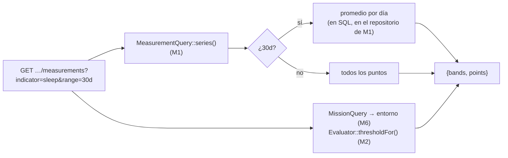

# 📈 M4 · Dashboard · Backend

> [← Backend](../README.md) · Código: `astrohealth/app/Modules/Dashboard/` · Qué construir: [ficha de M4](../../../../documentacion/modulos/M4-dashboard/README.md)

| Estado | Fase | Responsable |
|---|:---:|---|
| ⬜ Sin empezar | 3 | Backend |

**Qué hace:** entrega **la historia** de un indicador (7 o 30 días) con sus bandas de color, y **la tendencia** de los 10 indicadores con el mensaje listo para mostrar. **No tiene tablas:** todo lo lee por contratos.

---

## 1. Cómo arma una serie



## 2. Estructura de archivos

```
app/Modules/Dashboard/
├── DashboardServiceProvider.php
├── routes.php                              # astronauts/{id}/measurements · astronauts/{id}/trends
├── Domain/
│   ├── Enums/Range.php                     # 7d · 30d
│   └── Reglas/TrendMessage.php             # "Tu sueño ha bajado 3 días seguidos"
├── Application/
│   ├── GetIndicatorSeries.php
│   ├── GetTrends.php                       # 10 indicadores → TrendAnalyzer (M2) → mensaje
│   └── DTOs/SeriesResult.php · TrendItem.php
├── Http/
│   ├── Controllers/Api/SeriesController.php · TrendController.php
│   ├── Requests/SeriesRequest.php          # indicator ∈ catálogo · range ∈ {7d, 30d}
│   └── Resources/SeriesResource.php · TrendResource.php
└── Tests/
    ├── Unit/TrendMessageTest.php
    └── Feature/SeriesTest.php · TrendsTest.php
```

## 3. Endpoints

| Método | Ruta | Permiso | Respuesta |
|---|---|---|---|
| GET | `/api/v1/astronauts/{id}/measurements?indicator=&range=7d\|30d` | `can:health.read,id` | 200 `{indicator, unit, range, bands, points[]}` |
| GET | `/api/v1/astronauts/{id}/trends` | `can:health.read,id` | 200 lista de `{indicator, direction, trend_alert, current, status, message}` |

Ejemplos de JSON en la [ficha](../../../../documentacion/modulos/M4-dashboard/README.md#4-api).

## 4. Contratos y eventos

| Tipo | Nombre | Detalle |
|---|---|---|
| Usa | `MeasurementQuery` (M1) | `series()`, agrupada por día con 30d |
| Usa | `TrendAnalyzer` · `Evaluator` (M2) | Tendencia y bandas |
| Usa | `MissionQuery` (M6) | El entorno, para las bandas de radiación |

## 5. Rendimiento

- Con 30 días: máximo 30 puntos por serie (promedio diario en SQL).
- `GetTrends` hace **una** consulta para los 10 indicadores (los últimos 7 de cada uno) y no 10 consultas.
- Si Python cae, las 10 tendencias salen del respaldo local sin esperar 10 *timeouts* (circuito abierto de M2).

## 6. Códigos de error

| Código | HTTP | Cuándo |
|---|:---:|---|
| `VALIDATION_FAILED` | 422 | `indicator` o `range` inválidos |
| `FORBIDDEN` | 403 | Datos de otro astronauta |
| `NOT_FOUND` | 404 | El astronauta no existe |

## 7. Pruebas

| Prueba | Verifica |
|---|---|
| `SeriesTest` | 7d → todos los puntos · 30d → uno por día · bandas correctas · `range=90d` → 422 |
| `TrendsTest` | El evento de demo del sueño (astronauta 2, días 18–21) → `trend_alert` y mensaje · menos de 3 puntos → `stable` |
| `TrendMessageTest` | Textos en español para subir y bajar |

## 8. Avance

- [ ] `MeasurementQuery::series()` con promedio diario (en M1)
- [ ] `GetIndicatorSeries` + endpoint
- [ ] `GetTrends` + endpoint (una sola consulta)
- [ ] `TrendMessage`
- [ ] Pruebas en verde

## 9. Cómo quedó hecho

_Pendiente._

> 📝 **Documentar siempre:** este documento se actualiza en el mismo *pull request* que cambia el código.
