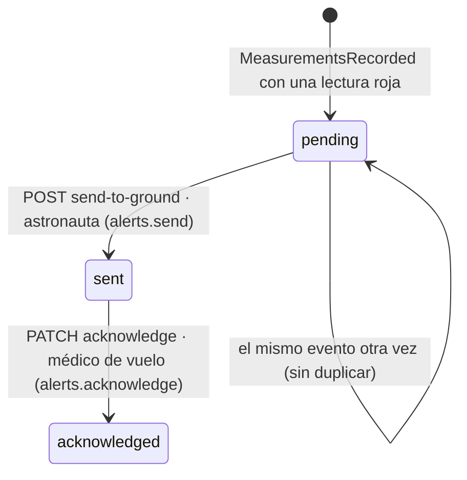

# 🚨 M5 · Recomendaciones y alertas a Tierra · Backend

> [← Backend](../README.md) · Código: `astrohealth/app/Modules/Alertas/` · Qué construir: [ficha de M5](../../../../documentacion/modulos/M5-alertas/README.md)

| Estado         | Fase | Responsable |
| -------------- | :--: | ----------- |
| ⬜ Sin empezar |  4   | Backend     |

**Qué hace:** convierte cada lectura **roja** en una **alerta**, dice **qué hacer**, y lleva la alerta por su ciclo: **pendiente → enviada a Tierra (con el retraso real del entorno) → confirmada por el médico de vuelo**.

---

## 1. El ciclo de una alerta



| Transición              | Quién                            | Regla (`AlertTransitions`)      | Si no se cumple           |
| ----------------------- | -------------------------------- | ------------------------------- | ------------------------- |
| → `pending`             | El _listener_, solo              | Una alerta por `measurement_id` | Se ignora el duplicado    |
| `pending` → `sent`      | El astronauta dueño de la alerta | Solo desde `pending`            | 409 `ALERTS_ALREADY_SENT` |
| `sent` → `acknowledged` | Médico de vuelo o admin          | Solo desde `sent`               | 409 `ALERTS_NOT_SENT`     |

`ground_eta_at = sent_at + MissionQuery::groundDelaySeconds()` → ISS 1 s · Luna 1.3 s · tránsito 300 s · **Marte 1200 s**.

## 2. Estructura de archivos

```
app/Modules/Alertas/
├── AlertasServiceProvider.php              # registra el listener de M1
├── routes.php
├── Domain/
│   ├── Enums/AlertLevel.php · AlertState.php · ErrorCode.php
│   ├── Reglas/AlertTransitions.php · GroundEta.php
│   └── Excepciones/AlertAlreadySent.php · AlertNotSent.php · RecommendationNotFound.php
├── Application/
│   ├── CreateAlertsForRedMeasurements.php
│   ├── SendAlertToGround.php
│   ├── AcknowledgeAlert.php
│   ├── ListAlerts.php · GetRecommendation.php
│   └── DTOs/AlertResult.php · RecommendationResult.php
├── Infrastructure/
│   ├── Listeners/OnMeasurementsRecorded.php    # síncrono: la alerta existe cuando Vue recibe la respuesta
│   ├── Models/Alert.php · Recommendation.php
│   └── Repositorios/Alert/FindAlertRepository.php · InsertAlertRepository.php · UpdateAlertRepository.php — Recommendation/FindRecommendationRepository.php · UpsertRecommendationRepository.php
├── Policies/AlertPolicy.php                # send: solo el astronauta dueño · view: dueño o health.read.any
├── Http/
│   ├── Controllers/Api/ListAlertsController.php · SendAlertToGroundController.php · AcknowledgeAlertController.php · ListRecommendationsController.php
│   ├── Requests/ListAlertsRequest.php · RecommendationRequest.php
│   └── Resources/AlertResource.php · RecommendationResource.php
├── Database/
│   ├── Migrations/                         # recommendations · alerts (measurement_id único)
│   └── Seeders/RecommendationSeeder.php
└── Tests/
    ├── Unit/AlertTransitionsTest.php · GroundEtaTest.php
    └── Feature/AlertCreationTest.php · SendToGroundTest.php · AcknowledgeTest.php · RecommendationsTest.php
```

## 3. Endpoints

| Método | Ruta                                         | Permiso                                                          | Caso de uso         | Respuesta                                 |
| ------ | -------------------------------------------- | ---------------------------------------------------------------- | ------------------- | ----------------------------------------- |
| GET    | `/api/v1/recommendations?indicator=&status=` | `crew.read`                                                      | `GetRecommendation` | 200 · 404                                 |
| GET    | `/api/v1/alerts?astronaut_id=&state=`        | `alerts.read` (+ `AlertPolicy`: el astronauta solo ve las suyas) | `ListAlerts`        | 200 paginado                              |
| POST   | `/api/v1/alerts/{id}/send-to-ground`         | `alerts.send` + `AlertPolicy::send`                              | `SendAlertToGround` | 200 con `ground_eta_at` y `delay_seconds` |
| PATCH  | `/api/v1/alerts/{id}/acknowledge`            | `alerts.acknowledge`                                             | `AcknowledgeAlert`  | 200                                       |

## 4. Contratos y eventos

| Tipo    | Nombre                      | Detalle                                                                      |
| ------- | --------------------------- | ---------------------------------------------------------------------------- |
| Escucha | `MeasurementsRecorded` (M1) | Crea las alertas rojas, venga la lectura de la ingesta o del registro manual |
| Usa     | `MissionQuery` (M6)         | `groundDelaySeconds()`                                                       |
| Usa     | `IndicatorCatalog` (M1)     | Nombre y unidad, para el mensaje                                             |

## 5. Códigos de error

| Código                            | HTTP | Cuándo                                                 |
| --------------------------------- | :--: | ------------------------------------------------------ |
| `ALERTS_ALREADY_SENT`             | 409  | Se envía de nuevo                                      |
| `ALERTS_NOT_SENT`                 | 409  | Se confirma sin haberla enviado                        |
| `ALERTS_RECOMMENDATION_NOT_FOUND` | 404  | No hay recomendación para ese indicador y estado       |
| `FORBIDDEN`                       | 403  | Enviar una alerta ajena, o confirmar siendo astronauta |

## 6. Pruebas

| Prueba                                   | Verifica                                                                                    |
| ---------------------------------------- | ------------------------------------------------------------------------------------------- |
| `AlertCreationTest`                      | Presión 148/94 (ingesta o manual) → 2 alertas · el mismo evento dos veces → siguen siendo 2 |
| `SendToGroundTest`                       | Marte → `delay_seconds = 1200` · Luna → `1.3` · reenvío → 409 · alerta ajena → 403          |
| `AcknowledgeTest`                        | El médico confirma → 200 · el astronauta intenta → 403 · sin enviar → 409                   |
| `GroundEtaTest` · `AlertTransitionsTest` | Reglas puras                                                                                |

## 7. Avance

- [ ] Migraciones + `RecommendationSeeder`
- [ ] _Listener_ `OnMeasurementsRecorded` (sin duplicados)
- [ ] `SendAlertToGround` con el retraso del entorno
- [ ] `AcknowledgeAlert`
- [ ] `AlertPolicy`
- [ ] Endpoints y pruebas en verde

## 8. Cómo quedó hecho

_Pendiente._

> 📝 **Documentar siempre:** este documento se actualiza en el mismo _pull request_ que cambia el código.
