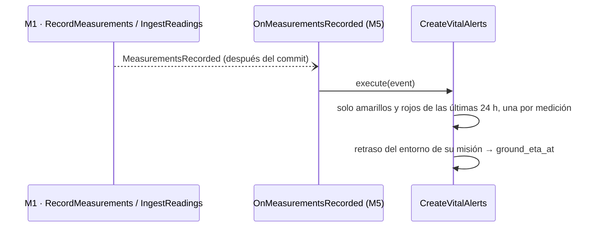

# 🚨 M5 · Alertas, recomendaciones e indicaciones · Backend

> [← Backend](../README.md) · Código: `astrohealth/app/Modules/Alertas/` · Qué construir: [ficha de M5](../../../../documentacion/modulos/M5-alertas/README.md) · Plan: F5 de `documentacion/PLAN_BACKEND.md`

| Estado   | Fase | Responsable |
| -------- | :--: | ----------- |
| ✅ Hecho |  F5  | Backend     |

**Qué hace:** convierte cada valor en amarillo o rojo en una **alerta** que sale sola hacia Tierra, deja que el tripulante mande un **SOS**, pida **ayuda** o cuente una **novedad**, que Tierra **atienda y responda**, que el médico dé **indicaciones** y guarda **"qué hacer"** ante cada indicador. Todo viaja con el **retraso del entorno** (Marte: 20 min).

---

## 1. Cómo nace una alerta vital



Las mediciones viejas (más de `config/alerts.php` → `vital_max_age_hours`, 24 h) no crean alerta: cuando el simulador carga los 30 días, el centro no se llena de avisos viejos.

## 2. Endpoints

| Método | Ruta                                           | Permiso                           | Caso de uso           | Respuesta                                                                                                          |
| ------ | ---------------------------------------------- | --------------------------------- | --------------------- | ------------------------------------------------------------------------------------------------------------------ |
| GET    | `/api/v1/alerts?astronaut=&mission=`           | `alerts.read`                     | `ListAlerts`          | 200 las que puede ver (Gate `health.read`): el astronauta, las suyas; el médico, las de su misión; el admin, todas |
| POST   | `/api/v1/alerts`                               | `alerts.send`                     | `SendMessageToGround` | 201 · SOS rojo · ayuda amarilla (roja con `urgent`) · novedad `info` · el tripulante sale de la sesión             |
| PATCH  | `/api/v1/alerts/{id}/acknowledge`              | `alerts.acknowledge`              | `AcknowledgeAlert`    | 200 con la respuesta · 403 otra misión · 409 ya atendida                                                           |
| GET    | `/api/v1/recommendations`                      | autenticado                       | `ListRecommendations` | 200 las 20 (10 indicadores × amarillo y rojo)                                                                      |
| PUT    | `/api/v1/recommendations/{indicator}/{status}` | `guide.manage`                    | `SaveRecommendation`  | 200 (pasos limpios, uno por línea)                                                                                 |
| GET    | `/api/v1/advice?astronaut=&mission=`           | `crew.read`                       | `ListAdvice`          | 200 las que puede ver                                                                                              |
| POST   | `/api/v1/advice`                               | `advice.send` + su misión         | `SendAdvice`          | 201 · llega a la nave en `arrives_at`                                                                              |
| PATCH  | `/api/v1/advice/{id}/read`                     | `crew.read` + ser el destinatario | `MarkAdviceRead`      | 200 · 403 si no es suya · 409 si todavía viaja                                                                     |

## 3. Estructura de archivos

```
app/Modules/Alertas/
├── AlertasServiceProvider.php (escucha MeasurementsRecorded) · routes.php
├── Domain/Entidades/Alert · Advice · Recommendation
│         Enums/AlertKind · AlertLevel · AlertSource · AdviceCategory · ErrorCode
│         Reglas/GroundLink (llegada = envío + retraso; texto de la alerta vital) · Excepciones/AlertProblem
├── Application/ListAlerts · SendMessageToGround · AcknowledgeAlert · CreateVitalAlerts
│               ListRecommendations · SaveRecommendation · ListAdvice · SendAdvice · MarkAdviceRead
│               Servicios/CrewScope (a quién ve, retraso, nombre) · DTOs/AdviceData
├── Infrastructure/Models/Alert · Advice · Recommendation
│                 Repositorios/Alert/{Find,Insert,Update} · Advice/{Find,Insert,Update} · Recommendation/{Find,Upsert}
│                 Configuracion/GroundDelays (config/environments.php y config/alerts.php)
│                 Listeners/OnMeasurementsRecorded
├── Http/Controllers/Api/ (8) · Requests/ · Resources/AlertResource · AdviceResource · RecommendationResource
├── Database/Migrations/ (recommendations · alerts · advice) · Seeders/RecommendationSeeder · DemoAlertsSeeder
└── Tests/Feature/AlertsApiTest · AdviceAndRecommendationsTest
```

## 4. Contratos y eventos

| Tipo    | Nombre                              | Para qué                                 |
| ------- | ----------------------------------- | ---------------------------------------- |
| Escucha | `MeasurementsRecorded` (M1)         | Crear las alertas vitales                |
| Usa     | `CrewQuery`, `MissionQuery` (M6)    | Tripulación, misión y entorno            |
| Usa     | `IndicatorCatalog` (M1)             | Nombre y unidad en el texto de la alerta |
| Usa     | `CurrentActor` (M0)                 | Quién envía, atiende o escribe           |
| Usa     | Gate `health.read` (M0, por nombre) | A quién puede ver cada persona           |

## 5. Códigos de error

| Código                      | HTTP | Cuándo                                           |
| --------------------------- | :--: | ------------------------------------------------ |
| `ALERTS_NOT_FOUND`          | 404  | La alerta no existe                              |
| `ALERTS_NOT_YOUR_PATIENT`   | 403  | Atender o indicar a un tripulante de otra misión |
| `ALERTS_ALREADY_ATTENDED`   | 409  | La alerta ya fue atendida                        |
| `ALERTS_NOT_CREW`           | 403  | Quien envía un mensaje no es tripulante          |
| `ALERTS_ADVICE_NOT_FOUND`   | 404  | La indicación no existe                          |
| `ALERTS_ADVICE_NOT_YOURS`   | 403  | Marcar la indicación de otro                     |
| `ALERTS_ADVICE_NOT_ARRIVED` | 409  | La indicación todavía viaja a la nave            |

## 6. Pruebas

| Prueba                         | Verifica                                                                                                                                                                                                                                |
| ------------------------------ | --------------------------------------------------------------------------------------------------------------------------------------------------------------------------------------------------------------------------------------- |
| `AlertsApiTest`                | Un valor rojo o amarillo crea su alerta (texto, origen, retraso de 1200 s) · valores viejos no · SOS, ayuda, ayuda urgente y novedad · Tierra no envía como tripulante · cada quien ve lo suyo · se atiende una vez y solo en su misión |
| `AdviceAndRecommendationsTest` | La indicación viaja y solo se marca al llegar · solo su destinatario la marca · solo médicos de la misión envían · validación · 20 recomendaciones, editables con `guide.manage`                                                        |

## 7. Cómo quedó hecho

- **El retraso se guarda en cada alerta e indicación** (`delay_seconds`): si después cambia el entorno, lo ya enviado conserva el tiempo con que viajó.
- **La velocidad de demo ×60 es solo de pantalla:** el frontend divide el retraso al mostrarlo; el backend guarda los tiempos reales.
- **Datos de la demo** (solo fuera de producción y si las tablas están vacías): `DemoAlertsSeeder` carga el historial de Ares-1 (7 alertas, 4 atendidas) y 3 indicaciones.
- **Tiempo real:** el frontend pregunta cada 5 s (`GET /alerts`); un canal con WebSockets queda para después.

> 📝 **Documentar siempre:** este documento se actualiza en el mismo _pull request_ que cambia el código.
