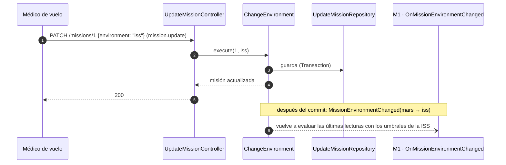

# 🌍 M6 · Entorno de misión · Backend

> [← Backend](../README.md) · Código: `astrohealth/app/Modules/Entorno/` · Qué construir: [ficha de M6](../../../../documentacion/modulos/M6-entorno/README.md)

| Estado         |                  Fase                  | Responsable |
| -------------- | :------------------------------------: | ----------- |
| ⬜ Sin empezar | **1** (tablas) · 4 (cambio de entorno) | Backend     |

**Qué hace:** es dueño de **la misión** y **la tripulación**, y de los datos de los 4 entornos (gravedad, radiación base, retraso de la comunicación y riesgos). Todos los módulos le preguntan "¿en qué entorno está este astronauta?" y "¿es de esta misión?".

---

## 1. Cambiar de entorno



## 2. Estructura de archivos

```
app/Modules/Entorno/
├── EntornoServiceProvider.php
├── routes.php                              # environments · missions/current · missions/{id} · astronauts
├── Contratos/
│   ├── MissionQuery.php                    # current() · environmentOf(astronautId) · groundDelaySeconds(astronautId) · radiationBase(env)
│   └── CrewQuery.php                       # all() · exists(id) · belongsToMission(astronautId, missionId) · missionOf(astronautId)
├── Domain/
│   ├── Enums/EnvironmentCode.php · ErrorCode.php
│   ├── Reglas/MissionDay.php               # día actual entre 1 y day_count
│   └── Eventos/MissionEnvironmentChanged.php
├── Application/
│   ├── ChangeEnvironment.php
│   ├── GetCurrentMission.php               # + clima espacial real (SpaceWeather de M2, opcional)
│   ├── ListEnvironments.php · ListCrew.php
│   └── DTOs/MissionResult.php · EnvironmentData.php · AstronautData.php
├── Infrastructure/
│   ├── EnvironmentConfig.php               # lee config/environments.php
│   ├── Models/Mission.php · Astronaut.php
│   └── Repositorios/Mission/FindMissionRepository.php (MissionQuery) · UpdateMissionRepository.php · UpsertMissionRepository.php — Astronaut/FindAstronautRepository.php (CrewQuery) · UpsertAstronautRepository.php · AstronautMapper.php
├── Http/
│   ├── Controllers/Api/ShowCurrentMissionController.php · UpdateMissionController.php · ListEnvironmentsController.php · ListAstronautsController.php
│   ├── Requests/UpdateMissionRequest.php
│   └── Resources/MissionResource.php · EnvironmentResource.php · AstronautResource.php
├── Database/
│   ├── Migrations/                         # missions · astronauts
│   └── Seeders/MissionSeeder.php           # Ares-1 (Marte, 30 días, hoy = día 24) + 4 astronautas
└── Tests/
    ├── Unit/MissionDayTest.php
    └── Feature/CurrentMissionTest.php · ChangeEnvironmentTest.php · CrewTest.php
```

**`config/environments.php`** (igual que `simulador/config/environments.yaml`):

```php
'mars' => ['name' => 'Marte', 'gravity_g' => 0.38, 'radiation_base_msv' => 0.6,
           'ground_delay_seconds' => 1200, 'risks' => ['Distancia de la Tierra', 'Radiación', 'Aislamiento']],
```

## 3. Endpoints

| Método | Ruta                       | Permiso          | Respuesta                                                                                                                       |
| ------ | -------------------------- | ---------------- | ------------------------------------------------------------------------------------------------------------------------------- |
| GET    | `/api/v1/environments`     | `crew.read`      | 200 los 4 entornos                                                                                                              |
| GET    | `/api/v1/missions/current` | `crew.read`      | 200 misión, entorno, día, clima espacial, tripulación ([ejemplo](../../../../documentacion/modulos/M6-entorno/README.md#4-api)) |
| PATCH  | `/api/v1/missions/{id}`    | `mission.update` | 200 · publica `MissionEnvironmentChanged`                                                                                       |
| GET    | `/api/v1/astronauts`       | `crew.read`      | 200 la tripulación                                                                                                              |

## 4. Contratos y eventos

| Tipo    | Nombre                      | Lo usa                                            |
| ------- | --------------------------- | ------------------------------------------------- |
| Ofrece  | `MissionQuery`              | M1, M4, M5                                        |
| Ofrece  | `CrewQuery`                 | M0 (`mission_id` del token), M1 (ingesta), M7, M8 |
| Publica | `MissionEnvironmentChanged` | M1                                                |
| Usa     | `SpaceWeather` (M2)         | Opcional: si falla, `space_weather: null`         |

## 5. Códigos de error

| Código                          | HTTP | Cuándo                                   |
| ------------------------------- | :--: | ---------------------------------------- |
| `VALIDATION_FAILED`             | 422  | Un entorno que no existe                 |
| `ENVIRONMENT_MISSION_NOT_FOUND` | 404  | No hay misión (falta el _seeder_)        |
| `FORBIDDEN`                     | 403  | Un astronauta intenta cambiar el entorno |

## 6. Pruebas

| Prueba                  | Verifica                                                                |
| ----------------------- | ----------------------------------------------------------------------- |
| `ChangeEnvironmentTest` | Médico cambia a ISS → 200 + evento · astronauta → 403 · `jupiter` → 422 |
| `CurrentMissionTest`    | `current_day` correcto · Python caído → `space_weather: null` sin error |
| `MissionDayTest`        | Antes del inicio → 1 · después del final → `day_count`                  |

## 7. Avance

- [ ] Migraciones `missions` y `astronauts` + `MissionSeeder` (**fase 1**: M0 los necesita para enlazar los usuarios)
- [ ] `config/environments.php` igual al del simulador
- [ ] Contratos `MissionQuery` y `CrewQuery`
- [ ] Endpoints de lectura
- [ ] `ChangeEnvironment` + evento
- [ ] Pruebas en verde

## 8. Cómo quedó hecho

_Pendiente._

> 📝 **Documentar siempre:** este documento se actualiza en el mismo _pull request_ que cambia el código.
