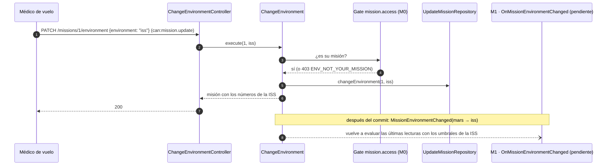

# 🌍 M6 · Entorno de misión · Backend

> [← Backend](../README.md) · Código: `astrohealth/app/Modules/Entorno/` · Qué construir: [ficha de M6](../../../../documentacion/modulos/M6-entorno/README.md) · Plan: F1 de `documentacion/PLAN_BACKEND.md`

| Estado   | Fase | Responsable |
| -------- | :--: | ----------- |
| ✅ Hecho |  F1  | Backend     |

**Qué hace:** es dueño de **las misiones** y **la tripulación**, y de los números de los 4 entornos (gravedad, radiación de referencia, retraso con Tierra y riesgos). Los demás módulos le preguntan por sus contratos "¿en qué entorno está esta misión?" y "¿de qué misión es este astronauta?".

---

## 1. Cambiar de entorno



Si se elige el mismo entorno que ya tiene, responde 200 y **no** publica el evento.

## 2. Estructura de archivos

```
app/Modules/Entorno/
├── EntornoServiceProvider.php              # bindings de MissionQuery y CrewQuery
├── routes.php                              # environments · missions · missions/current · missions/{id}/environment · astronauts
├── Contratos/
│   ├── MissionQuery.php                    # exists() · names() · environmentOf(missionId)
│   ├── CrewQuery.php                       # exists() · missionOf(astronautId) · all()
│   └── CrewMember.php                      # DTO público de un tripulante
├── Domain/
│   ├── Entidades/Mission.php
│   ├── Enums/Environment.php · MissionStatus.php · ErrorCode.php
│   ├── Reglas/MissionCalendar.php          # estado y día según las fechas (en UTC)
│   ├── ValueObjects/EnvironmentProfile.php
│   ├── Eventos/MissionEnvironmentChanged.php   # ShouldDispatchAfterCommit
│   └── Excepciones/MissionNotFound · MissionNameTaken · NotYourMission · NoCurrentMission · AstronautNotFound
├── Application/
│   ├── ListEnvironments · ListMissions · GetCurrentMission · CreateMission · ChangeEnvironment · AddCrewMember · UpdateCrewMember
│   ├── Servicios/MissionViews.php          # estado, día, fin y tripulación de cada misión
│   ├── Servicios/MissionAccess.php         # pregunta al Gate "mission.access" por nombre
│   └── DTOs/MissionData · CrewMemberData · MissionResult · CurrentMissionResult
├── Infrastructure/
│   ├── Catalogo/EnvironmentCatalog.php     # lee config/environments.php (falla si falta un dato)
│   ├── Models/Mission.php · Astronaut.php
│   └── Repositorios/Mission/{Find,Insert,Update,Upsert}MissionRepository · MissionMapper
│                    Astronaut/{Find,Insert,Update,Upsert}AstronautRepository · AstronautMapper
├── Http/
│   ├── Controllers/Api/ListEnvironments · ListMissions · CurrentMission · StoreMission · ChangeEnvironment · StoreAstronaut · UpdateAstronaut
│   ├── Requests/StoreMissionRequest · ChangeEnvironmentRequest · SaveAstronautRequest
│   └── Resources/EnvironmentResource · MissionResource · CurrentMissionResource · AstronautResource
├── Database/
│   ├── Migrations/                         # missions · astronauts · objective + nombre único
│   └── Seeders/MissionSeeder.php           # Ares-1 (en curso) · Órbita-7 (terminada) · Selene-2 (planificada)
└── Tests/
    ├── Unit/MissionCalendarTest.php
    └── Feature/EnvironmentsApiTest · MissionsApiTest · AstronautsApiTest
```

**`config/environments.php`** es la única fuente de los números (D14). Los riesgos son códigos; el frontend pone el texto y el ícono:

```php
'mars' => ['name' => 'Marte', 'label' => 'Rumbo a Marte', 'gravity_g' => 0.38,
           'radiation_msv_day' => 0.6, 'ground_delay_seconds' => 1200.0,
           'risks' => ['distance', 'radiation', 'isolation', 'fluids']],
```

## 3. Endpoints

| Método | Ruta                                | Permiso                                  | Caso de uso         | Respuesta                                                                                       |
| ------ | ----------------------------------- | ---------------------------------------- | ------------------- | ----------------------------------------------------------------------------------------------- |
| GET    | `/api/v1/environments`              | autenticado                              | `ListEnvironments`  | 200 los 4 entornos con sus números y códigos de riesgo                                          |
| GET    | `/api/v1/missions`                  | `crew.read`                              | `ListMissions`      | 200 misiones con `status`, `current_day`, `end_date` y `crew`. Admin: todas; los demás: la suya |
| GET    | `/api/v1/missions/current`          | autenticado                              | `GetCurrentMission` | 200 la suya (admin: la primera en curso) con gravedad, radiación, retraso y día · 404 si no hay |
| POST   | `/api/v1/missions`                  | `missions.manage`                        | `CreateMission`     | 201 la misión (sin tripulación)                                                                 |
| PATCH  | `/api/v1/missions/{id}/environment` | `mission.update` + Gate `mission.access` | `ChangeEnvironment` | 200 · publica `MissionEnvironmentChanged`                                                       |
| POST   | `/api/v1/astronauts`                | `missions.manage`                        | `AddCrewMember`     | 201 el tripulante                                                                               |
| PATCH  | `/api/v1/astronauts/{id}`           | `missions.manage`                        | `UpdateCrewMember`  | 200 (nombre, cargo o misión)                                                                    |

**Diferencias con el plan:** no hay `GET /astronauts?mission=`: la tripulación viene dentro de cada misión de `GET /missions`, que es lo que necesita la pantalla. El estado de la misión **no se guarda**: sale de las fechas con `MissionCalendar`.

## 4. Contratos y eventos

| Tipo    | Nombre                      | Lo usa                                                      |
| ------- | --------------------------- | ----------------------------------------------------------- |
| Ofrece  | `MissionQuery`              | M0 (nombres de misión en Usuarios), M2/M5 (`environmentOf`) |
| Ofrece  | `CrewQuery`                 | M0 (`mission_id` del token, Gate `health.read`), M1, M7, M8 |
| Publica | `MissionEnvironmentChanged` | M1/M2 (aún sin _listener_)                                  |
| Usa     | Gate `mission.access` (M0)  | Por **nombre**, con el `Gate` de Laravel                    |

> **Sin dependencias en círculo:** M0 ya usa los contratos de M6, así que M6 no importa código de M0. Pregunta "¿puede ver esta misión?" al Gate `mission.access` por su nombre, igual que las rutas usan `can:`.

## 5. Códigos de error

| Código                    | HTTP | Cuándo                                                                |
| ------------------------- | :--: | --------------------------------------------------------------------- |
| `VALIDATION_FAILED`       | 422  | Entorno que no existe, fecha mal escrita, duración fuera de 1–1000    |
| `ENV_MISSION_NAME_TAKEN`  | 422  | Ya hay una misión con ese nombre (campo `name`)                       |
| `ENV_MISSION_NOT_FOUND`   | 404  | La misión no existe                                                   |
| `ENV_ASTRONAUT_NOT_FOUND` | 404  | El tripulante no existe                                               |
| `ENV_NO_CURRENT_MISSION`  | 404  | La persona no sigue ninguna misión y no hay ninguna visible           |
| `ENV_NOT_YOUR_MISSION`    | 403  | Un médico de vuelo intenta cambiar el entorno de otra misión          |
| `FORBIDDEN`               | 403  | Sin el permiso de la ruta (p. ej. un astronauta cambiando el entorno) |

## 6. Pruebas

| Prueba                | Verifica                                                                                                                                                                                                                                       |
| --------------------- | ---------------------------------------------------------------------------------------------------------------------------------------------------------------------------------------------------------------------------------------------- |
| `MissionCalendarTest` | Víspera → planificada · día 1 · día 24 · último día · día siguiente → terminada · fecha de fin incluida                                                                                                                                        |
| `EnvironmentsApiTest` | Los 4 entornos · los números salen de la configuración · sin sesión → 401                                                                                                                                                                      |
| `MissionsApiTest`     | Admin ve todas ordenadas · los demás solo la suya · misión actual con sus números · crear y validar · nombre único · el médico cambia la suya y se publica el evento · mismo entorno → sin evento · otra misión → 403 · astronauta → 403 · 404 |
| `AstronautsApiTest`   | Crear tripulante y luego su usuario (M0) · cambiar de misión · 404 · validación · solo admin                                                                                                                                                   |

## 7. Avance

- [x] Migraciones `missions` y `astronauts` · `objective` + nombre único
- [x] `config/environments.php` (mismos números que el simulador)
- [x] Contratos `MissionQuery` y `CrewQuery`
- [x] Endpoints de lectura y de gestión
- [x] `ChangeEnvironment` + evento `MissionEnvironmentChanged`
- [x] Gate `health.read` acotado a la misión del médico; Gate `mission.access`
- [x] Pruebas en verde
- [ ] _Listener_ de `MissionEnvironmentChanged` (llega con M1/M2, F2–F3)

## 8. Cómo quedó hecho

- **"Hoy" es la fecha en UTC**, la hora de las misiones: el día de misión cambia a las 00:00 UTC (las 7 p. m. en Colombia).
- **El frontend no calcula el estado ni el día:** los recibe de la API. Los números de los entornos llegan de `GET /environments` y llenan las tablas que usan las pantallas.
- **Permisos por misión:** un médico (de vuelo o de la tripulación) solo ve la salud de los tripulantes de **su** misión; el admin (`missions.manage`) ve todas.

> 📝 **Documentar siempre:** este documento se actualiza en el mismo _pull request_ que cambia el código.
