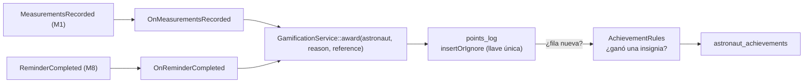

# 🏆 M7 · Gamificación · Backend

> [← Backend](../README.md) · Código: `astrohealth/app/Modules/Gamificacion/` · Qué construir: [ficha de M7](../../../../documentacion/modulos/M7-gamificacion/README.md)

| Estado         | Fase | Responsable |
| -------------- | :--: | ----------- |
| ⬜ Sin empezar |  5   | Backend     |

**Qué hace:** escucha lo que pasa (lecturas registradas, recordatorios cumplidos) y lo convierte en **puntos, nivel, racha e insignias**, **sin contar nunca dos veces lo mismo**.

---

## 1. De un evento a una insignia



| `reason`         |      Puntos       | `reference`              | Disparador                                                   |
| ---------------- | :---------------: | ------------------------ | ------------------------------------------------------------ |
| `daily_complete` |        10         | `2026-11-14`             | `MeasurementQuery::daysWithAllIndicators()` incluye la fecha |
| `streak_7`       |        50         | fecha del 7.º día        | `StreakRule` llega a 7 (y a cada múltiplo de 7)              |
| `sleep_7h`       |         5         | fecha                    | Lectura `sleep` ≥ 7                                          |
| `exercise`       |        15         | fecha                    | Lectura `exercise_min` ≥ 90                                  |
| `reminder`       |         5         | `reminder:12:2026-11-14` | `ReminderCompleted`                                          |
| `badge:<code>`   | según la insignia | `code`                   | Al ganar una insignia                                        |

> **Idempotente por diseño:** la llave única `(astronaut_id, reason, reference)` + `insertOrIgnore`. Un evento repetido o un lote reenviado por el simulador **no suma de nuevo**.

> **Los datos de la ingesta también suman:** así el ranking de la demo tiene vida con los 30 días simulados.

## 2. Estructura de archivos

```
app/Modules/Gamificacion/
├── GamificacionServiceProvider.php          # registra los 2 listeners
├── routes.php
├── Domain/
│   ├── Enums/PointReason.php · AchievementCode.php
│   └── Reglas/LevelRule.php · StreakRule.php · AchievementRules.php
├── Application/
│   ├── GamificationService.php              # (nombre del plan) award() en una transacción
│   ├── GetGamificationProfile.php · GetLeaderboard.php
│   └── DTOs/ProfileResult.php · LeaderboardRow.php
├── Infrastructure/
│   ├── Listeners/OnMeasurementsRecorded.php · OnReminderCompleted.php   # síncronos
│   ├── Models/Achievement.php · AstronautAchievement.php · PointsEntry.php
│   └── Repositorios/Points/FindPointsRepository.php · InsertPointsRepository.php (insertOrIgnore) — Achievement/FindAchievementRepository.php · InsertAstronautAchievementRepository.php · UpsertAchievementRepository.php
├── Http/
│   ├── Controllers/Api/ShowGamificationController.php · ShowLeaderboardController.php
│   └── Resources/GamificationResource.php · LeaderboardResource.php
├── Database/
│   ├── Migrations/                          # achievements · astronaut_achievements · points_log
│   └── Seeders/AchievementSeeder.php
└── Tests/
    ├── Unit/LevelRuleTest.php · StreakRuleTest.php · AchievementRulesTest.php
    └── Feature/AwardPointsTest.php · IdempotencyTest.php · ProfileTest.php · LeaderboardTest.php
```

## 3. Endpoints

| Método | Ruta                                   | Permiso             | Respuesta                                                     |
| ------ | -------------------------------------- | ------------------- | ------------------------------------------------------------- |
| GET    | `/api/v1/astronauts/{id}/gamification` | `gamification.read` | 200 puntos, nivel, progreso, racha, insignias, últimos puntos |
| GET    | `/api/v1/leaderboard`                  | `gamification.read` | 200 ranking de la tripulación                                 |

> Los puntos no son datos de salud: cualquier miembro de la tripulación puede ver el perfil de juego de otro (lo pide el ranking).

## 4. Contratos y eventos

| Tipo    | Nombre                      | Detalle                                |
| ------- | --------------------------- | -------------------------------------- |
| Escucha | `MeasurementsRecorded` (M1) | Día completo, sueño, ejercicio y racha |
| Escucha | `ReminderCompleted` (M8)    | +5 e insignia `on_time`                |
| Usa     | `MeasurementQuery` (M1)     | `daysWithAllIndicators()`              |
| Usa     | `CrewQuery` (M6)            | Nombres y avatares del ranking         |

## 5. Pruebas

| Prueba            | Verifica                                                              |
| ----------------- | --------------------------------------------------------------------- |
| `AwardPointsTest` | Completar el día → +10 · el 7.º día seguido → +10, +50 y `orbit_7`    |
| `IdempotencyTest` | El mismo evento dos veces → una sola fila · un lote reenviado no suma |
| `LevelRuleTest`   | 95 + 5 → nivel 2, progreso 0                                          |
| `StreakRuleTest`  | Racha que se corta · hoy incompleto cuenta hasta ayer                 |
| `LeaderboardTest` | Orden por puntos, empate por quien llegó primero                      |

## 6. Avance

- [ ] Migraciones + `AchievementSeeder`
- [ ] Reglas `LevelRule`, `StreakRule`, `AchievementRules`
- [ ] `GamificationService::award()` idempotente
- [ ] Los 2 _listeners_
- [ ] Endpoints de perfil y ranking
- [ ] Pruebas en verde

## 7. Cómo quedó hecho

_Pendiente._

> 📝 **Documentar siempre:** este documento se actualiza en el mismo _pull request_ que cambia el código.
