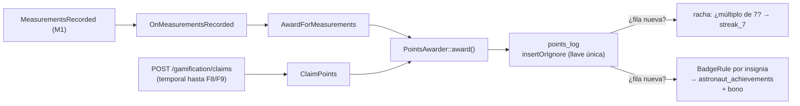

# 🏆 M7 · Gamificación · Backend

> [← Backend](../README.md) · Código: `astrohealth/app/Modules/Gamificacion/` · Qué construir: [ficha de M7](../../../../documentacion/modulos/M7-gamificacion/README.md) · Plan: F7 de `documentacion/PLAN_BACKEND.md`

| Estado   | Fase | Responsable |
| -------- | :--: | ----------- |
| ✅ Hecho |  F7  | Backend     |

**Qué hace:** convierte lo que hace cada tripulante (registrar sus datos, dormir, hacer ejercicio, cumplir recordatorios, hacer tests) en **puntos, nivel, racha e insignias**, **sin contar nunca dos veces lo mismo**. Los puntos se cuentan por **día de misión** (el día 1 es el inicio, en UTC, como `MissionCalendar` de M6).

---

## 1. De un evento a una insignia



| `reason`         |      Puntos       | `reference`             | Disparador                                                 |
| ---------------- | :---------------: | ----------------------- | ---------------------------------------------------------- |
| `daily_complete` |        10         | día de misión (`24`)    | Los 10 indicadores del catálogo medidos ese día de misión  |
| `streak_7`       |        50         | día de misión           | La racha de días completos llega a 7 (y a cada múltiplo)   |
| `sleep_7h`       |         5         | día de misión           | `sleep` ≥ 7 h                                              |
| `exercise`       |        15         | día de misión           | `exercise_min` ≥ 90                                        |
| `reminder`       |         5         | `<recordatorio>-<día>`  | Reclamo del tripulante (hasta F8: `ReminderCompleted`)     |
| `psych_test`     |        10         | `<test>-<día>`          | Reclamo del tripulante (hasta F9: evento de los tests)     |
| `badge`          | el bono de la insignia | `code` de la insignia | Al ganar una insignia                                     |

Los valores viven en `config/gamification.php` (**P7**: nada de números en el código), igual que las 7 h de sueño, los 90 min de ejercicio y los 100 puntos por nivel.

> **Idempotente por diseño:** la llave única `(astronaut_id, reason, reference)` + `insertOrIgnore`. Un evento repetido, un lote reenviado por el simulador o un doble clic **no suman de nuevo**.

> **El reclamo es temporal:** M8 (recordatorios) y los tests psicológicos todavía no tienen backend que publique su evento. Mientras tanto el tripulante reclama solo esos dos motivos y **para sí mismo**; cuántos puntos da lo decide la configuración, nunca quien pide. Se borra con F8 y F9.

## 2. Insignias

Las 9 viven en la tabla `achievements` (`AchievementSeeder`). Cada una tiene su regla pura en `Domain/Reglas/BadgeRule.php`, que recibe los hechos de cada día (`BadgeFacts`) y devuelve el **primer día** en que se cumplió (o `null`) y el **mejor avance** (para la barra de progreso de las bloqueadas).

| Código          | Regla                                         | `StreakRule`          |
| --------------- | --------------------------------------------- | --------------------- |
| `first_log`     | El primer día con el registro completo        | —                     |
| `orbit_7`       | 7 días seguidos con el registro completo      | `firstReaching`       |
| `mission_30`    | 30 días seguidos con el registro completo     | `firstReaching`       |
| `steel_heart`   | 7 días seguidos con pulso y presión en verde  | `firstReaching`       |
| `space_sleeper` | 7 noches seguidas de 7 h o más                | `firstReaching`       |
| `on_time`       | 10 recordatorios cumplidos                    | `firstTotalReaching`  |
| `swiss_clock`   | 100 recordatorios cumplidos                   | `firstTotalReaching`  |
| `iron_body`     | 14 días con 90 min de ejercicio o más         | `firstTotalReaching`  |
| `mind_check`    | Los 4 tests en una misma semana de misión     | `firstWeekReaching`   |

"Pulso y presión en verde" usa el **color que ya guardó M2** en cada medición (el último del día de `hr`, `bp_sys` y `bp_dia`): M7 no decide colores (**P4**).

## 3. Estructura de archivos

```
app/Modules/Gamificacion/
├── GamificacionServiceProvider.php          # escucha MeasurementsRecorded (M1)
├── routes.php
├── Domain/
│   ├── Entidades/PointEntry.php · Achievement.php
│   ├── Enums/PointReason.php · ErrorCode.php
│   ├── Excepciones/NotCrewMember.php        # 403 GAMIFICATION_NOT_CREW
│   ├── Reglas/LevelRule.php · StreakRule.php · BadgeRule.php
│   └── ValueObjects/BadgeFacts.php
├── Application/
│   ├── AwardForMeasurements.php · ClaimPoints.php · GetProfile.php · GetLeaderboard.php
│   └── Servicios/MissionClock.php · BadgeFactsBuilder.php · PointsAwarder.php
├── Infrastructure/
│   ├── Configuracion/GamificationSettings.php
│   ├── Listeners/OnMeasurementsRecorded.php
│   ├── Models/Achievement.php · AstronautAchievement.php · PointLog.php
│   └── Repositorios/Achievement/Find… · Upsert…  —  Points/Find… · Insert… (insertOrIgnore)
├── Http/
│   ├── Controllers/Api/ProfileController.php · LeaderboardController.php · ClaimController.php
│   ├── Requests/LeaderboardRequest.php · ClaimRequest.php
│   └── Resources/PointEntryResource.php
├── Database/
│   ├── Migrations/                          # achievements · astronaut_achievements · points_log
│   └── Seeders/AchievementSeeder.php · DemoPointsSeeder.php
└── Tests/
    ├── Unit/GamificationRulesTest.php
    └── Feature/GamificationApiTest.php
```

## 4. Endpoints

| Método | Ruta                                              | Permiso                                    | Respuesta                                                        |
| ------ | ------------------------------------------------- | ------------------------------------------ | ---------------------------------------------------------------- |
| GET    | `/api/v1/astronauts/{id}/gamification`            | `gamification.read` + Gate `health.read`   | 200 puntos, nivel, progreso, racha, 9 insignias con avance, últimos 8 puntos |
| GET    | `/api/v1/gamification/leaderboard?astronauts=1,2` | `gamification.read` + `mission.access` por tripulante | 200 ranking por puntos (sin datos de salud)            |
| POST   | `/api/v1/gamification/claims` `{reason, reference}` | `gamification.read`, solo tripulantes    | 200 `{awarded: bool}` · 422 si el motivo no es `reminder`/`psych_test` · 403 `GAMIFICATION_NOT_CREW` |

> El ranking solo incluye tripulantes de misiones que la persona puede ver; los ids de otra misión se ignoran sin error.

## 5. Contratos y eventos

| Tipo    | Nombre                      | Detalle                                           |
| ------- | --------------------------- | ------------------------------------------------- |
| Escucha | `MeasurementsRecorded` (M1) | Día completo, sueño, ejercicio, racha e insignias |
| Usa     | `MeasurementQuery` (M1)     | `series()`: qué se midió cada día y su color      |
| Usa     | `IndicatorCatalog` (M1)     | Cuántos indicadores hacen un día completo         |
| Usa     | `CrewQuery`, `MissionQuery` (M6) | La misión y su inicio (día de misión)        |
| Usa     | Gate `mission.access` (M0/M6) | Filtra el ranking                               |

## 6. Datos de demo

`DemoPointsSeeder` (solo fuera de producción, idempotente) da a Ares-1 los puntos que habría ganado hasta hoy: registro completo con algunos días sin hacer (para que las rachas no sean perfectas), sueño y ejercicio según **su historia real en la base** (`DemoHistorySeeder` de M1), recordatorios, los tests de cada semana y, al final, las insignias con `PointsAwarder::checkBadges()`.

## 7. Pruebas

| Prueba                   | Verifica                                                                                 |
| ------------------------ | ---------------------------------------------------------------------------------------- |
| `GamificationRulesTest`  | Niveles, racha (hoy incompleto cuenta hasta ayer), totales, semanas, cada insignia       |
| `GamificationApiTest`    | Día completo → 10 + 5 + 15 + bono · lo mismo dos veces no suma · día incompleto · 7.º día → `streak_7` y `orbit_7` · reclamos idempotentes y limitados · ranking solo de mi misión · 403 a otra misión |

## 8. Frontend

`useGamificationStore` pide el perfil y el ranking a la API. `refresh()` vuelve a pedir el perfil después de registrar (los puntos ya los sumó el backend) y celebra lo nuevo; `award()` reclama un recordatorio o un test. Se borraron `Utils/gamificationMock.ts`, `Utils/profile.ts` y `mocks/crewHistory.ts`; `Utils/rules.ts` quedó solo con los textos de la pantalla.

> 📝 **Documentar siempre:** este documento se actualiza en el mismo _pull request_ que cambia el código.
