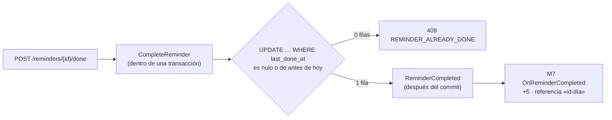

# ⏰ M8 · Recordatorios · Backend

> [← Backend](../README.md) · Código: `astrohealth/app/Modules/Recordatorios/` · Qué construir: [ficha de M8](../../../../documentacion/modulos/M8-recordatorios/README.md) · Plan: F8 de `documentacion/PLAN_BACKEND.md`

| Estado   | Fase | Responsable |
| -------- | :--: | ----------- |
| ✅ Hecho |  F8  | Backend     |

**Qué hace:** guarda la **rutina diaria** de cada tripulante (medir la presión, ejercicio, dosímetro, ánimo, sueño u otros) y la deja **marcar hecha una vez al día**. Al marcarla publica `ReminderCompleted` y **M7 suma +5 puntos**.

---

## 1. Hecho hoy, sin reiniciar nada

Un recordatorio está hecho hoy si `last_done_at` es del **mismo día UTC** que ahora (`DoneTodayRule`), el mismo día que usa el día de misión (M6) y los puntos (M7). No hay un proceso que lo reinicie a medianoche: al día siguiente simplemente deja de ser "de hoy".



> **Nunca dos veces:** la condición va en el propio `UPDATE`, así dos toques a la vez no lo marcan dos veces. Y en M7 la llave única de `points_log` (`reminder`, `«id»-«día»`) lo vuelve a asegurar.

El estado "ya es la hora / más tarde" lo calcula la pantalla con la hora del dispositivo (el reloj `useReminderClock` avisa cuando llega la hora); el backend solo decide lo que cuenta para los puntos: si está hecho hoy (`done_today`).

## 2. Estructura de archivos

```
app/Modules/Recordatorios/
├── RecordatoriosServiceProvider.php
├── routes.php
├── Domain/
│   ├── Entidades/Reminder.php
│   ├── Enums/ReminderType.php · ErrorCode.php
│   ├── Eventos/ReminderCompleted.php        # ShouldDispatchAfterCommit
│   ├── Excepciones/ReminderProblem.php      # 404 · 409 · 403
│   └── Reglas/DoneTodayRule.php
├── Application/
│   ├── ListReminders.php · CreateReminder.php · UpdateReminder.php · DeleteReminder.php · CompleteReminder.php
│   └── Servicios/OwnAstronaut.php           # el tripulante sale del token
├── Infrastructure/
│   ├── Models/Reminder.php
│   └── Repositorios/Reminder/Find… · Insert… · Update… (markDone condicional) · Delete… · ReminderMapper.php
├── Http/
│   ├── Controllers/Api/ReminderController.php · CompleteReminderController.php
│   ├── Requests/ReminderRequest.php         # POST todo obligatorio · PATCH solo lo que cambia
│   └── Resources/ReminderResource.php
├── Database/
│   ├── Migrations/                          # reminders
│   └── Seeders/ReminderSeeder.php · DemoRemindersSeeder.php
└── Tests/
    ├── Unit/DoneTodayRuleTest.php
    └── Feature/RemindersApiTest.php
```

## 3. Endpoints

Todos con `reminders.manage.own` y **siempre sobre la rutina de quien pide** (el astronauta sale del token). Uno de otro tripulante responde **404**, para no revelar que existe.

| Método | Ruta                          | Respuesta                                     |
| ------ | ----------------------------- | --------------------------------------------- |
| GET    | `/api/v1/reminders`           | 200 la rutina por hora                        |
| POST   | `/api/v1/reminders`           | 201 `{type, title, time "HH:MM"}`             |
| PATCH  | `/api/v1/reminders/{id}`      | 200 cambia `type`, `title`, `time` o `active` |
| DELETE | `/api/v1/reminders/{id}`      | 204 (los puntos que ya dio se quedan)         |
| POST   | `/api/v1/reminders/{id}/done` | 200 hecho hoy · 409 `REMINDER_ALREADY_DONE`   |

Cada recordatorio: `id`, `type`, `title`, `time`, `active`, `last_done_at` (ISO, UTC) y `done_today`.

## 4. Contratos y eventos

| Tipo    | Nombre              | Detalle                                         |
| ------- | ------------------- | ----------------------------------------------- |
| Publica | `ReminderCompleted` | `astronautId`, `reminderId`, `doneAt` → M7 (+5) |
| Usa     | `CurrentActor` (M0) | El astronauta de quien pide                     |
| Usa     | `CrewQuery` (M6)    | En el seeder: a quién darle la rutina           |

## 5. Datos iniciales y demo

- `ReminderSeeder`: los 5 recordatorios por defecto de `config/reminders.php` (**P7**) para cada tripulante que no tiene ninguno. Idempotente.
- `DemoRemindersSeeder` (solo fuera de producción): hoy a las 08:03 UTC cada tripulante de Ares-1 ya midió la presión. Publica `ReminderCompleted` como la app, así M7 suma los puntos de verdad.

## 6. Pruebas

| Prueba              | Verifica                                                                                                                                                                                                 |
| ------------------- | -------------------------------------------------------------------------------------------------------------------------------------------------------------------------------------------------------- |
| `DoneTodayRuleTest` | "Hoy" es el día UTC (las 20:00 de Bogotá ya son el día siguiente)                                                                                                                                        |
| `RemindersApiTest`  | La rutina por defecto (sin duplicar) · crear, cambiar y borrar · formato · hecho → +5 una vez (409 la segunda) · al día siguiente se puede otra vez · nadie toca los de otro (404) · solo la tripulación |

## 7. Cambios frente al plan

- **Sin comando `recordatorios:pending`:** el estado se calcula al leer (hecho hoy por la fecha; "es la hora" en la pantalla), así que no hay nada que marcar por consola.
- El campo `active` existe en la API; la pantalla muestra solo los activos.

## 8. Frontend

`useRemindersStore` usa la API (guardar, borrar y marcar hecho devuelven si salió bien y avisan el error). Al marcar uno hecho, Inicio llama a `gamification.refresh()` para celebrar los puntos que ya sumó el backend. Se borró `Utils/remindersMock.ts`.

> 📝 **Documentar siempre:** este documento se actualiza en el mismo _pull request_ que cambia el código.
