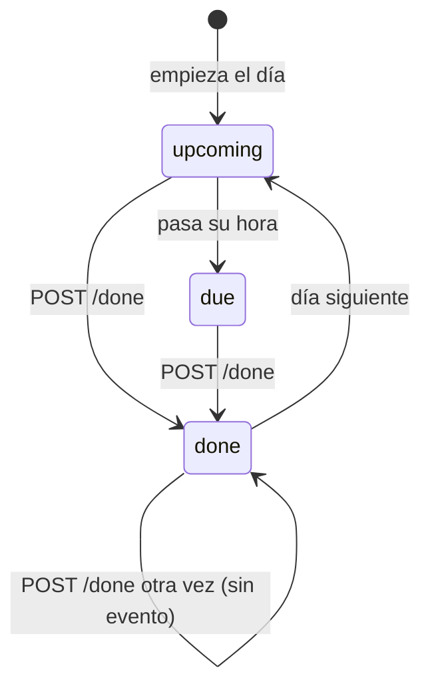

# ⏰ M8 · Recordatorios · Backend

> [← Backend](../README.md) · Código: `astrohealth/app/Modules/Recordatorios/` · Qué construir: [ficha de M8](../../../../documentacion/modulos/M8-recordatorios/README.md)

| Estado         | Fase | Responsable |
| -------------- | :--: | ----------- |
| ⬜ Sin empezar |  5   | Backend     |

**Qué hace:** guarda **la rutina de cada astronauta** (medir la presión, ejercicio, dosímetro, ánimo, sueño), calcula si cada recordatorio está **hecho, pendiente o por venir**, y al cumplirlo publica un evento para que M7 sume puntos.

---

## 1. Estados y cumplimiento



El estado **se calcula** (`ReminderStateRule`, con la hora y `last_done_at`), no se guarda: así no hace falta un proceso que lo "reinicie" cada día.

## 2. Estructura de archivos

```
app/Modules/Recordatorios/
├── RecordatoriosServiceProvider.php        # programa reminders:mark-due cada minuto
├── routes.php
├── Domain/
│   ├── Enums/ReminderType.php · ReminderState.php · ErrorCode.php
│   ├── Reglas/ReminderStateRule.php
│   └── Eventos/ReminderCompleted.php       # reminderId · astronautId · type · doneAt
├── Application/
│   ├── ListTodayReminders.php
│   ├── CompleteReminder.php                # ya hecho hoy → sin evento
│   ├── CreateReminder.php · UpdateReminder.php · DeleteReminder.php
│   └── DTOs/ReminderData.php · ReminderResult.php
├── Infrastructure/
│   ├── Models/Reminder.php
│   └── Repositorios/ReminderRepository.php
├── Policies/ReminderPolicy.php             # solo los del astronauta del token
├── Http/
│   ├── Controllers/Api/ReminderController.php      # index · store · update · destroy · done
│   ├── Requests/StoreReminderRequest.php · UpdateReminderRequest.php
│   └── Resources/ReminderResource.php      # incluye state
├── Console/MarkDueRemindersCommand.php     # reminders:mark-due → log de los pendientes
├── Database/
│   ├── Migrations/                         # reminders
│   └── Seeders/ReminderSeeder.php          # 5 por astronauta
└── Tests/
    ├── Unit/ReminderStateRuleTest.php
    └── Feature/RemindersCrudTest.php · CompleteReminderTest.php · ReminderPolicyTest.php
```

## 3. Endpoints

| Método | Ruta                          | Permiso                                                           | Respuesta                                                |
| ------ | ----------------------------- | ----------------------------------------------------------------- | -------------------------------------------------------- |
| GET    | `/api/v1/reminders`           | `reminders.manage.own` (o `health.read.any` con `?astronaut_id=`) | 200 los de hoy, ordenados por hora, con `state`          |
| POST   | `/api/v1/reminders`           | `reminders.manage.own`                                            | 201                                                      |
| PATCH  | `/api/v1/reminders/{id}`      | `reminders.manage.own` + `ReminderPolicy`                         | 200                                                      |
| DELETE | `/api/v1/reminders/{id}`      | `reminders.manage.own` + `ReminderPolicy`                         | 204                                                      |
| POST   | `/api/v1/reminders/{id}/done` | `reminders.manage.own` + `ReminderPolicy`                         | 200 · publica `ReminderCompleted` la primera vez del día |

> El astronauta **no envía** su `astronaut_id`: sale del token.

## 4. Contratos y eventos

| Tipo    | Nombre              | Detalle                        |
| ------- | ------------------- | ------------------------------ |
| Publica | `ReminderCompleted` | M7: +5 y la insignia `on_time` |
| Usa     | `CrewQuery` (M6)    | Que el astronauta exista       |
| Usa     | `CurrentActor` (M0) | El astronauta del token        |

## 5. Códigos de error

| Código                | HTTP | Cuándo                                   |
| --------------------- | :--: | ---------------------------------------- |
| `VALIDATION_FAILED`   | 422  | Hora fuera de `HH:MM` o tipo desconocido |
| `FORBIDDEN`           | 403  | Recordatorio de otro astronauta          |
| `REMINDERS_NOT_FOUND` | 404  | No existe                                |

## 6. Pruebas

| Prueba                  | Verifica                                                                               |
| ----------------------- | -------------------------------------------------------------------------------------- |
| `ReminderStateRuleTest` | 09:00 → el de las 08:00 `due` y el de las 10:00 `upcoming` · día siguiente se reinicia |
| `CompleteReminderTest`  | Primera vez → evento y +5 en M7 · segunda vez → 200 sin evento                         |
| `ReminderPolicyTest`    | El astronauta 2 no toca los del 3                                                      |
| `RemindersCrudTest`     | Crear, editar, borrar · `25:00` → 422                                                  |

## 7. Avance

- [ ] Migración + `ReminderSeeder`
- [ ] `ReminderStateRule`
- [ ] CRUD + `done` con `ReminderPolicy`
- [ ] Evento `ReminderCompleted`
- [ ] `reminders:mark-due` en el _scheduler_
- [ ] Pruebas en verde

## 8. Cómo quedó hecho

_Pendiente._

> 📝 **Documentar siempre:** este documento se actualiza en el mismo _pull request_ que cambia el código.
