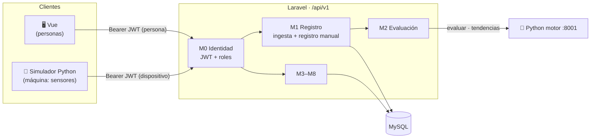
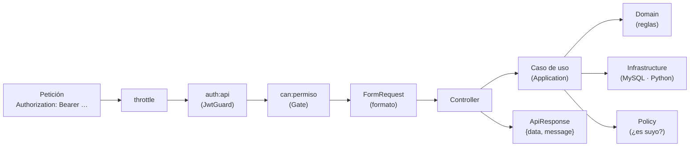
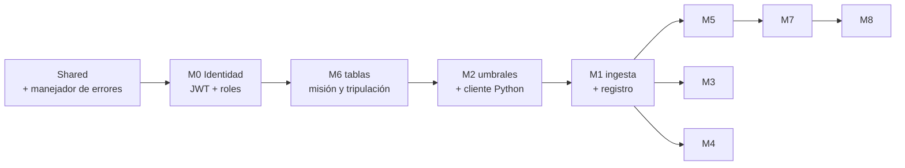

# ⚙️ Backend · Laravel 13

> [← Documentación técnica](../README.md) · Norma: [ARCHITECTURE.md](../../../documentacion/arquitectura/ARCHITECTURE.md) · Contrato: [API y JSON](../../../documentacion/arquitectura/01-api-y-json.md)

Esta es la guía del backend **archivo por archivo**: qué va en cada módulo, quién puede llamar a cada ruta, cómo fluye cada petición y cómo se prueba. Cada módulo tiene su documento, con el **avance** en casillas y una sección "Cómo quedó hecho" que se llena mientras se programa.

## 1. El backend en una imagen



**Dos tipos de cliente, una sola puerta:**

| Cliente    | Quién es                                                               | Cómo entra                                                                       | Qué puede hacer                                               |
| ---------- | ---------------------------------------------------------------------- | -------------------------------------------------------------------------------- | ------------------------------------------------------------- |
| 🧑‍🚀 Persona | Astronauta, médico de la tripulación, médico en Tierra o administrador | `POST /auth/login` con correo y contraseña → JWT de **15 min** + _refresh token_ | Lo que diga su **rol**                                        |
| 🤖 Máquina | El simulador de Python, que hace de sensores y _gateway_ de la nave    | `POST /auth/device-token` con `client_id` y `client_secret` → JWT de **15 min**  | **Solo** enviar lecturas (`measurements.ingest`) de su misión |

El simulador actúa como las máquinas reales de la nave: **lee "sensores", empaqueta las lecturas y las envía en lotes** a `POST /api/v1/ingest/readings`. Laravel valida, evalúa (semáforo), guarda y avisa a los demás módulos. El detalle está en [M0](M0-identidad/README.md) y [M1](M1-registro/README.md).

## 2. El camino de una petición



| Paso                     | Dónde                                                                           | Si falla                                        |
| ------------------------ | ------------------------------------------------------------------------------- | ----------------------------------------------- |
| Límite de peticiones     | `throttle:api-login`, `api-refresh`, `api-device` (M0) · `throttle:ingest` (M1) | 429 `TOO_MANY_REQUESTS`                         |
| ¿Quién es?               | `JwtGuard` de M0 (firma, `exp`, `aud`, lista de revocados)                      | 401 `AUTH_TOKEN_INVALID` · `AUTH_TOKEN_EXPIRED` |
| ¿Su rol puede?           | `can:<permiso>` (Gates de M0)                                                   | 403 `FORBIDDEN`                                 |
| ¿Los datos tienen forma? | `FormRequest` del módulo                                                        | 422 `VALIDATION_FAILED`                         |
| ¿El recurso es suyo?     | _Policy_ del módulo, dentro del caso de uso                                     | 403 `FORBIDDEN`                                 |
| ¿La regla lo permite?    | `Domain` → `BusinessError`                                                      | 409 / 422 con el código del módulo              |

## 3. Roles y permisos

| Rol                    | Quién                                              | Dónde     | En una frase                                                                      |
| ---------------------- | -------------------------------------------------- | --------- | --------------------------------------------------------------------------------- |
| `astronaut`            | Cada tripulante                                    | 🚀 Nave   | Ve y registra **lo suyo**, envía sus alertas a Tierra y cumple su rutina          |
| `crew_medical_officer` | Médico de la tripulación (CMO), también tripulante | 🚀 Nave   | Ve y registra a **toda la tripulación a bordo** y envía cualquier alerta a Tierra |
| `flight_surgeon`       | Médico en Tierra                                   | 🌍 Tierra | Ve a **toda** la tripulación, **confirma** las alertas y ajusta el entorno        |
| `admin`                | Administrador                                      | 🌍 Tierra | Gestiona usuarios, dispositivos y la misión                                       |
| `device`               | El simulador / los sensores                        | 🚀 Nave   | Solo envía lecturas de su misión                                                  |

**Matriz de permisos** (`config/permissions.php`, la única lista; los Gates se generan de ella):

| Permiso                                                 | `admin` | `flight_surgeon` | `crew_medical_officer` | `astronaut` | `device` |
| ------------------------------------------------------- | :-----: | :--------------: | :--------------------: | :---------: | :------: |
| `crew.read` — ver la misión y la tripulación            |   ✅    |        ✅        |           ✅           |     ✅      |          |
| `health.read.any` — ver la salud de cualquiera          |   ✅    |        ✅        |           ✅           |             |          |
| `health.read.own` — ver su propia salud                 |         |                  |           ✅           |     ✅      |          |
| `measurements.write.own` — registrar a mano lo suyo     |         |                  |           ✅           |     ✅      |          |
| `measurements.write.crew` — registrar a otro tripulante |         |                  |           ✅           |             |          |
| `measurements.ingest` — enviar lecturas de sensores     |         |                  |                        |             |    ✅    |
| `alerts.read` — ver alertas                             |   ✅    |        ✅        |           ✅           | ✅ (suyas)  |          |
| `alerts.send` — enviar una alerta a Tierra              |         |                  |    ✅ (cualquiera)     | ✅ (suyas)  |          |
| `alerts.acknowledge` — confirmar desde Tierra           |   ✅    |        ✅        |                        |             |          |
| `mission.update` — cambiar el entorno                   |   ✅    |        ✅        |                        |             |          |
| `missions.manage` — crear misiones y tripulantes        |   ✅    |                  |                        |             |          |
| `guide.manage` — rangos, qué hacer y tests psicológicos |   ✅    |        ✅        |                        |             |          |
| `advice.send` — dar indicaciones a un tripulante        |         |        ✅        |           ✅           |             |          |
| `clinical_notes.manage` — notas clínicas privadas       |         |        ✅        |           ✅           |             |          |
| `reminders.manage.own` — sus recordatorios              |         |                  |           ✅           |     ✅      |          |
| `gamification.read` — puntos y ranking                  |   ✅    |        ✅        |           ✅           |     ✅      |          |
| `users.manage` · `devices.manage`                       |   ✅    |                  |                        |             |          |

> **"Suyo"** lo decide el Gate `health.read` con el `astronaut_id` del token: un astronauta con `health.read.own` que pide `/astronauts/3/...` siendo el 2 recibe 403. Con `health.read.any`, un médico ve **solo a la tripulación de su misión** (la `mission_id` de su token); el admin (`missions.manage`) ve todas. El Gate `mission.access` aplica la misma regla a una misión.

## 4. Los módulos

|     | Módulo                                                | Carpeta         | Qué hace en el backend                                              |   Fase    | Estado |
| :-: | ----------------------------------------------------- | --------------- | ------------------------------------------------------------------- | :-------: | :----: |
| 🔐  | [**M0 · Identidad y acceso**](M0-identidad/README.md) | `Identidad`     | Login JWT, _refresh_ con rotación, roles, permisos, dispositivos    |   **1**   |   ✅   |
| 🩺  | [M1 · Registro](M1-registro/README.md)                | `Registro`      | **Ingesta de las máquinas** + registro manual, evaluación y evento  |     2     |   ⬜   |
| 🚦  | [M2 · Evaluación](M2-evaluacion/README.md)            | `Evaluacion`    | Semáforo, puntaje, tendencias; único cliente de Python              |     2     |   ⬜   |
| 🧍  | [M3 · Cuerpo](M3-cuerpo/README.md)                    | `Cuerpo`        | Estado por órgano                                                   |     3     |   ⬜   |
| 📈  | [M4 · Dashboard](M4-dashboard/README.md)              | `Dashboard`     | Series y tendencias                                                 |     3     |   ⬜   |
| 🚨  | [M5 · Alertas](M5-alertas/README.md)                  | `Alertas`       | Alertas rojas, recomendaciones, envío a Tierra                      |     4     |   ⬜   |
| 🌍  | [M6 · Entorno](M6-entorno/README.md)                  | `Entorno`       | Misión, tripulación, entornos                                       | **1** · 4 |   🟨   |
| 🏆  | [M7 · Gamificación](M7-gamificacion/README.md)        | `Gamificacion`  | Puntos, niveles, insignias, ranking                                 |     5     |   ✅   |
| ⏰  | [M8 · Recordatorios](M8-recordatorios/README.md)      | `Recordatorios` | Rutina diaria y su evento                                           |     5     |   ✅   |
| 🧱  | [Shared](shared.md)                                   | `Shared`        | `ApiResponse`, `BusinessError`, `Transaction`, manejador de errores |   **1**   |   ✅   |

## 5. Orden de construcción (backend)



1. **Shared + M0 primero:** sin el JWT nadie puede llamar a nada, y el simulador no puede enviar.
2. **M6 y M2 (tablas y umbrales):** son la base de M1.
3. **M1 con la ingesta:** desde aquí el simulador ya llena la base y el frontend tiene datos reales.

## 6. Convenciones del backend

| Tema              | Regla                                                                                                                       |
| ----------------- | --------------------------------------------------------------------------------------------------------------------------- |
| Clases            | `final`, `declare(strict_types=1);`, tipos en parámetros y retornos                                                         |
| Casos de uso      | Una clase, un `execute()`, recibe DTOs, devuelve DTOs                                                                       |
| Controladores     | `Request → caso de uso → Resource → ApiResponse`, menos de 15 líneas por método                                             |
| Respuestas        | Siempre con `ApiResponse` ([formato](../../../documentacion/arquitectura/01-api-y-json.md))                                 |
| Rutas             | En `routes.php` de cada módulo, prefijo `/api/v1`, `auth:api` + `can:`                                                      |
| Fechas            | UTC en la base y en el JSON (`Z`)                                                                                           |
| Pruebas           | `Tests/Unit` (Domain) y `Tests/Feature` (HTTP completo con un JWT de prueba)                                                |
| Helper de pruebas | _Trait_ `InteractsWithJwt` (`app/Modules/Identidad/Tests/Support/`): `userWithRole()`, `device()`, `tokenFor()`, `bearer()` |

```powershell
php artisan test                         # todo
php artisan test --filter=Identidad      # un módulo
php artisan route:list --path=api/v1     # rutas y su middleware
```

> 📝 **Documentar siempre:** cada documento de módulo se actualiza en el mismo _pull request_ que cambia su código.
