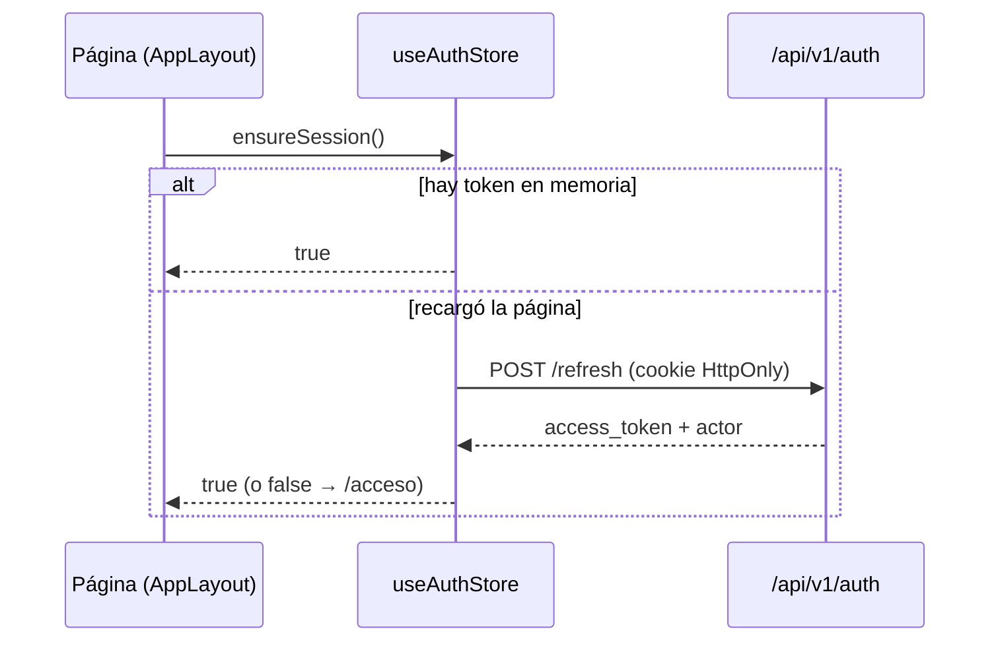

# 🔐 M0 · Identidad y acceso · Frontend

> [← Frontend](../README.md) · Contrato: [Sesión con JWT](../../../../documentacion/arquitectura/03-frontend-vue.md#sesión-con-jwt) · [Endpoints de M0](../../backend/M0-identidad/README.md#6-endpoints)

| Estado      | Fase  | Responsable |
| ----------- | :---: | ----------- |
| 🟨 En curso | **1** | Frontend    |

Este documento cuenta **cómo quedó hecho**. **Qué** hay que construir está en la guía del frontend y en los endpoints de M0.

## Avance

**Principal:** `modules/Identidad/Login.vue`, servido en **`/acceso`** (`app/Modules/Identidad/web.php`). Al abrir la app, `/` lleva aquí.

**Store y cliente**

- [x] `stores/useAuthStore.ts`: _access token_ en memoria, `actor`, `login()`, `refresh()`, `ensureSession()`, `logout()`, `can()`
- [x] `lib/api.ts`: el único cliente HTTP. Bearer, devuelve `data`, `ApiError` y un reintento con `/auth/refresh` ante `AUTH_TOKEN_EXPIRED`
- [x] Restaurar la sesión al recargar: `AppLayout` llama a `ensureSession()` (usa la _cookie_ del _refresh_)
- [x] Guarda de navegación: toda página con `AppLayout` exige sesión; sin sesión → `/acceso`
- [x] Sin permiso → ocultar y redirigir: el menú solo muestra "Administración" con `can('users.manage')` y `/admin` manda al panel a quien no lo tenga
- [x] Al iniciar sesión, administración entra a `/admin`; los demás, a `/dashboard`

**Componentes**

- [x] Formulario de login (correo, contraseña, errores de campo y `AUTH_INVALID_CREDENTIALS` / `TOO_MANY_REQUESTS`)
- [x] Menú de usuario (`NavUser`, `UserMenuContent`, `UserInfo`): nombre, rol y cerrar sesión
- [x] `RoleBadge` (con 🌍 Tierra o 🚀 nave, y "Sin rol")

## Vista de administración (`/admin`) · 🟨 frontend listo con datos de prueba

**Principal:** `modules/Identidad/Admin.vue` · piezas en `Components/Admin/` · datos en `Stores/useAdminStore.ts`.

| Sección      | Qué muestra                                                                                 | Acciones                                                    |
| ------------ | ------------------------------------------------------------------------------------------- | ----------------------------------------------------------- |
| Cabecera     | Misión, entorno y avance de días; el electrocardiograma como firma                          | —                                                           |
| Resumen      | Usuarios activos, tripulación, dispositivos en línea (últimos 5 min), alertas por confirmar | —                                                           |
| Usuarios     | Persona, rol (Tierra/Nave), estado, último acceso. Buscar y filtrar por rol                 | Crear, editar (nombre, rol, astronauta), activar/desactivar |
| Dispositivos | Nombre, a quién mide (o gateway), `client_id`, en línea / sin señal / desactivado           | Registrar (muestra el secreto UNA vez), activar/desactivar  |

> ⚠️ **Datos de prueba:** `Utils/adminMockData.ts`. Para conectar el backend solo cambia el interior de las acciones de `useAdminStore` por `api()`; los componentes no se tocan.

### Contrato que espera el frontend (para el backend de M0)

Los tipos están en `Types/admin.ts`. Todas con `can:users.manage` o `can:devices.manage` y el formato `{ data, message }`:

| Método y ruta                | Envía                                   | Devuelve `data`                                                                                          |
| ---------------------------- | --------------------------------------- | -------------------------------------------------------------------------------------------------------- |
| `GET /api/v1/users`          | —                                       | `ManagedUser[]`: `id, name, email, role, astronaut_id, astronaut_name, active, last_login_at`            |
| `POST /api/v1/users`         | `name, email, role, astronaut_id`       | `ManagedUser` (201)                                                                                      |
| `PATCH /api/v1/users/{id}`   | `name, role, astronaut_id` y/o `active` | `ManagedUser`                                                                                            |
| `GET /api/v1/devices`        | —                                       | `ManagedDevice[]`: `id, name, client_id, mission_id, astronaut_id, astronaut_name, active, last_seen_at` |
| `POST /api/v1/devices`       | `name, astronaut_id` (`null` = gateway) | `{ device: ManagedDevice, client_secret }` (201, el secreto solo aquí)                                   |
| `PATCH /api/v1/devices/{id}` | `active`                                | `ManagedDevice`                                                                                          |

El resumen usa además la misión actual y la tripulación (M6: `GET /api/v1/missions/current`, `GET /api/v1/astronauts`) y el número de alertas sin confirmar (M5).

## Cómo funciona



## Decisiones técnicas

- **Se quitó Fortify** (2026-11-14): el acceso es solo por la API con JWT. Ya no existen `/login`, `/register`, `/settings`, el doble factor ni las _passkeys_. Una migración nueva borra la tabla `passkeys` y las columnas `two_factor_*`.
- **Las páginas son "cáscaras":** el servidor ya no comparte `auth.user` con Inertia. Quién es el usuario lo sabe el _store_ por la API.
- **Un módulo, una carpeta:** el principal `Login.vue` solo compone; las piezas están en `Components/` y la lógica de movimiento en `Composables/`. Ningún archivo pasa de 300 líneas.
- **El `Origin` importa:** `/auth/refresh` solo acepta el `Origin` de `APP_URL`. Abra la app en `http://localhost:8000` (no en `127.0.0.1:8000`), o la sesión no se recupera al recargar.

## Cómo probarlo

```powershell
php artisan migrate --seed
composer run dev
# http://localhost:8000/acceso  →  astro1@astrohealth.test / password
```

> 📝 **Documentar siempre:** este documento se actualiza en el mismo _pull request_ que cambia el código.
