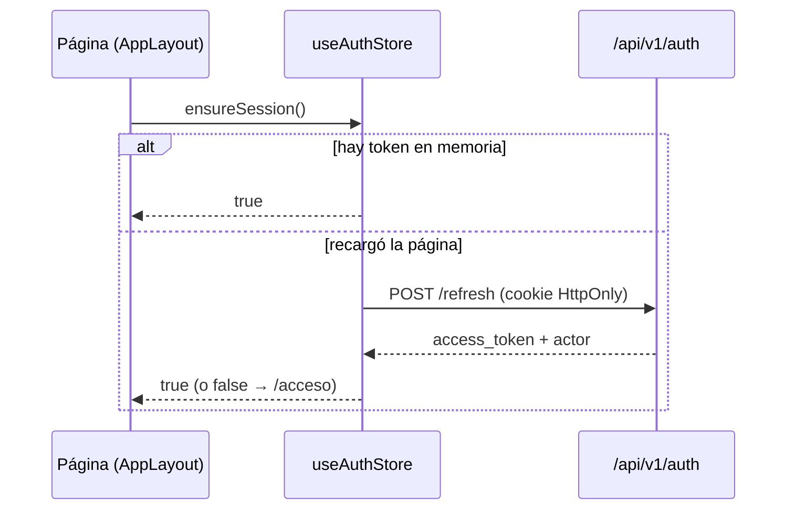

# 🔐 M0 · Identidad y acceso · Frontend

> [← Frontend](../README.md) · Contrato: [Sesión con JWT](../../../../documentacion/arquitectura/03-frontend-vue.md#sesión-con-jwt) · [Endpoints de M0](../../backend/M0-identidad/README.md#6-endpoints)

| Estado      | Fase  | Responsable |
| ----------- | :---: | ----------- |
| 🟨 En curso | **1** | Frontend    |

Este documento cuenta **cómo quedó hecho**. **Qué** hay que construir está en la guía del frontend y en los endpoints de M0.

## Avance

**Principal:** `modules/Identidad/Login.vue`, servido en **`/acceso`** (`app/Modules/Identidad/web.php`). Al abrir la app, `/` lleva aquí.

**Store y cliente**

- [x] `stores/useAuthStore.ts`: _access token_ en memoria, `actor`, `login()`, `refresh()`, `ensureSession()`, `logout()`, `can()`
- [x] `lib/api.ts`: el único cliente HTTP. Bearer, devuelve `data`, `ApiError` y un reintento con `/auth/refresh` ante `AUTH_TOKEN_EXPIRED`
- [x] Restaurar la sesión al recargar: `AppLayout` llama a `ensureSession()` (usa la _cookie_ del _refresh_)
- [x] Guarda de navegación: toda página con `AppLayout` exige sesión; sin sesión → `/acceso`
- [ ] Sin permiso → ocultar o redirigir (con `can()`, cuando existan las pantallas de los módulos)

**Componentes**

- [x] Formulario de login (correo, contraseña, errores de campo y `AUTH_INVALID_CREDENTIALS` / `TOO_MANY_REQUESTS`)
- [x] Menú de usuario (`NavUser`, `UserMenuContent`, `UserInfo`): nombre, rol y cerrar sesión
- [ ] `RoleBadge` (admin · médico de vuelo · astronauta)

## Cómo funciona



## Decisiones técnicas

- **Se quitó Fortify** (2026-11-14): el acceso es solo por la API con JWT. Ya no existen `/login`, `/register`, `/settings`, el doble factor ni las _passkeys_. Una migración nueva borra la tabla `passkeys` y las columnas `two_factor_*`.
- **Las páginas son "cáscaras":** el servidor ya no comparte `auth.user` con Inertia. Quién es el usuario lo sabe el _store_ por la API.
- **Un módulo, una carpeta:** el principal `Login.vue` solo compone; las piezas están en `Components/` y la lógica de movimiento en `Composables/`. Ningún archivo pasa de 300 líneas.
- **El `Origin` importa:** `/auth/refresh` solo acepta el `Origin` de `APP_URL`. Abra la app en `http://localhost:8000` (no en `127.0.0.1:8000`), o la sesión no se recupera al recargar.

## Cómo probarlo

```powershell
php artisan migrate --seed
composer run dev
# http://localhost:8000/acceso  →  astro1@astrohealth.test / password
```

> 📝 **Documentar siempre:** este documento se actualiza en el mismo _pull request_ que cambia el código.
