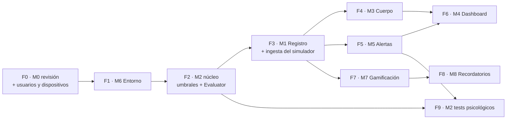

# Plan de trabajo · Backend de AstroHealth

> [← Documentación](README.md) · [Plan general](PLAN_ASTROHEALTH.md) · [Norma de arquitectura](arquitectura/ARCHITECTURE.md) · [Base de datos](arquitectura/02-base-de-datos.md)

**Objetivo:** que cada pantalla deje de usar datos de prueba (`*Mock*.ts`, `resources/js/mocks/`) y lea y escriba en Laravel + MySQL, cumpliendo la [norma](arquitectura/ARCHITECTURE.md) al pie de la letra.

**Rama:** `development`. **Un commit por paso pequeño** (una tabla, un caso de uso, un endpoint con su prueba).

---

## 0. Dónde estamos (15 nov 2026)

| Módulo | Frontend | Backend | Tablas | Datos de prueba que hay que retirar |
|---|:---:|---|---|---|
| M0 Identidad | ✅ | ✅ login, refresh, logout, `me`, token de dispositivo · ❌ gestión de usuarios y dispositivos | ✅ `users`, `devices`, `refresh_tokens` | `Identidad/Utils/adminMockData.ts` |
| M6 Entorno | ✅ | 🟡 modelos, repositorios y contratos · ❌ endpoints · ❌ pruebas | 🟡 `missions` (le faltan `objective` y `status`), `astronauts` | `Entorno/Utils/missionsMockData.ts`, `environments.ts`, `environmentFacts.ts` |
| M1 Registro | ✅ | ❌ | ❌ | `Registro/Utils/indicatorsMockData.ts`, `recordMock.ts` |
| M2 Evaluación | ✅ | ❌ | ❌ | `mocks/thresholds.ts`, `Evaluacion/Utils/psychMockData.ts`, `psychScoring.ts` |
| M3 Cuerpo | ✅ | ❌ | ❌ | `Cuerpo/Utils/bodyMockData.ts`, `notesMock.ts`, `mocks/crewProfiles.ts` |
| M4 Dashboard | ✅ | ❌ | (no tiene tablas) | `mocks/crewHistory.ts`, `mocks/crewHealth.ts` |
| M5 Alertas | ✅ | ❌ | ❌ | `Alertas/Utils/alertsMock*.ts`, `recommendationsMockData.ts`, `adviceMock.ts` |
| M7 Gamificación | ✅ | ❌ | ❌ | `Gamificacion/Utils/gamificationMock.ts`, `rules.ts` |
| M8 Recordatorios | ✅ | ❌ | ❌ | `Recordatorios/Utils/remindersMock.ts` |
| Simulador | ✅ API propia `:8001` | ❌ no envía lotes a Laravel | — | — |

**Lo que sí está bien:** M0 cumple la norma completa (capas, un repositorio por operación, entidades `readonly`, excepciones de negocio, 15 archivos de pruebas). `app/Shared` ya tiene `ApiResponse`, `BusinessError`, `Transaction` y el `ModuleServiceProvider`. No hay `DB::` fuera de `Infrastructure`, ni comprobaciones de rol fuera de M0. En el frontend ningún archivo pasa de 300 líneas y ningún módulo importa otro.

**Lo que hoy rompe la norma (y este plan arregla):** el frontend calcula semáforo, puntaje, puntos de tests psicológicos, insignias y puntos de gamificación (**P4**), y tiene umbrales escritos en el código (**P7**). Mientras sea una demo con datos de prueba se acepta; cada fase lo mueve al backend.

---

## 1. Receta: cómo se hace cada módulo

Cada fase sigue estos pasos, en este orden. Un módulo está **terminado** cuando cumple todos.

1. **Migraciones** en `app/Modules/<Modulo>/Database/Migrations/` (nunca editar una ya subida: **P11**).
2. **Seeder** con los datos de la demo (los mismos de los *mocks*, para que la pantalla se vea igual) y registrarlo en `DatabaseSeeder` en orden.
3. **Domain:** enums, entidades `readonly`, reglas puras y excepciones de negocio. **Pruebas unitarias** de cada regla.
4. **Infrastructure:** modelo Eloquent con `$fillable`, `Mapper`, un repositorio por operación (`Find`/`Insert`/`Update`/`Delete`/`Upsert`).
5. **Application:** un caso de uso por acción (`execute()`), DTOs de entrada y salida, `Transaction::run()` si escribe varias filas, eventos después del *commit*.
6. **Http:** un controlador `__invoke` por acción, `FormRequest`, `Resource`, ruta en `routes.php` con `auth:api` + `can:<permiso>`.
7. **Provider** registrado en `bootstrap/providers.php`, con los *bindings* de sus contratos.
8. **Pruebas *feature*:** una por criterio *Dado / Cuando / Entonces* de la ficha, más 401 (sin token), 403 (sin permiso) y 422 (datos inválidos).
9. **Frontend:** en el *store*, cambiar la función de prueba por `api()` de `@/lib/api`; **borrar** el archivo `*Mock*` y lo que el backend ya calcula. Los componentes no se tocan.
10. **Documentación:** `astrohealth/docs/backend/Mx-…/README.md` y `docs/database/Mx-…/README.md` al día.
11. **Verificar:** `php artisan test`, `vp check`, `vue-tsc --noEmit`, `npm run build` y la pantalla probada en el navegador con los 3 roles.

---

## 2. Orden de las fases

**Por qué M6 y M2 van antes que M1:** toda medición pertenece a un astronauta (M6) y se guarda **con su color**, que calcula M2 (contrato `Evaluator`). Sin ellos, M1 no puede cumplir su "listo cuando".

---

## F0 · M0 Identidad: revisión y lo que falta · ✅ hecho (16 nov 2026)

**Revisar (ya existe):**
- [x] `config/permissions.php` tiene todos los permisos que usan las pantallas (`users.manage`, `devices.manage`, `missions.manage`, `mission.update`, `crew.read`, `alerts.read`, `alerts.send`, `alerts.acknowledge`, `advice.send`, `clinical_notes.manage`, `guide.manage`, `gamification.read`, `measurements.ingest`, `measurements.write.own/crew`, `reminders.manage.own`, más el Gate `health.read`) y `AuthorizationMatrixTest` prueba cada uno con cada rol.
- [x] El Gate `health.read` decide "lo suyo": el astronauta, solo sus datos; el médico, los tripulantes de **su** misión; el admin, todas (cerrado en F1).
- [x] `TokenFactory` incluye `astronaut_id` y `mission_id` en el token; desde F0 también el del médico de vuelo.
- [x] Los seeders crean los mismos usuarios que usan los *mocks* (Elena, Kenji, Amara, Lucas, la Dra. Sofía Ramírez, el admin); la Dra. Sofía sigue Ares-1.

**Hecho en F0:** las 7 rutas de abajo, la columna `users.mission_id`, el comando `identidad:user-password <correo>` (el admin crea a la persona sin contraseña conocida), errores de negocio con su campo, `CreateDevice` con errores de negocio en vez de `InvalidArgumentException`, 20 pruebas nuevas y la pantalla de Usuarios sin `mockUsers`/`mockDevices`.
**Queda con datos de prueba en esa pantalla:** solo el contador de alertas (F5). Desde F1, la misión del encabezado es real y crear un usuario de la nave funciona.

**Construir:**

| Endpoint | Permiso | Caso de uso |
|---|---|---|
| `GET /api/v1/users` | `users.manage` | `ListUsers` |
| `POST /api/v1/users` | `users.manage` | `CreateUser` (rol válido con `RoleAssignment`; si es astronauta, enlaza `astronaut_id` por el contrato `CrewQuery`) |
| `PATCH /api/v1/users/{id}` | `users.manage` | `UpdateUser` |
| `PATCH /api/v1/users/{id}/active` | `users.manage` | `SetUserActive` (desactivar revoca sus *refresh tokens*) |
| `GET /api/v1/devices` · `POST` · `PATCH /{id}/active` | `devices.manage` | `ListDevices`, `CreateDevice` (ya existe), `SetDeviceActive` |

**Listo cuando:** la pantalla de Usuarios del admin funciona sin `adminMockData.ts`, y un usuario desactivado ya no puede refrescar su sesión.

---

## F1 · M6 Entorno · ✅ hecho (16 nov 2026)

**Tablas:** migración nueva que agrega a `missions` → `objective` `string(255)` y nombre único. El **estado no se guarda**: lo calcula la regla `MissionCalendar` con las fechas (una columna quedaría vieja al pasar los días). Los datos de cada entorno (gravedad, radiación diaria, retraso, riesgos) van en `config/environments.php` (**D14**), no en tablas.

| Endpoint | Permiso | Caso de uso |
|---|---|---|
| `GET /api/v1/environments` | autenticado | `ListEnvironments` (lee `config/environments.php`) |
| `GET /api/v1/missions` | `crew.read` | `ListMissions` (estado, día, fin y **tripulación dentro**; admin: todas; los demás: la suya) |
| `GET /api/v1/missions/current` | autenticado | `GetCurrentMission` (la suya; admin: la primera en curso) |
| `POST /api/v1/missions` | `missions.manage` | `CreateMission` |
| `PATCH /api/v1/missions/{id}/environment` | `mission.update` + Gate `mission.access` | `ChangeEnvironment` → evento `MissionEnvironmentChanged` |
| `POST /api/v1/astronauts` · `PATCH /{id}` | `missions.manage` | `AddCrewMember`, `UpdateCrewMember` |

**Cambios frente a lo planeado:** no se hizo `GET /astronauts?mission=` (la tripulación viene en cada misión) ni `PATCH /missions/{id}` (la pantalla no edita misiones; se agrega cuando haga falta).
**Domain:** `MissionCalendar` (estado, día y fin, en UTC), enums `Environment` y `MissionStatus`.
**Contratos:** `MissionQuery` (`exists`, `names`, `environmentOf`), `CrewQuery` (`exists`, `missionOf`, `all`).
**Permisos:** el Gate `health.read` quedó acotado a la misión del médico, y hay un Gate nuevo `mission.access`. M6 los consulta por nombre para no crear un círculo con M0.
**Frontend:** `missionsMockData.ts` borrado. `useMissionsStore`, `useMissionStore` y la misión del admin usan la API. Los números de los entornos llegan de `GET /environments` (`useEnvironmentsStore`). Crear un usuario de la nave ya funciona de punta a punta.
**Pruebas:** 28 nuevas (162 en verde).
**Listo cuando:** ✅ Mi misión, Misiones (admin) y el selector de misión del médico funcionan sin `missionsMockData.ts`, y cambiar el entorno se guarda en la base de datos.

---

## F2 · M2 Evaluación (núcleo): umbrales y semáforo · ✅ hecho (16 nov 2026)

**Cambio frente a lo planeado:** la versión 2 del simulador **quitó `/evaluate`, `/assess` y `/trends`** de Python (`simulador/docs/SIMULADOR.md`). Por eso no hay cliente de Python ni respaldo: el motor vive completo en Laravel (`Infrastructure/Motor/RuleEvaluator`), con una sola regla para el color. La norma (D7, P5) quedó actualizada.

**Tablas:** `thresholds` (por `indicator_code` + `environment`, único) y `assessments` (con `body_status` en JSON; una fila por evaluación).

| Endpoint | Permiso | Caso de uso |
|---|---|---|
| `GET /api/v1/thresholds?environment=` | autenticado | `ListThresholds` |
| `PUT /api/v1/thresholds/{indicator}?environment=` | `guide.manage` | `UpdateThreshold` (verde dentro del amarillo; publica `ThresholdUpdated`) |
| `GET /api/v1/astronauts/{id}/assessment` | Gate `health.read` | `GetLatestAssessment` (404 `EVALUATION_NO_DATA` hasta que M1 registre datos) |

**Domain:** `StatusRule`, `ScoreRule` (verde 100, amarillo 60, rojo 20; corazón, SpO₂ y radiación ×1,5), `OverallStatus` (desde 80 verde, desde 50 amarillo), `BodyStatusRule` (el peor de cada zona), `TrendRule` (pendiente + aviso si se aleja del centro del verde 3 veces seguidas), `RadiationThreshold` (verde hasta la dosis del entorno, amarillo hasta el doble). Los números están en `config/evaluation.php`.
**Contratos:** `Evaluator` (`evaluate`, `thresholdFor`, `assess` → calcula y guarda) y `TrendAnalyzer` (`trend`). Hablan en texto (`"green"`…), así M1 y M4 no dependen del `Domain` de M2.
**Seeder:** `ThresholdSeeder`, 10 indicadores × 4 entornos; solo crea lo que falta (no pisa lo que cambian los médicos).
**Frontend:** la Guía de salud lee y guarda en la API. `mocks/thresholds.ts` ya no guarda en el navegador: usa los umbrales que llegan del backend para colorear los datos de prueba que quedan (hasta F3).
**Arreglado:** el sueño de Kenji (5,8 h) ahora es Crítico en todas partes. Los puntajes de prueba se alinearon con `ScoreRule`: Kenji 90, Amara 87 (normal, con 3 zonas en precaución) y Lucas 100.
**Pruebas:** 43 nuevas (205 en verde).
**Listo cuando:** ✅ la Guía de salud lee y edita umbrales en la base de datos, y `Evaluator` da el color de cada valor con una sola regla.

---|---|---|
| `GET /api/v1/thresholds?environment=` | autenticado | `ListThresholds` |
| `PUT /api/v1/thresholds/{indicator}?environment=` | `guide.manage` | `UpdateThreshold` (valida verde ⊂ amarillo) |
| `GET /api/v1/astronauts/{id}/assessment` | `health.read` | `GetLatestAssessment` |

**Domain:** `StatusRule::classify($value, $threshold)`, `ScoreRule::weighted($statuses)` (verde 100, amarillo 60, rojo 20; corazón, SpO₂ y radiación ×1,5), `TrendRule` (3 mediciones seguidas empeorando → amarillo). Todo con pruebas unitarias, incluidos los bordes (exactamente 140, exactamente 6 h de sueño).
**Contratos que ofrece:** `Evaluator` (`evaluate(code, value, environment): Status`, `assess(...)`) y `TrendAnalyzer`.
**Infrastructure:** `Clients/PythonEvaluator` (POST `/evaluate`, `/assess`, `/trends` del simulador en `:8001`) **con respaldo local** usando `thresholds` si Python no responde (**D7**). Probado con `Http::fake()`, incluido el caso en que Python se cae.
**Seeder:** `ThresholdSeeder` con los umbrales del plan §2 para los 4 entornos (los mismos de `mocks/thresholds.ts`).
**Arregla:** el sueño de Kenji (5,8 h) que hoy sale Crítico en la gráfica y Precaución en la ficha: habrá una sola regla.
**Listo cuando:** la Guía de salud lee y edita umbrales en la base de datos, y `Evaluator` devuelve el mismo color con Python encendido o apagado.

---

## F3 · M1 Registro + ingesta del simulador · ✅ hecho en Laravel (16 nov 2026)

**Tablas:** `indicators` (10, con los textos de ayuda que tenía el frontend), `measurements` (con `source`, `reading_id` único, índice `(astronaut_id, indicator_id, measured_at)`), `ingest_batches`.

| Endpoint | Permiso | Caso de uso |
|---|---|---|
| `GET /api/v1/indicators` | autenticado | `ListIndicators` |
| `POST /api/v1/measurements` | `measurements.write.own` (el astronauta sale del token) | `RecordMeasurements` |
| `POST /api/v1/ingest/readings` | `measurements.ingest` (dispositivo) · `throttle:api-ingest` | `IngestReadings` (201 nuevo · 200 repetido con el mismo resumen) |
| `GET /api/v1/astronauts/{id}/measurements?indicator=&range=24h, 7d o 30d` | Gate `health.read` | `ListMeasurements` |

**Flujo:** valida (`ReadingValidator`) → M2 pone el color con el entorno de la misión → guarda en una transacción → M2 recalcula el puntaje → `MeasurementsRecorded` después del commit.
**Volver a colorear:** `ReevaluateLatest` escucha `MissionEnvironmentChanged` (M6) y `ThresholdUpdated` (M2) y cambia el color de la última medición de cada indicador.
**Contratos:** `IndicatorCatalog`, `MeasurementQuery` (`latestPerIndicator`, `series`).
**Frontend:** Registrar datos usa la API; `indicatorsMockData.ts` y `recordMock.ts` borrados. Lo guardado se copia a los datos de prueba del cuerpo y del Panel hasta F4/F6.
**Pruebas:** 17 nuevas (222 en verde).
**Pendiente:** el **exportador del simulador** (lado Python) que envíe los lotes con el token del dispositivo, y el comando `registro:import-file` (plan B sin red). La API ya está probada con el dispositivo real `sim-ares-1`.
**Listo cuando:** ✅ registrar datos guarda cada valor con su color; reenviar el mismo lote no duplica nada. ⏳ Falta que el simulador cargue los 30 días de Ares-1.

---|---|---|
| `GET /api/v1/indicators` | autenticado | `ListIndicators` |
| `POST /api/v1/measurements` | `measurements.write.own` (lo suyo) · `measurements.write.crew` (médico de la tripulación) | `RecordMeasurements` |
| `POST /api/v1/ingest/readings` | `measurements.ingest` (dispositivo) | `IngestReadings` (idempotente por `batch_id`; repetido → devuelve el resumen original) |
| `GET /api/v1/astronauts/{id}/measurements?indicator=&range=` | `health.read` | `ListMeasurements` |
| Comando `registro:import-file <json>` | consola | Plan B sin red (**D8**) |

**Flujo:** `RecordMeasurements` → `Evaluator` (M2) pone el `status` → `InsertMeasurementRepository::insertMany()` dentro de `Transaction::run()` → evento `MeasurementsRecorded` **después del commit** (**D11**).
**Contratos que ofrece:** `IndicatorCatalog`, `MeasurementQuery` (último valor por indicador, serie por rango, mediciones del día).
**Validación:** `StoreMeasurementsRequest` con los rangos físicamente posibles de `indicators.min_possible/max_possible`.
**Simulador (Python, tu parte):** cliente que pide el JWT de dispositivo (`/auth/device-token`) y envía los 30 días por lotes a `/ingest/readings`, con `reading_id` y `batch_id` estables para poder reenviar sin duplicar.
**Listo cuando:** registrar datos guarda cada valor con su color; el simulador carga los 30 días de Ares-1 y reenviar el mismo lote no duplica nada.

---

## F4 · M3 Cuerpo + notas clínicas · ✅ hecho (16 nov 2026)

**Tablas:** `body_parts` (9 zonas) y `clinical_notes` (no se editan ni se borran; guardan el nombre del autor y de quien resuelve).

| Endpoint | Permiso | Caso de uso |
|---|---|---|
| `GET /api/v1/body-parts` | autenticado | `ListBodyParts` (indicadores de cada zona desde el catálogo de M1) |
| `GET /api/v1/astronauts/{id}/body-status` | Gate `health.read` | `GetBodyStatus` (último valor por indicador; el estado de la zona lo decide M2 con `Evaluator::bodyStatus`) |
| `GET` · `POST /api/v1/astronauts/{id}/clinical-notes` | `clinical_notes.manage` + Gate `health.read` | `ListClinicalNotes`, `AddClinicalNote` |
| `PATCH /api/v1/clinical-notes/{id}/resolve` | `clinical_notes.manage` (misión revisada en el caso de uso) | `ResolveClinicalNote` (409 si no está pendiente) |

**Pruebas clave:** un astronauta y el admin **nunca** ven las notas; un médico de otra misión tampoco.
**Datos de demo** (solo fuera de producción): `DemoReadingsSeeder` guarda los últimos valores de Ares-1 pasando por M2 y `DemoClinicalNotesSeeder` las 4 notas. Los puntajes del backend coinciden con la demo (74, 90, 87, 100).
**Frontend:** el cuerpo (`useBodyStore`), el puntaje (`useAssessmentStore`) y las notas (`useNotesStore`) usan la API; `bodyMockData.ts` y `notesMock.ts` borrados.
**Pruebas:** 8 nuevas (230 en verde).
**Listo cuando:** ✅ Inicio y la ficha del tripulante pintan el cuerpo con datos reales, y las notas se guardan y se resuelven.

---|---|
| `astronaut_id` | `foreignId → astronauts` |
| `author_id` | `foreignId → users` |
| `kind` | `enum(evolution, impression, plan, follow_up)` |
| `text` | `text` (máx. 1000) |
| `follow_up` | `boolean` |
| `resolved_at` · `resolved_by` | *nullable* |
| `created_at` | sin `updated_at`: las notas no se editan ni se borran |

| Endpoint | Permiso | Caso de uso |
|---|---|---|
| `GET /api/v1/body-parts` | autenticado | `ListBodyParts` |
| `GET /api/v1/astronauts/{id}/body-status` | `health.read` | `GetBodyStatus` (último valor por zona, vía `MeasurementQuery` + `Evaluator`) |
| `GET` · `POST /api/v1/astronauts/{id}/clinical-notes` | `clinical_notes.manage` | `ListClinicalNotes`, `AddClinicalNote` |
| `PATCH /api/v1/clinical-notes/{id}/resolve` | `clinical_notes.manage` | `ResolveClinicalNote` (una nota ya resuelta → error de negocio) |

**Pruebas clave:** un astronauta **nunca** ve las notas clínicas (403), ni las propias.
**Listo cuando:** Inicio y la ficha del tripulante pintan el cuerpo con datos reales, y las notas se guardan y se resuelven.

---

## F5 · M5 Alertas, recomendaciones e indicaciones · ✅ hecho (16 nov 2026)

**Tablas:** `recommendations` (20), `alerts` (vital, SOS, ayuda, novedad; con retraso y respuesta) y `advice` (indicaciones del médico).

| Endpoint | Permiso | Caso de uso |
|---|---|---|
| `GET /api/v1/alerts?astronaut=&mission=` | `alerts.read` (+ Gate `health.read` por tripulante) | `ListAlerts` |
| `POST /api/v1/alerts` | `alerts.send` | `SendMessageToGround` (SOS, ayuda, novedad; el tripulante sale de la sesión) |
| `PATCH /api/v1/alerts/{id}/acknowledge` | `alerts.acknowledge` (+ su misión) | `AcknowledgeAlert` (con respuesta; una sola vez) |
| `GET /api/v1/recommendations` · `PUT /{indicator}/{status}` | autenticado · `guide.manage` | `ListRecommendations`, `SaveRecommendation` |
| `GET` · `POST /api/v1/advice` · `PATCH /api/v1/advice/{id}/read` | `crew.read` · `advice.send` · el destinatario | `ListAdvice`, `SendAdvice`, `MarkAdviceRead` |

**Alertas vitales:** `OnMeasurementsRecorded` crea una por cada valor amarillo o rojo de las últimas 24 h (`config/alerts.php`), una por medición.
**Retraso:** del entorno de la misión (`config/environments.php`), guardado en cada alerta e indicación. La velocidad ×60 de la demo es solo de pantalla.
**Frontend:** alertas, indicaciones, recomendaciones y el contador del admin usan la API; borrados `alertsMockData`, `alertsMockDb`, `adviceMock`, `recommendationsMockData` y `adminMockData`.
**Datos de demo** (solo fuera de producción): `DemoAlertsSeeder` (7 alertas de Ares-1, 4 atendidas, y 3 indicaciones).
**Pruebas:** 9 nuevas (239 en verde).
**Listo cuando:** ✅ un valor rojo crea la alerta sola, el SOS llega al médico con el retraso de Marte, y el médico responde y envía indicaciones que el astronauta marca como leídas.

---|---|---|
| `GET /api/v1/alerts?since=` | `alerts.read` | `ListAlerts` (el astronauta, las suyas; el médico, las de su misión) |
| `POST /api/v1/alerts` | `alerts.send` | `SendMessageToGround` (SOS, ayuda, novedad) |
| `PATCH /api/v1/alerts/{id}/acknowledge` | `alerts.acknowledge` | `AcknowledgeAlert` (con `reply` opcional) |
| `GET /api/v1/recommendations?indicator=&status=` | autenticado | `ListRecommendations` |
| `GET` · `POST /api/v1/advice` · `PATCH /api/v1/advice/{id}/read` | `advice.send` / el destinatario | `ListAdvice`, `SendAdvice`, `MarkAdviceRead` |

**Domain:** `GroundDelayRule` (`ground_eta_at = sent_at + retraso del entorno`, leído por `MissionQuery`), `AlertLevelRule`.
**Listeners:** `OnMeasurementsRecorded` (valor rojo → alerta automática; una por medición) y `OnPsychCriticalAnswered` (de F9).
**Tiempo real:** primero *polling* con `?since=` (lo que ya hace `useLiveAlerts`); Reverb/WebSockets solo si sobra tiempo.
**Listo cuando:** un valor rojo crea la alerta sola, el SOS llega al médico con el retraso de Marte, y el médico responde y envía indicaciones que el astronauta marca como leídas.

---

## F6 · M4 Dashboard (sin tablas)

Solo lee por contratos (`MeasurementQuery`, `Evaluator`, `TrendAnalyzer`, `CrewQuery`, `AlertQuery`).

| Endpoint | Permiso | Caso de uso |
|---|---|---|
| `GET /api/v1/astronauts/{id}/trends` | `health.read` | `GetTrends` (Python `/trends` con respaldo `TrendRule`) |
| `GET /api/v1/missions/{id}/crew-measurements?indicator=&range=` | `crew.read` | `GetCrewSeries` |
| `GET /api/v1/missions/{id}/health-summary` | `crew.read` | `GetHealthSummary` (sin atender, urgentes, en precaución, mediciones de hoy, quién necesita atención) |
| `GET /api/v1/missions/{id}/changes?hours=72` | `crew.read` | `GetRecentChanges` |

**Listo cuando:** Panel de salud y Mi evolución funcionan sin `mocks/crewHistory.ts` ni `crewHealth.ts`.

---

## F7 · M7 Gamificación

**Tablas:** `achievements` (las 9 insignias), `astronaut_achievements`, `points_log` (llave única `(astronaut_id, reason, reference)` para no sumar dos veces).

**Domain:** `PointsRule` (valores por `config/gamification.php`, no en el código: **P7**), `StreakRule::days($dates)`, `LevelRule`, una regla por insignia (`iron_body`, `swiss_clock`, `mission_30`…), todas con pruebas unitarias.
**Listeners:** `OnMeasurementsRecorded` (día completo, sueño ≥ 7 h, ejercicio), `OnReminderCompleted`, `OnPsychTestTaken`.

| Endpoint | Permiso | Caso de uso |
|---|---|---|
| `GET /api/v1/astronauts/{id}/gamification` | `gamification.read` | `GetGamificationProfile` |
| `GET /api/v1/leaderboard?mission=` | `gamification.read` | `GetLeaderboard` |

**Listo cuando:** los puntos y las insignias los da el backend; borrar `rules.ts` y `gamificationMock.ts` no cambia lo que se ve.

---

## F8 · M8 Recordatorios

**Tabla:** `reminders` con `type` (incluye `custom`), `title`, `time`, `active`, `last_done_at`.

| Endpoint | Permiso | Caso de uso |
|---|---|---|
| `GET` · `POST` · `PATCH` · `DELETE /api/v1/reminders` | el dueño | `ListReminders`, `CreateReminder`, `UpdateReminder`, `DeleteReminder` |
| `POST /api/v1/reminders/{id}/done` | el dueño | `CompleteReminder` → evento `ReminderCompleted` (hecho hoy dos veces → no suma otra vez) |
| Comando `recordatorios:pending` en el `schedule` | consola | Marca los pendientes de la hora |

**Seeder:** los 5 recordatorios por defecto para cada astronauta.
**Listo cuando:** completar un recordatorio suma +5 puntos una sola vez al día.

---

## F9 · M2 Tests psicológicos (PHQ-9, GAD-7, PSS-4, PVT)

**Tablas nuevas:** `psych_tests` (`code`, `name`, `kind`, `description`, `instructions`, `frequency_days`, `unit`, `scale` JSON, `questions` JSON, `bands` JSON, `source`) y `psych_results` (`test_id`, `astronaut_id`, `taken_at`, `score`, `status`, `band`, `detail`, `flagged`, `answers` JSON).

| Endpoint | Permiso | Caso de uso |
|---|---|---|
| `GET /api/v1/psych-tests` | autenticado | `ListPsychTests` |
| `POST` · `PUT /api/v1/psych-tests/{id}` | `guide.manage` | `CreatePsychTest`, `UpdatePsychTest` |
| `POST /api/v1/psych-results` | rol astronauta | `SubmitPsychTest` (el **backend** puntúa) |
| `GET /api/v1/psych-results?mission=` | `crew.read` / lo suyo | `ListPsychResults` |

**Domain:** `PsychScoringRule` (ítems invertidos, bandas), `PvtScoringRule` (mediana, lapsos > 500 ms, salidas en falso) con pruebas usando los mismos casos de `psychScoring.ts`.
**Seguridad clínica:** el ítem crítico del PHQ-9 publica `PsychCriticalAnswered` → M5 crea una alerta **urgente** a Tierra. Prueba obligatoria. Las respuestas individuales solo las ve el equipo médico.
**Listo cuando:** se borra `psychScoring.ts` del frontend y los resultados son los mismos.

---

## 3. Al final: limpieza y entrega

- [ ] `grep -ri mock resources/js` no devuelve nada fuera de las pruebas.
- [ ] `php artisan migrate:fresh --seed` + el simulador enviando lotes deja la demo de Ares-1 completa.
- [ ] El guion de 2 minutos ([plan §7](PLAN_ASTROHEALTH.md#7-guion-de-la-demo-2-minutos)) se hace de punta a punta con datos reales.
- [ ] Python apagado → la app sigue funcionando con el respaldo local.
- [ ] `PagesTest` y las pruebas de cada módulo en verde.

## 4. Estimación

| Fase | Tamaño | Notas |
|---|:---:|---|
| F0 M0 | S | Patrón ya hecho; es repetirlo |
| F1 M6 | S | Tablas ya existen |
| F2 M2 núcleo | M | Cliente Python + respaldo |
| F3 M1 + ingesta | L | La pieza central; incluye el simulador |
| F4 M3 | S | |
| F5 M5 | L | La que más pantallas toca |
| F6 M4 | M | Consultas de series |
| F7 M7 | M | Muchas reglas, todas puras |
| F8 M8 | S | |
| F9 Tests psicológicos | M | Puntuación + alerta crítica |

**Si el tiempo aprieta:** F0 → F3 y F5 son el corazón de la demo (registrar → color → alerta a Tierra). M7, M8 y F9 pueden quedarse con datos de prueba en la presentación, diciéndolo.
