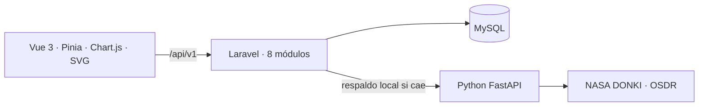

# 🚀 AstroHealth · Documentación

**NASA Space Apps Challenge 2026** · *Crear software de monitorización de la salud para astronautas en misiones espaciales.*

> Un astronauta en Marte está a 20 minutos-luz de su médico. AstroHealth le dice, en segundos, cómo está su cuerpo, qué viene empeorando y qué hacer, con datos calibrados con información real de la NASA.

## Por dónde empezar

| | Documento | Qué tiene |
|:---:|---|---|
| 1 | [**El plan**](PLAN_ASTROHEALTH.md) | Qué se construye: la arquitectura, la base de datos, los umbrales, los 8 módulos, las pantallas, el reparto, el orden y el guion de la demo |
| 2 | [**Los 8 módulos**](modulos/README.md) | Una ficha por módulo con todo para construirlo: datos, API, archivos por capa, componentes y criterios de aceptación |
| 3 | [**Guía técnica**](arquitectura/README.md) | Cómo se programa: [ARCHITECTURE.md](arquitectura/ARCHITECTURE.md) (norma obligatoria), la API, la base de datos, el frontend, Python, el entorno local y Git |
| 4 | [**Simulador**](../simulador/docs/SIMULADOR.md) | El servicio de Python: datos de la NASA (DONKI y OSDR), la misión simulada y el motor de evaluación |

## Los 8 módulos

| | Módulo | | Módulo |
|:---:|---|:---:|---|
| 🩺 | [M1 · Registro de indicadores](modulos/M1-registro/README.md) | 🚨 | [M5 · Recomendaciones y alertas a Tierra](modulos/M5-alertas/README.md) |
| 🚦 | [M2 · Motor de evaluación](modulos/M2-evaluacion/README.md) | 🌍 | [M6 · Entorno de misión](modulos/M6-entorno/README.md) |
| 🧍 | [M3 · Cuerpo humano interactivo ⭐](modulos/M3-cuerpo/README.md) | 🏆 | [M7 · Gamificación](modulos/M7-gamificacion/README.md) |
| 📈 | [M4 · Dashboard](modulos/M4-dashboard/README.md) | ⏰ | [M8 · Recordatorios](modulos/M8-recordatorios/README.md) |

## La arquitectura en un vistazo

## Colores del semáforo

🟢 `#22C55E` normal · 🟡 `#EAB308` precaución · 🔴 `#EF4444` crítico · ⚪ `#64748B` sin datos

---

> ⚠️ **Herramienta de apoyo para la demo. No reemplaza el criterio médico.** Los umbrales son referencias generales, configurables por los médicos de vuelo. Los datos de salud son simulados y van calibrados con datos reales de NASA OSDR (Inspiration4). El clima espacial es real (NASA DONKI).
