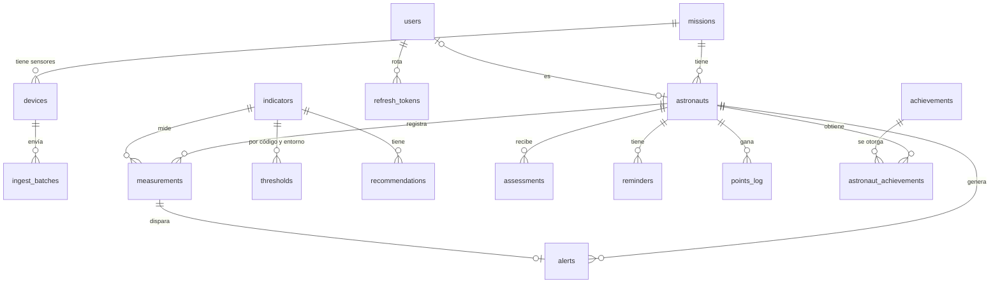

# 02 · Base de datos

> [← Guía técnica](README.md) · Anterior: [API y JSON](01-api-y-json.md) · Siguiente: [Frontend](03-frontend-vue.md)

MySQL, con migraciones **por módulo** en `app/Modules/<Modulo>/Database/Migrations/`. Son las 13 tablas del [plan](../PLAN_ASTROHEALTH.md#1-base-de-datos-mysql--hacer-primero) más las 3 del acceso y la ingesta (`devices`, `refresh_tokens`, `ingest_batches`), con sus columnas completas. **Es lo primero que se construye** (fase 1).

## 1. Dueño de cada tabla

Solo el módulo dueño crea la tabla y escribe en ella. Los demás módulos la consultan **por su contrato**.

| Tabla | Dueño | Contrato para los demás |
|---|---|---|
| `users` (+ `role`, `active`, `astronaut_id`), `devices`, `refresh_tokens` | M0 Identidad | `CurrentActor` |
| `missions`, `astronauts` | M6 Entorno | `MissionQuery`, `CrewQuery` |
| `indicators`, `measurements`, `ingest_batches` | M1 Registro | `IndicatorCatalog`, `MeasurementQuery` |
| `thresholds`, `assessments` | M2 Evaluación | `Evaluator`, `TrendAnalyzer` |
| `body_parts` | M3 Cuerpo | — |
| `recommendations`, `alerts` | M5 Alertas | `RecommendationQuery` |
| `achievements`, `astronaut_achievements`, `points_log` | M7 Gamificación | — |
| `reminders` | M8 Recordatorios | — |
| `sessions`, `cache`, `jobs` | *Starter kit* | — |

M4 Dashboard **no tiene tablas**: lee lo que necesita por contratos.

## 2. Diagrama



> Las relaciones entre tablas de **módulos distintos** (por ejemplo `measurements.astronaut_id`) llevan llave foránea en MySQL, pero en el código cada módulo solo usa el **id**. No se usan relaciones Eloquent entre módulos.

## 3. Tablas

Todas tienen `id` (`bigint` autoincremental) y `created_at` / `updated_at`, salvo que se diga otra cosa.

### M6 · `missions`
| Columna | Tipo | Notas |
|---|---|---|
| `name` | `string(80)` | `Ares-1` |
| `environment` | `enum(iss, transit, moon, mars)` | Define los umbrales y el retraso de comunicación |
| `start_date` | `date` | Día 1 de la misión |
| `day_count` | `unsignedSmallInteger` | Días planeados (30 en la demo) |

### M6 · `astronauts`
| Columna | Tipo | Notas |
|---|---|---|
| `mission_id` | `foreignId → missions` | |
| `name` | `string(80)` | |
| `role` | `string(60)` | Comandante, ingeniera de vuelo… |
| `avatar` | `string`, *nullable* | Ruta de la imagen |

### M1 · `indicators`
| Columna | Tipo | Notas |
|---|---|---|
| `code` | `string(20)`, único | `hr`, `bp_sys`, `bp_dia`, `glucose`, `temp`, `spo2`, `sleep`, `mood`, `radiation`, `exercise_min` |
| `name` | `string(60)` | "Frecuencia cardíaca" |
| `unit` | `string(10)` | `bpm`, `mmHg`, `mg/dL`, `°C`, `%`, `h`, `1-5`, `mSv`, `min` |
| `body_part` | `string(20)` | Código de la zona del cuerpo (M3) |
| `min_possible` · `max_possible` | `decimal(8,2)` | Rango físicamente posible para validar (FC 20–250, temp 30–45…) |
| `help_text` | `text` | "¿Cómo me mido?" y por qué importa en el espacio |
| `sort_order` | `unsignedTinyInteger` | Orden en el formulario |

### M1 · `measurements`
| Columna | Tipo | Notas |
|---|---|---|
| `astronaut_id` | `foreignId → astronauts` | |
| `indicator_id` | `foreignId → indicators` | |
| `value` | `decimal(8,2)` | |
| `status` | `enum(green, yellow, red)` | Lo calcula M2 al guardar |
| `source` | `string(30)` | `manual`, `simulated_reference`… ([valores](01-api-y-json.md#5-valores-de-source)) |
| `measured_at` | `timestamp` | |
| `reading_id` | `uuid`, *nullable*, único | Id de la lectura que envió el dispositivo: evita duplicados |
| `ingest_batch_id` | `foreignId → ingest_batches`, *nullable* | De qué lote llegó |
| **Índice** | `(astronaut_id, indicator_id, measured_at)` | Series del dashboard y el último valor |

### M1 · `ingest_batches`
| Columna | Tipo | Notas |
|---|---|---|
| `batch_id` | `uuid`, único | Lo genera el simulador; un lote repetido devuelve el resumen original |
| `device_id` | `foreignId → devices` | |
| `received` · `stored` · `duplicates` | `unsignedSmallInteger` | Resumen |
| `rejected` | `json` | `[{reading_id, error_code}]` |
| `created_at` | `timestamp` | |

### M0 · `users` (columnas que se agregan), `devices`, `refresh_tokens`
| Tabla | Columnas |
|---|---|
| `users` | + `role` `string(30)` (`admin`, `flight_surgeon`, `crew_medical_officer`, `astronaut`; `enum` `Role` en PHP) · + `active` `boolean` · + `astronaut_id` *nullable*, único → `astronauts` · + `mission_id` *nullable* → `missions` (solo el médico de vuelo) |
| `devices` | `mission_id` → `missions` · `astronaut_id` *nullable* (con `null` es un *gateway* de toda la misión) · `name` · `client_id` único · `secret_hash` · `active` · `last_seen_at` |
| `refresh_tokens` | `user_id` · `family_id` (uuid) · `token_hash` (sha256, único) · `expires_at` · `used_at` · `revoked_at` · `user_agent` · `ip` · `created_at` |

Detalle en [M0 · backend](../../astrohealth/docs/backend/M0-identidad/README.md#5-datos).

### M2 · `thresholds`
| Columna | Tipo | Notas |
|---|---|---|
| `indicator_code` | `string(20)` | `hr`, `bp_sys`… **Cambio frente al plan:** se usa el código y no el id, para que M2 no dependa de M1 (M1 ya llama a M2) |
| `environment` | `enum(iss, transit, moon, mars)` | Único con `indicator_code` |
| `green_min` · `green_max` | `decimal(8,2)` | Rango verde |
| `yellow_min` · `yellow_max` | `decimal(8,2)` | Banda **exterior** amarilla: lo que cae dentro y no es verde es amarillo; lo que cae fuera es rojo |

### M2 · `assessments`
| Columna | Tipo | Notas |
|---|---|---|
| `astronaut_id` | `foreignId → astronauts` | |
| `score` | `unsignedTinyInteger` | 0–100 |
| `body_status` | `json` | `{ "heart": "yellow", "brain": "green", … }`. **Se agrega al plan** para responder el estado por órgano |
| `summary` | `string(255)` | "Corazón en precaución; el resto, normal." |
| `created_at` | `timestamp` | Sin `updated_at`: cada evaluación es una fila nueva |

### M3 · `body_parts`
| Columna | Tipo | Notas |
|---|---|---|
| `code` | `string(20)`, único | `heart`, `brain`, `eyes`, `lungs`, `bones`, `ear`, `immune`, `metabolism`, `whole_body` |
| `name` | `string(60)` | "Corazón" |
| `function_text` | `text` | Qué hace el órgano |
| `space_risk_text` | `text` | Cómo lo afecta el espacio (NASA HRP) |
| `hrp_hazard` | `string(40)` | El peligro de la NASA con el que se relaciona |

### M5 · `recommendations`
| Columna | Tipo | Notas |
|---|---|---|
| `indicator_id` | `foreignId → indicators` | |
| `status` | `enum(yellow, red)` | Único con `indicator_id` |
| `title` | `string(80)` | "Presión alta" |
| `action_text` | `text` | Pasos, uno por línea: "Reposa 10 min · Hidrátate · Vuelve a medir" |
| `risk_ref` | `string`, *nullable* | Enlace al riesgo de la NASA HRP |

### M5 · `alerts`
| Columna | Tipo | Notas |
|---|---|---|
| `astronaut_id` | `foreignId → astronauts` | |
| `measurement_id` | `foreignId → measurements`, *nullable*, único | Una alerta por medición roja. `null` si es una alerta de tendencia |
| `level` | `enum(yellow, red)` | |
| `message` | `string(255)` | |
| `sent_to_ground` | `boolean`, por defecto `false` | |
| `sent_at` · `ground_eta_at` · `acknowledged_at` | `timestamp`, *nullable* | `ground_eta_at = sent_at + retraso del entorno` |

### M7 · `achievements`, `astronaut_achievements`, `points_log`
| Tabla | Columnas |
|---|---|
| `achievements` | `code` (único), `name`, `icon`, `condition`, `bonus` (puntos extra al ganarla), `target` (la meta de su barra de avance), `sort_order` |
| `astronaut_achievements` | `astronaut_id`, `achievement_id`, `earned_day` (día de misión), `earned_at`. Llave única `(astronaut_id, achievement_id)` |
| `points_log` | `astronaut_id`, `points`, `reason` (`daily_complete`, `streak_7`, `sleep_7h`, `exercise`, `reminder`, `psych_test`, `badge`), `reference` (evita sumar dos veces lo mismo: el día, el recordatorio, el test o la insignia), `day` (día de misión), `created_at`. Llave única `(astronaut_id, reason, reference)`; índice `(astronaut_id, day)` |

### M8 · `reminders`
| Columna | Tipo | Notas |
|---|---|---|
| `astronaut_id` | `foreignId → astronauts` | |
| `type` | `enum(measure_bp, exercise, log_sleep, mood_check, dosimeter, custom)` | |
| `title` | `string(80)` | "Hora de medir tu presión 🩺" |
| `time` | `time` | Hora del día |
| `last_done_at` | `timestamp`, *nullable* | Si es de hoy, el recordatorio está hecho |

## 4. Datos iniciales (*seeders*)

| *Seeder* | Módulo | Qué carga |
|---|---|---|
| `MissionSeeder` | M6 | La misión **Ares-1** (Marte, 30 días) y 4 astronautas |
| `UserSeeder` · `DeviceSeeder` | M0 | Admin, médico de vuelo y 4 astronautas (enlazados por `astronaut_id`) · el dispositivo del simulador |
| `IndicatorSeeder` | M1 | Los 10 indicadores, con unidad, rango posible y texto de ayuda |
| `ThresholdSeeder` | M2 | Los umbrales del [plan §2](../PLAN_ASTROHEALTH.md#2-umbrales-de-referencia-para-el-motor-de-evaluación) para los 4 entornos |
| `BodyPartSeeder` | M3 | Las 9 zonas, con su función y su riesgo espacial |
| `RecommendationSeeder` | M5 | Una recomendación por indicador, en amarillo y en rojo |
| `AchievementSeeder` · `DemoPointsSeeder` | M7 | Las 9 insignias · (solo fuera de producción) los puntos e insignias de Ares-1 hasta hoy |
| `ReminderSeeder` | M8 | Los 5 recordatorios por defecto para cada astronauta |
| **El simulador** (ingesta) | M1 | Los 30 días simulados llegan por `POST /api/v1/ingest/readings`. Plan B sin red: `registro:import-file <json>` |

```powershell
php artisan migrate:fresh --seed
# y el simulador enviando los lotes (ver M1 · backend)
```

> `DatabaseSeeder` llama a los *seeders* de los módulos **en el orden de la tabla**: cada uno necesita los ids del anterior.
