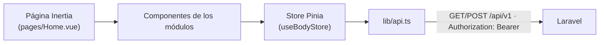

# 03 · Frontend (Vue 3)

> [← Guía técnica](README.md) · Anterior: [Base de datos](02-base-de-datos.md) · Siguiente: [Integración con Python](04-integracion-python.md)

**Vue 3 + TypeScript + Inertia + Pinia + Tailwind v4 + Chart.js + SVG.** Toda la parte visual: el cuerpo interactivo, el dashboard y las animaciones.

## 1. Cómo llegan los datos



1. **Inertia** entrega la página. Nada más: los datos y la sesión van por la API.
2. **Los *stores* de Pinia** piden los datos a `/api/v1` mediante `lib/api.ts` y los guardan.
3. **Los componentes** leen el *store* y presentan. **No calculan** colores, umbrales ni puntos: esos llegan ya calculados del backend.
4. **`lib/api.ts`** es el único cliente HTTP. Agrega `Authorization: Bearer <token>`, devuelve `data` y, si hay un error, lanza `ApiError` con `message`, `error_code` y `errors`.

### Sesión con JWT

| Paso | Qué hace el frontend |
|---|---|
| Login | Página `pages/Login.vue` → `POST /api/v1/auth/login`. Guarda el `access_token` y el `user` en `useAuthStore` (**en memoria**, nunca en `localStorage`). El *refresh token* llega en una *cookie* `HttpOnly` que JavaScript no ve |
| Cada petición | `lib/api.ts` agrega el `Bearer` |
| `401 AUTH_TOKEN_EXPIRED` | `lib/api.ts` llama **una vez** a `POST /auth/refresh` (con `credentials: 'include'`), guarda el token nuevo y repite la petición. Si el *refresh* falla → al login |
| Recargar la página | Al arrancar, la app llama a `/auth/refresh`: si la *cookie* sigue viva, la sesión vuelve sin pedir la contraseña |
| Qué mostrar | `GET /auth/me` trae `permissions`; `useAuthStore().can('alerts.acknowledge')` muestra u oculta botones. **Ocultar no es proteger:** el backend vuelve a comprobar |
| Logout | `POST /auth/logout` y se limpia el *store* |

Los roles son `admin`, `flight_surgeon` (médico en Tierra), `crew_medical_officer` (médico de la tripulación), `astronaut` y `device` ([matriz de permisos](../../astrohealth/docs/backend/README.md#3-roles-y-permisos)). Los dos médicos ven a toda la tripulación con el selector de astronauta; el astronauta, solo a sí mismo.

## 2. Carpetas

```
astrohealth/resources/js/
├── app.ts                    # Inertia + Pinia
├── pages/                    # Las 7 pantallas: componen los componentes de los módulos
│   ├── Home.vue              # Inicio: cuerpo (M3) + puntaje (M2) + alertas (M5) + recordatorios (M8)
│   ├── Record.vue            # Registrar (M1)
│   ├── Dashboard.vue         # Gráficas (M4)
│   ├── Mission.vue           # Selector de entorno (M6)
│   ├── Achievements.vue      # Logros (M7)
│   ├── Login.vue             # Inicio de sesión (M0)
│   └── Alerts.vue            # Centro de alertas (M5)
├── modules/<Modulo>/         # Lo de cada módulo
│   ├── Components/
│   ├── Stores/               # Store Pinia del módulo
│   ├── Composables/
│   ├── Types/                # Tipos de "data" de sus endpoints
│   └── Utils/
├── components/               # Globales: ui/ (shadcn-vue del kit), StatusBadge, AlertBanner, ToastNotification
├── layouts/                  # AppLayout con la barra de navegación y el selector de astronauta
├── composables/              # useCurrentAstronaut, useNotifications
├── stores/                   # useAuthStore (token en memoria, user, permissions)
├── lib/                      # api.ts, status.ts (colores), format.ts
└── types/                    # Tipos globales: Status, Environment, Astronaut
```

**Reglas:**

1. Las **páginas** viven en `pages/` y **solo componen**. Pueden usar componentes de cualquier módulo.
2. Un **módulo no importa nada de otro módulo**. Si dos módulos necesitan el mismo componente, se mueve a `components/` (por ejemplo, `StatusBadge`).
3. Cada responsabilidad visible es un componente. Una página no pasa de unas 150 líneas.
4. Los botones, campos, diálogos y *toasts* son los de `components/ui` (shadcn-vue del *kit*) y `vue-sonner`.

## 3. Colores del semáforo (siempre estos)

| Estado | Color | Uso |
|---|---|---|
| `green` · normal | `#22C55E` | |
| `yellow` · precaución | `#EAB308` | La zona del cuerpo **pulsa suavemente** |
| `red` · crítico | `#EF4444` | La zona pulsa, aparece el `AlertBanner` |
| sin datos | `#64748B` | Ojos y oído interno mientras no haya datos |

Se definen **una sola vez** como variables CSS en `resources/css/app.css` (`--status-green`…) y en `lib/status.ts`. Nadie escribe estos colores en un componente.

## 4. Librerías que se agregan

| Paquete | Para qué | Módulo |
|---|---|---|
| `pinia` | Estado compartido | Todos |
| `chart.js` + `vue-chartjs` | Gráficas con bandas de color | M4 |
| `gsap` | Animaciones del cuerpo, del valor que "vuela" y de la señal Tierra ↔ nave | M1, M3, M5 |
| `canvas-confetti` | Confeti al ganar una insignia | M7 |

```powershell
npm install pinia chart.js vue-chartjs gsap canvas-confetti
```

## 5. Animaciones: sí, pero con medida

- Duración de 150 a 400 ms en la interfaz. La señal Tierra ↔ nave y el confeti pueden durar más.
- Se respeta `prefers-reduced-motion`: sin pulsos ni confeti, solo el cambio de color.
- Se anima con `transform` y `opacity` (GPU), nunca con `width`, `top` ni `left`.

## 6. Responsivo

Escritorio, portátil y tableta. En el móvil, el cuerpo y el panel del órgano se apilan uno encima del otro. Nunca hay desplazamiento horizontal.

## 7. Notificaciones

- **Dentro de la app:** `ToastNotification` (con `vue-sonner`).
- **Del navegador:** la API `Notification`, solo si el usuario la acepta. Se pide permiso con un botón, nunca al cargar la página.
