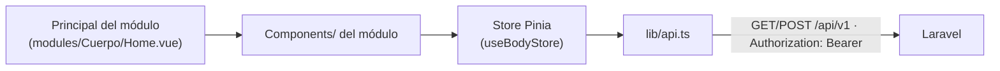

# 03 · Frontend (Vue 3)

> [← Guía técnica](README.md) · Anterior: [Base de datos](02-base-de-datos.md) · Siguiente: [Integración con Python](04-integracion-python.md)

**Vue 3 + TypeScript + Inertia + Pinia + Tailwind v4 + Chart.js + SVG.** Toda la parte visual: el cuerpo interactivo, el dashboard y las animaciones.

## 1. Cómo llegan los datos



1. **Inertia** entrega la pantalla (el principal del módulo). Nada más: los datos y la sesión van por la API.
2. **Los *stores* de Pinia** piden los datos a `/api/v1` mediante `lib/api.ts` y los guardan.
3. **Los componentes** leen el *store* y presentan. **No calculan** colores, umbrales ni puntos: esos llegan ya calculados del backend.
4. **`lib/api.ts`** es el único cliente HTTP. Agrega `Authorization: Bearer <token>`, devuelve `data` y, si hay un error, lanza `ApiError` con `message`, `error_code` y `errors`.

### Sesión con JWT

| Paso | Qué hace el frontend |
|---|---|
| Login | Principal `modules/Identidad/Login.vue` (`/acceso`) → `POST /api/v1/auth/login`. Guarda el `access_token` y el `actor` (quién es, su rol y sus permisos) en `useAuthStore` (**en memoria**, nunca en `localStorage`). El *refresh token* llega en una *cookie* `HttpOnly` que JavaScript no ve |
| Cada petición | `lib/api.ts` agrega el `Bearer` |
| `401 AUTH_TOKEN_EXPIRED` | `lib/api.ts` llama **una vez** a `POST /auth/refresh` (con `credentials: 'include'`), guarda el token nuevo y repite la petición. Si el *refresh* falla → al login |
| Recargar la página | Al arrancar, la app llama a `/auth/refresh`: si la *cookie* sigue viva, la sesión vuelve sin pedir la contraseña |
| Qué mostrar | `GET /auth/me` trae `permissions`; `useAuthStore().can('alerts.acknowledge')` muestra u oculta botones. **Ocultar no es proteger:** el backend vuelve a comprobar |
| Logout | `POST /auth/logout` y se limpia el *store* |

Los roles son `admin`, `flight_surgeon` (médico en Tierra), `crew_medical_officer` (médico de la tripulación), `astronaut` y `device` ([matriz de permisos](../../astrohealth/docs/backend/README.md#3-roles-y-permisos)). Los dos médicos ven a toda la tripulación con el selector de astronauta; el astronauta, solo a sí mismo.

## 2. Carpetas: un módulo, una carpeta

Cada módulo es **una carpeta** con su **principal** (la pantalla que sirve Inertia) y una carpeta **`Components/`** con las piezas. Así cada archivo tiene una sola responsabilidad y ninguno pasa de **300 líneas**.

```
astrohealth/resources/js/
├── app.ts                         # Inertia (páginas en modules/) + Pinia
├── modules/<Modulo>/              # ★ Lo de cada módulo
│   ├── <Principal>.vue            # La pantalla: solo compone (Inertia la sirve como "<Modulo>/<Principal>")
│   ├── Components/                # Las piezas de la pantalla, una responsabilidad cada una
│   ├── Composables/               # Lógica reutilizable del módulo (animaciones, formularios…)
│   ├── Stores/                    # Store Pinia del módulo
│   ├── Types/                     # Tipos de "data" de sus endpoints
│   └── Utils/
├── components/                    # Globales: ui/ (shadcn-vue del kit), AppLogo, StatusBadge, AlertBanner…
├── layouts/                       # AppLayout: menú lateral y guarda de sesión
├── composables/                   # Globales: useAppearance, useCurrentAstronaut…
├── stores/                        # useAuthStore (token en memoria, actor, permisos)
├── lib/                           # api.ts (único cliente HTTP), status.ts (colores), format.ts
└── types/                         # Tipos globales: Actor, Status, Environment…

astrohealth/resources/images/      # Imágenes de la app (marca/, fondos/), optimizadas para la web
```

**Las pantallas (principales) del plan:**

| Pantalla | Principal | Ruta |
|---|---|---|
| Acceso (M0) | `modules/Identidad/Login.vue` | `/acceso` (al abrir la app, `/` lleva aquí) |
| Inicio: cuerpo + puntaje + alertas + recordatorios | `modules/Cuerpo/Home.vue` | `/inicio` |
| Registrar (M1) | `modules/Registro/Record.vue` | `/registrar` |
| Dashboard (M4) | `modules/Dashboard/Dashboard.vue` | `/dashboard` |
| Misión (M6) | `modules/Entorno/Mission.vue` | `/mision` |
| Logros (M7) | `modules/Gamificacion/Achievements.vue` | `/logros` |
| Centro de alertas (M5) | `modules/Alertas/Alerts.vue` | `/alertas` |

La ruta de cada pantalla va en el `web.php` del módulo: `Route::inertia('acceso', 'Identidad/Login')`.

**Reglas:**

1. El **principal solo compone**: arma la pantalla con sus `Components/` y no tiene lógica de presentación propia. Es el único archivo que puede usar componentes de **otro** módulo (por ejemplo, `Cuerpo/Home.vue` muestra el puntaje de M2).
2. Un **componente de un módulo no importa nada de otro módulo**. Si dos módulos necesitan el mismo componente, se mueve a `components/` (por ejemplo, `StatusBadge`).
3. **Ningún archivo pasa de 300 líneas.** Si crece, se parte por responsabilidad: un componente nuevo o un *composable*.
4. Los botones, campos, diálogos y *toasts* genéricos son los de `components/ui` (shadcn-vue del *kit*) y `vue-sonner`.
5. Las imágenes se importan desde `resources/images/` (Vite les pone *hash* y las optimiza). Nada de imágenes de 5000 px: se reducen antes de agregarlas. Las originales quedan en `astrohealth/docs/diseno/fuentes/`.

## 3. Colores del semáforo (siempre estos)

| Estado | Color | Uso |
|---|---|---|
| `green` · normal | `#22C55E` | |
| `yellow` · precaución | `#EAB308` | La zona del cuerpo **pulsa suavemente** |
| `red` · crítico | `#EF4444` | La zona pulsa, aparece el `AlertBanner` |
| sin datos | `#64748B` | Ojos y oído interno mientras no haya datos |

Se definen **una sola vez** como variables CSS en `resources/css/app.css` (`--status-green`…) y en `lib/status.ts`. Nadie escribe estos colores en un componente.

## 4. Librerías que se agregan

| Paquete | Para qué | Módulo |
|---|---|---|
| `pinia` | Estado compartido | Todos |
| `chart.js` + `vue-chartjs` | Gráficas con bandas de color | M4 |
| `gsap` | Animaciones del cuerpo, del valor que "vuela" y de la señal Tierra ↔ nave | M1, M3, M5 |
| `canvas-confetti` | Confeti al ganar una insignia | M7 |

```powershell
npm install pinia chart.js vue-chartjs gsap canvas-confetti
```

## 5. Animaciones: pocas, con sentido y de calidad

**Decisión del equipo (2026-11-14):** nada de efectos "suaves" de relleno. Se anima **solo lo que dice algo** de la salud o de la acción del usuario. El ejemplo de referencia es la pantalla de acceso (`modules/Identidad/`).

| Sí | No |
|---|---|
| Lo que transmite **signos vitales**: el electrocardiograma (`HeartbeatLine`), el pulso de una zona del cuerpo en amarillo o rojo, la señal Tierra ↔ nave | Mover la imagen de fondo (paralaje, deriva de cámara, estrellas que se desplazan) |
| Un **fundido corto** (≈0,6 s) al entrar a una pantalla y al salir | Tarjetas o recuadros que giran, se inclinan en 3D o "aterrizan" |
| Respuesta clara a una acción: el valor que "vuela" al órgano (M1), el confeti al ganar una insignia (M7) | Elementos que flotan o se balancean sin motivo |

En la pantalla de acceso, los campos van **directo sobre el fondo**, sin tarjeta ni recuadro.

**Reglas de calidad:**

- Cada pantalla tiene su *composable* de movimiento (`use<Pantalla>Motion`) con GSAP; las piezas se marcan con `data-intro="…"`.
- Se anima con `transform` y `opacity` (GPU), nunca con `width`, `top` ni `left`.
- La interfaz responde en 150–400 ms. Nada bloquea: se puede escribir mientras la pantalla aparece.
- Todo bucle se limpia al desmontar (`onBeforeUnmount`, `gsap.context().revert()`).
- Se respeta `prefers-reduced-motion`: sin bucles ni fundidos.
- Las librerías de animación van en `optimizeDeps.include` de `vite.config.ts`; si no, Vite responde 504 al cargarlas por primera vez y la pantalla queda sin animación.

## 6. Responsivo

Escritorio, portátil y tableta. En el móvil, el cuerpo y el panel del órgano se apilan uno encima del otro. Nunca hay desplazamiento horizontal.

## 7. Notificaciones

- **Dentro de la app:** `ToastNotification` (con `vue-sonner`).
- **Del navegador:** la API `Notification`, solo si el usuario la acepta. Se pide permiso con un botón, nunca al cargar la página.
