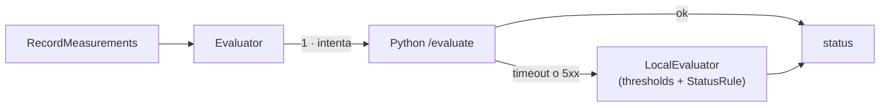
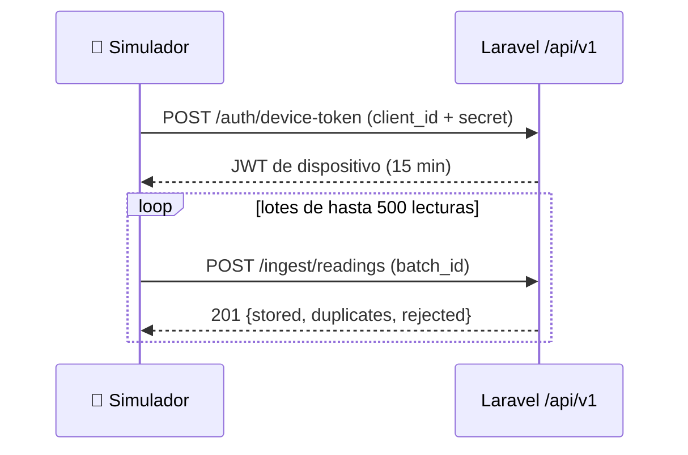

# 04 · Integración con Python

> [← Guía técnica](README.md) · Anterior: [Frontend](03-frontend-vue.md) · Siguiente: [Entorno local](05-entorno-local.md)

El simulador de Python tiene **su propia guía**: [`simulador/docs/SIMULADOR.md`](../../simulador/docs/SIMULADOR.md). Este documento cuenta solo **cómo lo usa la app**.

## 1. Qué hace cada lado

| Python (FastAPI, puerto 8001) | Laravel |
|---|---|
| Trae los datos reales de la NASA: DONKI (clima espacial) y OSDR (Inspiration4) | Guarda todo en MySQL |
| Hace de **máquinas de la nave**: genera las lecturas (calibradas con OSDR y DONKI) y las **envía** en lotes a `POST /api/v1/ingest/readings` con un JWT de dispositivo | Las recibe, valida, evalúa y guarda (M1) |
| Calcula el semáforo, el puntaje, las tendencias y las recomendaciones | Pide esos cálculos y **guarda el resultado** |
| No conoce a los usuarios ni la base de la app | Es el **único** que habla con Vue |

## 2. Un solo punto de contacto

Todas las llamadas a Python están en **M2 Evaluación**:

```
app/Modules/Evaluacion/
├── Contratos/
│   ├── Evaluator.php          # evaluate() y assess()
│   ├── TrendAnalyzer.php      # trends()
│   └── SpaceWeather.php       # now()
└── Infrastructure/Clients/
    ├── SimuladorClient.php    # Http::baseUrl(SIMULADOR_URL)->timeout(SIMULADOR_TIMEOUT)
    ├── PythonEvaluator.php    # Implementa Evaluator: intenta Python y, si falla, usa LocalEvaluator
    └── LocalEvaluator.php     # Respaldo: tabla thresholds + reglas de Domain
```

Los demás módulos piden lo que necesitan por estos contratos. **Nadie más** usa `Http::` contra Python.

## 3. Respaldo local (Python caído)



- Se pasa al respaldo si hay un *timeout* (3 s), un error de conexión o una respuesta 5xx.
- El respaldo da **el mismo resultado** que Python, porque los dos usan los mismos umbrales del plan. Una prueba lo verifica.
- Cada respaldo deja una línea en el *log* (`warning`, con el endpoint y el error). El usuario no ve ningún error.
- Las **tendencias** también tienen respaldo: una regresión lineal simple en `Domain/Reglas/TrendRule.php`.

## 4. Llenar la base con la misión simulada



```powershell
# Laravel encendido (composer run dev) y con la base sembrada
php artisan migrate:fresh --seed

# El simulador envía los 30 días
cd simulador
.venv\Scripts\activate
python scripts/send_to_astrohealth.py --days 30 --seed 42
```

El simulador necesita en su `.env`: `ASTROHEALTH_URL`, `ASTROHEALTH_CLIENT_ID` y `ASTROHEALTH_CLIENT_SECRET` (los mismos de `DeviceSeeder`). Los lotes son **idempotentes**: si se corta la red, se reenvían con el mismo `batch_id` sin duplicar nada. Contrato completo: [M1 · backend](../../astrohealth/docs/backend/M1-registro/README.md#1-la-ingesta-de-las-máquinas).

**Plan B sin red:** `php artisan registro:import-file ../simulador/data/output/Ares-1_42.json`.

## 5. Qué se acuerda con quien hace Python

| Tema | Acuerdo |
|---|---|
| Códigos de indicador | `hr`, `bp_sys`, `bp_dia`, `glucose`, `temp`, `spo2`, `sleep`, `mood`, `radiation`, `exercise_min` |
| Zonas del cuerpo | `heart`, `brain`, `eyes`, `lungs`, `bones`, `ear`, `immune`, `metabolism`, `whole_body`. Python hoy maneja 7 de ellas: le faltan `eyes` y `ear`, que en la app salen grises si no hay datos |
| Entornos | `iss`, `transit`, `moon`, `mars` |
| Formato | `{ "data": …, "message": "ok" }`, el mismo de la app |
| Umbrales | Los del plan §2. Si cambian, se cambian **en los dos lados** el mismo día |
