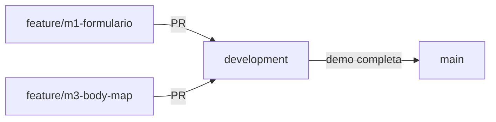

# 06 · Flujo de Git

> [← Guía técnica](README.md) · Anterior: [Entorno local](05-entorno-local.md)

Repositorio: **https://github.com/HACKATHON-NASA/ARTEMIS-III**

**En una frase:** todos parten de `development`, cada uno trabaja en una rama corta de su módulo, y los cambios vuelven a `development` solo por *pull request* (PR).

## 1. Las ramas

| Rama | Qué es | Cómo entra código |
|---|---|---|
| **`main`** | Lo que se presenta a los jueces | PR desde `development` cuando la demo funciona de punta a punta |
| **`development`** | El trabajo de todos los días | PR desde una rama `feature/…` o `fix/…` |
| `feature/mX-nombre` | Una parte de un módulo | Sale de `development` y vive horas, no días |



| Trabajo | Nombre de la rama | Ejemplo |
|---|---|---|
| Algo nuevo de un módulo | `feature/mX-<qué>` | `feature/m3-body-map`, `feature/m2-cliente-python` |
| Corregir un error | `fix/mX-<qué>` | `fix/m5-contador-marte` |
| Base de datos de varios módulos (fase 1) | `feature/base-de-datos` | |
| Documentación | `docs/<tema>` | `docs/ficha-m7` |

**Reglas de oro:**

1. **Nadie hace `push` directo** a `main` ni a `development`.
2. Antes de empezar: `git switch development` y `git pull`.
3. Las ramas son **cortas**: es un *hackathon*, así que se fusiona varias veces al día.
4. **Nadie fusiona su propio PR.** Otra persona lo revisa, aunque sea en 5 minutos.

## 2. El ciclo

```powershell
# 1 · Traer lo último
git switch development
git pull origin development

# 2 · Crear la rama
git switch -c feature/m1-formulario

# 3 · Commits pequeños
git add .
git commit -m "m1: formulario con un campo por indicador"

# 4 · Ponerse al día antes de subir
git fetch origin
git rebase origin/development

# 5 · Probar
php artisan test

# 6 · Subir y abrir el PR hacia development
git push -u origin feature/m1-formulario
```

**Formato del mensaje:** `mX: <qué hace>`, en español, en presente y corto. Ejemplos: `m2: respaldo local cuando Python no responde`, `m3: la zona del corazón pulsa en amarillo`.

Si después de un `rebase` la subida pide forzarse, se usa `git push --force-with-lease`, **solo en su propia rama**.

## 3. El *pull request*

- **base:** `development` ← **compare:** su rama.
- **Título:** `M3 · Cuerpo interactivo: zonas con color y pulso`.
- **Descripción:** sale sola de la [plantilla](../../.github/pull_request_template.md). Diga el módulo, las capas, los archivos y cómo probarlo.
- Se fusiona con **Squash and merge** y la rama se borra.

## 4. Para no pisarse

| Riesgo | Cómo se evita |
|---|---|
| Dos personas en el mismo archivo | Cada uno trabaja en **su** módulo ([reparto](../modulos/README.md#4-reparto-y-orden)). Las páginas de `pages/` las toca una sola persona a la vez |
| Migraciones que chocan | Cada módulo tiene las suyas, en su carpeta |
| `composer.lock` o `package-lock.json` en conflicto | Quien agrega un paquete lo avisa en el chat y fusiona rápido. En un conflicto: se toma la versión de `development` y se repite `npm install <paquete>` |
| Ramas que viven días | Fusionar en cuanto algo funcione, aunque sea pequeño |

## 5. Si aparece un conflicto

```powershell
git status                       # muestra los archivos en conflicto
# Abra cada archivo en VS Code y elija "Accept Current", "Accept Incoming" o "Accept Both"
git add <archivo>
git rebase --continue
```

Si se enreda: `git rebase --abort` lo deja todo como estaba, y se pide ayuda.

## 6. Rescates rápidos

| Pasó esto | Haga esto |
|---|---|
| Hizo *commit* en `development` por error | `git switch -c feature/mX-rescate` (la rama nueva se lleva el *commit*) y después `git switch development` y `git reset --hard origin/development` |
| Quiere deshacer el último *commit* sin perder los cambios | `git reset --soft HEAD~1` |
| Quiere descartar los cambios de un archivo | `git restore <archivo>` |
