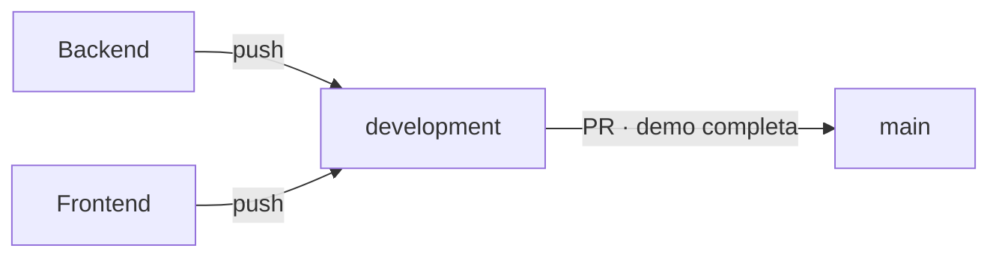

# 06 · Flujo de Git

> [← Guía técnica](README.md) · Anterior: [Entorno local](05-entorno-local.md)

Repositorio: **https://github.com/HACKATHON-NASA/ARTEMIS-III**

**En una frase:** todo el equipo trabaja en `development`. Antes de subir se trae lo último, se prueba y se sube. `main` solo recibe la demo completa.

## 1. Las ramas

| Rama | Qué es | Cómo entra código |
|---|---|---|
| **`development`** | El trabajo de todos los días. **Aquí trabaja todo el equipo** | `git push` directo, después de probar |
| **`main`** | Lo que se presenta a los jueces | PR desde `development` cuando la demo funciona de punta a punta |



**Reglas de oro:**

1. **Se trabaja siempre en `development`.** No se crean ramas `feature/`.
2. **Nadie hace `push` directo a `main`.**
3. Antes de subir: `git pull --rebase` y `php artisan test` en verde.
4. *Commits* pequeños y seguidos: es un *hackathon*, así que se sube varias veces al día.
5. **Nunca** `git push --force` sobre `development`.

## 2. El ciclo

```powershell
# 1 · Estar en development y traer lo último
git switch development
git pull --rebase origin development

# 2 · Programar y hacer commits pequeños
git add .
git commit -m "m1: formulario con un campo por indicador"

# 3 · Antes de subir: ponerse al día y probar
git pull --rebase origin development
php artisan test

# 4 · Subir
git push origin development
```

**Formato del mensaje:** `mX: <qué hace>`, en español, en presente y corto. Ejemplos: `m2: respaldo local cuando Python no responde`, `m3: la zona del corazón pulsa en amarillo`. Para lo que no es de un módulo: `docs: …`, `simulador: …`.

## 3. El *pull request* a `main`

Solo cuando la demo funciona de punta a punta:

- **base:** `main` ← **compare:** `development`.
- **Título:** `Demo · <qué incluye>`.
- **Descripción:** sale sola de la [plantilla](../../.github/pull_request_template.md).
- Otra persona lo revisa antes de fusionarlo.

## 4. Para no pisarse

| Riesgo | Cómo se evita |
|---|---|
| Dos personas en el mismo archivo | Cada uno trabaja en **su** módulo ([reparto](../modulos/README.md#4-reparto-y-orden)). Las páginas de `pages/` las toca una sola persona a la vez |
| Migraciones que chocan | Cada módulo tiene las suyas, en su carpeta |
| `composer.lock` o `package-lock.json` en conflicto | Quien agrega un paquete lo avisa en el chat y sube rápido. En un conflicto: se toma la versión de `development` y se repite `npm install <paquete>` |
| Cambios locales que se quedan días sin subir | Subir en cuanto algo funcione y pase las pruebas, aunque sea pequeño |

## 5. Si aparece un conflicto

```powershell
git status                       # muestra los archivos en conflicto
# Abra cada archivo en VS Code y elija "Accept Current", "Accept Incoming" o "Accept Both"
git add <archivo>
git rebase --continue
```

Si se enreda: `git rebase --abort` lo deja todo como estaba, y se pide ayuda.

## 6. Rescates rápidos

| Pasó esto | Haga esto |
|---|---|
| Quiere deshacer el último *commit* sin perder los cambios (antes de subirlo) | `git reset --soft HEAD~1` |
| Quiere descartar los cambios de un archivo | `git restore <archivo>` |
| Subió algo que rompe `development` | `git revert <commit>` y `git push` (nunca `--force`) |
