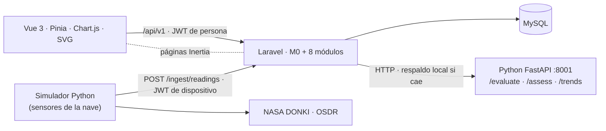
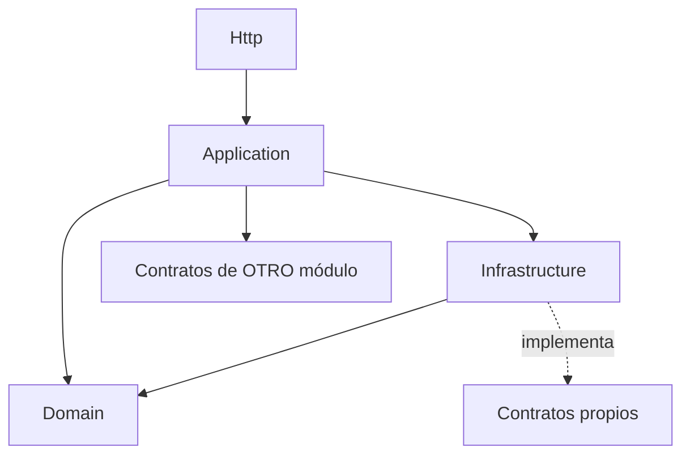
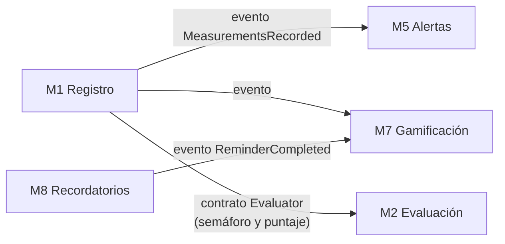
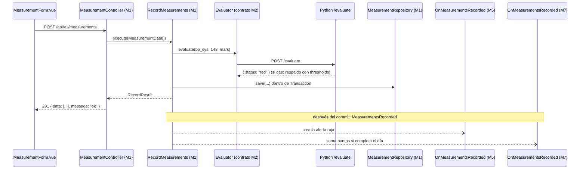

# ARCHITECTURE · Cómo se programa AstroHealth

> [← Guía técnica](README.md) · [Plan](../PLAN_ASTROHEALTH.md) · [Módulos](../modulos/README.md)

> ⚠️ **Norma obligatoria.** Toda persona o agente de IA que cree o modifique código de `astrohealth/` lee este documento antes de empezar.

**Antes de programar**, escriba en el *pull request* (o en la respuesta, si es un agente):

1. **Módulo:** M0–M8.
2. **Capa:** Domain, Application, Infrastructure, Http o frontend.
3. **Archivos** que va a crear o tocar.
4. **Dependencias:** contratos o eventos de otros módulos, y endpoints de Python.

Si una tarea obliga a romper una regla de esta norma, no se rompe en silencio. Se responde así y se espera una decisión:

```
ARCHITECTURE VIOLATION
Regla: <número y nombre>
Qué la rompería: <explicación>
Alternativa compatible: <propuesta>
```

## Contenido

1. [Principios](#1-principios)
2. [Decisiones del proyecto](#2-decisiones-del-proyecto)
3. [Vista general](#3-vista-general)
4. [Estructura de un módulo](#4-estructura-de-un-módulo)
5. [Las capas y sus dependencias](#5-las-capas-y-sus-dependencias)
6. [Reglas por capa](#6-reglas-por-capa)
7. [Comunicación entre módulos](#7-comunicación-entre-módulos)
8. [Nombres](#8-nombres)
9. [Seguridad](#9-seguridad)
10. [Pruebas](#10-pruebas)
11. [Prácticas prohibidas](#11-prácticas-prohibidas)
12. [Ejemplo de punta a punta](#12-ejemplo-de-punta-a-punta)

---

## 1. Principios

1. **8 módulos, cada uno dueño de lo suyo.** Cada módulo es dueño de sus tablas, sus reglas, sus rutas y sus pantallas.
2. **Capas con una sola responsabilidad:** Domain, Application, Infrastructure y Http. Las dependencias van en un solo sentido.
3. **El backend manda.** Umbrales, colores, puntos y reglas se calculan en Laravel o en Python. Vue solo presenta.
4. **Práctico antes que elegante en papel.** Una interfaz solo existe si separa módulos, si se puede cambiar (por ejemplo, Python o el respaldo local) o si se necesita para probar.
5. **La demo primero.** Todo lo que se construye sirve al [guion de 2 minutos](../PLAN_ASTROHEALTH.md#7-guion-de-la-demo-2-minutos). Lo que no aparece en el guion espera.
6. **Honestidad con los datos.** Todo dato lleva su origen (`source`) y la app muestra el aviso: *"Herramienta de apoyo, no reemplaza el criterio médico"*.

## 2. Decisiones del proyecto

| # | Tema | Decisión | Por qué |
|:---:|---|---|---|
| D1 | Dónde va el código | Backend en `astrohealth/app/Modules/<Modulo>/`. Frontend en `astrohealth/resources/js/modules/<Modulo>/` | Un único lugar evidente por módulo |
| D2 | Los módulos | `Identidad` (M0: login, roles, dispositivos) + los 8 del plan: `Registro` (M1), `Evaluacion` (M2), `Cuerpo` (M3), `Dashboard` (M4), `Alertas` (M5), `Entorno` (M6), `Gamificacion` (M7), `Recordatorios` (M8) | Los 8 del [plan](../PLAN_ASTROHEALTH.md#3-los-8-módulos), más el acceso, que todos necesitan |
| D3 | Idioma | **Español** para los nombres de módulo, la documentación y los textos que ve el usuario. **Inglés** para todo identificador técnico: tablas, columnas, rutas, campos JSON, clases, métodos y componentes | Así vienen el plan y el simulador (`measurements`, `MeasurementForm.vue`, `EvaluationService`) |
| D4 | Pantallas | Inertia sirve las **páginas**. Los **datos** llegan por la API `/api/v1` y se guardan en *stores* de Pinia. El login es una página propia contra `/api/v1/auth/login`; Fortify no se usa | El plan pide una API REST y Pinia; Inertia ya viene en el proyecto |
| D5 | Autenticación | **JWT** (`firebase/php-jwt`, HS256) para **toda** la API: *access token* de 15 min en `Authorization: Bearer` + *refresh token* rotativo en una *cookie* `HttpOnly`. Las máquinas (el simulador) usan *client credentials*. **Roles:** `admin`, `flight_surgeon` (médico en Tierra), `crew_medical_officer` (médico de la tripulación), `astronaut`, `device`, con los permisos de `config/permissions.php` | Personas y máquinas entran por la misma puerta, con roles. Detalle: [M0 · backend](../../astrohealth/docs/backend/M0-identidad/README.md) |
| D6 | Formato JSON | `{ "data": …, "message": "ok" }`. En los errores: `{ "data": null, "message": "…", "error_code": "…", "errors": {…} }` | Es el formato del plan y del simulador: uno solo para todo |
| D7 | Python | Laravel es el **único** que llama a Python. Si Python no responde, Laravel evalúa con la tabla `thresholds` (respaldo local) | Regla del plan: Laravel es el único que habla con el frontend |
| D8 | Cómo llegan los datos simulados | **El simulador los envía**, como las máquinas de la nave: lotes a `POST /api/v1/ingest/readings` con un JWT de dispositivo, idempotentes por `batch_id`. Plan B sin red: `registro:import-file` con el JSON del simulador | Es como funcionan los sensores reales: la máquina empuja, el sistema valida y evalúa. Detalle: [M1 · backend](../../astrohealth/docs/backend/M1-registro/README.md) |
| D9 | Zonas del cuerpo | Las 7 del plan (`heart`, `brain`, `eyes`, `lungs`, `bones`, `ear`, `immune`) **más** `metabolism` (glucosa) y `whole_body` (radiación) | La tabla de umbrales del plan asigna la glucosa y la radiación a esas zonas |
| D10 | Ejercicio | Se agrega el indicador `exercise_min` | Sin él, la zona `bones` no tiene datos. El simulador ya lo genera |
| D11 | Alerta al guardar un valor rojo | Por **evento de dominio** (`MeasurementsRecorded` → Alertas), no por un *Observer* de Eloquent | Así M1 no conoce las tablas de M5 (ver la [sección 7](#7-comunicación-entre-módulos)) |
| D12 | Migraciones | Modulares: `app/Modules/<Modulo>/Database/Migrations/` | Cada módulo crea sus tablas |
| D13 | Ramas | `main` · `development` · `feature/mX-nombre` | Ver el [flujo de Git](06-flujo-de-git.md). El plan dice `dev`: aquí se llama `development` |
| D14 | Valores de referencia | Umbrales, dosis y retrasos se guardan en la base de datos o en `config/`, nunca en el código | Los médicos de vuelo los podrían ajustar |

## 3. Vista general



```
ARTEMIS III/
├── documentacion/                  # Plan, guía técnica y fichas de los módulos
├── astrohealth/                    # Laravel + Inertia + Vue
│   ├── app/
│   │   ├── Modules/                # ★ Los 8 módulos (sección 4)
│   │   ├── Shared/                 # Piezas técnicas comunes, sin reglas de negocio
│   │   │   ├── ModuleServiceProvider.php     # Base de los providers: carga routes.php y migraciones
│   │   │   ├── Http/ApiResponse.php           # Construye el JSON de la API
│   │   │   ├── Http/Middleware/               # Middleware común
│   │   │   ├── Http/ApiExceptionRenderer.php  # Excepción → formato de error único
│   │   │   ├── Excepciones/BusinessError.php  # Base de los errores de negocio
│   │   │   └── Persistencia/Transaction.php   # Transacciones sin tocar DB:: (DatabaseTransaction)
│   │   ├── Models/User.php         # Del starter kit; su dueño es M0 (role, active, astronaut_id)
│   │   └── Providers/
│   ├── bootstrap/
│   │   ├── app.php                 # Manejador común de errores de la API
│   │   └── providers.php           # Registra los providers de los 8 módulos
│   ├── config/environments.php     # ISS, tránsito, Luna, Marte (igual que el simulador)
│   └── resources/js/               # Frontend (ver la guía del frontend)
└── simulador/                      # Python FastAPI (su propia guía: simulador/docs/SIMULADOR.md)
```

## 4. Estructura de un módulo

Las carpetas **ya están creadas** en los 8 módulos. Una carpeta que el módulo no use se queda vacía (con su `.gitkeep`).

```
astrohealth/app/Modules/Registro/
├── RegistroServiceProvider.php     # Rutas, migraciones, listeners y bindings de contratos
├── routes.php                      # Prefijo /api/v1, middleware web + auth
├── Contratos/                      # API PÚBLICA: interfaces y DTOs que usan otros módulos
├── Domain/                         # Reglas puras, sin base de datos ni HTTP
│   ├── Enums/                      # Valores cerrados (IndicatorCode, Status) y códigos de error
│   ├── Reglas/                     # Cálculos y validaciones puras
│   ├── Eventos/                    # Eventos que publica el módulo (públicos)
│   ├── ValueObjects/
│   └── Excepciones/                # Errores de negocio (heredan de BusinessError)
├── Application/                    # Casos de uso: una clase por acción
│   └── DTOs/
├── Infrastructure/                 # Lo ÚNICO que toca la base de datos o servicios externos
│   ├── Repositorios/
│   ├── Models/                     # Modelos Eloquent de sus tablas
│   └── Listeners/                  # Reacciones a eventos de otros módulos
├── Http/
│   ├── Controllers/Api/            # Devuelven el JSON de la API
│   ├── Controllers/Web/            # Devuelven páginas Inertia
│   ├── Requests/                   # Validación de entrada
│   ├── Resources/                  # Forma de "data"
│   └── Middleware/
├── Policies/  Console/
├── Database/{Migrations,Seeders,Factories}/
└── Tests/{Unit,Feature}/
```

| Si el problema es… | Se busca en |
|---|---|
| De un módulo, en general | `app/Modules/<Modulo>/` y `resources/js/modules/<Modulo>/` |
| De la base de datos | `Infrastructure/` |
| De una regla (color, puntos, racha) | `Domain/` |
| Del orden de los pasos de una acción | `Application/` |
| De una ruta, una validación o una respuesta | `Http/` y `routes.php` |
| Visual | `resources/js/modules/<Modulo>/` |
| De la conexión con Python | `app/Modules/Evaluacion/Infrastructure/Clients/` |
| De login, tokens, roles o permisos | `app/Modules/Identidad/` y `config/permissions.php` |
| De lo que envía el simulador | `app/Modules/Registro/` (ingesta) |

## 5. Las capas y sus dependencias



| Capa | Puede usar | No puede usar |
|---|---|---|
| `Domain` | PHP, su propio `Domain`, `Carbon` | `DB`, Eloquent, `Illuminate\Http`, Inertia, otros módulos |
| `Application` | `Domain` e `Infrastructure` de su módulo, `Contratos/` y `Domain/Eventos/` de otros módulos, `App\Shared` | `Request`, respuestas HTTP, `DB::`, consultas Eloquent |
| `Infrastructure` | `Domain`, Eloquent, `DB`, el cliente HTTP, `App\Shared\Persistencia` | `Http`. `Application` solo desde los *listeners* |
| `Http` | `Application`, los enums de `Domain`, `App\Shared\Http` | `Infrastructure`, `DB::` |
| Frontend | Lo que llega de `/api/v1` | Calcular colores, umbrales o puntos |

## 6. Reglas por capa

### Domain
- Reglas puras que se prueban sin arrancar Laravel. Por ejemplo: `StatusRule::classify($value, $threshold)`, `ScoreRule::weighted($statuses)` o `StreakRule::days($dates)`.
- Los valores de referencia (umbrales, puntos por acción) **llegan como parámetro**. No se escriben en la regla.

### Application
- **Una clase por caso de uso**, nombrada con un verbo y con un único método público `execute()`. Por ejemplo: `RecordMeasurements`, `SendAlertToGround` o `CompleteReminder`.
- Recibe DTOs y devuelve DTOs. Nunca recibe un `Request` ni devuelve una respuesta HTTP.
- Abre una transacción con `Transaction::run()` cuando escribe más de una fila relacionada.
- Lanza excepciones de negocio. No arma respuestas de error.

### Infrastructure
- Es **la única** capa que toca MySQL o hace llamadas HTTP hacia afuera (Python).
- Hay repositorios por agregado, con métodos que dicen lo que hacen: `latestByAstronaut()`, `seriesFor()`, `save()`. Nunca un `query()` genérico.
- Los contratos hacia otros módulos devuelven **DTOs**, no modelos Eloquent.
- Un módulo **solo** consulta **sus** tablas ([dueño de cada tabla](02-base-de-datos.md#1-dueño-de-cada-tabla)).

### Http
- El controlador es delgado: `Request → caso de uso → Resource → ApiResponse`. Cada método tiene pocas líneas.
- El `FormRequest` valida el formato y los rangos físicamente posibles. Las reglas del negocio van en `Application` o en `Domain`.
- Toda respuesta de `/api/v1` sale con `ApiResponse` y el [formato JSON único](01-api-y-json.md).

## 7. Comunicación entre módulos

1. Un módulo **nunca** lee ni escribe las tablas de otro.
2. Lo **público** de un módulo es solo lo que hay en `Contratos/` (consultas) y en `Domain/Eventos/` (hechos que ya pasaron).
3. Para **preguntar** algo se usa un contrato. Para **reaccionar** a algo que pasó se usa un evento.
4. Los eventos se publican **después** de confirmar la transacción (`ShouldDispatchAfterCommit`).
5. No hay dependencias en círculo. El mapa completo está en el [índice de módulos](../modulos/README.md#2-mapa-de-dependencias).



## 8. Nombres

| Elemento | Convención | Ejemplo |
|---|---|---|
| Módulo (carpeta) | `PascalCase`, en español, sin tildes | `Gamificacion` |
| Caso de uso | Verbo + objeto, método `execute()` | `RecordMeasurements::execute()` |
| Repositorio | `<Agregado>Repository` (se divide en `Read`/`Write` si crece) | `MeasurementRepository` |
| Contrato | Lo que ofrece, sin `Interface` | `Evaluator`, `MissionQuery` |
| DTO | `<Cosa>Data` (entrada) · `<Cosa>Result` (salida) | `MeasurementData`, `AssessmentResult` |
| Evento | Hecho en pasado | `MeasurementsRecorded`, `ReminderCompleted` |
| *Listener* | `On<Evento>` | `OnMeasurementsRecorded` |
| Controlador | `<Recurso>Controller` | `MeasurementController` |
| Request · Resource | `<Acción><Recurso>Request` · `<Recurso>Resource` | `StoreMeasurementsRequest`, `AlertResource` |
| Excepción de negocio | Lo que pasó, sin `Exception` | `AlertAlreadySent` |
| Código de error | `MAYÚSCULAS`, con el prefijo del módulo | `ALERTS_ALREADY_SENT` |
| Tabla · columna | `snake_case`, tabla en plural | `points_log.created_at` |
| Ruta API | `/api/v1/<recurso>`, plural y sin verbos (salvo las acciones del plan) | `/api/v1/alerts/{id}/send-to-ground` |
| Componente Vue | `PascalCase.vue` | `BodyMap.vue` |
| *Store* Pinia | `use<Cosa>Store` | `useMeasurementsStore` |
| Clases PHP | `final`, con tipos declarados | `final class RecordMeasurements` |

**Límites de tamaño:** una clase o un componente debería quedar por debajo de 300 líneas, y por encima de 500 hay que revisarlo. Un método, por debajo de 30 líneas. Un método de controlador, por debajo de 15.

## 9. Seguridad

| Tema | Cómo se cumple |
|---|---|
| Autenticación | JWT de 15 min + *refresh* rotativo con detección de reuso (personas) · *client credentials* (máquinas). Detalle en [M0](../../astrohealth/docs/backend/M0-identidad/README.md) |
| Autorización | Permisos por rol en `config/permissions.php` → Gates → `can:` en cada ruta. "Lo suyo" con el Gate `health.read` y las *Policies*. **Nunca** `if ($role === …)` fuera de M0 |
| Validación | Siempre en el backend (`FormRequest`), aunque Vue ya haya validado |
| CSRF | La API no usa la sesión. La *cookie* del *refresh* es `SameSite=Strict` y `/auth/refresh` comprueba el `Origin` |
| SQL | Eloquent o el Query Builder con *bindings*. Nunca se concatenan datos en una consulta |
| Asignación masiva | `$fillable` explícito. Nunca `$guarded = []` |
| XSS | Prohibido usar `v-html` con datos de usuarios |
| Secretos | Solo en `.env`, que nunca se sube |
| Errores | En producción no se exponen trazas, SQL ni rutas internas |

## 10. Pruebas

| Tipo | Qué cubre | Dónde |
|---|---|---|
| Unitarias | Reglas de `Domain` (semáforo, puntaje, racha, puntos) | `Tests/Unit` del módulo |
| *Feature* | La ruta completa: autenticación, validación, caso de uso, base de datos y JSON | `Tests/Feature` del módulo |
| Python simulado | El cliente de Python con `Http::fake()`, incluido el respaldo local cuando Python se cae | `Evaluacion/Tests/Feature` |
| Frontend | La lógica de los *stores* y *composables* | Vitest |

Cada criterio *Dado / Cuando / Entonces* de una ficha es una prueba. Comando: `php artisan test`. Antes de la primera prueba de módulo, se agrega `app/Modules/*/Tests` a `phpunit.xml`.

## 11. Prácticas prohibidas

> ⛔ Cualquiera de estas bloquea la aprobación de un *pull request*.

| # | Prohibido | Lo correcto |
|:---:|---|---|
| P1 | SQL, `DB::` o Eloquent en controladores | Caso de uso → repositorio |
| P2 | Consultas en `Application` o en `Domain` | Repositorio |
| P3 | Leer o escribir tablas de otro módulo | Contrato o evento |
| P4 | Calcular colores, umbrales o puntos en Vue | Backend; Vue recibe el resultado |
| P5 | Llamar a Python desde Vue o desde otro módulo que no sea M2 | Contrato `Evaluator` de M2 |
| P6 | JSON armado a mano o con otro formato | `ApiResponse` y el manejador común |
| P7 | Umbrales, dosis o puntos escritos en el código | Tabla `thresholds` o `config/` |
| P8 | Colores del semáforo distintos de los del plan | `#22C55E` · `#EAB308` · `#EF4444` · `#64748B` |
| P9 | Credenciales en el código o en el repositorio | `.env` |
| P10 | Un módulo de Vue que importa otro módulo | Mover el componente a `components/` |
| P11 | Editar una migración ya fusionada | Una migración nueva |
| P12 | Un dato simulado sin su `source` | `source` en cada medición |

## 12. Ejemplo de punta a punta

**Registrar la presión 148/94 (M1) → rojo (M2) → alerta (M5) → puntos (M7).**



| Paso | Capa | Archivo |
|:---:|---|---|
| 1 | Vue | `modules/Registro/Components/MeasurementForm.vue` → `useMeasurementsStore().record()` |
| 2 | Http | `Registro/Http/Requests/StoreMeasurementsRequest.php` (rangos físicamente posibles) |
| 3 | Http | `Registro/Http/Controllers/Api/MeasurementController.php` |
| 4 | Application | `Registro/Application/RecordMeasurements.php` |
| 5 | Contrato | `Evaluacion/Contratos/Evaluator.php` → `Evaluacion/Infrastructure/Clients/PythonEvaluator.php` |
| 6 | Infrastructure | `Registro/Infrastructure/Repositorios/MeasurementRepository.php` |
| 7 | Evento | `Registro/Domain/Eventos/MeasurementsRecorded.php` |
| 8 | *Listeners* | `Alertas/Infrastructure/Listeners/OnMeasurementsRecorded.php` y `Gamificacion/Infrastructure/Listeners/OnMeasurementsRecorded.php` |
