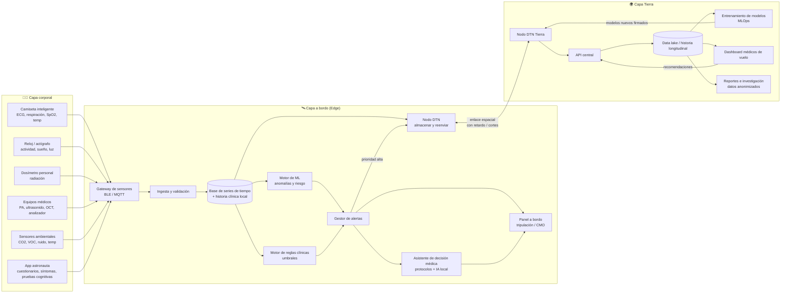
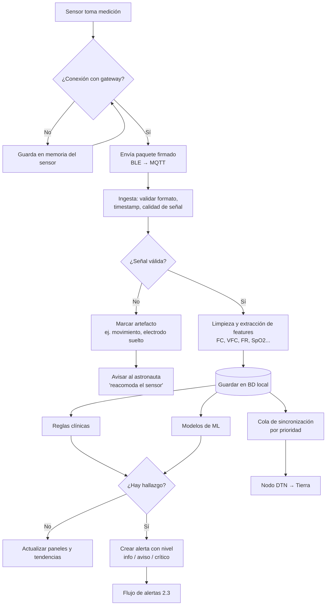
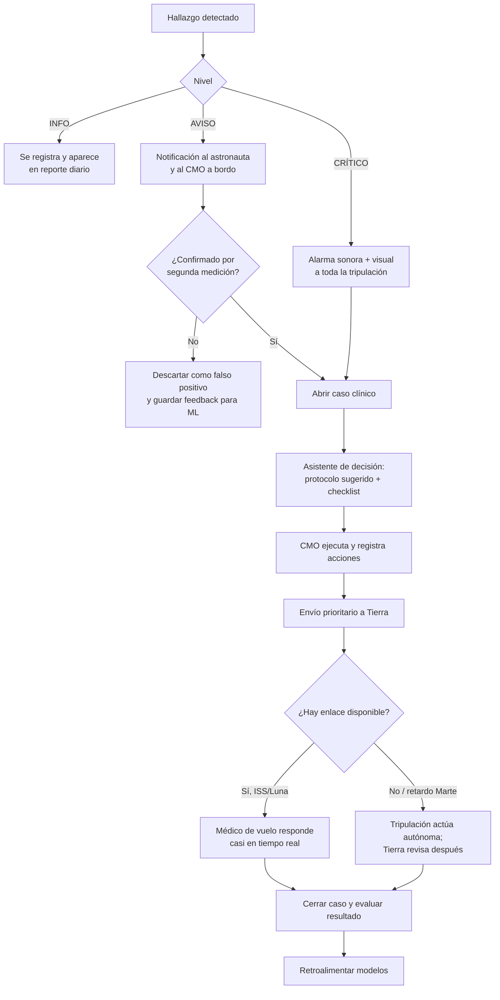
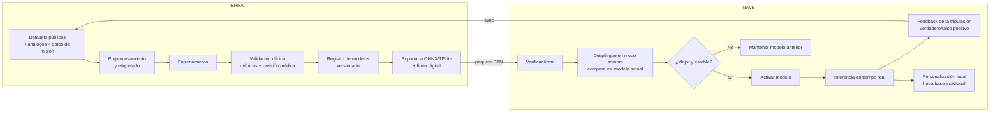
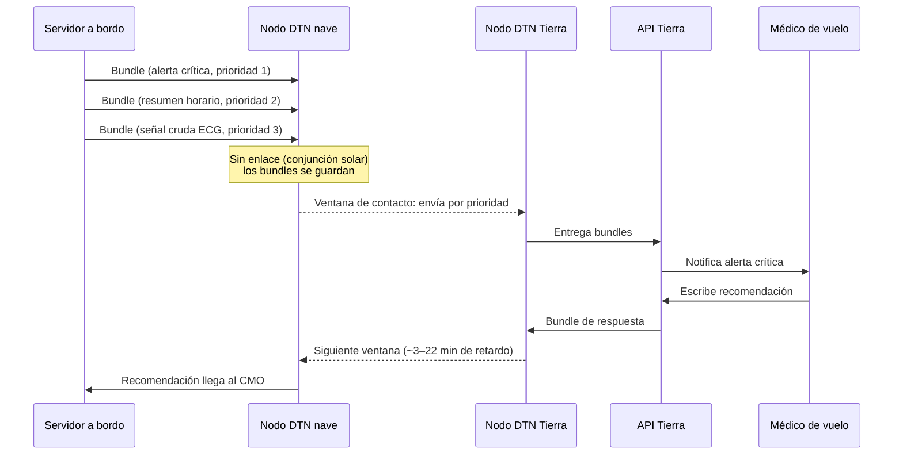
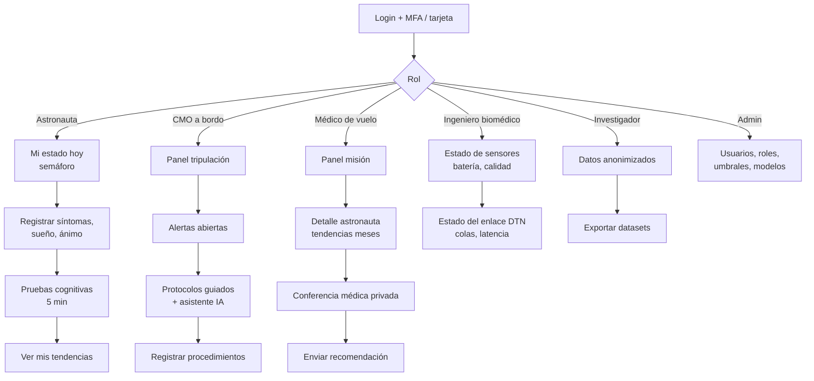
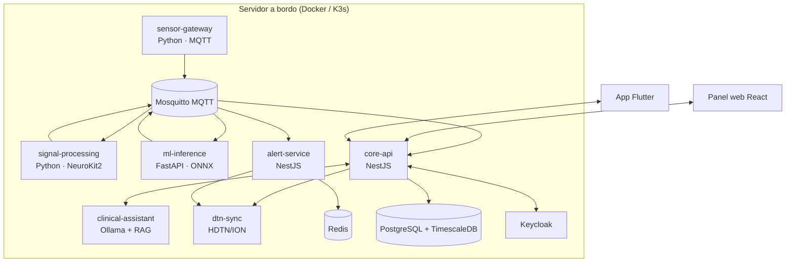
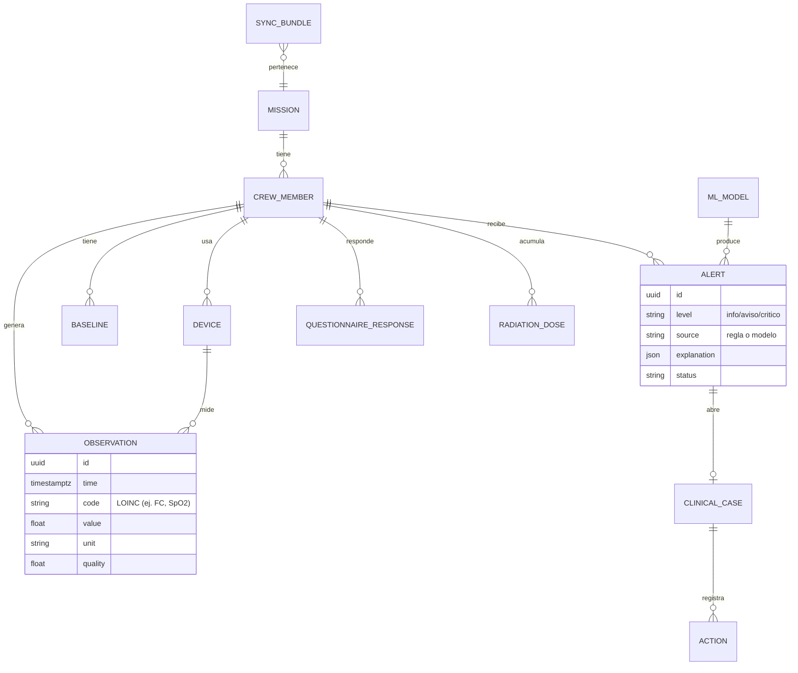

# AstroHealth — Arquitectura de largo plazo (Fase 2)

> Documento de diseño: flujo de la aplicación, arquitectura, funcionalidades, machine learning y stack tecnológico.
> Base: [informe de Fase 1](02-monitorizacion-salud-fase1.md) (problemas de salud, parámetros, sensores y comunicaciones).
>
> [← Volver al inicio](../../README.md) · **Documentos relacionados:** [Proyecto Space Apps](01-proyecto-space-apps.md) · [Enfermedades de los astronautas (resumen)](04-enfermedades-resumen.md) · [Informe de fisiopatología espacial](05-informe-fisiopatologia-hrp.md)

> 🔭 **Este documento es la visión a largo plazo**, pensada para un sistema de nivel industrial. **El stack oficial del MVP es Laravel + MySQL + Inertia/Vue + Tailwind CSS + Python (simulador)**, y está justificado en la [propuesta tecnológica](../propuesta/03-propuesta-tecnologica.md). Allí también se explica qué partes de esta visión se conservan y cuáles quedan para etapas posteriores.

## Índice

1. [Idea central](#1-idea-central)
2. [Diagramas de flujo](#2-diagramas-de-flujo)
3. [Qué debe VER la aplicación (pantallas)](#3-qué-debe-ver-la-aplicación-pantallas)
4. [Qué debe HACER la aplicación (funcionalidades)](#4-qué-debe-hacer-la-aplicación-funcionalidades)
5. [Machine Learning: qué modelos y para qué](#5-machine-learning-qué-modelos-y-para-qué)
6. [Stack tecnológico propuesto](#6-stack-tecnológico-propuesto)
7. [Arquitectura de microservicios (a bordo)](#7-arquitectura-de-microservicios-a-bordo)
8. [Modelo de datos (principal)](#8-modelo-de-datos-principal)
9. [Seguridad y privacidad (obligatorio)](#9-seguridad-y-privacidad-obligatorio)
10. [Plan de desarrollo por fases](#10-plan-de-desarrollo-por-fases)
11. [Estructura del repositorio](#11-estructura-del-repositorio)
12. [Escenarios de demo sugeridos](#12-escenarios-de-demo-sugeridos)
13. [Riesgos del proyecto](#13-riesgos-del-proyecto)

---

## 1. Idea central

El sistema **no puede depender de la Tierra**. Debe funcionar en tres capas:

1. **Capa corporal (sensores):** wearables y equipos médicos capturan señales.
2. **Capa a bordo (edge):** un servidor en la nave procesa, guarda, analiza con ML y genera alertas **en tiempo real, sin internet**.
3. **Capa Tierra (control de misión):** recibe los datos por un enlace con retardo (DTN), los médicos de vuelo analizan tendencias y envían recomendaciones.

> Regla de oro: **"Registrar siempre, decidir a bordo, sincronizar cuando se pueda."**

---

## 2. Diagramas de flujo

> Los diagramas están en **Mermaid**. Se ven en GitHub, GitLab, VS Code (extensión *Markdown Preview Mermaid*), Obsidian o en https://mermaid.live.

### 2.1 Arquitectura general



### 2.2 Flujo de un dato (del sensor a la pantalla)



### 2.3 Flujo de alertas



### 2.4 Flujo de Machine Learning (ciclo de vida)



### 2.5 Sincronización DTN (secuencia)



### 2.6 Flujo de uso por rol



---

## 3. Qué debe VER la aplicación (pantallas)

### 3.1 App del astronauta (tablet a bordo)
- **Semáforo de salud del día** (verde/amarillo/rojo) por sistema: corazón, sueño, radiación, hueso/músculo, ojos, mente.
- Signos vitales actuales: FC, SpO2, temperatura, frecuencia respiratoria.
- **Dosis de radiación acumulada** vs. límite de carrera (barra de progreso).
- Sueño de anoche y tendencia semanal.
- Recordatorios: ejercicio, hidratación, toma de muestras, pruebas oculares.
- Formularios rápidos: síntomas, dolor, ánimo, estrés (escalas validadas).
- Pruebas cognitivas cortas (tipo PVT: tiempo de reacción).
- Estado de sus sensores (batería, si están bien puestos).

### 3.2 Panel del Oficial Médico a bordo (CMO)
- Vista de **toda la tripulación** en tarjetas con semáforo.
- **Bandeja de alertas** ordenada por gravedad.
- ECG en vivo y señales en tiempo real del tripulante seleccionado.
- **Protocolos guiados paso a paso** (checklists) para emergencias.
- **Asistente IA local** (preguntas en lenguaje natural sobre protocolos, botiquín, fármacos).
- Inventario médico: fármacos disponibles y fechas de vencimiento.
- Ultrasonido guiado (overlay de instrucciones).

### 3.3 Dashboard Tierra (médicos de vuelo)
- **Mapa de la misión**: estado de cada tripulante y del enlace (latencia actual, próxima ventana).
- **Tendencias longitudinales**: masa corporal, densidad ósea estimada, VFC, sueño, SANS (OCT), Hb.
- Comparación con **línea base personal** previa al vuelo.
- Historial de alertas y decisiones a bordo.
- Módulo de **conferencia médica privada** (notas cifradas).
- Predicciones de riesgo a 7/30 días.
- Reportes PDF automáticos (diario/semanal/post-misión).

### 3.4 Panel técnico (ingeniería biomédica)
- Salud de sensores, firmware, calidad de señal.
- Colas DTN, bundles pendientes, ancho de banda usado.
- Versión de modelos ML activos y su rendimiento.

---

## 4. Qué debe HACER la aplicación (funcionalidades)

| # | Módulo | Qué hace |
|---|---|---|
| 1 | **Ingesta de sensores** | Recibe datos por BLE/MQTT, valida, normaliza unidades y timestamps |
| 2 | **Calidad de señal** | Detecta artefactos (movimiento, electrodo suelto) y avisa |
| 3 | **Procesamiento de señales** | Calcula FC, VFC, FR, detección de latidos, arritmias, estadios de sueño |
| 4 | **Línea base personal** | Aprende el "normal" de cada astronauta antes y durante el vuelo |
| 5 | **Reglas clínicas** | Umbrales configurables por médicos (ej. SpO2 < 92 %) |
| 6 | **Detección de anomalías (ML)** | Detecta desviaciones raras aunque no rompan umbrales |
| 7 | **Predicción de riesgo (ML)** | Estima riesgo a futuro: ortostatismo al aterrizar, fatiga, deterioro del sueño |
| 8 | **Gestor de alertas** | Prioriza, deduplica, escala y registra |
| 9 | **Soporte de decisión clínica** | Protocolos + IA local que sugiere pasos (nunca decide solo) |
| 10 | **Dosimetría** | Acumula dosis, proyecta vs. límite, alerta de evento solar → refugio |
| 11 | **Ambiente** | Correlaciona CO2/VOC con síntomas (cefalea, fatiga) |
| 12 | **Salud mental** | Cuestionarios, pruebas cognitivas, tendencia de ánimo |
| 13 | **Historia clínica (EHR)** | Registro clínico local en estándar FHIR |
| 14 | **Sincronización DTN** | Almacenar-y-reenviar por prioridades, reintentos, sin pérdida |
| 15 | **Seguridad y privacidad** | Cifrado, roles, auditoría, separación clínico/investigación |
| 16 | **Reportes** | Automáticos y exportables (PDF/CSV/FHIR) |
| 17 | **Simulador** | Genera datos realistas de astronautas y escenarios (para desarrollar y probar sin hardware) |
| 18 | **Modo degradado** | Si cae el servidor, la tablet sigue mostrando vitales y alarmas básicas |

---

## 5. Machine Learning: qué modelos y para qué

| Problema | Tipo de modelo | Entrada | Salida | Corre en |
|---|---|---|---|---|
| Detección de arritmias | CNN 1D / ResNet sobre ECG | ECG crudo | Clase de ritmo (normal, FA, extrasístoles...) | A bordo |
| Anomalías multivariables | Isolation Forest / **Autoencoder LSTM** | FC, VFC, FR, SpO2, temp, actividad | Puntaje de anomalía | A bordo |
| Estadios de sueño | Modelo de series (LSTM / Transformer pequeño) | Actigrafía + FC + VFC | Sueño/vigilia, eficiencia | A bordo |
| Estrés y fatiga | Gradient Boosting (XGBoost / LightGBM) | VFC, sueño, PVT, cuestionarios | Índice de estrés/fatiga | A bordo |
| Riesgo de intolerancia ortostática | Regresión logística / XGBoost | Tendencia de VFC, volumen, ejercicio, días de misión | Probabilidad al aterrizar | Tierra + a bordo |
| Pronóstico de tendencias | Prophet / ARIMA / Temporal Fusion Transformer | Series diarias (masa, sueño, VFC) | Proyección a 7/30 días | Tierra |
| Análisis de imagen (SANS) | CNN (transfer learning) | OCT / fondo de ojo | Indicadores de edema | Tierra (luego a bordo) |
| Asistente médico | LLM pequeño local + RAG sobre protocolos | Pregunta del CMO | Respuesta con fuente | A bordo |

**Principios de ML:**
- **Explicable:** cada alerta dice *por qué* (ej. SHAP: "VFC bajó 35 % + sueño 4,5 h").
- **Personalizado:** compara al astronauta consigo mismo, no solo con la población.
- **Ligero:** modelos exportados a **ONNX/TFLite** para correr en hardware limitado.
- **Humano en el bucle:** la IA sugiere, el CMO/médico decide.
- **Modo sombra:** un modelo nuevo primero corre "a escondidas" antes de activarse.

**Datos para entrenar (como no hay datos reales de astronautas):**
- PhysioNet: MIT-BIH Arrhythmia, PTB-XL (ECG), Sleep-EDF, CinC.
- WESAD (estrés con wearables).
- Datos sintéticos del **simulador** del proyecto (escenarios de misión).
- NASA Open Science Data Repository / LSDA (datos públicos y solicitudes).

---

## 6. Stack tecnológico propuesto

### 6.1 Resumen

| Capa | Tecnología propuesta | Por qué |
|---|---|---|
| **Sensores (simulados)** | Python + `bleak` (BLE), ESP32 opcional | Simular sensores reales o usar hardware barato |
| **Mensajería a bordo** | **MQTT** (Eclipse Mosquitto / EMQX) | Ligero, ideal IoT, QoS, funciona offline |
| **Backend a bordo (edge)** | **NestJS (TypeScript)** | Modular, robusto, WebSockets nativos |
| **Servicio de ML / señales** | **Python + FastAPI** | Ecosistema científico (NumPy, SciPy, NeuroKit2, scikit-learn) |
| **Base de series de tiempo** | **PostgreSQL + TimescaleDB** | SQL estándar + series de tiempo eficientes |
| **Historia clínica** | **HL7 FHIR** (HAPI FHIR server o modelo FHIR en Postgres) | Estándar de interoperabilidad médica |
| **Caché / colas internas** | Redis (o NATS) | Alertas en tiempo real, pub/sub |
| **Tiempo real a pantallas** | WebSockets (Socket.IO) | Vitales en vivo |
| **Comunicación espacial** | **DTN: NASA HDTN o ION** (Bundle Protocol v7) | Estándar real de NASA para enlaces con retardo |
| **Simulación de enlace** | `tc netem` (Linux) para simular retardo/cortes | Probar escenario ISS / Luna / Marte |
| **Frontend web (dashboards)** | **React + TypeScript + Vite** | Rápido, ecosistema grande |
| **UI / gráficos** | Tailwind + shadcn/ui, **Apache ECharts** o uPlot (ECG en vivo) | Gráficos rápidos de alta frecuencia |
| **App tablet astronauta** | **Flutter** (o PWA en React) | Multiplataforma, funciona offline |
| **ML entrenamiento** | PyTorch, scikit-learn, XGBoost, NeuroKit2 | Estándar de industria |
| **MLOps** | **MLflow** (registro de modelos), DVC (versionado de datos) | Trazabilidad de modelos |
| **Inferencia ligera** | **ONNX Runtime** / TFLite | Correr modelos en hardware limitado |
| **LLM local (asistente)** | Ollama + modelo pequeño (Llama/Qwen/Phi) + RAG (pgvector) | Funciona sin internet |
| **Backend Tierra** | NestJS + PostgreSQL/TimescaleDB | Mismo stack que a bordo = menos código |
| **Data lake / analítica** | Parquet + DuckDB (o S3 + Athena en AWS) | Análisis longitudinal barato |
| **Monitoreo del sistema** | Prometheus + Grafana | Salud de servicios y colas |
| **Seguridad** | Keycloak (OAuth2/OIDC, roles, MFA), TLS/mTLS, cifrado AES-256, BPSec en DTN | Estándares de seguridad |
| **Contenedores** | **Docker + Docker Compose** (dev) → K3s (Kubernetes ligero) | Igual entorno a bordo y en Tierra |
| **CI/CD** | GitHub Actions | Pruebas y despliegue automático |
| **Cloud (Tierra)** | AWS (EC2/Lightsail, S3, RDS) | Servicios maduros y conocidos por el equipo |

### 6.2 Alternativas

| Si se prefiere... | Cambiar por |
|---|---|
| PHP | Laravel en lugar de NestJS (se pierde algo de tiempo real nativo) |
| Vue | Vue 3 + Vite en lugar de React |
| Menos piezas | MQTT → WebSockets directo; TimescaleDB → solo PostgreSQL |
| Más rendimiento en señales | Rust o Go para el gateway de ingesta |

### 6.3 Por qué separar NestJS y Python
- **NestJS**: usuarios, roles, alertas, API, tiempo real, FHIR, sincronización.
- **Python**: procesamiento de señales y ML (donde están las mejores librerías).
- Se comunican por **MQTT/Redis** o REST interno.

---

## 7. Arquitectura de microservicios (a bordo)



---

## 8. Modelo de datos (principal)



**Equivalencias FHIR:** `CREW_MEMBER → Patient`, `OBSERVATION → Observation`, `DEVICE → Device`, `ALERT → Flag/DetectedIssue`, `CLINICAL_CASE → Encounter`, `QUESTIONNAIRE_RESPONSE → QuestionnaireResponse`.

---

## 9. Seguridad y privacidad (obligatorio)

- **Autenticación:** Keycloak con MFA; roles: astronauta, CMO, médico de vuelo, BME, investigador, admin.
- **Autorización:** cada astronauta ve solo lo suyo; investigadores solo datos **anonimizados**.
- **Cifrado:** TLS/mTLS entre servicios, AES-256 en reposo, **BPSec** en los bundles DTN.
- **Auditoría:** log inmutable de quién vio o cambió qué.
- **Firma de modelos y actualizaciones:** nada se instala a bordo sin firma verificada.
- **Separación de datos:** clínicos vs. operativos vs. investigación (como NASA LSAH vs. LSDA).

---

## 10. Plan de desarrollo por fases

| Fase | Entregable | Duración aprox. |
|---|---|---|
| **0. Diseño** | Requisitos, casos de uso, este documento, mockups | 2 semanas |
| **1. Simulador** | Generador de datos de 4–6 astronautas (normal + escenarios: arritmia, mal sueño, evento solar, CO2 alto) publicando por MQTT | 2 semanas |
| **2. MVP a bordo** | Ingesta → TimescaleDB → reglas → alertas → panel React en vivo | 3–4 semanas |
| **3. ML v1** | Anomalías (Isolation Forest/autoencoder) + arritmias (CNN con MIT-BIH) + sueño | 3–4 semanas |
| **4. Tierra + DTN** | Backend Tierra, sincronización con HDTN/ION, simulación de retardo ISS/Luna/Marte con `netem` | 3 semanas |
| **5. App astronauta** | Flutter: semáforo, cuestionarios, PVT, modo offline | 2–3 semanas |
| **6. Asistente IA** | LLM local + RAG sobre protocolos médicos | 2 semanas |
| **7. Seguridad + pruebas** | Keycloak, cifrado, auditoría, pruebas de carga y de cortes de enlace | 2 semanas |
| **8. Demo final** | Escenario completo: "emergencia durante conjunción solar en Marte" | 1 semana |

**MVP mínimo para presentar:** simulador + edge (ingesta, reglas, 1 modelo ML, alertas) + dashboard + sincronización con retardo simulado.

---

## 11. Estructura del repositorio

```
astrohealth/
├── docker-compose.yml
├── docs/                    # este .md, informe Fase 1, diagramas
├── simulator/               # Python: generador de astronautas y escenarios
├── edge/
│   ├── sensor-gateway/      # Python
│   ├── signal-processing/   # Python + NeuroKit2
│   ├── ml-inference/        # FastAPI + ONNX Runtime
│   ├── core-api/            # NestJS (auth, FHIR, alertas, websockets)
│   ├── clinical-assistant/  # Ollama + RAG
│   └── dtn-sync/            # config HDTN/ION
├── ground/
│   ├── ground-api/          # NestJS
│   └── analytics/           # DuckDB / notebooks
├── ml/
│   ├── notebooks/
│   ├── training/            # PyTorch, scikit-learn, XGBoost
│   └── mlflow/
├── web-dashboard/           # React + TS + Vite
├── crew-app/                # Flutter
└── infra/                   # Keycloak, Mosquitto, Prometheus, Grafana, netem
```

---

## 12. Escenarios de demo sugeridos

1. **Arritmia en ejercicio:** el modelo detecta FA en el ECG → alerta crítica → protocolo guiado.
2. **Evento solar:** sube la tasa de dosis → alerta a toda la tripulación → "ir al refugio".
3. **CO2 alto + cefaleas:** el sistema correlaciona y recomienda ventilación.
4. **Fatiga acumulada:** 5 noches de mal sueño + PVT lento → aviso al CMO.
5. **Conjunción solar en Marte:** 14 días sin enlace → el sistema sigue operando y sincroniza todo al volver.

---

## 13. Riesgos del proyecto

- **No hay datos reales de astronautas:** usar datasets públicos + simulador; dejarlo explícito.
- **Falsos positivos:** generan "fatiga de alarmas"; por eso doble confirmación y umbrales ajustables.
- **Validación clínica:** el sistema es de apoyo, no un dispositivo médico certificado.
- **Hardware limitado a bordo:** modelos pequeños y optimizados (ONNX/TFLite).

