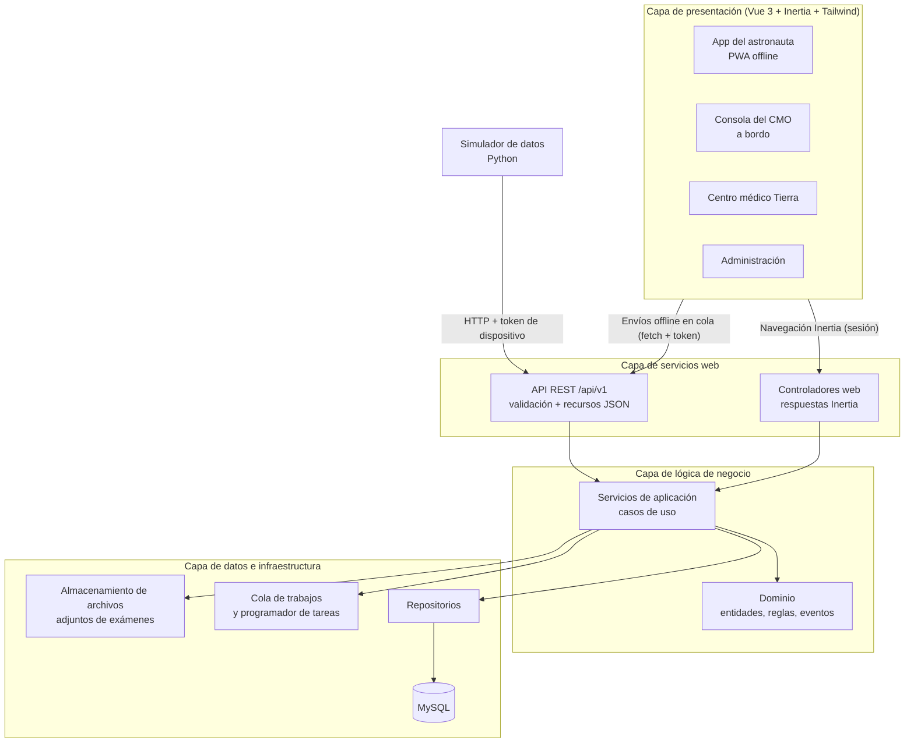
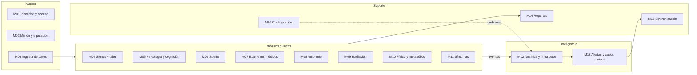
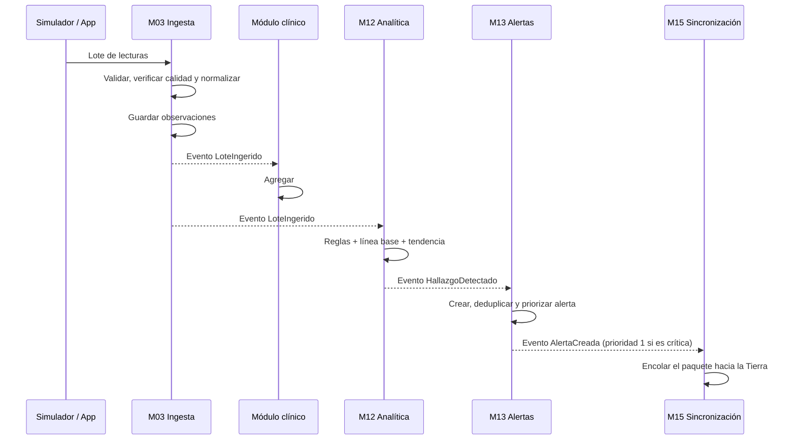

# 02 · Propuesta de módulos del sistema

> **AstroHealth** · Propuesta para el NASA International Space Apps Challenge 2026
> Documento 2 de 5 · [← Análisis de enfermedades](01-analisis-enfermedades.md) · [Inicio](../../README.md) · [Siguiente: Propuesta tecnológica →](03-propuesta-tecnologica.md)

---

## Contenido

1. [Principios de diseño](#1-principios-de-diseño)
2. [Arquitectura por capas](#2-arquitectura-por-capas)
3. [Mapa de módulos](#3-mapa-de-módulos)
4. [Módulos de backend](#4-módulos-de-backend)
5. [Módulos de frontend](#5-módulos-de-frontend)
6. [Comunicación entre módulos](#6-comunicación-entre-módulos)
7. [Roles y permisos](#7-roles-y-permisos)

---

## 1. Principios de diseño

| Principio | Qué significa en AstroHealth |
|---|---|
| **Modularidad** | Cada módulo es dueño de sus datos, reglas y endpoints. Ningún módulo lee directamente las tablas de otro. |
| **Separación por capas** | Presentación → Controladores (web e API) → Aplicación → Dominio → Infraestructura. Cada capa solo conoce a la de abajo. |
| **Bajo acoplamiento** | Los módulos se comunican mediante **eventos de dominio** (por ejemplo, `ObservacionRegistrada`) y **contratos** (interfaces), no con llamadas cruzadas. |
| **Offline-first** | "Registrar siempre, decidir a bordo, sincronizar cuando se pueda" (regla de oro de la Fase 2). |
| **Una sola lógica de negocio** | Las páginas de Inertia y la API REST llaman a los mismos servicios de aplicación; ninguna regla se duplica en el frontend. |
| **Configurable, no codificado** | Umbrales, frecuencias de tests y rangos de referencia se guardan como datos editables, no como constantes en el código. |
| **Explicable** | Toda alerta indica **por qué** se generó (regla, valor, línea base, tendencia). |
| **Humano en el bucle** | El sistema sugiere y prioriza; las decisiones clínicas las registra una persona. |

---

## 2. Arquitectura por capas



| Capa | Responsabilidad | No debe |
|---|---|---|
| **Presentación** | Páginas y componentes Vue: mostrar datos, capturar entradas, funcionar sin conexión, cola local de envíos | Contener reglas clínicas |
| **Servicios web** | Controladores web (devuelven páginas Inertia) y API REST (`/api/v1`, para el simulador y la cola offline): autenticar, validar y transformar | Contener lógica de negocio |
| **Lógica de negocio** | Casos de uso, reglas clínicas, cálculo de líneas base, emisión de eventos | Conocer HTTP o SQL |
| **Datos e infraestructura** | Persistencia, colas, archivos, tareas programadas | Tomar decisiones de negocio |

---

## 3. Mapa de módulos



| Código | Módulo | Grupo | Afecciones que cubre (ver [01](01-analisis-enfermedades.md)) | Prioridad |
|---|---|---|---|:---:|
| M01 | Identidad y acceso | Núcleo | — | 🟢 MVP |
| M02 | Misión y tripulación | Núcleo | — | 🟢 MVP |
| M03 | Ingesta de datos | Núcleo | Todas las que usan sensores | 🟢 MVP |
| M04 | Signos vitales | Clínico | Cardiovascular, ortostatismo, estrés térmico | 🟢 MVP |
| M05 | Psicología y cognición | Clínico | Estrés, ánimo, deterioro cognitivo, cohesión | 🟢 MVP |
| M06 | Sueño | Clínico | Privación de sueño, desajuste circadiano | 🟢 MVP |
| M07 | Exámenes médicos | Clínico | Anemia, hueso, riñón, vitaminas, virus, SANS | 🟢 MVP |
| M08 | Ambiente | Clínico | CO₂, contaminantes, ruido | 🟢 MVP |
| M09 | Radiación | Clínico | Exposición acumulada, SPE | 🟢 MVP |
| M10 | Físico y metabólico | Clínico | Hueso, músculo, nutrición, masa corporal | 🟢 MVP |
| M11 | Síntomas | Clínico | Transversal: mareo, cefalea, dolor, piel | 🟢 MVP |
| M12 | Analítica y línea base | Inteligencia | Transversal | 🟢 MVP |
| M13 | Alertas y casos clínicos | Inteligencia | Transversal | 🟢 MVP |
| M14 | Reportes | Soporte | Transversal | 🟢 MVP |
| M15 | Sincronización | Soporte | Distancia de la Tierra (D) | 🟢 MVP |
| M16 | Configuración | Soporte | — | 🟢 MVP |
| — | Simulador | Herramienta externa | Genera los datos de todos los módulos | 🟢 MVP |

---

## 4. Módulos de backend

Cada módulo de backend se organiza internamente igual:

```
Modulo/
├── Http/          # Controladores, validación de solicitudes, recursos JSON  (capa API)
├── Application/   # Servicios y casos de uso                                (lógica de negocio)
├── Domain/        # Entidades, objetos de valor, reglas, eventos             (lógica de negocio)
├── Infrastructure/# Repositorios, modelos ORM, integraciones                 (datos)
├── Database/      # Migraciones y seeders del módulo
├── routes.php     # Rutas del módulo bajo /api/v1/...
└── Tests/         # Pruebas unitarias y de integración del módulo
```

### 4.1 Núcleo

#### M01 · Identidad y acceso

| Submódulo | Responsabilidad |
|---|---|
| Autenticación | Inicio de sesión, tokens de API, cierre de sesión, expiración |
| Roles y permisos | Astronauta, CMO, médico de vuelo, ingeniero biomédico, investigador, administrador |
| Tokens de dispositivo | Credenciales para el simulador y los sensores (solo pueden escribir lecturas) |
| Auditoría | Registro inmutable de quién vio o cambió qué y cuándo |

#### M02 · Misión y tripulación

| Submódulo | Responsabilidad |
|---|---|
| Misiones | Nombre, tipo (órbita baja, Luna, Marte), fechas, día de misión actual |
| Tripulantes | Perfil, datos demográficos básicos, rol a bordo |
| Dispositivos | Sensores asignados a cada tripulante, estado y batería |
| Línea base previa al vuelo | Valores de referencia individuales registrados antes del vuelo |

#### M03 · Ingesta de datos

| Submódulo | Responsabilidad |
|---|---|
| Recepción | Endpoint de lotes (`POST /api/v1/ingesta/lotes`) con clave de idempotencia |
| Validación | Formato, unidades, marca de tiempo, rango físicamente posible |
| Calidad de señal | Marca los artefactos (por ejemplo, electrodo suelto) y avisa al astronauta |
| Normalización | Convierte unidades y asigna códigos estándar (LOINC) |
| Enrutamiento | Entrega cada observación al módulo clínico que corresponde |

### 4.2 Módulos clínicos

#### M04 · Signos vitales

| Submódulo | Responsabilidad |
|---|---|
| Monitoreo continuo | FC, SpO₂, frecuencia respiratoria, temperatura central |
| Presión arterial | Tomas diarias; evaluación ortostática (de pie en gravedad, antes del vuelo o tras aterrizar, o con LBNP en vuelo) |
| ECG | Ritmo, QTc y pausas (resumen calculado; la señal cruda solo en la demo) |
| Detección de irregularidades | Variabilidad anómala de los intervalos entre latidos (RR) como indicio de arritmia (escenario E1) |
| VFC | Variabilidad de la frecuencia cardiaca diaria como indicador de estrés y fatiga |
| Contexto de actividad | Etiqueta cada lectura como reposo, ejercicio o sueño para aplicar los umbrales correctos ([04 §8](04-manejo-de-datos.md#8-configuración-inicial-de-umbrales)) |
| Agregación | Resúmenes por minuto, hora y día para las gráficas y la sincronización |

#### M05 · Psicología y cognición

| Submódulo | Responsabilidad |
|---|---|
| **Tests cognitivos** | Banco de pruebas: tiempo de reacción (PVT), aritmética simple y memoria. Registra cada respuesta, el tiempo y si es correcta |
| **Seguimiento emocional** | Escalas breves de ánimo, estrés, carga de trabajo y cohesión del grupo |
| **Planificación de evaluaciones** | Calendario de tests (por ejemplo, PVT diario y escalas semanales) y recordatorios |
| **Detección de deterioro** | Compara cada sesión con la línea base personal (ver [04](04-manejo-de-datos.md#5-ejemplo-completo-detección-de-deterioro-cognitivo)) |
| **Reportes psicológicos** | Evolución individual; confidencial, visible solo para el personal médico |

#### M06 · Sueño

| Submódulo | Responsabilidad |
|---|---|
| Registro de sueño | Duración, eficiencia y horarios, a partir de actigrafía simulada o entrada manual |
| Higiene del sueño | Uso de medicación, luz y ruido percibidos |
| Regularidad circadiana | Variación de los horarios de acostarse y despertarse |

#### M07 · Exámenes médicos

| Submódulo | Responsabilidad |
|---|---|
| **Carga de resultados** | Formulario estructurado o archivo CSV; PDF opcional como adjunto |
| **Catálogo de pruebas** | Prueba, unidad, código LOINC y rango de referencia (editable) |
| **Interpretación** | Marca cada valor como bajo, normal, alto o crítico |
| **Evolución** | Gráfica histórica por prueba y cambio frente a la toma anterior (*delta check*) |
| **Exámenes programados** | Recordatorios de exámenes silenciosos (Doppler, OCT, marcadores óseos) |

#### M08 · Ambiente

| Submódulo | Responsabilidad |
|---|---|
| Atmósfera | pCO₂ por módulo de la nave, compuestos orgánicos volátiles (VOC) y partículas |
| Ruido | Dosis acústica acumulada |
| Correlación ambiente–salud | Cruza CO₂ con cefalea, fatiga y resultados cognitivos |

#### M09 · Radiación

| Submódulo | Responsabilidad |
|---|---|
| Dosimetría personal | Dosis acumulada frente al límite de carrera de 600 mSv |
| Tasa en tiempo real | Detección de subidas bruscas (evento solar) |
| Proyección | Estimación de la dosis al final de la misión |

#### M10 · Físico y metabólico

| Submódulo | Responsabilidad |
|---|---|
| Ejercicio | Sesiones (ARED, cinta, cicloergómetro), carga y FC |
| Composición corporal | Masa corporal semanal y fuerza |
| Nutrición e hidratación | Ingesta y balance hídrico |
| Glucosa | Serie del monitor continuo (CGM) y su umbral |

#### M11 · Síntomas

| Submódulo | Responsabilidad |
|---|---|
| Diario de síntomas | Selección rápida (cefalea, náusea, dolor, mareo…) con intensidad de 0 a 10 |
| Adjuntos | Fotografía (por ejemplo, de lesiones cutáneas) |
| Cuestionario de mareo espacial | Se activa automáticamente los primeros días de misión |

### 4.3 Inteligencia

#### M12 · Analítica y línea base

| Submódulo | Responsabilidad |
|---|---|
| **Motor de reglas** | Evalúa umbrales configurables (por ejemplo, SpO₂ < 92 %) |
| **Línea base personal** | Línea base de **referencia fija** por tripulante y variable (solo se recalcula con autorización médica) y estadística móvil de 7 días para tendencias; ver la política en [04 §4.4](04-manejo-de-datos.md#44-métodos-de-análisis-explicables) |
| **Tendencias** | Pendiente de los últimos 7 y 30 días, media móvil exponencial (EWMA) |
| **Correlaciones** | Reglas que combinan módulos (CO₂ + cefalea; sueño + PVT) |
| **Explicación** | Genera el texto del "por qué" de cada hallazgo |

#### M13 · Alertas y casos clínicos

| Submódulo | Responsabilidad |
|---|---|
| **Gestor de alertas** | Crea, deduplica, prioriza (`info`, `aviso`, `crítico`) y notifica |
| **Confirmación** | Las alertas de aviso piden una segunda medición antes de escalar |
| **Casos clínicos** | Agrupan alertas, acciones del CMO y su resultado |
| **Protocolos guiados** | Listas de verificación paso a paso según el tipo de caso |
| **Retroalimentación** | Marca verdaderos y falsos positivos para ajustar los umbrales |

### 4.4 Soporte

#### M14 · Reportes

| Submódulo | Responsabilidad |
|---|---|
| Reporte diario | Estado de cada tripulante con semáforo por sistema |
| Reporte de misión | Tendencias completas al cierre |
| Exportación | PDF y CSV; datos anonimizados para investigación (JSON compatible con FHIR, como evolución) |

#### M15 · Sincronización

| Submódulo | Responsabilidad |
|---|---|
| Cola de salida | Paquetes priorizados: 1 = alerta crítica, 2 = resumen, 3 = detalle |
| Simulador de enlace | Retardo configurable (ISS < 1 s, Luna ~1,3 s, Marte ~3–22 min) y ventanas sin enlace |
| Recepción en Tierra | Entrega idempotente y acuse de recibo |
| Recomendaciones | Mensajes del médico de vuelo de vuelta a la nave |

#### M16 · Configuración

| Submódulo | Responsabilidad |
|---|---|
| Umbrales | Editables por el médico de vuelo, con historial de cambios |
| Ajustes temporales a bordo | El CMO puede ajustar un umbral durante un apagón; queda auditado, se sincroniza y el médico de vuelo lo confirma o lo revierte |
| Catálogos | Pruebas de laboratorio, escalas, tipos de síntoma |
| Parámetros de misión | Perfil de enlace, frecuencia de tests, límites de dosis |

---

## 5. Módulos de frontend

| Aplicación | Usuario | Dispositivo | Funciona sin conexión | Prioridad |
|---|---|---|:---:|:---:|
| **F1 · App del astronauta** | Astronauta | Tableta a bordo | ✅ Sí (PWA) | 🟢 MVP |
| **F2 · Consola del CMO** | Oficial médico a bordo | Portátil o tableta | ✅ Sí | 🟢 MVP |
| **F3 · Centro médico Tierra** | Médico de vuelo | Escritorio | ➖ No es necesario | 🟢 MVP |
| **F4 · Administración** | Administrador e ingeniero biomédico | Escritorio | ➖ No es necesario | 🟢 MVP |

### F1 · App del astronauta

| Submódulo | Contenido |
|---|---|
| Mi estado hoy | Semáforo por sistema: corazón, sueño, mente, radiación, cuerpo |
| Mis signos vitales | Valores actuales y tendencia semanal |
| Tests cognitivos | PVT y aritmética en unos 5 minutos, con pantalla sin distracciones |
| ¿Cómo me siento? | Escalas de ánimo y estrés; diario de síntomas |
| Mi sueño | Registro de la noche anterior y tendencia |
| Mis exámenes | Carga de resultados y evolución |
| Recordatorios | Tests, exámenes, hidratación, ejercicio |
| Estado de sincronización | Indicador de pendientes y última sincronización |

### F2 · Consola del CMO

| Submódulo | Contenido |
|---|---|
| Panel de tripulación | Tarjetas con semáforo de cada tripulante |
| Bandeja de alertas | Ordenada por gravedad, con su explicación |
| Detalle del tripulante | Gráficas de todas las variables y comparación con la línea base |
| Casos clínicos | Protocolo guiado y registro de acciones |
| Recomendaciones de la Tierra | Mensajes recibidos del médico de vuelo |

### F3 · Centro médico Tierra

| Submódulo | Contenido |
|---|---|
| Panel de misión | Estado de la tripulación y del enlace (latencia, próxima ventana, pendientes) |
| Tendencias longitudinales | Semanas y meses por variable |
| Historial de alertas y decisiones | Lo que se decidió a bordo y cuándo llegó |
| Enviar recomendación | Mensaje priorizado hacia la nave |
| Reportes | Diario, semanal y de misión |

### F4 · Administración

| Submódulo | Contenido |
|---|---|
| Usuarios y roles | Alta, baja y asignación de roles |
| Umbrales y catálogos | Edición con historial de cambios |
| Dispositivos y simulador | Tokens, estado y escenarios activos |
| Auditoría | Consulta del registro de accesos |

### Componentes compartidos de interfaz

Para que todas las aplicaciones se vean y funcionen igual, se construye una **librería común**:

- semáforo de estado,
- tarjeta de signo vital,
- gráfica de serie de tiempo con banda de línea base,
- insignia de alerta,
- formulario de escala,
- indicador de sincronización,
- tabla de resultados con marcas de rango.

Se implementan como **componentes Vue** reutilizables, estilizados con Tailwind.

### Bocetos de las pantallas principales

**F1 · Mi estado hoy** (tableta del astronauta)

```text
┌──────────────────────────────────────────────┐
│ AstroHealth · T2 · Día 34       ⟳ 3 pendientes│
├──────────────────────────────────────────────┤
│  ✔ Corazón   ✔ Sueño   ⚠ Mente   ✔ Cuerpo     │
│                                              │
│  FC 62 lpm   SpO₂ 98 %   FR 14   T 36,8 °C    │
│                                              │
│  ⚠ Tu tiempo de reacción está más lento que   │
│    tu línea base (3 días seguidos).           │
│                                              │
│  [ Hacer test (5 min) ] [ ¿Cómo me siento? ]  │
│  [ Registrar síntoma ]  [ Cargar examen ]     │
└──────────────────────────────────────────────┘
```

**F2 · Consola del CMO**

```text
┌────────────────────────┬─────────────────────────────┐
│ Tripulación            │ Alertas (por gravedad)      │
│ ┌────┐┌────┐┌────┐┌───┐│ 🚨 —                         │
│ │ T1 ││ T2 ││ T3 ││T4 ││ ⚠ T2 Deterioro cognitivo     │
│ │ ✔  ││ ⚠  ││ ✔  ││ ✔ ││   PVT 342 ms (base 281±18)  │
│ └────┘└────┘└────┘└───┘│   Sueño 4,9 h · Fatiga 7/10 │
│                        │   [Confirmar] [Descartar]   │
│ Enlace: Marte · 12 min │ ℹ T4 Sueño corto 1 noche     │
│ Próxima ventana 14:20  │                             │
└────────────────────────┴─────────────────────────────┘
```

El semáforo siempre combina **icono, texto y color**, para no depender solo del color.

---

## 6. Comunicación entre módulos

Los módulos clínicos **no llaman** a Analítica ni a Alertas: publican un evento y quien esté interesado reacciona. Así se puede añadir un módulo nuevo sin tocar los existentes.



| Evento | Lo publica | Lo consumen |
|---|---|---|
| `LoteIngerido` | M03 | M04, M09, M12, M15 |
| `ObservacionRegistrada` | M04, M06, M10, M11 (registros individuales) | M12, M14 |
| `TestCognitivoCompletado` | M05 | M12 |
| `ResultadoExamenCargado` | M07 | M12, M14 |
| `HallazgoDetectado` | M12 | M13 |
| `AlertaCreada` / `AlertaEscalada` | M13 | M14, M15, notificaciones |
| `RecomendacionRecibida` | M15 | M13, F2 |
| `UmbralModificado` | M16 | M12, M01 (auditoría), M15 |

---

## 7. Roles y permisos

| Capacidad | Astronauta | CMO | Médico de vuelo | Ing. biomédico | Investigador | Admin |
|---|:---:|:---:|:---:|:---:|:---:|:---:|
| Ver sus propios datos | ✅ | ✅ | — | — | — | — |
| Ver los datos de toda la tripulación | — | ✅ | ✅ | — | — | — |
| Registrar síntomas, tests y exámenes propios | ✅ | ✅ | — | — | — | — |
| Ver alertas y casos clínicos | — | ✅ | ✅ | — | — | — |
| Gestionar alertas y casos clínicos (en la nave) | — | ✅ | — (responde con recomendaciones) | — | — | — |
| Ver la evaluación psicológica detallada (escalas, cohesión, evolución) | Propia | Propia | ✅ | — | — | — |
| Ver las alertas de deterioro cognitivo | — | ✅ | ✅ | — | — | — |
| Enviar recomendaciones | — | — | ✅ | — | — | — |
| Ver el estado de dispositivos y sincronización | Propio | ✅ | ✅ | ✅ | — | ✅ |
| Exportar datos anonimizados | — | — | — | — | ✅ | — |
| Editar umbrales clínicos | — | — | ✅ | — | — | — |
| Ajuste temporal de umbrales a bordo | — | ✅ | — | — | — | — |
| Gestionar usuarios y roles | — | — | — | — | — | ✅ |

> **Privacidad por diseño:** separación de datos clínicos, operativos y de investigación, como hace la NASA con el LSAH (datos clínicos) y el LSDA (datos de investigación). Los investigadores solo acceden a datos anonimizados. Para un uso en Colombia, los datos de salud son **datos sensibles** según la Ley 1581 de 2012: requieren consentimiento explícito e informado y medidas de seguridad reforzadas.

---

[← Análisis de enfermedades](01-analisis-enfermedades.md) · [Inicio](../../README.md) · [Siguiente: Propuesta tecnológica →](03-propuesta-tecnologica.md)
