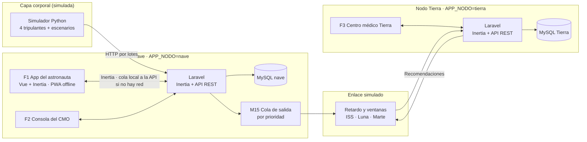

# 03 · Propuesta tecnológica

> **AstroHealth** · Propuesta para el NASA International Space Apps Challenge 2026
> Documento 3 de 5 · [← Módulos del sistema](02-modulos-del-sistema.md) · [Inicio](../../README.md) · [Siguiente: Manejo de datos →](04-manejo-de-datos.md)

---

## Contenido

1. [El punto de partida: dos visiones](#1-el-punto-de-partida-dos-visiones)
2. [Decisión de stack](#2-decisión-de-stack)
3. [Stack por capa](#3-stack-por-capa)
4. [Evaluación de la visión de la Fase 2](#4-evaluación-de-la-visión-de-la-fase-2)
5. [Arquitectura de despliegue](#5-arquitectura-de-despliegue)
6. [Estrategia offline-first](#6-estrategia-offline-first)
7. [Estructura del repositorio](#7-estructura-del-repositorio)
8. [Calidad y buenas prácticas](#8-calidad-y-buenas-prácticas)
9. [Hoja de ruta tecnológica](#9-hoja-de-ruta-tecnológica)

---

## 1. El punto de partida: dos visiones

La investigación contenía **dos propuestas distintas**:

| | [Proyecto Space Apps](../investigacion/01-proyecto-space-apps.md) (planteamiento inicial) | [Arquitectura de largo plazo](../investigacion/03-arquitectura-vision-fase2.md) (Fase 2) |
|---|---|---|
| Backend | PHP puro + API REST | NestJS (TypeScript) + Python/FastAPI |
| Base de datos | MySQL | PostgreSQL + TimescaleDB + Redis |
| Frontend | Tailwind CSS v4 + JavaScript (PWA) | React + TypeScript + Vite; Flutter para la tableta |
| Mensajería | — | MQTT (Mosquitto) |
| Comunicación espacial | Sincronización simple | DTN real (NASA HDTN/ION) |
| IA | — | ML con PyTorch + LLM local (Ollama) + MLOps |
| Infraestructura | cPanel | Docker + K3s + Prometheus/Grafana + Keycloak |
| Piezas a dominar | ~4 | ~20 |

La Fase 2 describe un **sistema de nivel industrial**, correcto como visión, pero desproporcionado para un equipo de cinco estudiantes con cuatro semanas hasta el evento. El planteamiento inicial, en cambio, se queda corto en estructura (PHP puro). La decisión toma lo mejor de ambos.

---

## 2. Decisión de stack

> ✅ **Decidido por el equipo:** **Laravel + MySQL** en el backend, **Inertia.js + Vue 3 + Tailwind CSS v4** en el frontend (como PWA) y **Python** para el simulador de datos.

### 2.1 ¿Por qué Laravel y no PHP puro?

El proyecto exige una arquitectura **modular, por capas, mantenible y robusta**. Con PHP puro, el equipo tendría que construir a mano lo que un framework ya resuelve y prueba:

| Necesidad del proyecto | PHP puro | Laravel |
|---|---|---|
| Enrutamiento y versionado de la API | Manual | Integrado (rutas, prefijos, grupos) |
| Validación de entrada | Manual | *Form Requests* declarativos |
| Autenticación por sesión, tokens y roles | Manual (riesgo de seguridad) | Sesiones + Sanctum + *Policies*/*Gates* |
| Acceso a datos y migraciones | SQL a mano | Eloquent + migraciones versionadas |
| Eventos entre módulos | Manual | Sistema de eventos y *listeners* nativo |
| Tareas en segundo plano | Manual | Colas + programador (*scheduler*) |
| Pruebas automatizadas | Configuración propia | Pest/PHPUnit integrados |
| Funciona en cPanel | ✅ | ✅ (con cron para colas y tareas) |

**Laravel no cambia el lenguaje del equipo** (sigue siendo PHP con MySQL), pero da la estructura que necesita el proyecto.

### 2.2 ¿Por qué Inertia + Vue 3?

| Ventaja | Qué significa para AstroHealth |
|---|---|
| **Un solo proyecto** | Las páginas Vue viven dentro del proyecto Laravel; no hay que mantener una SPA y una API de pantallas por separado |
| **Rutas, sesión y permisos en Laravel** | Los controladores entregan los datos de cada página; las *Policies* deciden qué ve cada rol |
| **Componentes reactivos** | El test PVT necesita medir tiempos de reacción en el navegador con precisión de milisegundos (`performance.now()`); Vue lo hace natural |
| **Curva suave** | Las plantillas de Vue se parecen al HTML; más fácil que React para quien viene de JavaScript sin framework |
| **Kit oficial** | Laravel ofrece un *starter kit* con Vue, Inertia y Tailwind ya configurados (autenticación incluida) |
| **Recarga parcial y sondeo** | Inertia 2 permite refrescar solo los datos de un panel cada pocos segundos, sin WebSockets |

**La limitación a resolver:** Inertia pide cada página al servidor, así que por sí sola **no funciona sin conexión**. La [sección 6](#6-estrategia-offline-first) explica cómo se cubre: las pantallas que deben funcionar offline guardan sus datos en el navegador y los envían a la API REST cuando vuelve la red.

### 2.3 ¿Por qué Python solo para el simulador?

- La librería **NeuroKit2** genera señales fisiológicas realistas (ECG, respiración, PPG) con funciones ya hechas.
- **NumPy** facilita los modelos estadísticos (ritmos circadianos, ruido, tendencias).
- El simulador es una **herramienta externa** que se comunica con la API por HTTP, igual que lo haría un sensor real. Así el backend no depende de Python.

---

## 3. Stack por capa

### 3.1 Resumen

| Capa | Tecnología | Versión sugerida | Justificación | Alternativa |
|---|---|---|---|---|
| **Frontend: páginas** | Inertia.js + Vue 3 (Composition API) | Inertia 2 · Vue 3.5 | Páginas Vue servidas por Laravel, sin API aparte para las pantallas | — (decidido) |
| **Frontend: estilos** | Tailwind CSS | v4 | Consistencia visual rápida; incluido en el *starter kit* | — |
| **Frontend: compilación** | Vite + `laravel-vite-plugin` | Estable actual | Integración oficial con Laravel, Vue y Tailwind v4 | — |
| **Frontend: gráficas** | Apache ECharts (`vue-echarts`) | 5.x | Series de tiempo largas, zoom, bandas de referencia | Chart.js (más simple, menos potente) |
| **Frontend: offline** | `vite-plugin-pwa` (Workbox) + IndexedDB (Dexie.js) | — | Caché de la aplicación y cola local de envíos | Service Worker escrito a mano |
| **Servicios web** | Controladores Inertia + API REST JSON `/api/v1` | OpenAPI 3 | Inertia para navegar; REST para el simulador y la cola offline | — |
| **Backend** | PHP + Laravel | PHP 8.3+ · Laravel 12 o la versión estable vigente | Capas, eventos, colas y seguridad integrados | — (decidido) |
| **Autenticación** | Sesión de Laravel (web) + Sanctum (tokens de API y de dispositivo) | — | Sesión para Inertia; tokens para el simulador y la cola offline | — |
| **Base de datos** | MySQL | 8.x | Disponible en cPanel; funciones de ventana y columnas JSON | — (decidido) |
| **Colas y tareas** | Cola de Laravel (driver `database`) + *scheduler* por cron | — | Funciona en cPanel sin procesos permanentes | Redis, si se usa VPS |
| **Tiempo real** | Sondeo de Inertia (`usePoll`, cada 5–10 s) con recarga parcial | — | Simple y compatible con cPanel | Laravel Reverb (WebSockets) si hay VPS |
| **Simulación** | Python + NumPy + NeuroKit2 + httpx | Python 3.12 | Señales fisiológicas realistas y escenarios | — (decidido) |
| **Reportes PDF** | `barryvdh/laravel-dompdf` | — | Genera los reportes de M14 desde plantillas | Spatie Browsershot |
| **Documentación de la API** | Scribe | — | Genera la documentación OpenAPI desde el código | L5-Swagger |
| **Pruebas** | Pest (PHP), Vitest + Vue Test Utils (JS), pytest (simulador) | — | Pruebas por módulo | PHPUnit |
| **Calidad de código** | Laravel Pint, Larastan, ESLint (`eslint-plugin-vue`), Prettier | — | Estilo uniforme y análisis estático | — |
| **Control de versiones y CI** | Git + GitHub + GitHub Actions | — | Pruebas automáticas en cada *pull request* | GitLab CI |
| **Entorno local** | Laravel Herd, Laragon o Laravel Sail (Docker) | — | Mismo entorno para todo el equipo | XAMPP |
| **Despliegue** | cPanel (dominio del equipo) | — | Ya está disponible y lo maneja el líder técnico | VPS con Docker |

> El *starter kit* de Vue trae TypeScript. El equipo puede usarlo de forma ligera (tipos solo en los datos que llegan de Laravel) o escribir los componentes nuevos en JavaScript; lo importante es elegir una opción en el Sprint 0 y mantenerla.

### 3.2 Estándares de datos

Aunque la base sea MySQL, el modelo de datos sigue los estándares médicos para que, más adelante, se pueda exportar o integrar con sistemas reales:

| Estándar | Uso en AstroHealth |
|---|---|
| **HL7 FHIR** (inspiración) | Estructura de las entidades: `Patient` → tripulante, `Observation` → observación, `Device` → dispositivo, `QuestionnaireResponse` → respuesta a una escala |
| **LOINC** | Código de cada variable medida (tabla siguiente) |
| **UCUM** | Unidades normalizadas (`/min`, `%`, `mm[Hg]`, `Cel`, `kg`) |
| **ISO 8601 en UTC** | Todas las marcas de tiempo |

| Variable | Código LOINC | Unidad UCUM |
|---|---|---|
| Frecuencia cardiaca | 8867-4 | `/min` |
| Frecuencia respiratoria | 9279-1 | `/min` |
| SpO₂ (oximetría de pulso) | 59408-5 | `%` |
| Temperatura corporal | 8310-5 | `Cel` |
| Presión arterial sistólica | 8480-6 | `mm[Hg]` |
| Presión arterial diastólica | 8462-4 | `mm[Hg]` |
| Peso corporal | 29463-7 | `kg` |

> Los códigos LOINC del resto de variables (laboratorio, escalas) se registran en el catálogo del módulo M16 a medida que se incorporen.

### 3.3 Volumen de datos y decisión de muestreo

MySQL soporta sin problema el volumen del proyecto **si se controla la frecuencia de muestreo**:

| Estrategia | Cálculo (4 tripulantes × 6 series continuas) | Filas por día | Valoración |
|---|---|---:|---|
| 1 lectura por segundo | 4 × 6 × 86.400 | 2.073.600 | ❌ Innecesario para el MVP |
| **1 lectura por minuto** | 4 × 6 × 1.440 | **34.560** | ✅ Recomendado |
| Resúmenes por hora | 4 × 6 × 24 | 576 | ✅ Para gráficas largas y sincronización |

- Con 1 lectura por minuto, 30 días de historia simulada son ~1 millón de filas; las series de ambiente (por módulo de la nave) y de radiación añaden otras ~10.000 filas por día.
- El **ECG crudo** (cientos de muestras por segundo) solo se genera en ventanas cortas para la demo y se guarda como archivo, no como filas.
- Las tablas de observaciones se indexan por `(tripulante_id, codigo, medido_en)` y pueden particionarse por mes si crecen.

---

## 4. Evaluación de la visión de la Fase 2

Cada tecnología de la Fase 2 se evalúa con argumentos. **No se descarta la visión**: se ordena en el tiempo.

| Tecnología (Fase 2) | Valoración | Argumento | Decisión |
|---|:---:|---|---|
| NestJS | 🟡 | Excelente, pero introduce un lenguaje y un framework nuevos para el equipo | Laravel ocupa ese rol |
| React + TypeScript | 🟡 | Potente, pero con más curva de aprendizaje; Vue 3 cumple el mismo papel con Inertia | Reemplazado por Vue 3 |
| Flutter | 🔴 | Tercer lenguaje (Dart) y otra base de código; una PWA cubre la tableta | Reemplazado por la PWA |
| PostgreSQL + TimescaleDB | 🟡 | Mejor para series de tiempo, pero cPanel ofrece MySQL; con muestreo por minuto, MySQL alcanza | Migración futura si se necesita |
| MQTT | 🟡 | Ideal con sensores reales; con datos simulados, HTTP por lotes es suficiente | Evolución con hardware real |
| DTN real (HDTN/ION) | 🔴 | Requiere infraestructura Linux especializada; el valor demostrativo se logra simulando retardo y cortes | **Se simula** en M15 |
| ML con PyTorch + MLOps | 🟡 | Sin datos reales, un modelo complejo no es verificable; reglas + estadística son **explicables** | Reglas + línea base en el MVP; ML como evolución |
| LLM local (Ollama + RAG) | 🔴 | Requiere hardware con GPU o mucha memoria; no es necesario para el MVP | Fuera del MVP |
| Keycloak | 🟡 | Muy completo, pero la autenticación de Laravel + roles cubren el alcance | Evolución |
| Docker + K3s | 🟡 | K3s no aporta valor en una demo; Docker sí, para el entorno local | Docker opcional (Sail) |
| Prometheus + Grafana | 🔴 | Monitoreo de infraestructura, no de salud | Fuera del MVP |

**Lo que sí se conserva de la Fase 2:** la regla de oro (*registrar siempre, decidir a bordo, sincronizar cuando se pueda*), las tres capas (sensores → a bordo → Tierra), los niveles de alerta, la línea base personal, el simulador, los escenarios de demo, el modelo de datos inspirado en FHIR y la separación de datos clínicos y de investigación.

---

## 5. Arquitectura de despliegue

Una sola base de código se despliega **dos veces** y la variable `APP_NODO` (`nave` o `tierra`) define el comportamiento. Así se reproduce la arquitectura de tres capas de la Fase 2 sin multiplicar las tecnologías.



| Componente | Dónde se ejecuta en la demo |
|---|---|
| Nodo nave | Subdominio 1 en cPanel (o servidor local) |
| Nodo Tierra | Subdominio 2 en cPanel |
| Enlace simulado | Tarea programada del nodo nave que libera paquetes según el perfil de enlace |
| Simulador | Portátil del equipo, enviando datos a la API de la nave |

> **Resolución del enlace simulado:** en cPanel, el cron se ejecuta como mínimo **una vez por minuto**. Por eso los retardos de la ISS (< 1 s) y de la Luna (~1,3 s) se tratan como **entrega en el siguiente ciclo** (prácticamente inmediata), y solo el perfil de Marte (~3–22 min) se simula con precisión de minutos. Para la demo basta: el mensaje clave es el contraste entre "casi en vivo" y "minutos o semanas".

> **Plan B (si el tiempo apremia):** un solo despliegue en el que el nodo Tierra es una vista que solo muestra los paquetes "entregados" según el retardo simulado. Se mantiene el mensaje de la demo con la mitad del esfuerzo de despliegue.

---

## 6. Estrategia offline-first

Hay dos niveles de desconexión, y el sistema resuelve ambos:

| Nivel | Situación | Solución |
|---|---|---|
| **Tableta ↔ servidor de a bordo** | La tableta pierde la red de la nave | PWA: la aplicación se sirve desde la caché del Service Worker; los registros se guardan en IndexedDB y se envían a la API REST al reconectar |
| **Nave ↔ Tierra** | Retardo de minutos o apagón de semanas (conjunción solar) | M15: la nave sigue operando de forma autónoma; los paquetes esperan en la cola y se envían por prioridad cuando hay ventana |

### 6.1 Cómo se combina Inertia con el modo sin conexión

| Tipo de pantalla | Ejemplos | Comportamiento sin red |
|---|---|---|
| **Captura crítica** | Test PVT, test de aritmética, ánimo y estrés, síntomas, carga de exámenes | Componente Vue autónomo: funciona con los datos ya cargados, guarda cada registro en IndexedDB y la cola lo envía a `/api/v1` con un token de Sanctum al volver la red |
| **Consulta** | Mi estado hoy, tendencias, alertas | Muestra la última copia guardada en IndexedDB con un aviso de "datos de hh:mm" |
| **Administración y Tierra** | Umbrales, usuarios, F3 | Requieren conexión (no se usan a bordo sin red) |

- El Service Worker precarga los archivos compilados de Vite (JS y CSS) para que la aplicación abra sin red.
- Al detectar que no hay conexión, la navegación de Inertia se sustituye por las pantallas de captura y consulta locales.

### 6.2 Reglas para evitar conflictos

1. **Cada registro nace con un UUID generado en el cliente**, así reenviar el mismo registro no lo duplica (idempotencia).
2. **Las observaciones son inmutables**: no se editan, se corrigen con un nuevo registro que anula el anterior. Así no hay conflictos de escritura.
3. **La marca de tiempo de la medición** (no la de llegada) define el orden.
4. **Los umbrales los define el médico de vuelo en la Tierra** y llegan a la nave como configuración de solo lectura.
5. **Durante un apagón, el CMO puede aplicar un ajuste temporal** a un umbral. El ajuste se aplica solo a bordo, queda auditado y viaja a la Tierra con prioridad 2; al revisarlo, el médico de vuelo lo confirma (pasa a ser la configuración oficial) o lo revierte. Así se respeta el principio de autonomía sin perder el control médico.

> El API de *Background Sync* del navegador no está disponible en todos los navegadores, así que la cola local se reintenta también al abrir la aplicación y al detectar el evento `online`.

---

## 7. Estructura del repositorio

```
ArtemisIII/
├── README.md                     # Qué hay en cada carpeta
├── documentacion/                # Investigación, propuesta, fichas de módulos y plan (lo que se escribió antes de programar)
├── astrohealth/                   # Proyecto Laravel (starter kit de Vue), con su docs/ técnico
│   ├── app/
│   │   ├── Modules/
│   │   │   ├── Identidad/        # M01
│   │   │   ├── Mision/           # M02
│   │   │   ├── Ingesta/          # M03
│   │   │   ├── SignosVitales/    # M04
│   │   │   ├── Psicologia/       # M05
│   │   │   ├── Sueno/            # M06
│   │   │   ├── Examenes/         # M07
│   │   │   ├── Ambiente/         # M08
│   │   │   ├── Radiacion/        # M09
│   │   │   ├── FisicoMetabolico/ # M10
│   │   │   ├── Sintomas/         # M11
│   │   │   ├── Analitica/        # M12
│   │   │   ├── Alertas/          # M13
│   │   │   ├── Reportes/         # M14
│   │   │   ├── Sincronizacion/   # M15
│   │   │   └── Configuracion/    # M16
│   │   └── Shared/               # Clases base, objetos de valor comunes
│   ├── resources/
│   │   ├── css/                  # Tailwind v4
│   │   ├── js/
│   │   │   ├── Pages/            # Páginas Inertia: Astronauta/, Cmo/, Tierra/, Admin/
│   │   │   ├── Components/       # Librería de componentes Vue compartidos
│   │   │   ├── Layouts/          # Plantillas de cada aplicación
│   │   │   └── offline/          # Cola en IndexedDB y cliente de la API
│   │   └── views/app.blade.php   # Raíz de Inertia (la otra plantilla Blade es la del PDF de M14)
│   └── tests/
├── simulador/                    # Python
│   ├── astrohealth_sim/
│   │   ├── perfiles.py           # Línea base de cada tripulante
│   │   ├── generadores/          # Vitales, sueño, cognición, ambiente, radiación
│   │   ├── escenarios/           # Arritmia, mal sueño, SPE, CO2 alto, deterioro
│   │   └── cliente_api.py        # Envío por lotes a la API
│   └── tests/
└── .github/workflows/            # CI: pruebas de backend, frontend y simulador
```

> Cada módulo de `app/Modules` tiene su *ServiceProvider* y su archivo de rutas (web e API), con la estructura interna descrita en [02 §4](02-modulos-del-sistema.md#4-módulos-de-backend). La organización manual es más simple que un paquete de módulos y suficiente para el proyecto.

---

## 8. Calidad y buenas prácticas

| Práctica | Aplicación |
|---|---|
| **Flujo de Git** | Rama `main` protegida; ramas `feature/HU-05.01-test-pvt`; *pull requests* con al menos una revisión |
| **Convención de commits** | *Conventional Commits* (`feat:`, `fix:`, `docs:`, `test:`) |
| **Pruebas mínimas** | Reglas clínicas y detección de deterioro con pruebas unitarias; endpoints con pruebas de integración; componentes de captura con Vitest |
| **Contrato de API primero** | Definir los endpoints y las *props* de cada página antes de implementarlas, para que frontend y backend trabajen en paralelo |
| **Seguridad** | HTTPS, contraseñas con *hash*, tokens con expiración, validación de toda la entrada, auditoría de accesos, protección contra inyección SQL, XSS y CSRF mediante las herramientas del framework |
| **Privacidad** | Datos de salud tratados como sensibles (Ley 1581 de 2012); datos simulados en todos los entornos |
| **Accesibilidad** | Contraste suficiente, tamaños de toque grandes en la tableta, el semáforo nunca depende solo del color (incluye icono y texto) |
| **Configuración** | Ningún secreto en el repositorio; variables en `.env` |

---

## 9. Hoja de ruta tecnológica

| Etapa | Alcance tecnológico |
|---|---|
| **MVP (evento, 14–15 de noviembre)** | Laravel + MySQL + Inertia/Vue + Tailwind + ECharts + PWA; los 16 módulos y las 4 aplicaciones; simulador en Python con los 9 escenarios; enlace simulado; reglas + línea base estadística; reportes PDF |
| **Evolución 1** | WebSockets (Reverb), exportación FHIR, análisis de imágenes (OCT), más escenarios |
| **Evolución 2** | Servicio de ML en Python (detección de anomalías con Isolation Forest, explicable), migración a PostgreSQL/TimescaleDB si el volumen lo exige |
| **Visión (Fase 2)** | MQTT con sensores reales, DTN real (HDTN/ION), asistente con LLM local, despliegue en contenedores |

---

[← Módulos del sistema](02-modulos-del-sistema.md) · [Inicio](../../README.md) · [Siguiente: Manejo de datos →](04-manejo-de-datos.md)
