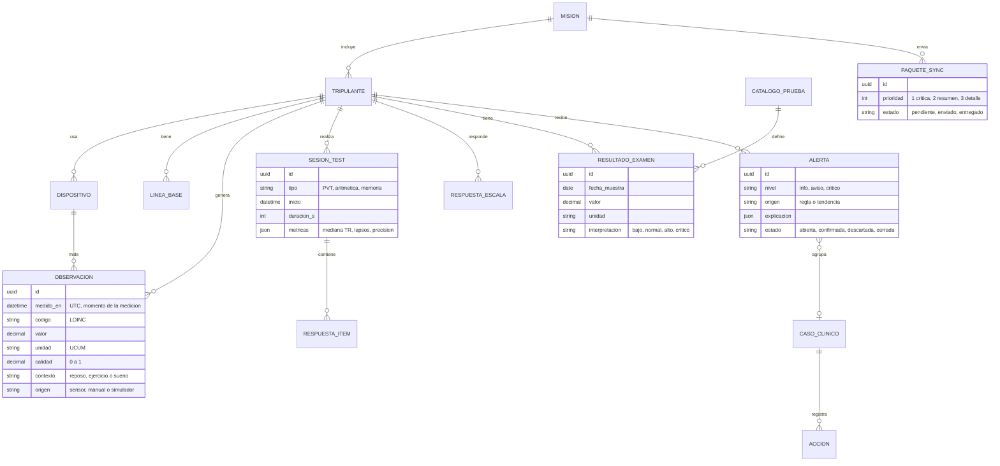
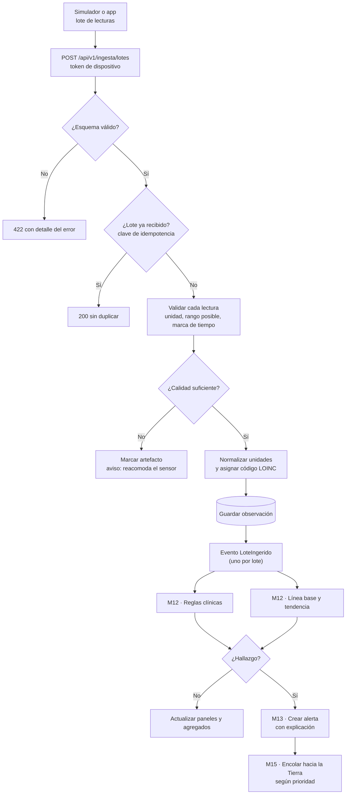
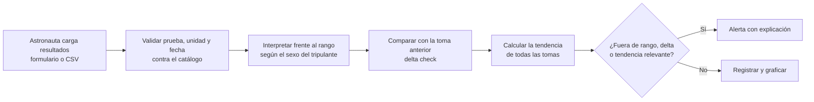

# 04 · Manejo de datos: tipos, simulación y procesamiento

> **AstroHealth** · Propuesta para el NASA International Space Apps Challenge 2026
> Documento 4 de 5 · [← Propuesta tecnológica](03-propuesta-tecnologica.md) · [Inicio](../../README.md) · [Siguiente: Estructura Scrum →](05-estructura-scrum.md)

---

## Contenido

1. [Datos que genera el monitoreo de un astronauta](#1-datos-que-genera-el-monitoreo-de-un-astronauta)
2. [Modelo de datos](#2-modelo-de-datos)
3. [Generación de datos simulados realistas](#3-generación-de-datos-simulados-realistas)
4. [Recepción, procesamiento y análisis](#4-recepción-procesamiento-y-análisis)
5. [Ejemplo completo: detección de deterioro cognitivo](#5-ejemplo-completo-detección-de-deterioro-cognitivo)
6. [Ejemplo completo: exámenes médicos](#6-ejemplo-completo-exámenes-médicos)
7. [Escenarios de simulación](#7-escenarios-de-simulación)
8. [Configuración inicial de umbrales](#8-configuración-inicial-de-umbrales)

> ⚠️ Todos los valores de simulación son **parámetros de diseño** para generar datos verosímiles, basados en la documentación del proyecto y en referencias clínicas terrestres. No son criterios diagnósticos.

---

## 1. Datos que genera el monitoreo de un astronauta

| Categoría | Ejemplos | Naturaleza | Frecuencia | Fuente real (documentación) | Entrada en AstroHealth | Módulo |
|---|---|---|---|---|---|---|
| **Signos vitales continuos** | FC, SpO₂, FR, temperatura central, actividad | Serie de tiempo | Continua (se guarda 1/min) | Bio-Monitor/Astroskin, oxímetro | Simulador → API | M04 |
| **Signos vitales puntuales** | PA diaria, prueba ortostática (de pie en gravedad o con LBNP en vuelo), VFC diaria | Medición | Diaria | Equipo BP/ECG del CHeCS | Simulador o formulario | M04 |
| **Señal cruda** | ECG de 3 derivaciones | Señal de alta frecuencia | Ventanas cortas (demo) | Astroskin, Holter | Simulador → archivo | M04 |
| **Sueño** | Duración, eficiencia, horarios, medicación | Resumen por noche | Diaria | Actigrafía (Actiwatch) | Simulador o formulario | M06 |
| **Tests cognitivos** | Tiempo de reacción (PVT), aritmética, memoria | Sesión con respuestas | Diaria o en días alternos | PVT, batería *Cognition* | App del astronauta | M05 |
| **Escalas psicológicas** | Ánimo, estrés, fatiga, carga de trabajo, cohesión | Cuestionario | Diaria (breve) y semanal | Escalas validadas, entrevistas privadas | App del astronauta | M05 |
| **Síntomas** | Cefalea, náusea, dolor, mareo, lesiones | Evento | Cuando ocurre | Reporte del tripulante | App del astronauta | M11 |
| **Exámenes de laboratorio** | Hb, Hto, reticulocitos, vitamina D, marcadores óseos, orina | Resultado con unidad | Semanal o mensual | Analizador portátil, muestras enviadas a la Tierra | Formulario o CSV | M07 |
| **Exámenes de imagen** | OCT (Δ TRT), Doppler de cuello, agudeza visual | Resultado estructurado + adjunto | Periódica | OCT, ultrasonido | Formulario | M07 |
| **Ambiente** | pCO₂ por módulo de la nave, VOC, ruido | Serie de tiempo | Continua (1/min) | Monitores ambientales | Simulador → API | M08 |
| **Radiación** | Dosis acumulada, tasa de dosis | Serie de tiempo | Continua (1/min) | Dosímetros activos y pasivos | Simulador → API | M09 |
| **Físico** | Sesiones de ejercicio, masa corporal, fuerza | Registro | Diario y semanal | ARED, cinta, medidor de masa inercial, dinamómetro | Simulador o formulario | M10 |
| **Metabólico** | Ingesta, hidratación, glucosa | Registro y serie de tiempo | Por comida; glucosa cada 5 min | Registro del tripulante, monitor continuo de glucosa (CGM) | App del astronauta; simulador → API | M10 |

---

## 2. Modelo de datos

Modelo conceptual simplificado, inspirado en HL7 FHIR:



---

## 3. Generación de datos simulados realistas

### 3.1 Principios del simulador

| Principio | Implementación |
|---|---|
| **Perfil individual** | Cada tripulante tiene su propia línea base (FC en reposo, VFC, tiempo de reacción, horas de sueño). Así, el sistema debe aprender de cada persona. |
| **Ritmo circadiano** | Las variables oscilan en un ciclo de 24 h (más bajas de noche) mediante una función seno. |
| **Ruido fisiológico** | Variación aleatoria gaussiana alrededor del valor esperado. |
| **Tendencias por día de misión** | Cambios lentos documentados (por ejemplo, la Hb baja y los marcadores óseos suben). |
| **Actividad** | Bloques de ejercicio (que suben la FC y la FR) y de sueño. |
| **Escenarios inyectables** | Anomalías activables por línea de comandos (sección 7). |
| **Artefactos** | Lecturas imposibles o con baja calidad (electrodo suelto) para probar la validación. |
| **Reproducibilidad** | Semilla aleatoria fija: la misma semilla genera los mismos datos para las pruebas y la demo. |
| **Tiempo acelerado** | Puede generar 30 días de misión en minutos (relleno histórico) o emitir en tiempo real (demo en vivo). |

### 3.2 Fórmula general para variables continuas

```
valor(t) = base_individual
         + amplitud · sin(2π · (hora(t) − fase) / 24)     ← ritmo circadiano
         + efecto_actividad(t)                            ← ejercicio o sueño
         + deriva · dia_mision(t)                         ← tendencia de la misión
         + efecto_escenario(t)                            ← anomalía inyectada
         + ruido ~ Normal(0, σ)                           ← variación aleatoria
```

El resultado se recorta a límites fisiológicamente posibles (por ejemplo, SpO₂ ≤ 100 %).

### 3.3 Parámetros sugeridos por variable

#### Signos vitales (M04)

| Variable | Base individual (sorteada por tripulante) | Ritmo circadiano | Ruido (σ) | Efectos |
|---|---|---|---|---|
| FC | 55–70 lpm | ±5 lpm (mínimo de madrugada) | 2 lpm | Ejercicio +40 a +70 lpm; vuelve a la base en ~5 min al terminar |
| SpO₂ | 97–99 % | — | 0,5 % | Máximo 100 % |
| FR | 12–16 rpm | ±1 rpm | 1 rpm | Ejercicio +8 a +15 rpm |
| Temperatura central | 36,6–37,0 °C | ±0,3 °C (mínimo de madrugada) | 0,1 °C | Ejercicio +0,5 a +1,0 °C |
| PA sistólica / diastólica | 110–125 / 70–80 mmHg | — | 4 / 3 mmHg | Una toma diaria; prueba ortostática semanal |
| VFC (RMSSD) | 30–60 ms | — | 5 ms | Disminuye con estrés y con mal sueño |
| ECG crudo | — | — | — | `neurokit2.ecg_simulate()` con la FC del momento |

> Cada lectura lleva su **contexto** (`reposo`, `ejercicio` o `sueño`), igual que lo marcaría un wearable con acelerómetro. Los umbrales se aplican según ese contexto ([sección 8](#8-configuración-inicial-de-umbrales)); así el ejercicio normal no dispara alertas.

#### Sueño (M06)

| Variable | Distribución | Justificación (documentación) |
|---|---|---|
| Duración | Base por tripulante entre 6,5 y 7,0 h; cada noche Normal(base; 0,3 h) | En la ISS se midieron ~6–6,5 h (Barger *et al.*, 2014; *Sleep*, 2022). La base se sitúa algo por encima para que la misión normal (E0) no dispare avisos; el déficit real lo inyecta el escenario E4 |
| Eficiencia | Normal(91 %; 2,5 %), entre 60 y 98 % | El umbral de aviso está en 85 % durante 3 noches seguidas |
| Hora de acostarse | Horario programado ± Normal(0; 30 min) | La regularidad es un indicador |
| Medicación para dormir | Probabilidad del 30–50 % por noche | Uso frecuente de hipnóticos documentado |

#### Tests cognitivos (M05)

| Test | Qué se mide | Simulación de la línea base | Efecto de la fatiga o del mal sueño |
|---|---|---|---|
| **PVT** (3 o 5 min) | Tiempo de reacción a un estímulo visual | Tiempos log-normales con mediana de 250–300 ms por tripulante | La mediana sube y aumentan los **lapsos** (> 500 ms) |
| **Aritmética** (20 ítems) | Sumas y restas de dos cifras | Precisión del 92–98 %; 2–4 s por ítem | Baja la precisión y sube el tiempo |
| **Memoria** (secuencia) | Longitud máxima recordada | 6–8 elementos | Disminuye en 1–2 elementos |

> **Efecto de aprendizaje:** en las primeras sesiones el rendimiento mejora por práctica. El simulador lo reproduce y el análisis lo descarta (ver sección 5).

#### Escalas psicológicas (M05)

| Escala | Formato | Simulación |
|---|---|---|
| Ánimo, estrés, fatiga (diaria) | Escala visual de 0 a 10 | Base individual ± ruido; deriva lenta según la duración de la misión |
| Carga de trabajo y cohesión (semanal) | Cuestionario breve, Likert de 1 a 5 | Correlacionada con el sueño y los eventos de la misión |

> En un sistema real se usarían **instrumentos psicológicos validados** y con licencia, elegidos por profesionales. Para el reto bastan escalas simples con la misma estructura de datos.

#### Exámenes de laboratorio (M07)

| Prueba | Unidad | Rango de referencia (terrestre, configurable) | Tendencia simulada en la misión |
|---|---|---|---|
| Hemoglobina | g/dL | H: 13,5–17,5 · M: 12,0–15,5 | Descenso gradual (anemia espacial, hemólisis +54 %) |
| Hematocrito | % | H: 41–53 · M: 36–46 | Acompaña a la hemoglobina |
| Reticulocitos | % | 0,5–2,5 | Leve variación |
| Bilirrubina total | mg/dL | 0,1–1,2 | Leve aumento (asociado a la hemólisis) |
| Vitamina D (25-OH) | ng/mL | 30–100 | Descenso lento (sin luz solar) |
| Vitamina B12 | pg/mL | 200–900 | Estable |
| Calcio sérico | mg/dL | 8,5–10,5 | Estable o levemente alto |
| CTX (marcador de resorción ósea) | Relativo a la línea base | Comparación con la propia línea base | Aumento temprano marcado (la resorción sube un 113 % en ~11 días) |

#### Ambiente y radiación (M08 y M09)

| Variable | Valor base | Ruido / variación | Fuente |
|---|---|---|---|
| pCO₂ por módulo | 2,0 mmHg | ±0,3 mmHg; picos locales | ISS entre 1 y 9 mmHg; límite 3,0 mmHg |
| Tasa de dosis en órbita baja | ~0,5 mSv/día | ±10 % | Derivado: una misión a Marte equivale a ~10 veces la dosis de 6 meses en la ISS |
| Tasa de dosis en crucero a Marte | 1,8 mSv/día | ±10 % | Medido por el RAD del Curiosity |

### 3.4 Interfaz del simulador

```bash
# Rellenar 30 días de historia para 4 tripulantes, perfil de órbita baja
python -m astrohealth_sim historico --dias 30 --tripulantes 4 --perfil leo --semilla 42

# Emitir en tiempo real e inyectar un escenario a los 10 minutos
python -m astrohealth_sim vivo --perfil marte --escenario E4:T2:10m
```

El simulador envía los datos a la API **exactamente igual que lo haría un sensor real**, con su propio token de dispositivo. Al sustituirlo por hardware real, el backend no cambia.

---

## 4. Recepción, procesamiento y análisis

### 4.1 Flujo completo



### 4.2 Contrato de recepción (ejemplo)

`POST /api/v1/ingesta/lotes`

```json
{
  "lote_id": "7f3c2a10-5b1e-4f7e-9a2d-0c8e1b4d6f21",
  "dispositivo_id": "astroskin-T2",
  "tripulante_id": "T2",
  "enviado_en": "2026-10-12T14:05:00Z",
  "lecturas": [
    { "id": "0d6b2f4e-1c3a-4e8b-9f21-6a7c5d3e2b10", "codigo": "8867-4",  "valor": 72,   "unidad": "/min", "medido_en": "2026-10-12T14:04:00Z", "calidad": 0.98, "contexto": "reposo" },
    { "id": "5a9e7c31-8f24-4b6d-a0c3-2e1f9b8d7c45", "codigo": "59408-5", "valor": 97,   "unidad": "%",    "medido_en": "2026-10-12T14:04:00Z", "calidad": 0.95, "contexto": "reposo" },
    { "id": "c47d1e82-3b5f-4a90-8e6c-9f0a2b4d1e73", "codigo": "8310-5",  "valor": 36.9, "unidad": "Cel",  "medido_en": "2026-10-12T14:04:00Z", "calidad": 0.99, "contexto": "reposo" }
  ]
}
```

| Respuesta | Significado |
|---|---|
| `201 Created` | Lote aceptado; devuelve cuántas lecturas se guardaron y cuántas se marcaron como artefacto |
| `200 OK` | El lote ya se había recibido (reenvío tras un corte); no se duplica |
| `422 Unprocessable Entity` | Esquema inválido; devuelve el detalle por campo |
| `401 / 403` | Token inválido o sin permiso para ese tripulante |

### 4.3 Etapas del procesamiento

| Etapa | Qué hace | Ejemplo |
|---|---|---|
| **Validación** | Rechaza lo físicamente imposible | FC de 400 lpm → rechazada |
| **Calidad** | Marca lecturas dudosas sin borrarlas | Calidad < 0,5 → artefacto; no dispara alertas |
| **Normalización** | Unidades UCUM, códigos LOINC, marca de tiempo en UTC | °F → °C |
| **Agregación** | Resúmenes por hora y día (mínimo, máximo, media, percentiles) | Gráficas largas y sincronización ligera |
| **Línea base** | Referencia fija por tripulante y variable (política en la sección 4.4) | FC en reposo de T2: 61 ± 3 lpm |
| **Reglas** | Umbrales configurables según el contexto de actividad (sección 8) | SpO₂ < 92 % → aviso |
| **Tendencia** | Pendiente de 7 y 30 días; EWMA | Masa corporal −0,4 % por semana |
| **Correlación** | Reglas que cruzan módulos | CO₂ > 3 mmHg + cefalea en las mismas 24 h |
| **Explicación** | Texto legible de cada hallazgo | "VFC −35 % frente a su línea base + 4,5 h de sueño" |

### 4.4 Métodos de análisis (explicables)

| Método | Para qué | Por qué se eligió |
|---|---|---|
| **Umbral fijo** | Valores peligrosos en cualquier persona (SpO₂ < 90 %) | Simple y estándar clínico |
| **Puntuación z frente a la línea base** `z = (x − μ) / σ` | Desviaciones respecto a la normalidad de cada persona | Personaliza sin necesitar datos de entrenamiento |
| **Persistencia** (N de M) | Evitar alertas por una sola lectura ruidosa | Reduce la fatiga de alarmas |
| **Regresión lineal sobre ventana** | Detectar deterioros lentos (pendiente) | Explica "empeora X por semana" |
| **EWMA** | Suavizar series ruidosas | Ligero de calcular en PHP |
| **Confirmación por segunda medición** | Las alertas de aviso se confirman antes de escalar | Recomendado en la Fase 2 |

#### Política de línea base

Para que un deterioro lento nunca quede "normalizado", el sistema distingue dos cálculos:

| Uso | Cálculo | Cuándo se actualiza |
|---|---|---|
| **Referencia para alertas** (puntuación z, cambio porcentual) | Media y desviación estándar de una **ventana inicial fija**: la línea base previa al vuelo (M02) si existe; si no, los primeros 7 días de misión (signos vitales y sueño) o las sesiones 3 a 7 (cognición) | Solo con **autorización médica**, que queda en la auditoría |
| **Tendencia y visualización** | Media móvil de 7 días y EWMA | De forma continua |

Para evitar puntuaciones z desproporcionadas cuando la línea base es muy estable, cada métrica tiene una **desviación mínima** (σ mínima) configurable en M16.

> El **machine learning** (por ejemplo, Isolation Forest para anomalías multivariables) queda como evolución. Sin datos reales no se puede validar, y los métodos estadísticos anteriores son transparentes para el médico.

---

## 5. Ejemplo completo: detección de deterioro cognitivo

Es el primero de los dos casos de uso centrales del proyecto: **si las respuestas del astronauta en los tests cognitivos empeoran con el tiempo, el sistema debe detectar el deterioro y generar una alerta**.

### 5.1 Captura

1. La app programa un **PVT de 3 minutos** y un **test de aritmética de 20 ítems** cada día, a una hora similar (para no confundir el deterioro con el ritmo circadiano).
2. Por cada ítem se guarda: estímulo, respuesta, si es correcta, tiempo de respuesta y marca de tiempo.
3. Al terminar, se calculan las **métricas de la sesión**:

| Métrica | PVT | Aritmética |
|---|---|---|
| Velocidad | Mediana del tiempo de reacción | Tiempo medio por ítem |
| Errores | Lapsos (> 500 ms) y falsas salidas (< 100 ms) | % de respuestas incorrectas |
| Estabilidad | Desviación del tiempo de reacción | — |

> El **test de memoria** (HU-05.07) aporta la métrica *longitud máxima recordada*, con σ mínima de 1 elemento (parámetro de diseño). Como es un número entero, solo participa en las rachas de z, no en el criterio de la pendiente.

### 5.2 Línea base

- Las **2 primeras sesiones** son de familiarización y se descartan (efecto de aprendizaje).
- La **línea base** se calcula con las **5 sesiones siguientes**: media (μ) y desviación estándar (σ) de cada métrica.
- La línea base se recalcula solo si el médico lo autoriza, para que un deterioro lento no termine "normalizado" (ver la [política de línea base](#44-métodos-de-análisis-explicables)).
- Cada métrica usa una σ mínima: 10 ms y el 10 % de μ (la mayor) para la mediana del PVT, 0,2 s y el 10 % de μ para el tiempo por ítem, 7,5 puntos porcentuales para la precisión (con 20 ítems, cada error vale 5 puntos: con 2 puntos, un solo error de más daba z ≥ 2 y el 22 % de las misiones normales simuladas generaba un aviso falso; con 7,5 puntos, el 0,1 %), 1 lapso, 1 falsa salida y 10 ms para la desviación del tiempo de reacción.

### 5.3 Reglas de detección

| Nivel | Condición | Ejemplo de explicación generada |
|---|---|---|
| ℹ️ **Info** | Una sesión con z ≥ 2 en cualquier métrica | "PVT de hoy más lento de lo habitual (z = 2,1)" |
| ⚠️ **Aviso** | z ≥ 2 en **3 sesiones consecutivas** en la **misma métrica** (la pendiente de 7 días se informa en la explicación, pero no dispara avisos: como disparador daba falsos en ~97 % de las misiones normales simuladas) | "Tiempo de reacción +18 % en 3 días seguidos; precisión aritmética del 96 % al 85 %" |
| 🚨 **Crítico** | Solo en el PVT: z ≥ 3 en **2 sesiones consecutivas** en la **misma métrica** **y** lapsos en la sesión actual > 2 veces la línea base (mínimo 2 lapsos). En aritmética y memoria (o en el PVT sin el aumento de lapsos) la misma racha da un aviso | "Deterioro marcado de la atención; evaluar antes de tareas críticas" |

> Las rachas se cuentan **en la misma métrica**. Si se tomara la peor de las seis métricas de cada sesión, el ruido normal haría que ~15 % de las sesiones superaran z ≥ 2 en alguna, y la misión normal (E0) generaría avisos falsos.

### 5.4 Contexto que acompaña la alerta

La alerta cruza datos de otros módulos para ayudar al médico a interpretarla:

- horas de sueño de las últimas noches (M06),
- puntuaciones de fatiga y estrés (M05),
- pCO₂ promedio de las últimas 24 h (M08),
- VFC reciente (M04).

> Ejemplo: *"T2 · Aviso · Deterioro cognitivo: mediana del PVT 342 ms (línea base 281 ± 18 ms) en 3 sesiones consecutivas. Contexto: 4,9 h de sueño en promedio durante las últimas 4 noches; fatiga 7/10."*

### 5.5 Pseudocódigo

```text
al completar SesionTest s del tripulante t:
    metricas ← calcular_metricas(s)
    n ← numero de sesiones validas de t, incluida s

    si n ≤ 2: marcar s como familiarizacion; terminar
    si n ≤ 7:
        acumular s para la linea base
        si n = 7: calcular μ y σ de cada metrica con las sesiones 3 a 7
        terminar                                   # sin alertas hasta la sesion 8

    para cada metrica m:
        σm ← max(σ[m], σ_min[m], σ_rel[m] · μ[m])  # evita z enormes con lineas base muy estables (σ_rel = 10 % en mediana PVT y tiempo de aritmetica)
        z[m] ← (metricas[m] − μ[m]) / σm           # orientado para que z > 0 = peor
    zmax[s] ← max(z)                              # solo para el nivel INFO

    para cada metrica m:                          # las rachas se cuentan en la MISMA metrica
        racha2[m] ← sesiones consecutivas, terminando en s, con z[m] ≥ 2
        racha3[m] ← sesiones consecutivas, terminando en s, con z[m] ≥ 3
    pendiente ← regresion_lineal(metrica principal, ultimos 7 dias)   # solo para la explicacion; no cambia el nivel

    si s.tipo = PVT y max(racha3) ≥ 2 y lapsos(s) > max(2 · μ[lapsos], 2):
        crear_alerta(CRITICO)
    si no, si max(racha2) ≥ 3 o max(racha3) ≥ 2:
        crear_alerta(AVISO)
    si no, si zmax[s] ≥ 2:
        registrar_hallazgo(INFO)
```

---

## 6. Ejemplo completo: exámenes médicos

Es el segundo caso de uso central: **el astronauta carga sus resultados y el sistema los registra, analiza su evolución y señala los valores fuera de rango**.

### 6.1 Flujo



### 6.2 Formato de carga por CSV

```csv
fecha_muestra,codigo_prueba,valor,unidad
2026-10-10,718-7,13.1,g/dL
2026-10-10,4544-3,39.5,%
2026-10-10,62292-8,24,ng/mL
```

> Los códigos corresponden a hemoglobina (718-7), hematocrito (4544-3) y 25-OH vitamina D total, D₂ + D₃ (62292-8), en LOINC. El catálogo (M16) traduce cada código al nombre visible y al rango de referencia.

### 6.3 Reglas de interpretación

| Regla | Condición | Resultado |
|---|---|---|
| **Fuera de rango** | Valor fuera del rango de referencia | Marca `bajo` o `alto` |
| **Valor crítico** | Valor fuera del rango crítico configurado | Alerta crítica |
| **Delta check** | Cambio frente a la toma anterior mayor que el umbral de la prueba (p. ej., Hb ±1,5 g/dL) | Aviso: "cambio brusco" |
| **Tendencia** | Las 3 últimas tomas empeoran una tras otra y el cambio total supera el 7,5 % del valor inicial (con el 5 %, el ruido normal de la Hb simulada daba un aviso falso en el 17 % de las misiones normales) | Aviso: "descenso progresivo" (por ejemplo, anemia espacial) |

### 6.4 Visualización

Cada prueba muestra una gráfica con:

- la **banda del rango de referencia**,
- los **puntos de cada toma**, coloreados según su interpretación,
- la **línea de tendencia**,
- las fechas clave de la misión (lanzamiento, eventos).

---

## 7. Escenarios de simulación

Los escenarios permiten **demostrar** cada capacidad del sistema de forma controlada. Coinciden con los propuestos en la Fase 2 y añaden los de los dos casos de uso centrales (deterioro cognitivo y exámenes). **Los nueve escenarios forman parte del MVP.**

| ID | Escenario | Qué inyecta el simulador | Qué debe hacer AstroHealth | Módulos | Entrega |
|---|---|---|---|---|:---:|
| E0 | **Misión normal** | Solo variación fisiológica | Ningún aviso ni alerta crítica con la semilla de referencia (solo hallazgos informativos aislados); paneles en verde | Todos | MVP |
| E1 | **Arritmia en ejercicio** | Patrón irregular en el ECG + FC alta durante el ejercicio | Alerta crítica → protocolo guiado | M04, M13 | MVP |
| E2 | **Evento solar (SPE)** | Subida brusca de la tasa de dosis | Alerta crítica a toda la tripulación: "ir al refugio" | M09, M13 | MVP |
| E3 | **CO₂ alto + cefaleas** | pCO₂ de 4–5 mmHg en un módulo + síntomas de cefalea | Aviso global del módulo (CO₂ alto) y correlación con las cefaleas → recomendar ventilación | M08, M11, M12 | MVP |
| E4 | **Fatiga acumulada** | 5 noches de mal sueño + PVT más lento + VFC baja | Aviso de deterioro cognitivo al CMO | M05, M06, M12 | MVP |
| E5 | **Conjunción solar** | 14 días sin enlace con la Tierra | Operación autónoma; sincronización ordenada al volver el enlace | M15 | MVP |
| E6 | **Sensor suelto** | Lecturas con baja calidad o imposibles | Artefacto marcado; aviso para reacomodar el sensor (con datos en vivo); sin falsa alarma | M03 | MVP |
| E7 | **Anemia progresiva** | Hb descendente en exámenes semanales | Aviso de tendencia en el módulo de exámenes | M07, M12 | MVP |
| E8 | **Hipoxemia** | SpO₂ sostenida < 92 % | Aviso → confirmación → crítico si < 90 % | M04, M13 | MVP |

---

## 8. Configuración inicial de umbrales

Valores iniciales tomados de la [Fase 1](../investigacion/02-monitorizacion-salud-fase1.md#3-qué-monitorear-parámetros-rangos-y-alertas). **Son editables** en M16 y deben validarlos médicos. Cada regla se aplica según el **contexto de actividad** de la lectura, para que el ejercicio normal no genere alertas.

| Variable | Contexto | Aviso | Crítico | Persistencia |
|---|---|---|---|---|
| FC | Reposo y sueño | Cambio > 20 % frente a la línea base | < 40 o > 120 lpm sostenida | 5 min |
| FC | Ejercicio | No baja de 100 lpm a los 10 min de terminar (recuperación lenta) | > 185 lpm | 2 min |
| ECG | Cualquiera | — | Pausa > 3 s; QTc > 500 ms | Inmediato |
| PA | Reposo | > 140/90 o < 90/60 mmHg; caída ortostática > 20/10 | — | 2 tomas |
| SpO₂ | Cualquiera | < 92 % | < 90 % | 3 min |
| FR | Reposo y sueño | < 8 o > 25 rpm | — | 5 min |
| FR | Ejercicio | No se evalúa (subir es lo esperado) | — | — |
| Temperatura central | Reposo y sueño | > 38 °C | < 35 °C | 10 min |
| Temperatura central | Ejercicio | > 39 °C | — | 10 min |
| Sueño | Por noche | < 6 h o eficiencia < 85 % | — | 3 noches consecutivas |
| Masa corporal | Semanal | Pérdida > 5 % | — | 1 semana |
| Glucosa (CGM) | Cualquiera | < 70 o > 180 mg/dL | — | 2 lecturas |
| Dosis de carrera | Acumulada | Proyección > 80 % de 600 mSv | — | — |
| Tasa de dosis | Cualquiera | — | Subida súbita (evento solar) | Inmediato |
| pCO₂ | Por módulo | > 3 mmHg + síntomas (aviso para el tripulante) | — | Promedio de 1 h |
| pCO₂ | Por módulo | > 3 mmHg sostenido, aunque nadie tenga síntomas (aviso global) | — | 60 min |
| VOC, partículas, ruido | Por módulo | Límites NASA (SMAC y norma de ruido), cargados con su fuente por el médico de vuelo; **inactivos** hasta entonces | — | 60 min |
| SANS (OCT) | Examen | Δ TRT ≥ 20 µm | — | 1 examen |
| Cognición | Sesión de test | z ≥ 2 en 3 sesiones consecutivas (misma métrica) | z ≥ 3 en 2 sesiones consecutivas (misma métrica) + lapsos | Ver sección 5 |

> Los 10 minutos posteriores a un bloque de ejercicio se evalúan con la regla de **recuperación**, no con la de reposo. Durante la misión normal (E0), el simulador mantiene todas las variables dentro de estos umbrales; las alertas solo aparecen cuando un escenario las inyecta.

---

[← Propuesta tecnológica](03-propuesta-tecnologica.md) · [Inicio](../../README.md) · [Siguiente: Estructura Scrum →](05-estructura-scrum.md)
