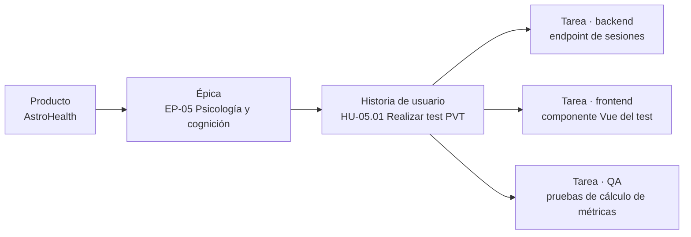
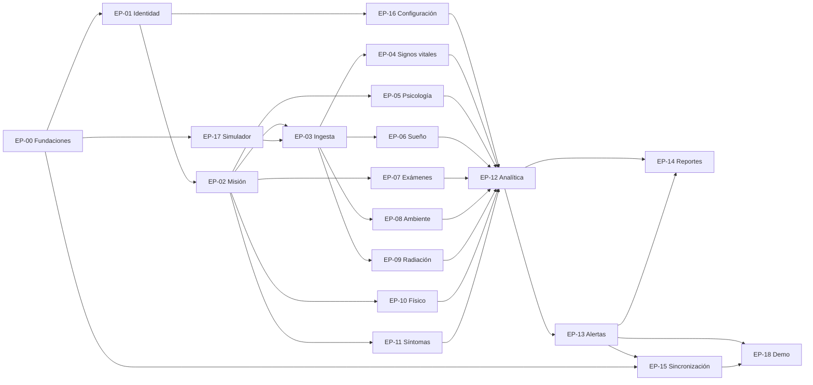
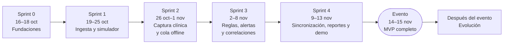

# 05 · Estructura de trabajo ágil (Scrum)

> **AstroHealth** · Propuesta para el NASA International Space Apps Challenge 2026
> Documento 5 de 5 · [← Manejo de datos](04-manejo-de-datos.md) · [Inicio](../../README.md)

---

## Contenido

1. [Roles del equipo](#1-roles-del-equipo)
2. [Jerarquía y convenciones del backlog](#2-jerarquía-y-convenciones-del-backlog)
3. [Catálogo de épicas](#3-catálogo-de-épicas)
4. [Backlog por épica](#4-backlog-por-épica)
5. [Historias de ejemplo desarrolladas](#5-historias-de-ejemplo-desarrolladas)
6. [Plan de entregas y sprints](#6-plan-de-entregas-y-sprints)
7. [Eventos de Scrum, tablero y métricas](#7-eventos-de-scrum-tablero-y-métricas)

> Este documento define **la estructura** del backlog: todas las épicas, los títulos de las historias y algunas historias completas como modelo. El resto se detalla en cada *sprint planning*.

---

## 1. Roles del equipo

### 1.1 Responsabilidades de Scrum (Guía Scrum 2020)

| Responsabilidad | Persona | Motivo |
|---|---|---|
| **Product Owner** | Santiago Adrián Rodríguez Ramírez | Líder del proyecto; conoce la visión completa y prioriza el backlog |
| **Scrum Master** | Miguel Hernando Osses Ribero | Lleva el plan de pruebas y la documentación; tiene visión transversal del avance |
| **Developers** | Los cinco integrantes (incluidos el Product Owner y el Scrum Master) | Equipo multifuncional |
| **Stakeholder / asesor** | Barney Jaimes (mentor) | Valida el enfoque en las revisiones de sprint |

> El equipo puede reasignar estas responsabilidades. En equipos pequeños es normal que el Product Owner también desarrolle; lo importante es que **una sola persona prioriza el backlog**.

### 1.2 Responsables por épica

Según los roles definidos en el [proyecto Space Apps](../investigacion/01-proyecto-space-apps.md#71-equipo-de-desarrollo). Todas las épicas tienen un responsable; el responsable coordina, no trabaja solo.

Los roles son **fijos**: el **backend** lo hace Julieth, el **frontend** Jhon y Gabriela, y Miguel mantiene el simulador, las pruebas y la documentación. Santiago es *Product Owner* y se encarga del despliegue.

| Integrante | Rol fijo | Épicas que lidera |
|---|---|---|
| Santiago Adrián Rodríguez Ramírez | *Product Owner* y despliegue (repositorio, CI y cPanel) | EP-00 |
| Julieth Dayana Leguizamón Gélvez | **Backend**: Laravel y MySQL de todos los módulos | EP-01 a EP-16 (backend) |
| Gabriela Olivar Duarte | **Frontend**: gráficas, alertas y administración | EP-02, EP-05, EP-07, EP-08, EP-09, EP-13 y EP-16 (frontend: incluye la aplicación F4) |
| Jhon Fredy Martínez Díaz | **Frontend**: paneles y PWA | EP-03, EP-04, EP-06, EP-10, EP-11 y EP-15 (frontend: PWA offline), librería de componentes |
| Miguel Hernando Osses Ribero | Simulador, pruebas y documentación | EP-17, EP-18, plan de QA de todas las épicas |

> ⚠️ **Carga de trabajo:** todo el backend recae en Julieth, así que el backend es el cuello de botella del producto. Ver el [plan de contingencia](../../scrum/plan-de-sprints.md#11-plan-de-contingencia). El reparto exacto de cada historia por capa (backend, frontend y otros) está en el [plan de sprints](../../scrum/plan-de-sprints.md#roles-del-equipo).

### 1.3 Roles de usuario (para redactar las historias)

| Rol | Descripción |
|---|---|
| **Astronauta** | Registra sus datos y consulta su propio estado |
| **CMO** | Oficial médico a bordo; atiende alertas y casos, a menudo sin formación médica completa |
| **Médico de vuelo** | En la Tierra; revisa tendencias, define umbrales y envía recomendaciones |
| **Ingeniero biomédico** | Supervisa sensores, dispositivos y sincronización |
| **Investigador** | Analiza datos anonimizados |
| **Administrador** | Gestiona usuarios, roles y catálogos |
| **Equipo de desarrollo** | Necesita datos simulados y herramientas para probar (solo en historias técnicas) |

---

## 2. Jerarquía y convenciones del backlog

### 2.1 Jerarquía



| Nivel | Identificador | Equivale a | Duración típica |
|---|---|---|---|
| Épica | `EP-NN` | Un módulo funcional (ver [02](02-modulos-del-sistema.md)) | Varios sprints |
| Historia | `HU-NN.MM` | Una funcionalidad con valor para un rol | Cabe en un sprint |
| Tarea | Lista de verificación dentro de la historia | Trabajo técnico concreto | Horas a 1 día |

### 2.2 Plantilla de historia

```markdown
### HU-NN.MM · Título corto

**Como** [rol], **quiero** [acción], **para** [beneficio].

| Prioridad | Puntos | Capa | Módulo | Depende de |
|---|---|---|---|---|
| Must | 5 | backend + frontend | M05 | HU-01.02 |

**Criterios de aceptación**
- **Dado** [contexto], **cuando** [acción], **entonces** [resultado verificable].

**Tareas**
- [ ] ...
```

### 2.3 Convenciones

| Elemento | Convención |
|---|---|
| **Prioridad** | MoSCoW dentro del MVP: *Must* (imprescindible para la demo), *Should* (importante; segunda en recortarse si hay retraso), *Could* (deseable; primera en recortarse), *Won't* (esta vez no) |
| **Estimación** | Puntos de historia en serie de Fibonacci: 1, 2, 3, 5, 8, 13. Una historia de más de 8 puntos se divide |
| **Criterios de aceptación** | Formato *Dado / Cuando / Entonces*; cada uno debe poder convertirse en una prueba |
| **Etiquetas** | `backend`, `frontend`, `simulador`, `datos`, `qa`, `docs`, `infra` |
| **Ramas** | `feature/HU-05.01-test-pvt` |

### 2.4 Definition of Ready (lista para entrar al sprint)

- [ ] Sigue el formato *Como / quiero / para*, con un rol de usuario de la tabla 1.3.
- [ ] Tiene criterios de aceptación verificables.
- [ ] Está estimada y mide 8 puntos o menos.
- [ ] Sus dependencias están terminadas o planificadas en el mismo sprint.
- [ ] Si toca la API o una página Inertia, el contrato (endpoint o *props*) está definido.

### 2.5 Definition of Done (terminada)

- [ ] Cumple todos los criterios de aceptación.
- [ ] Tiene pruebas automatizadas de la lógica de negocio y pasan en CI.
- [ ] El código fue revisado por otra persona en un *pull request*.
- [ ] Funciona con datos del simulador y no genera alertas en la misión normal (E0).
- [ ] La interfaz es usable en tableta y escritorio, y cumple los criterios básicos de accesibilidad.
- [ ] La documentación de la API está actualizada.
- [ ] Está desplegada en el entorno de demo.

---

## 3. Catálogo de épicas

| Épica | Nombre | Módulos | Objetivo | Prioridad | Entrega |
|---|---|---|---|:---:|:---:|
| **EP-00** | Fundaciones técnicas | — | Repositorio, *starter kit* de Laravel con Vue e Inertia, CI, librería de componentes, despliegue | Must | MVP |
| **EP-01** | Identidad y acceso | M01 | Inicio de sesión, roles y auditoría | Must | MVP |
| **EP-02** | Misión y tripulación | M02 | Misión, tripulantes, dispositivos y línea base | Must | MVP |
| **EP-03** | Ingesta de datos | M03 | Recibir, validar y normalizar lecturas | Must | MVP |
| **EP-04** | Signos vitales | M04 | Monitoreo cardiovascular y de signos vitales | Must | MVP |
| **EP-05** | Psicología y cognición | M05 | Tests cognitivos, seguimiento emocional, detección de deterioro | Must | MVP |
| **EP-06** | Sueño | M06 | Registro y análisis del sueño | Must | MVP |
| **EP-07** | Exámenes médicos | M07 | Carga, interpretación y evolución de exámenes | Must | MVP |
| **EP-08** | Ambiente | M08 | CO₂ y su correlación con los síntomas; VOC, partículas y ruido | Must | MVP |
| **EP-09** | Radiación | M09 | Dosimetría y alerta de evento solar | Should | MVP |
| **EP-10** | Físico y metabólico | M10 | Ejercicio, masa corporal, fuerza, nutrición, hidratación y glucosa | Could | MVP |
| **EP-11** | Síntomas | M11 | Diario de síntomas y cuestionario de mareo | Must | MVP |
| **EP-12** | Analítica y línea base | M12 | Reglas, líneas base, tendencias, correlaciones | Must | MVP |
| **EP-13** | Alertas y casos clínicos | M13 | Gestión de alertas y protocolos guiados | Must | MVP |
| **EP-14** | Reportes | M14 | Reportes diarios y de misión; exportación | Should | MVP |
| **EP-15** | Sincronización | M15 | Cola priorizada, enlace simulado, recomendaciones, PWA offline | Must | MVP |
| **EP-16** | Configuración | M16 | Umbrales y catálogos editables; ajustes temporales a bordo | Must | MVP |
| **EP-17** | Simulador de datos | Externo | Datos realistas y escenarios | Must | MVP |
| **EP-18** | Demo y presentación | — | Guion, escenarios de demo, video y material de la entrega | Must | MVP |

### 3.1 Dependencias entre épicas



---

## 4. Backlog por épica

Títulos de las historias, en orden de prioridad dentro de cada épica. Las marcadas con ★ están desarrolladas en la [sección 5](#5-historias-de-ejemplo-desarrolladas).

### EP-00 · Fundaciones técnicas
| ID | Historia (resumen) | Prioridad |
|---|---|:---:|
| HU-00.01 | Como equipo de desarrollo, quiero un repositorio con el *starter kit* de Laravel (Vue, Inertia y Tailwind v4) y la estructura de módulos, para empezar sobre una base común | Must |
| HU-00.02 | Como equipo de desarrollo, quiero CI que ejecute las pruebas en cada *pull request*, para detectar errores pronto | Must |
| HU-00.03 | Como equipo de desarrollo, quiero una librería de componentes Vue, para que las cuatro aplicaciones se vean coherentes | Must |
| HU-00.04 | Como equipo de desarrollo, quiero desplegar los nodos nave y Tierra en cPanel, para tener un entorno de demo | Must |

### EP-01 · Identidad y acceso
| ID | Historia (resumen) | Prioridad |
|---|---|:---:|
| HU-01.01 | Como astronauta, CMO o médico de vuelo, quiero iniciar sesión con mis credenciales, para acceder solo a lo que me corresponde | Must |
| HU-01.02 | Como administrador, quiero asignar roles, para controlar qué ve cada persona | Must |
| HU-01.03 | Como ingeniero biomédico, quiero emitir tokens de dispositivo, para que los sensores y el simulador envíen datos de forma segura | Must |
| HU-01.04 | Como médico de vuelo, quiero un registro de auditoría de accesos, para proteger la privacidad de la tripulación | Should |

### EP-02 · Misión y tripulación
| ID | Historia (resumen) | Prioridad |
|---|---|:---:|
| HU-02.01 | Como administrador, quiero crear una misión con su perfil de enlace (ISS, Luna o Marte), para simular sus condiciones | Must |
| HU-02.02 | Como administrador, quiero registrar a los tripulantes y sus dispositivos, para asociar los datos a cada persona | Must |
| HU-02.03 | Como médico de vuelo, quiero registrar la línea base previa al vuelo, para comparar la evolución de cada tripulante | Must |

### EP-03 · Ingesta de datos
| ID | Historia (resumen) | Prioridad |
|---|---|:---:|
| HU-03.01 | Como ingeniero biomédico, quiero que los dispositivos envíen lecturas por lotes con su token, para que los datos lleguen de forma eficiente y trazable | Must |
| HU-03.02 | Como CMO, quiero que se rechacen las lecturas imposibles y se marquen las de baja calidad, para no recibir falsas alarmas | Must |
| HU-03.03 | Como astronauta, quiero un aviso cuando un sensor está mal colocado, para corregirlo a tiempo | Should |

### EP-04 · Signos vitales
| ID | Historia (resumen) | Prioridad |
|---|---|:---:|
| HU-04.01 | Como astronauta, quiero ver mis signos vitales actuales y su tendencia, para conocer mi estado | Must |
| HU-04.02 | Como CMO, quiero ver los signos vitales de toda la tripulación con su semáforo, para detectar problemas de un vistazo | Must |
| HU-04.03 | Como CMO, quiero registrar una prueba ortostática, para evaluar el riesgo antes de la reentrada | Should |
| HU-04.04 | Como médico de vuelo, quiero ver el ECG de una ventana de tiempo, para revisar una arritmia detectada | Should |
| HU-04.05 | Como CMO, quiero que se detecten irregularidades del ritmo a partir de los intervalos entre latidos, para atender una posible arritmia (escenario E1) | Could |

### EP-05 · Psicología y cognición
| ID | Historia (resumen) | Prioridad |
|---|---|:---:|
| ★ HU-05.01 | Como astronauta, quiero realizar un test de tiempo de reacción (PVT) en la tableta, para medir mi atención | Must |
| HU-05.02 | Como astronauta, quiero realizar un test de aritmética, para medir mi velocidad y precisión de cálculo | Must |
| HU-05.03 | Como astronauta, quiero registrar mi ánimo, estrés y fatiga en menos de un minuto, para hacer un seguimiento emocional | Must |
| HU-05.07 | Como astronauta, quiero realizar un test de memoria de secuencias, para medir mi memoria de trabajo | Could |
| ★ HU-05.04 | Como CMO, quiero que el sistema detecte un deterioro cognitivo sostenido, para intervenir antes de que afecte la misión | Must |
| HU-05.05 | Como astronauta, quiero recordatorios de mis tests programados, para hacerlos a una hora similar cada día | Should |
| HU-05.06 | Como médico de vuelo, quiero ver la evolución psicológica de cada tripulante, para preparar las conferencias privadas | Should |

### EP-06 · Sueño
| ID | Historia (resumen) | Prioridad |
|---|---|:---:|
| HU-06.01 | Como astronauta, quiero ver cuánto y qué tan bien dormí, para ajustar mis hábitos | Must |
| HU-06.02 | Como CMO, quiero un aviso si un tripulante acumula varias noches de mal sueño, para prevenir la fatiga | Must |
| HU-06.03 | Como astronauta, quiero registrar si tomé medicación para dormir, para que se tenga en cuenta en el análisis | Should |

### EP-07 · Exámenes médicos
| ID | Historia (resumen) | Prioridad |
|---|---|:---:|
| ★ HU-07.01 | Como astronauta, quiero cargar los resultados de mis exámenes, para que queden registrados y analizados | Must |
| ★ HU-07.02 | Como CMO, quiero que los valores fuera de rango se marquen automáticamente, para identificarlos de inmediato | Must |
| HU-07.03 | Como médico de vuelo, quiero ver la evolución de cada prueba en una gráfica con su rango, para detectar tendencias | Must |
| HU-07.04 | Como astronauta, quiero recordatorios de mis exámenes programados, para no olvidar los que no dan síntomas | Should |
| HU-07.05 | Como astronauta, quiero adjuntar el PDF del laboratorio a mis resultados, para conservar el documento original | Could |

### EP-08 · Ambiente
| ID | Historia (resumen) | Prioridad |
|---|---|:---:|
| HU-08.01 | Como CMO, quiero ver el pCO₂ por módulo de la nave, para identificar zonas de riesgo | Must |
| HU-08.02 | Como CMO, quiero que el sistema relacione el CO₂ alto con las cefaleas reportadas, para recomendar ventilación | Must |
| HU-08.03 | Como CMO, quiero alertas por VOC, partículas y ruido cuando el médico de vuelo cargue sus límites con fuente, para vigilar toda la atmósfera de la nave | Could |

### EP-09 · Radiación
| ID | Historia (resumen) | Prioridad |
|---|---|:---:|
| HU-09.01 | Como astronauta, quiero ver mi dosis acumulada frente al límite de carrera, para conocer mi exposición | Should |
| HU-09.02 | Como astronauta, quiero una alarma inmediata para toda la tripulación ante un evento solar, para ir al refugio a tiempo | Should |

### EP-10 · Físico y metabólico
| ID | Historia (resumen) | Prioridad |
|---|---|:---:|
| HU-10.01 | Como astronauta, quiero registrar mis sesiones de ejercicio, para cumplir las contramedidas | Could |
| HU-10.02 | Como médico de vuelo, quiero ver la tendencia de la masa corporal, para detectar pérdidas significativas | Could |
| HU-10.03 | Como astronauta, quiero registrar lo que como y bebo, para seguir mi ingesta y mi hidratación | Could |
| HU-10.04 | Como astronauta, quiero registrar mi fuerza de prensión, para seguir la pérdida muscular | Could |
| HU-10.05 | Como médico de vuelo, quiero recibir la glucosa del monitor continuo y que se evalúe su umbral, para detectar hipoglucemias e hiperglucemias | Could |

### EP-11 · Síntomas
| ID | Historia (resumen) | Prioridad |
|---|---|:---:|
| HU-11.01 | Como astronauta, quiero registrar un síntoma con su intensidad en pocos toques, para informarlo sin interrumpir mis tareas | Must |
| HU-11.02 | Como astronauta, quiero responder un cuestionario de mareo los primeros días, para seguir mi adaptación | Should |
| HU-11.03 | Como astronauta, quiero adjuntar una fotografía a un síntoma, para mostrar lesiones de la piel | Could |

### EP-12 · Analítica y línea base
| ID | Historia (resumen) | Prioridad |
|---|---|:---:|
| HU-12.01 | Como médico de vuelo, quiero que se calcule la línea base de referencia de cada tripulante y variable, para comparar a cada persona consigo misma | Must |
| HU-12.02 | Como CMO, quiero que se evalúen los umbrales configurados según el contexto de actividad, para detectar valores peligrosos sin falsas alarmas por el ejercicio | Must |
| HU-12.03 | Como CMO, quiero que cada hallazgo explique por qué se generó, para confiar en él y actuar | Must |
| HU-12.04 | Como médico de vuelo, quiero ver las tendencias de 7 y 30 días, para detectar deterioros lentos | Should |

### EP-13 · Alertas y casos clínicos
| ID | Historia (resumen) | Prioridad |
|---|---|:---:|
| HU-13.01 | Como CMO, quiero una bandeja de alertas ordenada por gravedad, para atender primero lo urgente | Must |
| HU-13.02 | Como CMO, quiero confirmar o descartar una alerta, para reducir las falsas alarmas | Must |
| HU-13.03 | Como CMO, quiero abrir un caso clínico con un protocolo guiado, para actuar paso a paso sin apoyo de la Tierra | Should |
| HU-13.04 | Como médico de vuelo, quiero que cada paso de los protocolos guiados cite su fuente y muestre si fue validado clínicamente, para que el CMO sepa cuánto confiar en él | Should |

### EP-14 · Reportes
| ID | Historia (resumen) | Prioridad |
|---|---|:---:|
| HU-14.01 | Como médico de vuelo, quiero un reporte diario por tripulante, para revisar el estado sin navegar por todo el sistema | Should |
| HU-14.02 | Como investigador, quiero exportar datos anonimizados en CSV, para analizarlos | Could |
| HU-14.03 | Como médico de vuelo, quiero un reporte de misión por tripulante, para revisar la evolución completa al cierre | Should |

### EP-15 · Sincronización
| ID | Historia (resumen) | Prioridad |
|---|---|:---:|
| HU-15.01 | Como médico de vuelo, quiero que los paquetes hacia la Tierra se encolen por prioridad, para que lo crítico llegue primero | Must |
| ★ HU-15.02 | Como médico de vuelo, quiero recibir todos los datos tras un corte de enlace, sin pérdidas ni duplicados, para tener la historia completa | Must |
| HU-15.03 | Como médico de vuelo, quiero enviar una recomendación a la nave, para orientar al CMO | Must |
| HU-15.04 | Como astronauta, quiero que la app funcione sin conexión y envíe mis registros al reconectar, para no perder datos | Must |

### EP-16 · Configuración
| ID | Historia (resumen) | Prioridad |
|---|---|:---:|
| HU-16.01 | Como médico de vuelo, quiero editar los umbrales de alerta, para adaptarlos a la misión | Must |
| HU-16.02 | Como administrador, quiero gestionar el catálogo de exámenes y sus rangos, para mantenerlo actualizado | Must |
| HU-16.03 | Como CMO, quiero aplicar un ajuste temporal de un umbral durante un apagón, para adaptar las alertas sin esperar a la Tierra | Should |

### EP-17 · Simulador de datos
| ID | Historia (resumen) | Prioridad |
|---|---|:---:|
| ★ HU-17.01 | Como equipo de desarrollo, quiero generar el historial de una misión de N días para varios tripulantes, para probar el sistema con datos realistas | Must |
| HU-17.02 | Como equipo de desarrollo, quiero emitir datos en tiempo real, para la demo en vivo | Must |
| HU-17.03 | Como equipo de desarrollo, quiero inyectar los escenarios E0–E8, para demostrar cada capacidad | Must |
| HU-17.04 | Como equipo de desarrollo, quiero generar series de ambiente (pCO₂ por módulo) y de radiación, para alimentar M08 y M09 | Must |

### EP-18 · Demo y presentación
| ID | Historia (resumen) | Prioridad |
|---|---|:---:|
| HU-18.01 | Como equipo, queremos un guion de demo con los escenarios clave, para presentar el valor en pocos minutos | Must |
| HU-18.02 | Como equipo, queremos el material que exige la entrega del evento (video, descripción, enlaces), para completar la participación | Must |

---

## 5. Historias de ejemplo desarrolladas

### HU-05.01 · Realizar un test de tiempo de reacción (PVT)

**Como** astronauta, **quiero** realizar un test de tiempo de reacción en la tableta, **para** medir mi nivel de atención.

| Prioridad | Puntos | Capa | Módulo | Depende de |
|---|:---:|---|---|---|
| Must | 5 | backend + frontend | M05 | HU-01.01, HU-02.02, HU-15.04 |

**Criterios de aceptación**
- **Dado** que tengo un test programado, **cuando** lo inicio, **entonces** veo instrucciones y una pantalla sin distracciones durante 3 minutos.
- **Dado** que el test está en curso, **cuando** aparece el estímulo y toco la pantalla, **entonces** se registra el tiempo de reacción en milisegundos.
- **Dado** que toco antes de que aparezca el estímulo o en menos de 100 ms, **cuando** se registra la respuesta, **entonces** cuenta como falsa salida.
- **Dado** que termino el test, **cuando** se guarda la sesión, **entonces** se calculan la mediana del tiempo de reacción, los lapsos (> 500 ms) y las falsas salidas.
- **Dado** que no hay conexión, **cuando** termino el test, **entonces** la sesión se guarda localmente y se envía al reconectar sin duplicarse.

**Tareas**
- [ ] Backend: migraciones y modelos `SesionTest` y `RespuestaItem`.
- [ ] Backend: `POST /api/v1/psicologia/sesiones` con validación e idempotencia por UUID.
- [ ] Backend: servicio de cálculo de métricas + pruebas unitarias.
- [ ] Frontend: página Inertia y componente Vue del test, con tiempos de alta precisión (`performance.now()`).
- [ ] Frontend: guardado en la cola local (IndexedDB) cuando no hay red.
- [ ] QA: pruebas con sesiones simuladas.

---

### HU-05.04 · Detectar un deterioro cognitivo sostenido

**Como** CMO, **quiero** que el sistema detecte un deterioro cognitivo sostenido, **para** intervenir antes de que afecte la seguridad de la misión.

| Prioridad | Puntos | Capa | Módulo | Depende de |
|---|:---:|---|---|---|
| Must | 8 | backend | M05, M12, M13 | HU-05.01, HU-05.02, HU-12.01, HU-13.01 |

**Criterios de aceptación**
- **Dado** un tripulante con 7 sesiones o menos, **cuando** completa un test, **entonces** no se generan alertas (2 sesiones de familiarización y 5 de construcción de la línea base).
- **Dado** un tripulante con línea base, **cuando** obtiene z ≥ 2 en 3 sesiones consecutivas en la misma métrica, **entonces** se crea una alerta de nivel **aviso**.
- **Dado** un tripulante con línea base, **cuando** obtiene z ≥ 3 en 2 sesiones consecutivas de **PVT** en la misma métrica y los lapsos de la sesión actual superan el doble de su línea base (mínimo 2), **entonces** se crea una alerta **crítica**; en aritmética y memoria, la misma racha crea un **aviso**.
- **Dado** el escenario E0 (misión normal, semilla 42), **cuando** se procesan los 30 días, **entonces** no se crea ningún aviso cognitivo (σ mínima de la precisión: 7,5 puntos).
- **Dado** que se crea la alerta, **cuando** el CMO la abre, **entonces** ve la explicación (métrica, valor, línea base) y el contexto de sueño y fatiga.
- **Dado** el escenario E4 del simulador, **cuando** se ejecuta, **entonces** la alerta aparece en la sesión esperada.

**Tareas**
- [ ] Backend: servicio de línea base cognitiva con σ mínima por métrica + pruebas.
- [ ] Backend: reglas de racha (z ≥ 2 y z ≥ 3) y de nivel + pruebas con casos límite.
- [ ] Backend: generador de explicación con contexto de otros módulos.
- [ ] QA: validación con el escenario E4 y comprobación de que E0 no genera avisos.

---

### HU-07.01 · Cargar resultados de exámenes

**Como** astronauta, **quiero** cargar los resultados de mis exámenes, **para** que queden registrados y se analice su evolución.

| Prioridad | Puntos | Capa | Módulo | Depende de |
|---|:---:|---|---|---|
| Must | 5 | backend + frontend | M07 | HU-16.02, HU-15.04 |

**Criterios de aceptación**
- **Dado** el formulario de exámenes, **cuando** elijo una prueba del catálogo, **entonces** la unidad se completa automáticamente.
- **Dado** un archivo CSV con el formato definido, **cuando** lo cargo, **entonces** veo una vista previa con las filas válidas y las que tienen errores antes de confirmar.
- **Dado** un valor con una unidad distinta a la del catálogo, **cuando** lo envío, **entonces** el sistema lo rechaza con un mensaje claro.
- **Dado** que confirmo la carga, **cuando** se guarda, **entonces** cada resultado queda asociado a la fecha de la muestra, no a la fecha de carga.

**Tareas**
- [ ] Backend: migraciones y modelo `ResultadoExamen`, relación con `CatalogoPrueba`.
- [ ] Backend: validación de prueba, unidad y fecha contra el catálogo (*Form Request*).
- [ ] Backend: importación de CSV con informe de errores por fila + pruebas.
- [ ] Frontend: formulario y vista previa del CSV en Vue.
- [ ] QA: archivos CSV válidos, con errores y con unidades incorrectas.

---

### HU-07.02 · Marcar valores fuera de rango

**Como** CMO, **quiero** que los valores fuera de rango se marquen automáticamente, **para** identificarlos de inmediato.

| Prioridad | Puntos | Capa | Módulo | Depende de |
|---|:---:|---|---|---|
| Must | 3 | backend + frontend | M07, M12 | HU-07.01, HU-13.01 |

**Criterios de aceptación**
- **Dado** un resultado por debajo o por encima del rango de referencia según el sexo del tripulante, **cuando** se guarda, **entonces** se marca como `bajo` o `alto` con un color **y** un icono.
- **Dado** un resultado fuera del rango crítico, **cuando** se guarda, **entonces** se crea una alerta crítica.
- **Dado** un cambio frente a la toma anterior mayor que el umbral de *delta check*, **cuando** se guarda, **entonces** se crea un aviso de "cambio brusco".
- **Dado** que el médico cambia un rango de referencia, **cuando** consulto los resultados, **entonces** se muestran con el rango vigente, se conserva la interpretación original y queda registro del cambio.

**Tareas**
- [ ] Backend: servicio de interpretación (rango por sexo, rango crítico, *delta check*) + pruebas unitarias.
- [ ] Backend: emisión del evento `ResultadoExamenCargado` hacia M12.
- [ ] Frontend: tabla de resultados con marcas de rango (color + icono + texto).
- [ ] QA: casos límite en los bordes de cada rango.

---

### HU-15.02 · Sincronizar sin pérdidas tras un corte de enlace

**Como** médico de vuelo, **quiero** recibir todos los datos tras un corte de enlace, sin pérdidas ni duplicados, **para** tener la historia completa de la tripulación.

| Prioridad | Puntos | Capa | Módulo | Depende de |
|---|:---:|---|---|---|
| Must | 8 | backend | M15 | HU-15.01 |

**Criterios de aceptación**
- **Dado** un corte de enlace de 14 días (escenario E5), **cuando** se restablece, **entonces** los paquetes se envían en orden de prioridad (1 → 2 → 3).
- **Dado** que un paquete se envía dos veces, **cuando** llega al nodo Tierra, **entonces** se guarda una sola vez (idempotencia por UUID).
- **Dado** un perfil de Marte con 12 minutos de retardo, **cuando** se envía un paquete, **entonces** el nodo Tierra no lo muestra antes de 12 minutos.
- **Dado** el panel del enlace, **cuando** hay paquetes pendientes, **entonces** se muestran su cantidad, su prioridad y la hora estimada de entrega.

**Tareas**
- [ ] Backend: modelo `PaqueteSync` con prioridad y estados (pendiente, enviado, entregado).
- [ ] Backend: tarea programada que libera paquetes según el perfil de enlace y las ventanas.
- [ ] Backend: endpoint de recepción en el nodo Tierra con idempotencia y acuse de recibo.
- [ ] Frontend: panel del enlace (pendientes, prioridad, hora estimada) con sondeo de Inertia.
- [ ] QA: escenario E5 completo y reenvío duplicado de paquetes.

---

### HU-17.01 · Generar el historial de una misión

**Como** equipo de desarrollo, **quiero** generar el historial de una misión de N días para varios tripulantes, **para** probar el sistema con datos realistas.

| Prioridad | Puntos | Capa | Módulo | Depende de |
|---|:---:|---|---|---|
| Must | 5 | simulador | Externo | HU-03.01 |

**Criterios de aceptación**
- **Dado** el comando `historico --dias 30 --tripulantes 4 --semilla 42`, **cuando** se ejecuta dos veces, **entonces** genera exactamente los mismos datos.
- **Dado** el perfil de cada tripulante, **cuando** se generan los signos vitales, **entonces** muestran ritmo circadiano, efecto del ejercicio (con su contexto) y ruido dentro de los parámetros del documento [04](04-manejo-de-datos.md#33-parámetros-sugeridos-por-variable).
- **Dado** que la API no responde, **cuando** el simulador envía un lote, **entonces** reintenta con espera creciente sin perder ni duplicar datos.
- **Dado** el escenario E0 (misión normal), **cuando** se procesa el historial, **entonces** no se genera ningún aviso ni alerta crítica.

**Tareas**
- [ ] Simulador: perfiles individuales con semilla fija (`perfiles.py`).
- [ ] Simulador: generadores de signos vitales, sueño y cognición según la fórmula de [04 §3.2](04-manejo-de-datos.md#32-fórmula-general-para-variables-continuas).
- [ ] Simulador: cliente de la API con lotes, UUID y reintentos con espera creciente.
- [ ] QA: prueba de reproducibilidad (dos ejecuciones idénticas) y prueba de E0 sin avisos.

---

## 6. Plan de entregas y sprints

El equipo desarrolla **antes del evento** y presenta en el NASA International Space Apps Challenge el **14 y 15 de noviembre de 2026**. Hay 22 días de desarrollo (20 de octubre – 10 de noviembre) con tres personas desarrollando, repartidos en cinco fases cortas, más tres días de estabilización y ensayo. **Objetivo: llegar al evento con el producto completo** (16 módulos, 4 aplicaciones y 9 escenarios).

> 📋 **El plan detallado historia por historia** (orden, responsables, dependencias, entregables técnicos y criterios de cierre de cada sprint) está en [`scrum/plan-de-sprints.md`](../../scrum/plan-de-sprints.md). Esta tabla es su resumen.

| Sprint | Fechas (2026) | Objetivo del sprint | Contenido principal | Resultado demostrable |
|---|---|---|---|---|
| **Sprint 0** | 20–21 oct | Base técnica lista | EP-00, HU-01.01, HU-01.02 | *Starter kit* (Vue + Inertia + Tailwind), CI, inicio de sesión con roles y despliegue en los dos nodos |
| **Sprint 1** | 22–25 oct | Los datos fluyen | EP-02, EP-03 (ingesta), EP-16 (umbrales y catálogo), HU-01.03, HU-01.04, HU-17.01, HU-17.04 | El simulador carga 30 días de todas las series sin duplicados |
| **Sprint 2** | 26–31 oct | Captura clínica | Cola offline (HU-15.04), captura y consulta de EP-04, EP-05, EP-06, EP-07, EP-08, EP-09, EP-10 y EP-11 | El astronauta registra y consulta todo, también sin conexión; pasa E6 |
| **Sprint 3** | 1–5 nov | El sistema piensa y avisa | EP-12, EP-13, escenarios (HU-17.03), alertas de cada módulo (HU-04.02, 05.04, 06.02, 07.02, 08.02, 08.03, 09.02, 10.05) | Líneas base, reglas por contexto, alertas explicadas; pasan E0, E2, E3, E4, E7 y E8 |
| **Sprint 4** | 6–10 nov | Autonomía, reportes y demo | Sincronización (HU-15.02, 15.03), HU-16.03, protocolos con fuente (HU-13.04), ECG y arritmias, reportes diario y de misión, EP-18 | Pasan E1 y E5; ensayo general con los 9 escenarios → **MVP completo** |
| **Evento** | 14–15 nov | Presentación | EP-18 | Demo en vivo y entrega oficial |
| Después del evento | Desde 16 nov | Evolución | — | WebSockets, exportación FHIR, ML, análisis de imágenes |

**Hitos clave**

- **28 de octubre:** se publican los enunciados oficiales y los conjuntos de datos del reto. El refinamiento del Sprint 2 revisa si hay que ajustar el alcance o el uso de datos.
- **11 de noviembre:** congelación del código; del 11 al 13 solo se corrigen errores y se ensaya la demo.
- **Domingo 25 de octubre y sábado 31 de octubre** (cierres de los Sprints 1 y 2): revisiones de velocidad. Si no alcanza, se aplica el [plan de contingencia](../../scrum/plan-de-sprints.md#11-plan-de-contingencia): primero se recortan las historias *Could*, después las *Should*; el núcleo de la demo no se recorta.
- **Principio de orden:** primero se capturan y muestran los datos (Sprints 1 y 2), después se generan las alertas (Sprint 3) y por último se sincroniza con la Tierra (Sprint 4). Toda historia que crea alertas depende de HU-13.01, que incluye el gestor de alertas.



---

## 7. Eventos de Scrum, tablero y métricas

### 7.1 Eventos adaptados a sprints de una semana

| Evento | Cuándo | Duración | Propósito |
|---|---|---|---|
| **Sprint planning** | Lunes (inicio del sprint) | 1 h | Definir el objetivo del sprint, elegir historias "listas" y dividirlas en tareas |
| **Daily Scrum** | Cada día (puede ser asíncrona por chat) | 15 min | Revisar el avance hacia el objetivo del sprint y los impedimentos |
| **Sprint review** | Viernes, con el mentor | 30 min | Demostrar lo terminado con datos del simulador |
| **Retrospectiva** | Después de la review | 20 min | Qué mantener, qué mejorar y una acción concreta |
| **Refinamiento** | Miércoles | 30 min | Preparar las historias del siguiente sprint (*Definition of Ready*) |

### 7.2 Tablero

Se recomienda **GitHub Projects**, porque es gratuito y enlaza las historias con las ramas y los *pull requests* del repositorio.

| Columna | Entra cuando… |
|---|---|
| Backlog | La historia existe |
| Lista | Cumple la *Definition of Ready* |
| En curso | Alguien la toma (máximo 2 por persona) |
| En revisión | Hay un *pull request* abierto |
| Hecha | Cumple la *Definition of Done* |

### 7.3 Métricas

| Métrica | Uso |
|---|---|
| **Velocidad** (puntos por sprint) | Planificar los sprints siguientes con datos reales |
| **Burndown del sprint** | Detectar a mitad de sprint si el objetivo está en riesgo |
| **Historias de MVP restantes** | Saber cuánto falta para el evento |
| **Escenarios de demo que pasan** (E0–E8) | Indicador de calidad del producto |

---

[← Manejo de datos](04-manejo-de-datos.md) · [Inicio](../../README.md)
