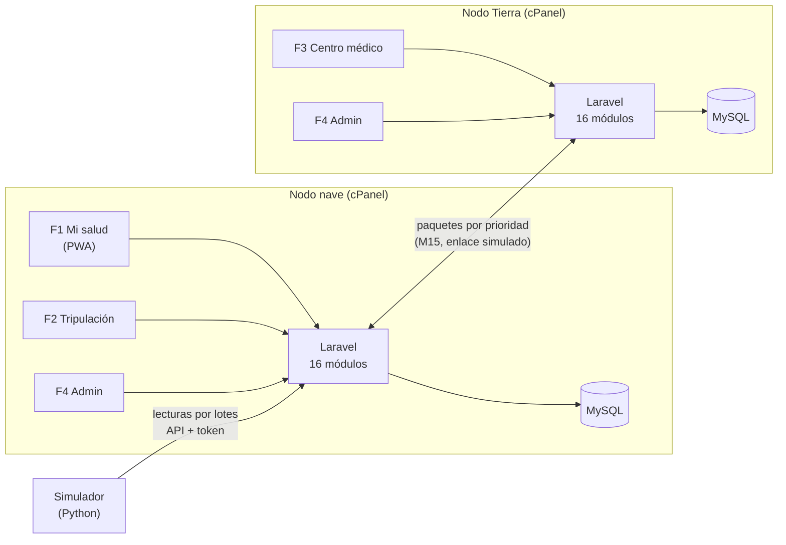
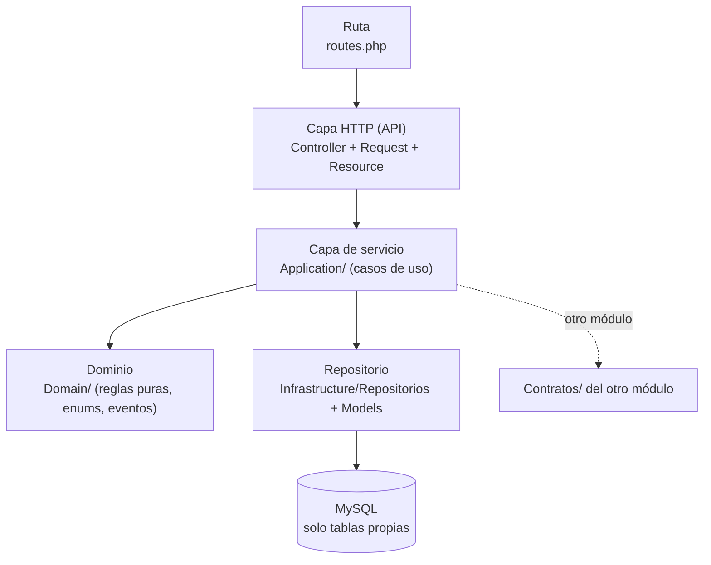
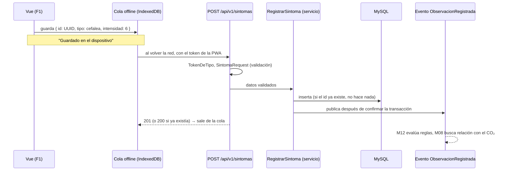

# 2 · Arquitectura

> [← Guía](README.md) · Anterior: [El proyecto](01-el-proyecto.md) · Siguiente: [Backend con Laravel](03-backend-laravel.md)

## En una frase

Un **monolito modular** en Laravel: una sola aplicación, dividida en 16 módulos que no se tocan entre sí por dentro, con el frontend en Vue servido por Inertia y desplegada dos veces (nave y Tierra).

## Las piezas

| Pieza | Tecnología | Qué hace |
|---|---|---|
| Backend | Laravel (PHP) | Reglas de negocio, API, pantallas (vía Inertia), eventos, colas y tareas programadas |
| Frontend | Inertia + Vue 3 + TypeScript + Tailwind v4 | Las 4 aplicaciones (F1–F4). **No** es una SPA aparte: Laravel entrega cada página con sus datos |
| Base de datos | MySQL | Una base por nodo |
| Sin conexión | IndexedDB (Dexie) en el navegador | F1 guarda lo que registra el astronauta y lo envía al volver la red (M15) |
| Simulador | Python | Genera los datos de los sensores y los escenarios E0–E8 |
| Despliegue | cPanel (dos subdominios) | Cron cada minuto para la cola y las tareas programadas |

## Dos formas de hablar con el backend

Es lo más importante de entender. Hay **dos puertas**, y cada una tiene sus reglas:

| | **Puerta web** (Inertia) | **Puerta API** (`/api/v1/...`) |
|---|---|---|
| Quién la usa | Las personas, desde las pantallas | Máquinas: sensores, simulador, la cola offline de la PWA y el otro nodo |
| Autenticación | Sesión con *cookie* (inicio de sesión normal) | **Token** de Sanctum (`Authorization: Bearer …`) |
| Qué devuelve | Una página de Vue con sus *props* | JSON |
| Errores de validación | Vuelven al formulario (`useForm` los muestra bajo cada campo) | JSON con el [formato de error común](04-api-y-errores.md#4-errores) |
| Ejemplo | `GET /admin/usuarios` → página `Admin/Usuarios/Index` | `POST /api/v1/sintomas` → `201` con JSON |

**Regla:** escribir en la API exige token, nunca sesión ([M01 §3.3](../M01-identidad/backend/README.md#33-tokens)). Leer datos para una pantalla se hace por la puerta web, con *props*.

## Módulos

Los 16 módulos y sus dependencias están en el [índice de módulos](../README.md#1-índice-de-módulos) y en el [mapa de dependencias](../README.md#2-mapa-de-dependencias). Se agrupan así:

| Grupo | Módulos | Papel |
|---|---|---|
| Núcleo | M01 Identidad, M02 Misión, M03 Ingesta, M16 Configuración | Quién entra, de qué misión hablamos, cómo llegan los datos y con qué umbrales se juzgan |
| Clínicos | M04 Vitales, M05 Psicología, M06 Sueño, M07 Exámenes, M08 Ambiente, M09 Radiación, M10 Físico, M11 Síntomas | Capturan y muestran cada tipo de dato |
| Inteligencia | M12 Analítica, M13 Alertas | Líneas base, reglas, hallazgos explicados y alertas |
| Soporte | M14 Reportes, M15 Sincronización | PDF, exportación y comunicación nave ↔ Tierra |

### Las 3 reglas de oro entre módulos

1. **Un módulo nunca lee ni escribe las tablas de otro.** Si necesita algo de otro, usa una interfaz de su carpeta `Contratos/`.
2. **Los módulos clínicos no llaman a Analítica ni a Alertas:** publican **eventos** (`ObservacionRegistrada`…) y quien esté interesado reacciona.
3. **Ningún valor clínico u operativo se escribe en el código:** se lee de M16 (`ParametrosMision`, `ConsultaUmbrales`), que guarda una configuración por misión.

Lista completa en [reglas de comunicación](../README.md#4-reglas-de-comunicación-entre-módulos) y [eventos de dominio](../README.md#5-eventos-de-dominio).

## Capas dentro de cada módulo

Cada módulo tiene las mismas capas. La petición entra por arriba y nunca se salta una capa hacia abajo:

| Capa | Carpeta | Responde a | Nunca hace |
|---|---|---|---|
| **HTTP (API)** | `Http/` | ¿Quién llama, está autorizado, los datos vienen bien formados? ¿Qué se responde? | Reglas de negocio ni consultas a la base |
| **Servicio** | `Application/` | ¿Qué pasos sigue esta acción? (guardar, publicar el evento, encolar) | Leer la petición HTTP ni devolver JSON |
| **Dominio** | `Domain/` | ¿Qué es válido según el negocio? (una regla, un cálculo) | Tocar la base de datos o HTTP |
| **Repositorio** | `Infrastructure/` | ¿Cómo se guarda y se consulta en MySQL? | Decidir reglas de negocio |

Cómo se programa cada capa, con un ejemplo completo: [Backend con Laravel](03-backend-laravel.md).

## Recorrido de una petición

**Ejemplo:** la astronauta T2 registra un dolor de cabeza en F1, sin conexión.

## Los dos nodos

- **Mismo código, distinta configuración:** `APP_NODO=nave` o `APP_NODO=tierra` activa o desactiva comportamientos (por ejemplo, en la Tierra no se evalúan reglas).
- **Solo M15 habla con el otro nodo.** Cada módulo cuyos datos viajan implementa un `Importador`.
- **Prioridades:** 1 = alerta crítica, 2 = resumen, 3 = detalle. Al volver el enlace, primero lo crítico.
