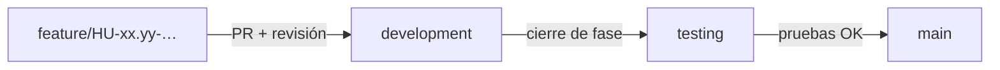

# 7 · Forma de trabajo

> [← Guía](README.md) · Anterior: [Base de datos y migraciones](06-base-de-datos.md) · Siguiente: [Preparar el entorno local](08-entorno-local.md) · [Plan de sprints](../../scrum/plan-de-sprints.md)

Cómo pasa una historia de "por hacer" a "hecha": Jira para saber quién hace qué, Git para el código, *pull requests* para revisar y pruebas cruzadas para no dejar errores. El ritmo (reunión diaria, revisión de fase) está en el [plan](../../scrum/plan-de-sprints.md#ritmo-de-trabajo-fases-cortas).

## 1. Jira

| En Jira | Corresponde a |
|---|---|
| Épica | Un módulo o épica del backlog (`EP-11 · Síntomas`) |
| Historia | Una HU (`HU-11.01 · Registrar un síntoma con su intensidad`), con el enlace a su ficha en `modulos/` |
| Subtareas | Una por capa con trabajo: **BD**, **Backend** y **Frontend**, cada una asignada a su responsable del [plan](../../scrum/plan-de-sprints.md) |
| Error (*bug*) | Lo que falla en pruebas, enlazado a su historia |

**Tablero:**

```
Por hacer → En progreso → En revisión → En pruebas → Hecho
```

| Columna | Entra cuando… | Sale cuando… |
|---|---|---|
| Por hacer | La historia está en la fase actual | Alguien la empieza |
| En progreso | Se creó la rama | Se abre el *pull request* con la CI en verde |
| En revisión | Hay *pull request* hacia `development` | Otra persona lo aprueba y se fusiona en `development` |
| En pruebas | Está fusionada | Quien prueba confirma **todos** sus criterios de aceptación. Si algo falla, vuelve a "En progreso" con un *bug* enlazado |
| Hecho | Pasó las pruebas | — |

## 2. Git

### Primera vez

```bash
git clone https://github.com/HACKATHON-NASA/ARTEMIS-III.git ArtemisIII
cd ArtemisIII
git switch development
cd astrohealth
composer install && npm install
cp .env.example .env && php artisan key:generate
php artisan migrate --seed
composer run dev
```

### Ramas

Repositorio: **https://github.com/HACKATHON-NASA/ARTEMIS-III** (organización HACKATHON-NASA).

| Rama | Para qué | Quién escribe en ella |
|---|---|---|
| **`development`** | **Rama de trabajo de todos los días.** Aquí se integra cada historia terminada | Solo por *pull request* desde una rama de historia |
| `testing` | Versión que se está probando completa (escenarios E0–E8, revisión de fase) | *Pull request* de `development` → `testing`, al cerrar cada fase |
| `main` | Versión estable: la que se despliega y se presenta en el evento | *Pull request* de `testing` → `main`, cuando las pruebas pasan |



- **Siempre se trabaja desde `development`.** Nadie sube código directo a `development`, `testing` ni `main`: todo entra por *pull request*.
- Una rama por historia y por capa, salida siempre de `development` actualizado:

```bash
git switch development && git pull
git switch -c feature/HU-11.01-backend      # o -frontend; la BD va con el backend
```

| Tipo | Nombre |
|---|---|
| Historia | `feature/HU-xx.yy-backend` · `feature/HU-xx.yy-frontend` |
| Error | `fix/HU-xx.yy-<que-falla>` |
| Fundaciones o configuración | `chore/<tema>` |
| Urgente durante el evento | `hotfix/<tema>` |

### *Commits*

Pequeños y con la historia al inicio, en español y en presente:

```
HU-11.01: valida el tipo de síntoma con el catálogo
HU-11.01: publica ObservacionRegistrada al guardar
```

Antes de abrir el *pull request*, se trae lo último de `development` para resolver conflictos en la rama y no en `development`:

```bash
git fetch origin && git rebase origin/development
php artisan test && npm run test
git push --force-with-lease
```

### *Pull request*

**Título:** `HU-11.01 · Backend · Registrar un síntoma con su intensidad`

**Descripción:**

```markdown
Historia: modulos/M11-sintomas/backend/HU/HU-11.01-registrar-un-sintoma-con-su-intensidad.md

## Antes de programar (ARCHITECTURE.md)
- Módulo: M11 · Síntomas
- Capas: Http, Application, Infrastructure
- Archivos: …
- Dependencias: CatalogoSintomas (M16), evento ObservacionRegistrada

## Qué hace
- …

## Criterios de aceptación
- [x] Cefalea de intensidad 6 → se guarda y publica la observación (prueba: `RegistrarSintomaTest`)
- [x] …

## Cómo probarlo
1. …
```

**Reglas para fusionar:**
1. CI en verde (Pest, Vitest y pytest).
2. Aprobado por **otra** persona, que leyó el *diff* completo. Nadie fusiona su propio *pull request*.
3. Se fusiona con *squash*: un *commit* por *pull request* en `development`. El *pull request* siempre apunta a `development`, nunca a `main`.
4. La rama se borra después de fusionar.

## 3. Backend y frontend de la misma historia, en paralelo

El frontend **no espera** a que termine el backend: las *props* y las rutas ya están escritas en la ficha del módulo.

1. Backend y frontend leen la misma historia y la misma tabla de *props* (`frontend/README.md` §3 del módulo).
2. Mientras no existe el controlador, el frontend prueba su página con *props* de ejemplo (en Vitest o en una ruta temporal de su rama).
3. Si al construir aparece que una *prop* o una ruta tiene que cambiar, **primero se cambia la ficha** (con su línea en el [CHANGELOG](../../CHANGELOG.md)) y se avisa en el chat. El código nunca contradice la ficha.

## 4. Cuándo una historia está lista

**Lista para empezar** (*ready*): está en la fase actual, sus dependencias están en "Hecho" (columna *Depende de* del plan) y tiene ficha en `modulos/`.

**Terminada** (*done*):

- [ ] Todos los criterios de aceptación tienen su prueba y pasan.
- [ ] Cumple [ARCHITECTURE.md](ARCHITECTURE.md): capas, sobre JSON, códigos funcionales documentados y ninguna [práctica prohibida](ARCHITECTURE.md#25-prácticas-prohibidas). La prueba de arquitectura está en verde.
- [ ] Ningún valor clínico u operativo escrito en el código (sale de M16).
- [ ] Textos exactos de la historia; pantalla usable con teclado y sin desplazamiento horizontal a 375 px.
- [ ] Revisada y fusionada en `development`; probada por otra persona en "En pruebas".
- [ ] Si cambió algo de la ficha, la ficha y el CHANGELOG están actualizados.

## 5. Pruebas cruzadas

Todos probamos todo, todo el tiempo:

| Quién prueba | Qué |
|---|---|
| Quien programa | Sus pruebas automáticas, antes del *pull request* |
| Quien revisa el *pull request* | Lee el código y ejecuta las pruebas |
| Otra persona del equipo, en "En pruebas" | Recorre los criterios de aceptación en la aplicación real (local o nodo de pruebas), como lo haría un usuario |
| Todo el equipo, al cerrar cada fase | Los escenarios E0–E8 que ya deben pasar, no solo los nuevos |

Un error encontrado se registra en Jira con: pasos para reproducirlo, qué se esperaba, qué pasó y, si salió en la API, su `traza_id` ([errores](04-api-y-errores.md#5-cómo-encontrar-un-error-en-el-log)).

## 6. Trabajar con IA

Se puede (y conviene) usar IA para programar, con las reglas del [plan §10](../../scrum/plan-de-sprints.md#10-cómo-trabajar-con-ia-sin-introducir-errores). En corto: se le da la historia, la ficha del módulo y esta guía; primero las pruebas; los valores clínicos se copian de la documentación, nunca de la IA; y una persona revisa todo el *diff*.

## 7. Comunicación

- **Dudas que bloquean:** al chat del equipo, el mismo día. Si nadie responde en una hora, a la reunión diaria.
- **Cambios en la documentación:** con su línea en el [CHANGELOG](../../CHANGELOG.md).
- **Decisiones:** las toma el *Product Owner* y quedan escritas en la ficha que corresponde.
