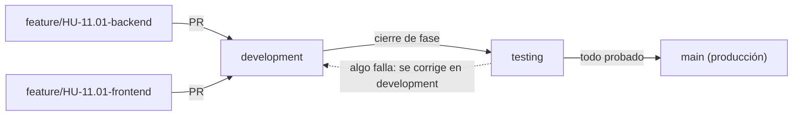

# 9 · Flujo de trabajo con Git

> [← Guía](README.md) · Anterior: [Preparar el entorno local](08-entorno-local.md) · [Forma de trabajo](07-forma-de-trabajo.md) · Siguiente: [Estructura de carpetas](10-estructura-de-carpetas.md)

Cómo trabajamos **todos al mismo tiempo sobre el mismo código sin pisarnos ni llenarnos de conflictos de *merge***. Repositorio: **https://github.com/HACKATHON-NASA/ARTEMIS-III**.

La idea en una frase: **todos partimos de `development`, cada uno trabaja en su propia rama corta, y los cambios vuelven a `development` solo por *pull request* (PR) revisado.**

---

## 1. Las tres ramas permanentes

| Rama | Qué es | Cómo entra código | Quién la toca |
|---|---|---|---|
| **`development`** | **La rama de trabajo de todos los días.** Aquí se juntan las historias terminadas | Solo por PR desde una rama de historia, con revisión | Todo el equipo, siempre por PR |
| **`testing`** | La versión que se prueba completa: escenarios E0–E8 y criterios de cierre de la fase | PR de `development` → `testing` al cerrar cada fase | El responsable de la versión |
| **`main`** | **Producción**: lo que se despliega en los nodos y se presenta en el evento. Solo llega lo que ya se probó | PR de `testing` → `main` cuando todas las pruebas pasan | El responsable de la versión |



**Reglas de oro:**

1. **Nadie hace `push` directo** a `development`, `testing` ni `main`. Todo entra por PR.
2. **Siempre se empieza desde `development` actualizado** (`git pull`).
3. **Una rama por historia y por capa**, que vive poco (uno o dos días) y se borra al fusionarse.
4. **Si algo falla en `testing`, no se arregla en `testing`:** se arregla en una rama nueva desde `development`, se fusiona en `development` y se vuelve a pasar a `testing`.

---

## 2. Configuración inicial (una sola vez por computador)

```powershell
git config --global user.name "Su Nombre"
git config --global user.email "su-correo@ejemplo.com"
git config --global pull.rebase true      # git pull no crea commits de merge innecesarios
git config --global fetch.prune true      # borra las ramas remotas que ya no existen
git config --global core.autocrlf true    # finales de línea correctos en Windows
```

Y el repositorio, si todavía no lo tiene ([entorno local, paso 5](08-entorno-local.md#paso-5--clonar-el-repositorio)):

```powershell
git clone https://github.com/HACKATHON-NASA/ARTEMIS-III.git ArtemisIII
cd ArtemisIII
git switch development
```

---

## 3. El ciclo de una historia, paso a paso

Ejemplo: Julieth hace el backend de **HU-11.01 · Registrar un síntoma**.

### Paso 1 · Traer lo último de `development`

**Siempre**, antes de empezar cualquier cosa:

```powershell
git switch development
git pull origin development
```

### Paso 2 · Crear su rama

```powershell
git switch -c feature/HU-11.01-backend
```

| Tipo de trabajo | Nombre de la rama |
|---|---|
| Historia, por capa | `feature/HU-xx.yy-backend` · `feature/HU-xx.yy-frontend` (la base de datos va con el backend) |
| Corregir un error | `fix/HU-xx.yy-<que-falla>` (ej.: `fix/HU-11.01-intensidad-cero`) |
| Documentación | `docs/<tema>` |
| Configuración, dependencias, CI | `chore/<tema>` |
| Urgencia en producción (evento) | `hotfix/<tema>` |

El código de la historia en el nombre enlaza la rama con su tarjeta de Jira.

### Paso 3 · Trabajar con *commits* pequeños

```powershell
git status
git add .
git commit -m "HU-11.01: valida el tipo de síntoma con el catálogo"
```

**Formato del mensaje:** `HU-xx.yy: <qué hace>`, en español, en presente y corto. Un *commit* por cada paso que tenga sentido solo, no uno gigante al final.

```
HU-11.01: crea la migración de sintomas_registrados
HU-11.01: valida el tipo de síntoma con el catálogo
HU-11.01: publica ObservacionRegistrada al guardar
```

### Paso 4 · Mantenerse al día con `development`

**Cada mañana** y **siempre antes de abrir el PR**, traiga lo que otros fusionaron y ponga sus cambios encima:

```powershell
git fetch origin
git rebase origin/development
```

Así los conflictos, si los hay, aparecen **en su rama y en pequeño**, no en `development`. Cómo resolverlos: [sección 5](#5-si-aparece-un-conflicto).

### Paso 5 · Probar

```powershell
php artisan test
npm run test
```

Las dos tienen que pasar antes de subir. (`npm run test` existe desde que se configura Vitest en HU-00.01.)

### Paso 6 · Subir la rama

La primera vez:

```powershell
git push -u origin feature/HU-11.01-backend
```

Si después hizo `rebase`, la subida necesita forzarse, **solo en su propia rama**:

```powershell
git push --force-with-lease
```

> ⚠️ `--force-with-lease` **nunca** sobre `development`, `testing` ni `main`.

### Paso 7 · Abrir el *pull request*

En GitHub aparece el botón **"Compare & pull request"**. Revise:

- **base:** `development` ← **compare:** `feature/HU-11.01-backend`. **Nunca** `main`.
- **Título:** `HU-11.01 · Backend · Registrar un síntoma con su intensidad`.
- **Descripción:** se llena sola con la plantilla del repositorio ([abajo](#plantilla-del-pull-request)).
- **Reviewers:** otra persona del equipo.
- En Jira, la tarjeta pasa a **"En revisión"**.

### Paso 8 · Revisión y fusión

1. La CI tiene que estar en verde.
2. Otra persona lee el *diff* completo, prueba y aprueba. Si pide cambios, se hacen en la **misma rama** (nuevos *commits* + `git push`), y el PR se actualiza solo.
3. Se fusiona con **"Squash and merge"**: toda la rama queda como **un solo *commit*** en `development`.
4. **Nadie fusiona su propio PR.**

### Paso 9 · Borrar la rama y volver a empezar

GitHub borra la rama remota sola al fusionar (si está activada la opción de la [sección 8](#8-configuración-de-github-para-el-administrador)). En su computador:

```powershell
git switch development
git pull origin development
git branch -D feature/HU-11.01-backend
```

(Se usa `-D` porque con *squash* Git no reconoce la rama como fusionada, aunque sí lo está.) En Jira, la tarjeta pasa a **"En pruebas"**.

Y para la siguiente historia, se vuelve al **paso 1**.

---

## 4. Cómo evitar los conflictos de *merge*

| Hábito | Por qué |
|---|---|
| `git pull` de `development` **al empezar el día** y `git rebase origin/development` **antes de cada PR** | Cuanto más vieja la rama, más conflictos |
| **Ramas cortas**: una historia por rama, uno o dos días como máximo | Menos cambios acumulados, menos choques |
| **PR pequeños** | Se revisan rápido y se fusionan antes de que otros cambien lo mismo |
| **Cada capa en su rama** (backend y frontend separados) | Julieth y Jhon o Gabriela tocan carpetas distintas |
| **Avisar en el chat** antes de tocar un archivo compartido (tabla siguiente) | Esos archivos los toca casi todo el mundo |
| **No reformatear archivos ajenos.** Pint y el formateador, solo sobre los archivos que usted cambió | Un cambio de espacios en 300 líneas es un conflicto seguro |
| **No editar migraciones ya fusionadas**: se crea otra | Evita que cada uno tenga una base distinta |

**Archivos compartidos** (avisar antes de tocarlos y fusionar rápido):

| Archivo | Qué se suele añadir |
|---|---|
| `bootstrap/providers.php` | El *provider* de un módulo nuevo |
| `bootstrap/app.php` | Middleware, alias, manejo de errores |
| `composer.json` · `composer.lock` | Paquetes de PHP |
| `package.json` · `package-lock.json` | Paquetes de npm |
| `database/seeders/DatabaseSeeder.php` | El *seeder* de un módulo |
| `resources/js/navegacion.ts` | Entradas del menú |
| `app/Providers/AppServiceProvider.php` | Configuración global |

---

## 5. Si aparece un conflicto

Durante un `git rebase origin/development`, Git se detiene y dice qué archivos chocan.

1. Vea cuáles son:

   ```powershell
   git status
   ```

2. Abra cada archivo en VS Code. Verá bloques así:

   ```
   <<<<<<< HEAD
   lo que ya está en development
   =======
   lo que usted cambió
   >>>>>>> HU-11.01: …
   ```

   VS Code ofrece botones: **Accept Current**, **Accept Incoming** o **Accept Both**. Deje el código **correcto combinando las dos partes** y borre las marcas `<<<<<<<`, `=======` y `>>>>>>>`.

3. Marque cada archivo como resuelto y continúe:

   ```powershell
   git add <archivo>
   git rebase --continue
   ```

4. Si se complica, **cancele sin perder nada** y pida ayuda:

   ```powershell
   git rebase --abort
   ```

**Conflicto en `package-lock.json` o `composer.lock`:** no se arreglan a mano. Tome la versión de `development` y regenere:

```powershell
git checkout origin/development -- package-lock.json
npm install                     # vuelve a añadir sus paquetes
git add package-lock.json
git rebase --continue
```

(Igual con `composer.lock` y `composer install`; si usted había añadido un paquete, `composer require <paquete>` de nuevo.)

Después de resolver, **corra las pruebas** antes de subir.

---

## 6. De `development` a `testing` y a `main`

### Cierre de fase: `development` → `testing`

1. Al cerrar cada fase del [plan](../../scrum/plan-de-sprints.md#2-resumen-de-sprints), el responsable de la versión abre un PR **`development` → `testing`**.
2. Se fusiona con **"Create a merge commit"** (**no** *squash*), para que las tres ramas compartan historia y no aparezcan conflictos falsos después.
3. En `testing` se prueba todo: los escenarios E0–E8 que ya deben pasar y los criterios de cierre de la fase.
4. **Si algo falla:** se crea la tarjeta del error en Jira y se corrige con una rama `fix/…` **desde `development`**, por PR a `development`. Después se repite el paso 1. **Nunca se programa directamente en `testing`.**

### Versión estable: `testing` → `main`

1. Cuando `testing` pasa todas las pruebas, PR **`testing` → `main`**, también con **"Create a merge commit"**.
2. Se marca la versión con una etiqueta:

   ```powershell
   git switch main && git pull
   git tag -a v0.1.0 -m "Fase 1: los datos fluyen"
   git push origin v0.1.0
   ```

3. Lo que está en `main` es lo que se despliega en los nodos del cPanel.

### Urgencia durante el evento: `hotfix`

Solo si algo falla en producción el 14 o el 15 de noviembre:

```powershell
git switch main && git pull
git switch -c hotfix/<tema>
# corregir, probar, commit, push
```

PR a **`main`** con revisión y, en cuanto se fusiona, **otro PR de `main` → `development`**, para que la corrección no se pierda.

---

## 7. Rescates rápidos

| Situación | Comando |
|---|---|
| Ver en qué rama estoy y qué cambié | `git status` |
| Ver el historial en forma de árbol | `git log --oneline --graph -15` |
| Empecé a trabajar en `development` sin crear rama (sin *commit* todavía) | `git switch -c feature/HU-xx.yy-backend` (los cambios se vienen con usted) |
| Hice *commits* en `development` por error (sin subir) | `git switch -c feature/HU-xx.yy-backend` y luego `git switch development` + `git reset --hard origin/development` |
| Guardar cambios a medias para cambiar de rama | `git stash` · volver: `git stash pop` |
| Deshacer mi último *commit* (sin subir), conservando los cambios | `git reset --soft HEAD~1` |
| Descartar los cambios de un archivo | `git restore <archivo>` |
| Mi rama quedó muy desactualizada | `git fetch origin` + `git rebase origin/development` |

> Ante la duda, **antes de un comando con `reset` o `--force`, pregunte en el chat.**

---

## 8. Configuración de GitHub (para el administrador)

Una sola vez, en el repositorio:

| Dónde | Qué |
|---|---|
| **Settings → General → Default branch** | Cambiar a **`development`**. Así los PR apuntan a `development` por defecto y el `git clone` deja a todos en esa rama |
| **Settings → General → Pull Requests** | Activar **"Allow squash merging"** y **"Allow merge commits"**; desactivar *rebase merging*. Activar **"Automatically delete head branches"** (borra la rama al fusionar) |
| **Settings → Branches → Add rule** (para `development`, `testing` y `main`) | **Require a pull request before merging** con **1 aprobación**; **Require status checks to pass** (cuando exista la CI); **Do not allow bypassing**; sin *force push* ni borrado |

---

## Plantilla del *pull request*

Vive en `.github/pull_request_template.md` en la raíz del repositorio. GitHub la pone sola en cada PR nuevo:

```markdown
Historia: documentacion/modulos/Mxx-…/<capa>/HU/HU-xx.yy-….md
Jira: HU-xx.yy

## Antes de programar (ARCHITECTURE.md)
- Módulo:
- Capas:
- Archivos:
- Dependencias:

## Qué hace
-

## Criterios de aceptación
- [ ] … (prueba: `…Test`)

## Cómo probarlo
1.

## Revisión
- [ ] `php artisan test` y `npm run test` pasan
- [ ] Sin prácticas prohibidas de ARCHITECTURE.md
- [ ] Si cambió una ficha, está actualizada con su línea en el CHANGELOG
```

---

## Resumen en una tarjeta

```
Empezar el día      →  git switch development  ·  git pull origin development
Nueva historia      →  git switch -c feature/HU-xx.yy-backend
Guardar avance      →  git add .  ·  git commit -m "HU-xx.yy: …"
Ponerse al día      →  git fetch origin  ·  git rebase origin/development
Subir               →  git push -u origin feature/HU-xx.yy-backend
PR                  →  base: development  ·  revisión  ·  Squash and merge
Terminar            →  git switch development  ·  git pull  ·  git branch -D feature/…
```
