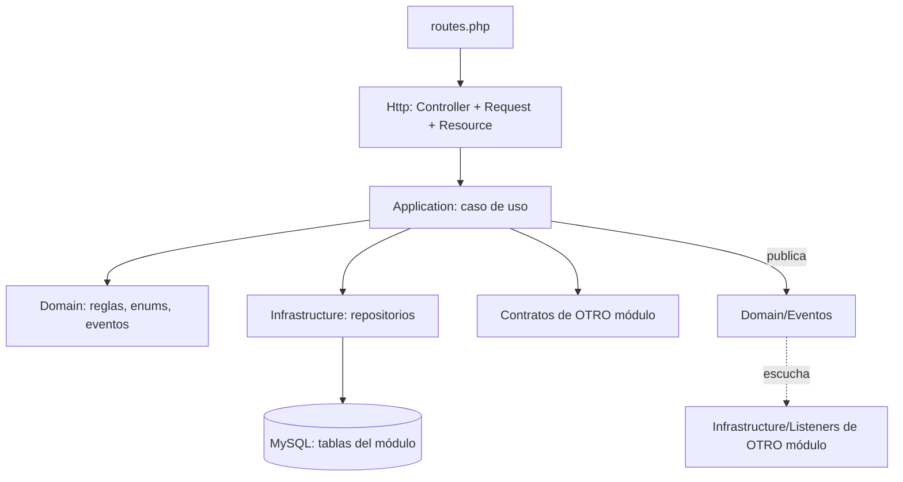
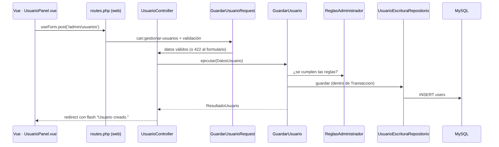

# 10 · Estructura de carpetas: dónde se trabaja cada cosa

> [← Guía](README.md) · Anterior: [Flujo de trabajo con Git](09-flujo-de-git.md) · [ARCHITECTURE.md](ARCHITECTURE.md)

Este documento responde **"¿dónde pongo esto?"** para el backend (Laravel) y el frontend (Vue), y explica **cómo se conectan** las piezas. La estructura **ya está creada** en el repositorio: cada carpeta trae un `README.md` que dice qué va y qué no va. Nadie tiene que inventar carpetas.

---

## 1. Vista general del repositorio

```
ArtemisIII/
├── documentacion/            # QUÉ construir: investigación, propuesta, fichas de los 16 módulos, guías, plan
├── astrohealth/              # EL CÓDIGO: la aplicación Laravel + Vue
│   ├── app/
│   │   ├── Modules/          # ★ BACKEND de los 16 módulos (aquí se programa)
│   │   └── Shared/           # Piezas técnicas comunes (sobre JSON, errores, transacciones)
│   ├── resources/
│   │   ├── js/
│   │   │   ├── modules/      # ★ FRONTEND de los 16 módulos (aquí se programa)
│   │   │   └── …             # Lo global: components, layouts, composables, lib, contratos, offline, types, pages
│   │   └── css/              # Tailwind v4 y variables de color
│   ├── routes/ database/ config/ bootstrap/ tests/   # Del starter kit y de Laravel
│   └── docs/                 # Cómo quedó hecho: backend/, frontend/, database/ (por módulo) y server/
├── simulador/                # Python: genera los datos y los escenarios E0–E8
└── .github/                  # Plantilla de pull request (y la CI en HU-00.02)
```

| Si va a… | Trabaja en |
|---|---|
| Programar el backend de una historia | `astrohealth/app/Modules/<Modulo>/` |
| Programar el frontend de una historia | `astrohealth/resources/js/modules/<Modulo>/` |
| Algo técnico común a todos los módulos | `astrohealth/app/Shared/` o las carpetas globales de `resources/js/` |
| Leer qué hay que construir | `documentacion/modulos/Mxx-…/` |
| Documentar cómo quedó hecho el código | `astrohealth/docs/<backend\|frontend\|database>/<Mxx-modulo>/` o `astrohealth/docs/server/` |

---

## 2. El backend (Laravel)

### 2.1 Dónde

**Todo el código del proyecto va en `astrohealth/app/Modules/<Modulo>/`.** Un módulo por carpeta, con el espacio de nombres `App\Modules\<Modulo>`:

| Código | Carpeta | Código | Carpeta |
|---|---|---|---|
| M01 | `Identidad` | M09 | `Radiacion` |
| M02 | `Mision` | M10 | `FisicoMetabolico` |
| M03 | `Ingesta` | M11 | `Sintomas` |
| M04 | `SignosVitales` | M12 | `Analitica` |
| M05 | `Psicologia` | M13 | `Alertas` |
| M06 | `Sueno` | M14 | `Reportes` |
| M07 | `Examenes` | M15 | `Sincronizacion` |
| M08 | `Ambiente` | M16 | `Configuracion` |

Las carpetas que trae el *starter kit* (`app/Actions/Fortify`, `app/Concerns`, `app/Http/Controllers/Settings`, `app/Models/User.php`…) **no reciben código nuevo**: solo se adaptan en HU-01.01. Detalle en [`app/README.md`](../../../astrohealth/app/README.md).

### 2.2 Las carpetas de un módulo

Todas existen en los 16 módulos. Si un módulo no necesita alguna (por ejemplo, `Console`), queda solo con su README.

| Carpeta | Capa | Qué va | Ejemplo en M01 |
|---|---|---|---|
| `<Modulo>ServiceProvider.php` · `routes.php` | — | Registro del módulo y sus rutas web y API | `IdentidadServiceProvider`, rutas `/admin/usuarios` |
| `Contratos/` | API pública | Interfaces que otros módulos pueden usar | `RegistroAuditoria` |
| `Domain/Enums/` | **Domain** | Valores cerrados y códigos funcionales | `Rol`, `AccionAuditoria`, `CodigoIdentidad` |
| `Domain/Reglas/` | **Domain** | Reglas y cálculos puros | `ReglasAdministrador` |
| `Domain/Eventos/` | **Domain** | Eventos que publica el módulo | (M01 no publica) |
| `Domain/ValueObjects/` | **Domain** | Objetos de valor inmutables | — |
| `Domain/Excepciones/` | **Domain** | Errores de negocio | `UltimoAdministrador` |
| `Application/` | **Service** | Un caso de uso por clase, con `ejecutar()` | `GuardarUsuario`, `EmitirTokenDispositivo` |
| `Application/DTOs/` | **Service** | Datos de entrada y salida de los casos de uso | `DatosUsuario` |
| `Infrastructure/Repositorios/` | **Repository** | Lectura y escritura en MySQL | `AuditoriaEscrituraRepositorio` |
| `Infrastructure/Models/` | **Repository** | Modelos Eloquent de las tablas propias | `Auditoria` |
| `Infrastructure/Listeners/` | **Repository** (adaptador) | Reacciones a eventos de otros módulos | `AuditarUmbralModificado` |
| `Infrastructure/Sincronizacion/` | **Repository** (adaptador) | Importador para la sincronización nave ↔ Tierra | `ImportadorAuditoria` |
| `Http/Controllers/Web/` | **API/HTTP** | Controladores de pantallas (Inertia) | `UsuarioController` |
| `Http/Controllers/Api/` | **API/HTTP** | Controladores de `/api/v1` (sobre JSON) | (M01 no tiene API) |
| `Http/Requests/` | **API/HTTP** | Validación de entrada | `GuardarUsuarioRequest` |
| `Http/Resources/` | **API/HTTP** | Forma de `data` y de las *props* | `UsuarioResource` |
| `Http/Middleware/` | **API/HTTP** | Middleware del módulo | `TokenDeTipo` |
| `Policies/` | Seguridad | Autorización por recurso | `TokenPolicy`, `GatesIdentidad` |
| `Console/` | — | Comandos de Artisan | `TokenNodoCommand` |
| `Database/Migrations/` · `Seeders/` · `Factories/` | Persistencia | Tablas propias, datos iniciales y datos de prueba | `create_auditoria`, `UsuariosDePruebaSeeder` |
| `Tests/Unit/` · `Tests/Feature/` | Pruebas | Domain sin base · ruta completa | `RolTest`, `UsuariosTest` |

El [README de M01](../../../astrohealth/app/Modules/Identidad/README.md) muestra, carpeta por carpeta, **qué archivo crea cada historia**. Es el modelo para los demás módulos.

### 2.3 Quién puede usar a quién



| Desde | Puede usar | Nunca |
|---|---|---|
| `Http` | `Application`, enums y excepciones de `Domain`, `app/Shared/Http` | Repositorios, modelos, `DB::` |
| `Application` | `Domain`, sus repositorios, `Contratos/` y eventos de otros módulos, `app/Shared` | `Request`, respuestas, SQL |
| `Domain` | Solo PHP | Laravel de datos o HTTP |
| `Infrastructure` | `Domain`, Eloquent, `DB` | `Http` |

La prueba de arquitectura (`tests/ArquitecturaTest.php`, HU-00.01) lo comprueba en cada *pull request*.

---

## 3. El frontend (Vue + Inertia)

### 3.1 Dónde

```
astrohealth/resources/js/
├── app.ts                 # Arranque de Inertia (el resolver busca páginas en modules/*/Pages y pages/)
├── modules/<Modulo>/      # ★ Lo de cada módulo
│   ├── Pages/             #   Páginas con el nombre de la ficha: Pages/Admin/Usuarios/Index.vue
│   ├── Components/        #   Componentes solo de este módulo
│   ├── Composables/       #   use<Algo>.ts del módulo
│   ├── Types/             #   Tipos de las props de sus páginas
│   └── Utils/             #   Funciones puras del módulo
├── components/            # Globales: ui/ (shadcn-vue del kit), los 6 de HU-00.03, los que usa más de un módulo
├── layouts/               # Las 4 aplicaciones: Astronauta, Cmo, Tierra, Admin
├── composables/           # Globales: usePermisos
├── lib/                   # Utilidades globales: formato.ts
├── contratos/             # Tipos y valores que también existen en el backend: roles.ts, semaforo.ts
├── offline/               # Cola sin conexión de M15 (la única que llama a /api/v1)
├── types/                 # Tipos de las props compartidas de Inertia
├── pages/                 # Páginas globales: errores y catálogo de componentes
├── actions/ · routes/ · wayfinder/   # GENERADAS por Wayfinder: no se editan ni se suben
```

| Necesito… | Va en |
|---|---|
| Una pantalla de la ficha | `modules/<Modulo>/Pages/<App>/<Recurso>/<Index\|Show\|Create\|Edit>.vue` |
| Un pedazo de esa pantalla (filtros, tabla, formulario, diálogo) | `modules/<Modulo>/Components/` |
| Un botón, campo, diálogo o tabla | **No se crea:** `components/ui/` |
| Un componente que usan dos módulos | `components/` (se mueve; un módulo nunca importa de otro) |
| Los tipos de las *props* | `modules/<Modulo>/Types/` |

### 3.2 Cómo es una pantalla

Una página **solo coordina**: recibe *props* tipadas y las reparte entre componentes. Ejemplo de M01:

```
modules/Identidad/
├── Pages/Admin/Usuarios/Index.vue        # recibe { usuarios, roles, filtros } y arma la pantalla
├── Components/UsuariosFiltros.vue        # búsqueda, rol y estado (router.get con la URL)
├── Components/UsuariosTabla.vue          # tabla y tarjetas en móvil
├── Components/UsuarioPanel.vue           # alta y edición (useForm → POST/PUT /admin/usuarios)
├── Components/DialogoDesactivarUsuario.vue
└── Types/usuarios.ts                     # tipo de las props, copiado de la ficha
```

Manual completo: [Frontend con Vue e Inertia](05-frontend-vue.md).

---

## 4. Integraciones: cómo se conecta todo

| # | Integración | Cómo funciona | Dónde está el código |
|:---:|---|---|---|
| 1 | **Laravel ↔ Vue** (pantallas) | Inertia: el controlador devuelve `Inertia::render('Admin/Usuarios/Index', $props)`; Vue recibe las *props*. Los formularios usan `useForm` y el `router` de Inertia, que llaman a rutas **web** con sesión y CSRF | `Http/Controllers/Web` ↔ `modules/<Modulo>/Pages` |
| 2 | **Props compartidas** | `HandleInertiaRequests` envía en cada página `auth` (usuario y permisos), `nodo`, `tripulante`, `mision` y `flash` | `app/Http/Middleware/HandleInertiaRequests.php` ↔ `resources/js/types` |
| 3 | **Rutas en TypeScript** (Wayfinder) | Vite genera `resources/js/actions` y `resources/js/routes` a partir de las rutas de Laravel, para importar las URL en vez de escribirlas a mano. Se regeneran solas con `npm run dev` | Generadas; no se editan ni se suben |
| 4 | **Máquinas → API** | El simulador, la cola offline de la PWA y el otro nodo escriben en `/api/v1/<modulo>/…` con un **token** de Sanctum y reciben el sobre JSON (`success`, `code`, `data`, `meta`) | `Http/Controllers/Api` + `RespuestaApi`; `resources/js/offline`; `simulador/` |
| 5 | **Módulo ↔ módulo** | Consultas por **contratos** (`ConsultaTripulantes::porUsuario()`); avisos por **eventos** (`ObservacionRegistrada` → M12 evalúa reglas) | `Contratos/` y `Domain/Eventos` de quien ofrece; `Infrastructure/Listeners` de quien escucha |
| 6 | **Nave ↔ Tierra** | Solo M15: encola paquetes por prioridad y los envía cuando hay enlace; cada módulo cuyos datos viajan tiene su `Importador` | `Sincronizacion/` y `Infrastructure/Sincronizacion` de cada módulo |
| 7 | **Configuración por misión** | Umbrales y parámetros clínicos u operativos se leen de M16 (`ConsultaUmbrales`, `ParametrosMision`), nunca del código | Contratos de `Configuracion` |
| 8 | **Base de datos** | Cada módulo migra y consulta **solo** sus tablas; las referencias a tablas ajenas son lógicas | `Database/Migrations` y `Infrastructure` de cada módulo |
| 9 | **Cola y tareas programadas** | Los trabajos pesados (ingesta histórica, *listeners*) van a la cola `database`; las tareas periódicas, al *scheduler* del *provider* | `composer run dev` arranca la cola en local; cron en cPanel |

### Recorrido completo: crear un usuario (M01, HU-01.02)



| Pieza | Archivo |
|---|---|
| Formulario | `resources/js/modules/Identidad/Components/UsuarioPanel.vue` |
| Ruta | `app/Modules/Identidad/routes.php` |
| Validación | `app/Modules/Identidad/Http/Requests/GuardarUsuarioRequest.php` |
| Controlador | `app/Modules/Identidad/Http/Controllers/Web/UsuarioController.php` |
| Caso de uso | `app/Modules/Identidad/Application/GuardarUsuario.php` |
| Regla | `app/Modules/Identidad/Domain/Reglas/ReglasAdministrador.php` |
| Persistencia | `app/Modules/Identidad/Infrastructure/Repositorios/UsuarioEscrituraRepositorio.php` |
| Prueba | `app/Modules/Identidad/Tests/Feature/UsuariosTest.php` |

El ejemplo por la API (simulador → lote de lecturas) está en [ARCHITECTURE §27](ARCHITECTURE.md#27-ejemplos-de-flujo).

---

## 5. Voy a empezar una historia: ¿qué archivos creo?

1. **Lea la historia** de su capa en `documentacion/modulos/Mxx-…/<capa>/HU/` y el README de la carpeta del módulo en el código.
2. **Escriba** (en el PR) módulo, capas, archivos y dependencias ([ARCHITECTURE](ARCHITECTURE.md)).
3. **Backend**, en este orden:
   1. Migración en `Database/Migrations` y modelo en `Infrastructure/Models`.
   2. *Enums*, reglas y excepciones en `Domain`.
   3. Repositorios en `Infrastructure/Repositorios`.
   4. Caso de uso y DTOs en `Application`.
   5. `Request`, `Resource` y controlador en `Http`; la ruta en `routes.php`.
   6. Pruebas en `Tests` (escritas primero, a partir de los criterios).
4. **Frontend:** tipos en `Types/`, componentes en `Components/`, página en `Pages/`, pruebas con Vitest.
5. Abra el PR hacia `development` ([flujo de Git](09-flujo-de-git.md)).

---

## 6. Documentar siempre

La regla del proyecto: **el código y la documentación cambian juntos, en el mismo *pull request***. Un PR que cambia algo sin documentarlo no se aprueba.

| Si usted… | Actualice |
|---|---|
| Crea un archivo de un tipo nuevo en una carpeta | El `README.md` de esa carpeta |
| Cambia una ruta, una *prop*, una tabla o una regla de la ficha | La ficha del módulo (`documentacion/modulos/Mxx-…/`) **antes** de programarlo, y avisa en el chat |
| Añade un código funcional (`MODULO_ALGO`) | La tabla "Códigos de respuesta" del `backend/README.md` del módulo |
| Termina una historia | El `README.md` de su módulo en `astrohealth/docs/<capa>/<Mxx-modulo>/`: historia implementada, rutas o páginas reales, cómo probarla |
| Toma una decisión técnica no evidente | Un `.md` en `astrohealth/docs/<capa>/<Mxx-modulo>/` (o en `docs/server/` si es del servidor) y un comentario breve en el código que diga **por qué** |
| Cambia cualquier documento | Una línea en [`documentacion/CHANGELOG.md`](../../CHANGELOG.md) |
| Abre un PR | La plantilla completa: historia, capas, archivos, criterios y cómo probarlo |

Los errores de siempre que **no** se pueden repetir:

- Código sin su prueba.
- Una ficha que dice una cosa y un código que hace otra.
- Carpetas o archivos nuevos sin explicar.
- Valores clínicos escritos a mano en el código.
- Cambios grandes sin avisar en archivos compartidos ([flujo de Git §4](09-flujo-de-git.md#4-cómo-evitar-los-conflictos-de-merge)).
