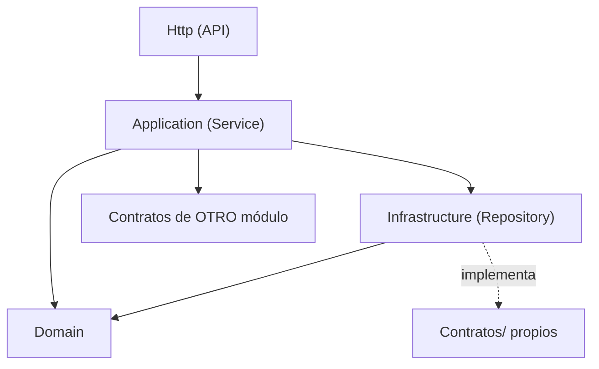
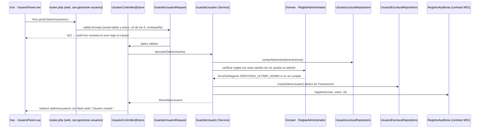
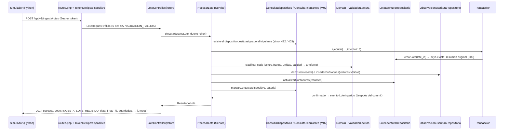

# ARCHITECTURE · Norma arquitectónica de AstroHealth

> ⚠️ **Este archivo contiene reglas arquitectónicas obligatorias del proyecto. Todo desarrollador o agente de IA que modifique el sistema debe leer este documento antes de crear o modificar código.**

> [← Guía del proyecto](README.md) · [Índice de módulos](../README.md) · [Plan de sprints](../../scrum/plan-de-sprints.md)

**Antes de desarrollar** cualquier característica, toda persona o agente identifica y escribe (en el *pull request* o en la respuesta):

1. **Módulo afectado** (M01–M16).
2. **Capa afectada** (Domain, Infrastructure/Repository, Application/Service, Http/API, frontend).
3. **Archivos** que va a crear o modificar.
4. **Dependencias** involucradas (contratos de otros módulos, eventos, parámetros de M16).

Y solo después desarrolla.

**Protección de la arquitectura.** Si una solicitud obliga a romper una regla de este documento, **no se rompe en silencio**. Se responde con:

```
ARCHITECTURE VIOLATION
Regla: <número y nombre de la regla>
Qué la rompería: <explicación>
Alternativa compatible: <propuesta>
```

y se espera una decisión. Una excepción aprobada se documenta en la sección 26 de este archivo.

## Contenido

1. [Objetivo](#1-objetivo)
2. [Principios](#2-principios)
3. [Decisiones de adaptación](#3-decisiones-de-adaptación)
4. [Estructura general](#4-estructura-general)
5. [Estructura de un módulo](#5-estructura-de-un-módulo)
6. [Las capas](#6-las-capas)
7. [Reglas de dependencia](#7-reglas-de-dependencia)
8. [Reglas de Repository](#8-reglas-de-repository)
9. [Reglas de Service](#9-reglas-de-service)
10. [Reglas de Domain](#10-reglas-de-domain)
11. [Reglas HTTP/API](#11-reglas-httpapi)
12. [Estándar JSON](#12-estándar-json)
13. [Manejo de errores y códigos funcionales](#13-manejo-de-errores-y-códigos-funcionales)
14. [Seguridad](#14-seguridad)
15. [Vue e Inertia](#15-vue-e-inertia)
16. [Modularización del frontend](#16-modularización-del-frontend)
17. [Convenciones de nombres](#17-convenciones-de-nombres)
18. [Límites de tamaño](#18-límites-de-tamaño)
19. [Testing](#19-testing)
20. [Rendimiento](#20-rendimiento)
21. [Logging y auditoría](#21-logging-y-auditoría)
22. [Transacciones](#22-transacciones)
23. [Comunicación entre módulos y eventos](#23-comunicación-entre-módulos-y-eventos)
24. [Buenas prácticas](#24-buenas-prácticas)
25. [Prácticas prohibidas](#25-prácticas-prohibidas)
26. [Excepciones documentadas](#26-excepciones-documentadas)
27. [Ejemplos de flujo](#27-ejemplos-de-flujo)

---

## 1. Objetivo

Que un sistema de **16 módulos**, construido por varias personas (y con ayuda de IA) en poco tiempo, se mantenga **predecible**: cada funcionalidad tiene un único lugar evidente, cada capa una única responsabilidad y cada error dice qué pasó y dónde.

**Regla de localización.** Si algo falla, se sabe dónde buscar sin preguntar:

| Si el problema es… | Se busca en |
|---|---|
| De síntomas, en general | `app/Modules/Sintomas/` y `resources/js/modules/Sintomas/` |
| De base de datos | `app/Modules/Sintomas/Infrastructure/` (Repository) |
| De una regla del negocio | `app/Modules/Sintomas/Domain/` |
| Del flujo de una acción | `app/Modules/Sintomas/Application/` (Service) |
| De HTTP (ruta, validación, respuesta) | `app/Modules/Sintomas/Http/` y `routes.php` |
| Visual | `resources/js/modules/Sintomas/` |
| De un valor clínico (umbral, límite, tiempo) | La configuración de la misión en M16, nunca el código |

## 2. Principios

1. **Modularidad:** 16 módulos independientes (M01–M16), cada uno dueño de sus tablas, sus reglas y sus pantallas.
2. **Capas con responsabilidad única:** Domain, Repository, Service y API, con dependencias en un solo sentido.
3. **SOLID**, con prioridad en **responsabilidad única (S)** e **inversión de dependencias (D)**.
4. **Profesional pero práctica:** una abstracción solo existe si aporta desacoplamiento, pruebas o más de una implementación. Nada de carpetas vacías ni patrones por moda.
5. **El backend manda:** toda regla y toda validación importante vive en el backend; el frontend presenta.
6. **Configuración por misión:** ningún valor clínico u operativo se escribe en el código ([módulos §4, regla 8](../README.md#4-reglas-de-comunicación-entre-módulos)).
7. **Fichas primero:** la ficha de cada módulo (`modulos/Mxx-…/`) especifica **qué** construir; este documento, **cómo**. Si se contradicen, se avisa y se corrige una de las dos antes de programar.

## 3. Decisiones de adaptación

Esta norma se escribió a partir de una plantilla general para sistemas empresariales. Estas son las decisiones tomadas para AstroHealth:

| # | Tema | Plantilla | Decisión en AstroHealth | Por qué |
|:---:|---|---|---|---|
| D1 | Carpeta de los módulos | `modules/` | **Backend:** `astrohealth/app/Modules/<Modulo>/`. **Frontend:** `astrohealth/resources/js/modules/<Modulo>/`. **Documentación:** `documentacion/modulos/` | Es la convención de Laravel (`App\Modules\…`) y la que ya usan las 16 fichas |
| D2 | Módulos | Ejemplos (Sales, Customers…) | Los 16 reales: `Identidad`, `Mision`, `Ingesta`, `SignosVitales`, `Psicologia`, `Sueno`, `Examenes`, `Ambiente`, `Radiacion`, `FisicoMetabolico`, `Sintomas`, `Analitica`, `Alertas`, `Reportes`, `Sincronizacion`, `Configuracion` | [Índice de módulos](../README.md#1-índice-de-módulos) |
| D3 | Nombres de las capas | `Domain/`, `Repository/`, `Services/`, `Http/` | `Domain/`, **`Infrastructure/`** (= Repository), **`Application/`** (= Service), `Http/` (= API) | Son los nombres estándar de *Clean Architecture* y los que ya usan las 16 fichas. La equivalencia es exacta (sección 6) |
| D4 | Idioma del código | Inglés, salvo convención existente | **Español** para el dominio (clases, métodos, tablas, campos JSON, códigos). **Inglés** solo para lo que impone el framework o la estructura: nombres de carpetas de capa, sufijos de Laravel (`Controller`, `Request`, `Resource`, `ServiceProvider`, `Policy`, `Test`) y las claves del sobre JSON (`success`, `code`…) | Las 16 fichas, el contrato del [plan §9](../../scrum/plan-de-sprints.md#9-contratos-compartidos) y el catálogo de datos ya están en español. Mezclar dentro del dominio es lo que se prohíbe |
| D5 | Clases de *Actions* | Carpeta `Actions/` | No se usa: cada clase de `Application/` ya es **una acción** (`RegistrarSintoma`) | Evita dos lugares para lo mismo |
| D6 | DTOs | Carpeta `DTOs/` | `Application/DTOs/` (entrada y salida de los servicios) y `Contratos/` (los que se exponen a otros módulos). Los objetos de valor del negocio, en `Domain/ValueObjects/` | Cada DTO queda junto a quien lo usa |
| D7 | Transacciones | Dentro de Repository o con una abstracción | Abstracción `App\Shared\Persistencia\Transaccion`, implementada con `DB::transaction` en infraestructura. Las fichas que dicen "`DB::transaction`" o "en una transacción" se implementan con ella | El servicio controla el alcance de la transacción sin tocar `DB::` |
| D8 | Formato JSON | Sobre `success / code / message / data / errors / meta` | Se adopta para **toda** la API `/api/v1`. Lo que las fichas describen como "cuerpo de la respuesta" es el contenido de `data` | Una sola forma para el simulador, la PWA y el otro nodo |
| D9 | Respuestas web (Inertia) | — | No llevan sobre: son páginas con *props*, redirecciones con *flash* y errores de validación de `useForm` | Es como funciona Inertia |
| D10 | TypeScript | Analizar | **Sí**, desde el inicio (lo trae el *starter kit*). Los archivos que las fichas nombran `.js` se crean `.ts` | Tipos de *props* verificados y menos errores |
| D11 | Pinia | Solo para estado realmente compartido | **No se instala** al inicio. Las *props* de Inertia y el estado local bastan; la cola offline usa IndexedDB. Se añade solo con una justificación aprobada | Menos piezas |
| D12 | Componentes base | Botones, inputs, modales… consistentes | Los de `components/ui` del *starter kit* (shadcn-vue) y los 6 compartidos de [HU-00.03](../../scrum/fundaciones/HU-00.03-libreria-de-componentes.md) | Una sola versión visual |
| D13 | Auditoría | Dejar la arquitectura preparada | **Ya existe**: tabla `auditoria` de M01, de solo inserción, con el contrato `RegistroAuditoria` ([M01](../M01-identidad/backend/README.md#34-auditoría)) | Es un requisito de privacidad del proyecto |
| D14 | Migraciones | Normales o modulares | **Modulares:** `app/Modules/<Modulo>/Database/Migrations/` | Cada módulo es dueño de sus tablas |

## 4. Estructura general

```
ArtemisIII/
├── documentacion/                    # Investigación, propuesta, fichas de los módulos y plan
├── astrohealth/                       # Proyecto Laravel + Vue (y su docs/ técnico)
│   ├── app/
│   │   ├── Modules/                  # Los 16 módulos (sección 5)
│   │   │   ├── Identidad/            # M01
│   │   │   ├── Mision/               # M02
│   │   │   ├── …
│   │   │   └── Configuracion/        # M16
│   │   ├── Shared/                   # Lo común a todos los módulos (sin reglas de negocio)
│   │   │   ├── ModuloServiceProvider.php
│   │   │   ├── Http/RespuestaApi.php             # Construye el sobre JSON (sección 12)
│   │   │   ├── Http/CodigoGeneral.php            # Códigos funcionales comunes (sección 13)
│   │   │   ├── Http/Middleware/AsignarTrazaId.php
│   │   │   ├── Excepciones/ErrorDeNegocio.php
│   │   │   └── Persistencia/{Transaccion,TransaccionMysql}.php
│   │   ├── Models/User.php           # Del starter kit (lo administra M01)
│   │   └── Providers/AppServiceProvider.php
│   ├── bootstrap/app.php             # Middleware global y manejador común de errores
│   ├── resources/js/                 # Frontend (sección 16)
│   ├── routes/                       # Solo las rutas del kit; las de cada módulo, en su routes.php
│   └── tests/                        # Pest.php, TestCase y ArquitecturaTest
├── simulador/                        # Python
└── .github/workflows/                # CI
```

## 5. Estructura de un módulo

```
astrohealth/app/Modules/Sintomas/
├── SintomasServiceProvider.php       # Rutas, migraciones, contratos, listeners, gates y tareas del módulo
├── routes.php                        # Grupo web (Inertia) y grupo API (/api/v1/sintomas)
├── Contratos/                        # API PÚBLICA del módulo: interfaces y DTOs que usan otros módulos
│   └── ConsultaSintomas.php
├── Domain/                           # Núcleo del negocio, sin base de datos ni HTTP
│   ├── Enums/                        # Valores cerrados y códigos funcionales del módulo
│   ├── Reglas/                       # Reglas y cálculos puros
│   ├── Eventos/                      # Eventos que publica el módulo (públicos)
│   ├── ValueObjects/
│   └── Excepciones/                  # Errores de negocio (heredan de ErrorDeNegocio)
├── Application/                      # = SERVICE: un caso de uso por clase
│   ├── RegistrarSintoma.php
│   └── DTOs/                         # Datos de entrada y salida de los casos de uso
├── Infrastructure/                   # = REPOSITORY: lo único que toca la base de datos
│   ├── Repositorios/
│   │   ├── SintomaLecturaRepositorio.php     # Consultas; implementa Contratos/ConsultaSintomas
│   │   └── SintomaEscrituraRepositorio.php   # Inserciones y cambios
│   ├── Models/                       # Modelos Eloquent de las tablas propias
│   ├── Listeners/                    # Reacciones a eventos de otros módulos (llaman a un servicio)
│   └── Sincronizacion/               # Importador de M15, si los datos viajan entre nodos
├── Http/                             # = API
│   ├── Controllers/Web/              # Devuelven páginas Inertia o redirecciones
│   ├── Controllers/Api/              # Devuelven el sobre JSON
│   ├── Requests/                     # Validación de entrada
│   ├── Resources/                    # Forma de data y de las props
│   └── Middleware/                   # Solo si el módulo lo necesita
├── Policies/                         # Autorización sobre recursos concretos
├── Console/                          # Comandos de Artisan del módulo
├── Database/
│   ├── Migrations/
│   ├── Seeders/
│   └── Factories/
└── Tests/
    ├── Unit/                         # Domain
    └── Feature/                      # HTTP + Service + Repository
```

**Solo se crean las carpetas que el módulo necesita**, pero cuando existen se llaman así, en todos los módulos. Las fichas nombran a veces el repositorio como `<Cosa>Eloquent` (por ejemplo `SintomasEloquent`): es el **repositorio de lectura** que implementa el contrato.

## 6. Las capas

| Capa conceptual | Carpeta | Responsabilidad | Ejemplos |
|---|---|---|---|
| **Domain** | `Domain/` | Reglas de negocio puras, enumeraciones, estados, objetos de valor, eventos y excepciones de negocio | "Un usuario desactivado no puede iniciar sesión"; "una lectura con calidad < 0,5 es artefacto"; mediana y lapsos del PVT |
| **Repository** | `Infrastructure/` | Todo acceso a MySQL: SELECT, INSERT, UPDATE, DELETE, Eloquent, Query Builder, `DB::`, bloqueos e implementación de transacciones | `SintomaEscrituraRepositorio::guardar()`, `LoteEscrituraRepositorio::insertarLecturas()` |
| **Service / Application** | `Application/` | Casos de uso: coordina repositorios, aplica reglas del dominio, controla el flujo, abre la transacción, publica eventos y devuelve DTOs o resultados | `RegistrarSintoma`, `ProcesarLote`, `GuardarUsuario` |
| **API / HTTP** | `Http/` y `routes.php` | Entrada y salida: ruta, autenticación, autorización, validación de formato, llamada a **un** servicio y respuesta (sobre JSON o Inertia) | `SintomaController`, `SintomaRequest`, `SintomaResource` |
| **Contratos** | `Contratos/` | Lo que el módulo ofrece a otros módulos | `ConsultaSintomas::enVentana()` |

## 7. Reglas de dependencia



| Capa | Puede usar | No puede usar |
|---|---|---|
| `Domain` | PHP, sus propios `Domain/*`, `Carbon` | `Illuminate\Http`, `Illuminate\Database`, `DB`, modelos Eloquent, Inertia, otros módulos (salvo sus `Domain/Eventos`) |
| `Application` | `Domain`, `Infrastructure` del **mismo** módulo, `Contratos/` y `Domain/Eventos/` de otros módulos, `App\Shared` | `Http` (ni `Request` ni respuestas), `DB::`, Query Builder, métodos de persistencia de Eloquent |
| `Infrastructure` | `Domain`, Eloquent, `DB`, `App\Shared\Persistencia` | `Http`, `Application` (salvo los *listeners*, que llaman a un servicio) |
| `Http` | `Application`, `Domain` (enums y excepciones), `App\Shared\Http` | `Infrastructure` (repositorios y modelos), `DB::` |
| Frontend | Lo que llega en *props* o en el sobre JSON | Conocer repositorios, tablas o reglas internas |

- **Inversión de dependencias:** se define una interfaz cuando hay una razón real: los `Contratos/` entre módulos, `Transaccion`, el cliente del nodo remoto (M15) o algo que las pruebas deban sustituir. Dentro de un módulo, un servicio puede recibir su repositorio concreto por inyección. **No** se crean interfaces "por si acaso".
- **Sin dependencias circulares entre módulos.** El [mapa de dependencias](../README.md#2-mapa-de-dependencias) es la referencia; si una dependencia nueva cierra un ciclo, se resuelve con un evento.

Estas reglas se comprueban **automáticamente** con pruebas de arquitectura de Pest (sección 19).

## 8. Reglas de Repository

1. **Es la única capa que toca la base de datos.** Sin excepciones fuera de la [sección 26](#26-excepciones-documentadas).
2. **Cada módulo tiene sus repositorios** y solo consulta **sus** tablas ([propiedad de las tablas](../README.md#6-propiedad-de-las-tablas)).
3. **Separación por responsabilidad:** como mínimo, **lectura** (`<Agregado>LecturaRepositorio`) y **escritura** (`<Agregado>EscrituraRepositorio`) por agregado. Si una de ellas crece más allá del límite de la sección 18 o mezcla temas distintos, se divide por tema (`AlertaBandejaRepositorio`, `AlertaEstadisticaRepositorio`).
4. **Métodos con intención:** `porId()`, `activasDeTripulante()`, `guardar()`, `marcarConfirmada()`. Nunca un `query()` genérico que devuelva un *builder* hacia fuera.
5. **Qué devuelven:** DTOs, colecciones de DTOs o modelos Eloquent **ya cargados** (con sus relaciones por *eager loading*). Fuera del repositorio se pueden **leer** atributos de un modelo, pero nunca llamar a `save()`, `update()`, `delete()`, `where()` ni a relaciones sin cargar (`Model::shouldBeStrict` hace fallar la carga perezosa).
6. **Los contratos hacia otros módulos devuelven DTOs**, nunca modelos Eloquent.
7. **SQL a mano** solo con *bindings* (`?`), nunca concatenando datos. Si la sentencia es específica de MySQL, el repositorio tiene su variante para SQLite (pruebas).

## 9. Reglas de Service

1. **Una clase por caso de uso**, nombrada con un verbo (`RegistrarSintoma`), con un único método público `ejecutar(...)`.
2. **Coordina:** comprueba con el dominio, llama a uno o varios repositorios, usa contratos de otros módulos, publica eventos y encola hacia la Tierra.
3. **Recibe DTOs** (nunca `Request` ni arrays sin forma) y **devuelve DTOs o resultados** (nunca respuestas HTTP ni páginas).
4. **Abre la transacción** con `Transaccion::ejecutar()` cuando modifica más de una fila relacionada (sección 22).
5. **No escribe SQL** ni usa Query Builder o métodos de persistencia de Eloquent.
6. **Lanza excepciones de negocio** del módulo (`Domain/Excepciones/`) cuando una regla lo impide; no arma respuestas de error.
7. Se puede usar igual desde un controlador web, uno de API, un comando o un *listener*.

## 10. Reglas de Domain

1. **Reglas puras:** sin base de datos, sin HTTP, sin Inertia y, en lo posible, sin Laravel. Se prueban con pruebas unitarias sin arrancar el framework.
2. Contiene: enumeraciones (`Domain/Enums`), reglas y cálculos (`Domain/Reglas`), objetos de valor, eventos y excepciones de negocio.
3. **Los modelos Eloquent no son entidades de dominio** y viven en `Infrastructure/Models`. No se duplica cada tabla con una entidad: el dominio modela reglas, no filas.
4. Los **valores clínicos** (umbrales, ventanas, límites) **no se escriben aquí**: el servicio los obtiene de M16 y se los pasa a la regla como parámetro.

## 11. Reglas HTTP/API

1. **Controladores delgados:** `Request → validación → Service → Resource → respuesta`. Unas pocas líneas por método y nunca cientos de líneas por clase.
2. **Validación de entrada en `FormRequest`** (formato, obligatoriedad, rangos de tipo). Las **reglas de negocio** van en el servicio o el dominio:

   | Validación de entrada (`Request`) | Regla de negocio (`Application` / `Domain`) |
   |---|---|
   | `email` tiene formato de correo | Debe quedar al menos un administrador activo |
   | `intensidad` es un entero entre 0 y 10 | El cuestionario de mareo solo se responde los días 1 a 3 de la misión |
   | `lote_id` es un UUID | El dispositivo solo escribe datos de su tripulante asignado |

3. **Autorización** con el *Gate* o la *Policy* que dice la ficha (los nombres de los *Gates* los define solo [M01](../M01-identidad/backend/README.md#5-permisos)), en el middleware de la ruta o con `Gate::authorize()` en el controlador.
4. **Rutas:** `/api/v1/<modulo>/<recurso>` en plural y en español, sin verbos en la URL; las escrituras de la API exigen token (`auth:sanctum` + `TokenDeTipo`).
5. **Respuestas de la API** siempre con el sobre JSON (sección 12), construido con `RespuestaApi`. Las web, con `Inertia::render()` o redirecciones con *flash*.

## 12. Estándar JSON

Aplica a **toda** respuesta de `/api/v1/...`. Las claves del sobre son fijas; el contenido de `data`, `errors` y `meta` usa `snake_case` en español.

### Éxito

```json
{
  "success": true,
  "code": "SINTOMAS_REGISTRADO",
  "message": "Síntoma registrado.",
  "data": { "id": "0d6b2f4e-…", "tipo": "cefalea", "intensidad": 6, "inicio_en": "2026-10-22T14:05:00.000Z" },
  "meta": { "traza_id": "5b0e9c1a-7f42-4d2e-9a1b-3c6d8e2f4a70" }
}
```

### Lista paginada

```json
{
  "success": true,
  "code": "OK",
  "message": "Consulta realizada.",
  "data": [ { … }, { … } ],
  "meta": { "traza_id": "…", "paginacion": { "pagina": 1, "por_pagina": 25, "total": 31, "ultima_pagina": 2 } }
}
```

### Error

```json
{
  "success": false,
  "code": "INGESTA_LOTE_MIXTO",
  "message": "Un lote debe ser personal o ambiental, no ambos.",
  "data": null,
  "errors": { "tripulante_id": ["lote_mixto"] },
  "meta": { "traza_id": "…", "modulo": "M03" }
}
```

| Clave | Cuándo va | Contenido |
|---|---|---|
| `success` | Siempre | `true` si el código HTTP es 2xx |
| `code` | Siempre | Código funcional (sección 13) |
| `message` | Siempre | Texto para una persona, en español; el texto exacto de la ficha cuando lo define |
| `data` | Siempre | El recurso o la lista (lo que la ficha llama "cuerpo de la respuesta"); `null` en los errores |
| `errors` | Solo en errores | Errores por campo (`{ "campo": ["…"] }`); `{}` si no son de campo. M03 pone aquí códigos en lugar de textos, como dice [su ficha](../M03-ingesta/backend/HU/README.md) |
| `meta` | Siempre | `traza_id` siempre; `modulo` en los errores; `paginacion` en las listas; `debug` solo en local (sección 13) |

**Formato de los datos:** fechas ISO 8601 en UTC con `Z`; identificadores UUID en texto; números como número JSON (punto decimal); `null` explícito; valores enumerados exactamente como en el [plan §9.1](../../scrum/plan-de-sprints.md#91-valores-enumerados). Detalle en [API, JSON y errores](04-api-y-errores.md).

### Códigos HTTP

| HTTP | Uso |
|:---:|---|
| `200` | Consulta correcta, o reenvío de algo que ya existía (idempotencia por UUID) |
| `201` | Se creó |
| `204` | Borrado o revocación (sin cuerpo) |
| `400` | Petición mal formada (JSON inválido) |
| `401` | Sin autenticar, token inválido o sesión usada donde se exige token |
| `403` | Autenticado sin permiso |
| `404` | No existe o no es visible para quien pregunta |
| `409` | La acción choca con el estado actual del recurso, cuando la ficha no indica otro código |
| `413` | Cuerpo o archivo demasiado grande |
| `422` | Datos que no cumplen la validación o una regla de negocio |
| `429` | Demasiadas peticiones |
| `500` | Error no previsto |
| `503` | Mantenimiento |

Nunca se responde `200` para esconder un error. Si una ficha fija un código para un caso, manda la ficha.

## 13. Manejo de errores y códigos funcionales

**Códigos funcionales.** Constantes en `MAYÚSCULAS_CON_GUION_BAJO`, en español, con el prefijo del módulo:

| Prefijo | Módulo | Prefijo | Módulo |
|---|---|---|---|
| `IDENTIDAD_` | M01 | `FISICO_` | M10 |
| `MISION_` | M02 | `SINTOMAS_` | M11 |
| `INGESTA_` | M03 | `ANALITICA_` | M12 |
| `VITALES_` | M04 | `ALERTAS_` | M13 |
| `PSICOLOGIA_` | M05 | `REPORTES_` | M14 |
| `SUENO_` | M06 | `SINCRONIZACION_` | M15 |
| `EXAMENES_` | M07 | `CONFIGURACION_` | M16 |
| `AMBIENTE_` | M08 | (sin prefijo) | Códigos generales |
| `RADIACION_` | M09 | | |

| Códigos generales (`App\Shared\Http\CodigoGeneral`) | HTTP |
|---|:---:|
| `OK` | 200 |
| `PETICION_INVALIDA` | 400 |
| `NO_AUTENTICADO` | 401 |
| `SIN_PERMISO` | 403 |
| `NO_ENCONTRADO` | 404 |
| `CONFLICTO` | 409 |
| `DEMASIADO_GRANDE` | 413 |
| `VALIDACION_FALLIDA` | 422 |
| `DEMASIADAS_PETICIONES` | 429 |
| `ERROR_INTERNO` | 500 |
| `MANTENIMIENTO` | 503 |

- Cada módulo declara sus códigos en un *enum* (`Domain/Enums/CodigoSintomas`) y los **documenta** en una tabla "Códigos de respuesta" de su `backend/README.md`. Un código publicado **no cambia**: lo usan el simulador, la PWA y el otro nodo.
- Los éxitos de escritura llevan un código propio (`SINTOMAS_REGISTRADO`, `SINTOMAS_YA_REGISTRADO` en el reenvío); las consultas, `OK`.
- **Errores de negocio:** el servicio lanza una excepción que hereda de `ErrorDeNegocio` (con su código y su HTTP). El manejador común de `bootstrap/app.php` la convierte en el sobre de error. Nadie arma respuestas de error a mano.
- **Dónde se generó:** `meta.modulo` (deducido del espacio de nombres de la excepción o del controlador) y `meta.traza_id`, que también va en el encabezado `X-Traza-Id` y en cada línea de *log* de esa petición.
- **En local** (`APP_DEBUG=true`), `meta.debug` añade `{ excepcion, archivo, linea }`.
- **En producción nunca** se exponen trazas, SQL, credenciales, tokens, rutas internas ni datos del servidor: un `500` responde siempre "Ocurrió un error inesperado." con su `traza_id`.
- **Pantallas:** las páginas de error `403`, `404`, `500` y `503` muestran "Código de seguimiento: <traza_id>".

## 14. Seguridad

| Tema | Cómo se cumple |
|---|---|
| Autenticación | Sesión de Laravel para las pantallas; tokens de **Sanctum** para la API ([M01](../M01-identidad/backend/README.md#33-tokens)). Sin registro público |
| Autorización | *Gates* de M01 (lista única) y *Policies* por recurso; **mínimo privilegio**: cada rol ve solo lo que su ficha permite. El frontend oculta; el backend prohíbe |
| Validación | Toda entrada se valida en el backend (`FormRequest`), aunque Vue ya la haya validado |
| CSRF | Activo en todo el grupo `web`. La API no usa sesión, así que no lo necesita |
| Inyección SQL | Eloquent y Query Builder con *bindings*; SQL a mano solo en repositorios y siempre con parámetros |
| Asignación masiva | `$fillable` explícito en cada modelo; nunca `$guarded = []`; `Model::shouldBeStrict()` en local y pruebas |
| XSS | Vue escapa por defecto; **prohibido** `v-html` con datos de usuarios |
| Contraseñas | *Hash* de Laravel (`'password' => 'hashed'`); nunca en *logs* ni en auditoría |
| Sesiones | 8 h de inactividad, sin "Recordarme"; se cierran si el usuario se desactiva o cambia de rol |
| *Rate limiting* | Limitadores oficiales de Laravel (`RateLimiter` y `throttle`): inicio de sesión (5 intentos por minuto, del *kit*) y un limitador por token en la API. Nada casero |
| Datos sensibles | Son datos de salud: acceso a datos ajenos auditado (M01), archivos en disco privado servidos solo con permiso, fotos sin EXIF |
| Secretos | Solo en `.env` (nunca en el repositorio ni en el código); `.env.example` sin valores reales |
| Eventos sensibles | Inicio de sesión, fallos, cambios de rol, tokens y umbrales quedan en la auditoría de M01 |

## 15. Vue e Inertia

1. Inertia **une** Laravel y Vue, pero no mezcla responsabilidades: el controlador entrega *props* ya calculadas; la página las presenta.
2. **Ninguna regla de negocio en Vue.** Umbrales, rangos, permisos y textos clínicos llegan en las *props*.
3. Las pantallas reciben sus datos como *props*; **no** usan `fetch` ni `axios` para eso. Solo la cola offline (M15) llama a `/api/v1`.
4. Formularios con conexión: `useForm`. Capturas de F1 sin conexión: UUID en el cliente y cola offline.
5. **TypeScript:** las *props* de cada página se tipan en `Types/` del módulo, con la forma de la ficha.
6. **Estado:** local (`ref`, `computed`) por defecto; nada de *stores* globales para datos que ya vienen en *props* (D11).
7. **Responsivo:** escritorio, portátil y tableta como mínimo; F1 también en móvil. Nunca desplazamiento horizontal de la página.

## 16. Modularización del frontend

```
astrohealth/resources/js/
├── app.ts                        # Resolver de páginas por módulo (abajo)
├── modules/                      # Un directorio por módulo, mismo nombre que en el backend
│   ├── Sintomas/
│   │   ├── Pages/                # Páginas Inertia del módulo, con su nombre de página
│   │   │   ├── Astronauta/Sintomas/Create.vue
│   │   │   └── Tierra/Sintomas/Show.vue
│   │   ├── Components/           # Componentes solo de este módulo
│   │   ├── Composables/
│   │   ├── Services/             # Llamadas fuera de Inertia (solo si el módulo las tiene)
│   │   ├── Types/                # Tipos de las props de sus páginas
│   │   └── Utils/
│   └── …
├── pages/                        # Páginas que no son de ningún módulo: Errores/Error y Dev/Componentes
├── components/                   # GLOBALES: ui/ (kit) + los 6 de HU-00.03 + los que usa más de un módulo
├── layouts/                      # Las 4 aplicaciones: Astronauta, Cmo, Tierra, Admin
├── composables/                  # Globales (usePermisos)
├── lib/                          # Utilidades globales (formato)
├── contratos/                    # Tipos y valores compartidos con el backend (roles, semáforo)
├── offline/                      # Cola offline de M15: infraestructura global usada por todos
└── types/                        # Tipos globales (props compartidas de Inertia)
```

**Resolver de páginas.** Los nombres de página de las fichas **no cambian** (`'Astronauta/Sintomas/Create'`); el resolver los busca dentro de `modules/*/Pages/`:

```ts
const paginas = import.meta.glob(['./modules/*/Pages/**/*.vue', './pages/**/*.vue'])

resolve: (nombre) => {
  const ruta = Object.keys(paginas).find(
    (p) => p.endsWith(`/Pages/${nombre}.vue`) || p === `./pages/${nombre}.vue`,
  )
  if (!ruta) throw new Error(`Página no encontrada: ${nombre}`)
  return paginas[ruta]()
}
```

Una prueba de Vitest comprueba que ningún nombre de página está repetido entre módulos. Las páginas del *starter kit* (inicio de sesión, ajustes) pasan a `modules/Identidad/Pages/`.

**Reglas:**

1. Cada página vive en el módulo cuya ficha la lista.
2. Un componente usado por **un** módulo vive en `modules/<Modulo>/Components/`. Si lo empieza a usar otro módulo, se **mueve** a `components/` (no se importa de otro módulo).
3. Un módulo del frontend **no importa** nada de otro módulo: solo de las carpetas globales.
4. **Componentización:** cada responsabilidad visible de una pantalla es un componente. Por ejemplo, `Admin/Usuarios/Index.vue` usa `UsuariosFiltros`, `UsuariosTabla`, `UsuarioPanel` (alta y edición), `DialogoDesactivarUsuario` y la paginación del *kit*. La página solo los coordina.
5. Botones, campos, selectores, diálogos, tablas, alertas, insignias, paginación y cargadores: **siempre** los del *kit* y de HU-00.03.

## 17. Convenciones de nombres

| Elemento | Convención | Ejemplo |
|---|---|---|
| Módulo | `PascalCase`, en español, sin tildes | `SignosVitales` |
| Controlador | `<Recurso>Controller`, en `Controllers/Web` o `Controllers/Api` | `SintomaController` |
| Servicio (caso de uso) | Verbo + objeto, sin sufijo; método `ejecutar()` | `RegistrarSintoma::ejecutar()` |
| Repositorio | `<Agregado>LecturaRepositorio` · `<Agregado>EscrituraRepositorio` | `AlertaLecturaRepositorio` |
| Contrato | Lo que ofrece, sin `Interface` | `ConsultaSintomas`, `ColaSincronizacion` |
| DTO | `Datos<Cosa>` (entrada) · `Resultado<Accion>` (salida) | `DatosSintoma`, `ResultadoRegistro` |
| Request | `<Accion o Recurso>Request` | `SintomaRequest`, `GuardarUsuarioRequest` |
| Resource | `<Recurso>Resource` | `SintomaResource` |
| Excepción de negocio | Lo que pasó, sin sufijo `Exception` | `SintomaConOtraFoto` |
| Evento | Hecho en participio | `ObservacionRegistrada`, `AlertaCreada` |
| *Listener* | `Al<Evento>` | `AlIngerirLote` |
| Enum de códigos | `Codigo<Modulo>` | `CodigoSintomas::Registrado` |
| Comando | `<modulo>:<accion>` | `identidad:token-nodo` |
| Tabla y columna | `snake_case`, plural | `sintomas_registrados.inicio_en` |
| Página Vue | `<App>/<Recurso>/<Index|Show|Create|Edit>.vue` | `Tierra/Sintomas/Show.vue` |
| Componente Vue | `PascalCase.vue`, sustantivo | `SintomasTabla.vue` |
| Composable | `use<Algo>.ts` | `usePermisos.ts` |
| Métodos y variables | `camelCase` | `porTripulante()`, `tripulanteId` |
| Clases PHP | `final` por defecto; tipos declarados en parámetros y retornos | `final class RegistrarSintoma` |

## 18. Límites de tamaño

| Archivo | Objetivo | Revisión obligatoria |
|---|:---:|:---:|
| Clase PHP, componente o página Vue | < 300 líneas | > 500 líneas |
| Método o función | < 30 líneas | > 60 líneas |
| Método de controlador | < 15 líneas | > 25 líneas |

No se divide artificialmente para cumplir un número: manda **cohesión + responsabilidad única + legibilidad**. ESLint avisa en Vue y TypeScript a partir de 500 líneas; en PHP lo revisa quien aprueba el *pull request*.

## 19. Testing

| Tipo | Qué cubre | Dónde |
|---|---|---|
| Unitarias | Reglas de `Domain/` sin framework | `Tests/Unit` del módulo |
| *Feature* | Ruta completa: autenticación, permisos, validación, servicio, repositorio y respuesta | `Tests/Feature` del módulo |
| Repositorio | Consultas complejas y concurrencia (idempotencia de M03) | `Tests/Feature` del módulo |
| Autorización | Matriz *Gate* × rol ([M01](../M01-identidad/backend/HU/HU-01.02-asignacion-de-roles.md)) | M01 |
| **Arquitectura** | Las reglas de dependencia de la sección 7, en CI | `tests/ArquitecturaTest.php` |
| Frontend | Lógica de componentes y composables | Vitest |
| Escenarios | E0–E8 de punta a punta | Al cierre de cada fase |

Cada criterio *Dado / Cuando / Entonces* de una historia es una prueba, escrita **antes** del código. Prueba de arquitectura (Pest):

```php
$modulos = ['Identidad', 'Mision', 'Ingesta', /* … los 16 */];

foreach ($modulos as $m) {
    arch("$m: Http no toca la base de datos")
        ->expect("App\\Modules\\$m\\Http")
        ->not->toUse(['Illuminate\Support\Facades\DB', "App\\Modules\\$m\\Infrastructure"]);

    arch("$m: Application sin SQL")
        ->expect("App\\Modules\\$m\\Application")
        ->not->toUse(['Illuminate\Support\Facades\DB', 'Illuminate\Database\Query\Builder']);

    arch("$m: Domain sin framework de datos ni HTTP")
        ->expect("App\\Modules\\$m\\Domain")
        ->not->toUse(['Illuminate\Support\Facades\DB', 'Illuminate\Database', 'Illuminate\Http', 'Inertia']);

    $ajenos = collect($modulos)->reject(fn ($o) => $o === $m)
        ->flatMap(fn ($o) => ["App\\Modules\\$o\\Application", "App\\Modules\\$o\\Infrastructure", "App\\Modules\\$o\\Http"])
        ->all();
    arch("$m: solo usa Contratos y Eventos de otros módulos")
        ->expect("App\\Modules\\$m")->not->toUse($ajenos);
}
```

## 20. Rendimiento

- **N+1:** `Model::shouldBeStrict()` hace fallar la carga perezosa en local y en pruebas; los repositorios usan *eager loading*.
- **Índices:** los de cada ficha de base de datos, pensados para sus consultas principales.
- **Paginación** en toda lista que pueda crecer (25 o 50 por página, según la ficha).
- **No se envían miles de filas a Vue:** las gráficas usan agregados (M04) y rangos de tiempo acotados.
- ***Props* perezosas** de Inertia para pestañas y paneles que no se ven al cargar; `usePoll` solo con las *props* que cambian.
- **Colas** para el trabajo pesado (ingesta histórica, *listeners* de `LoteIngerido`) y **caché** donde la ficha lo indica (umbrales de M12).

## 21. Logging y auditoría

| | *Log* (`storage/logs`) | Auditoría (tabla `auditoria` de M01) |
|---|---|---|
| Para qué | Diagnosticar fallos técnicos | Saber quién vio o cambió datos de salud |
| Qué se registra | Errores `500`, fallos de sincronización con el otro nodo, reintentos agotados, bloqueos por *rate limiting*, avisos de configuración | Inicios y cierres de sesión, fallos de inicio, accesos a datos ajenos, cambios de usuarios, tokens y umbrales |
| Formato | Estructurado: mensaje + contexto (`traza_id`, `modulo`, `actor`, ruta) | Columnas fijas ([M01](../M01-identidad/database/README.md#1-tablas)) |
| Nunca | Contraseñas, tokens, valores de salud, contenido de archivos | Contraseñas, tokens, valores de salud |

## 22. Transacciones

1. Toda acción que modifica **más de una fila relacionada** va en una transacción: el sistema nunca queda a medias.
2. El servicio la abre con la abstracción, sin tocar `DB::`:

   ```php
   $this->transaccion->ejecutar(function () use ($datos) { … }, intentos: 3);
   ```

   `TransaccionMysql` (en `App\Shared\Persistencia`) la implementa con `DB::transaction()`.
3. Los eventos se publican **después** de confirmar (`ShouldDispatchAfterCommit`), y los trabajos en cola con `afterCommit`.
4. Ninguna llamada externa (envío al otro nodo) ocurre dentro de una transacción: se encola y sale después.

## 23. Comunicación entre módulos y eventos

1. Un módulo **nunca** lee ni escribe las tablas de otro.
2. Lo **público** de un módulo es solo `Contratos/` (consultas y servicios que ofrece) y `Domain/Eventos/` (hechos que publica).
3. **Consulta síncrona** → contrato (`ConsultaTripulantes::porUsuario()`). **Reacción a algo que pasó** → evento (`ObservacionRegistrada` → M12 evalúa reglas).
4. Los eventos son para **procesos secundarios** (analítica, alertas, auditoría, sincronización). La lógica esencial de una acción no se esconde en un *listener*: va en el servicio, donde se lee de arriba abajo.
5. **Integraciones externas** (el otro nodo, el correo) se encapsulan en un cliente o adaptador detrás de una interfaz (`Sincronizacion\Contratos\ClienteNodoRemoto`). Nunca hay llamadas HTTP externas repartidas por el código.
6. Lista de reglas y eventos: [módulos §4 y §5](../README.md#4-reglas-de-comunicación-entre-módulos).

## 24. Buenas prácticas

- Nombres que explican; el código se entiende sin comentarios. Se comenta **por qué**, no qué: decisiones, reglas no evidentes y APIs públicas.
- Sin números mágicos: los valores clínicos y operativos vienen de M16; los técnicos son constantes con nombre.
- Sin duplicación: si dos módulos necesitan lo mismo, va a `App\Shared` (si es técnico) o a un contrato (si es del negocio).
- Sin efectos secundarios ocultos: un método `porId()` no escribe; un `guardar()` no envía correos.
- Una historia, una rama, un *pull request* pequeño ([forma de trabajo](07-forma-de-trabajo.md)).

## 25. Prácticas prohibidas

> ⛔ Cualquiera de estas prácticas bloquea la aprobación de un *pull request*.

| # | Prohibido | Lo correcto |
|:---:|---|---|
| P1 | SQL en controladores | Repositorio |
| P2 | `DB::` en controladores | Repositorio (y `Transaccion` en el servicio) |
| P3 | Eloquent directo desde controladores (`Modelo::where()`, `->save()`) | Servicio → repositorio |
| P4 | Consultas SQL, Query Builder o métodos de persistencia de Eloquent en servicios | Repositorio |
| P5 | SQL, Eloquent o `DB::` en `Domain` | Domain recibe datos; el repositorio los consulta |
| P6 | Lógica de negocio compleja en controladores | Servicio y dominio |
| P7 | Lógica de negocio importante en Vue (umbrales, permisos, cálculos clínicos) | Backend; Vue recibe el resultado en *props* |
| P8 | Componentes Vue gigantes (más de 500 líneas sin justificación) | Dividir por responsabilidad |
| P9 | Servicios gigantes que hacen varias acciones | Un caso de uso por clase |
| P10 | Repositorios gigantes con toda la persistencia del módulo | Lectura y escritura por agregado, divididos por tema si crecen |
| P11 | Duplicar código entre módulos | `App\Shared` o un contrato |
| P12 | Respuestas JSON con formatos distintos o armadas a mano | `RespuestaApi` y el manejador común |
| P13 | Exponer trazas, SQL, rutas internas o tokens en una respuesta | Manejador común + `traza_id` |
| P14 | Credenciales, tokens o contraseñas en el código o en el repositorio | `.env` |
| P15 | Mezclar lógica de varios módulos o tocar tablas ajenas | Contratos y eventos |
| P16 | Valores clínicos u operativos escritos en el código | `ParametrosMision` / `ConsultaUmbrales` de M16 |
| P17 | Mezclar español e inglés en nombres del dominio | Convención D4 |
| P18 | `v-html` con datos de usuarios | Interpolación normal de Vue |
| P19 | Validar solo en Vue | `FormRequest` en el backend |
| P20 | Editar una migración ya fusionada | Migración nueva |

## 26. Excepciones documentadas

Únicos casos en los que se permite algo que otra regla prohíbe. Para añadir uno hace falta la aprobación del *Product Owner* y una fila aquí.

| # | Excepción | Dónde | Por qué |
|:---:|---|---|---|
| E1 | Reglas `unique` y `exists` de Laravel sobre tablas **del propio módulo** | `FormRequest` | Es validación declarativa del framework. Las comprobaciones contra datos de **otro** módulo usan su contrato |
| E2 | Autenticación de Sanctum y de la sesión, y lectura del usuario autenticado (`$request->user()`, `->activo`, `->rol`) | Middleware y *Gates* de M01 | Lo resuelve el framework |
| E3 | `DB::unprepared()` y SQL por motor en migraciones (los *triggers* de `auditoria`) | `Database/Migrations` | Las migraciones son parte de la persistencia |
| E4 | `Schema::` y `DB::` en *seeders* y en `TransaccionMysql` | `Database/Seeders`, `App\Shared\Persistencia` | Son infraestructura |

## 27. Ejemplos de flujo

### Ejemplo 1 · Crear un usuario (M01, HU-01.02), por la puerta web



| Paso | Capa | Archivo | Qué hace y qué no |
|:---:|---|---|---|
| 1 | Vue | `modules/Identidad/Components/UsuarioPanel.vue` | `useForm` envía; no decide reglas |
| 2 | HTTP | `routes.php` | Grupo `web`, `auth`, `can:gestionar-usuarios` |
| 3 | HTTP | `Http/Requests/GuardarUsuarioRequest.php` | Formato de cada campo (E1 para `unique:users,email`) |
| 4 | HTTP | `Http/Controllers/Web/UsuarioController.php` | Convierte a `DatosUsuario`, llama al servicio, redirige |
| 5 | Service | `Application/GuardarUsuario.php` | Orden de los pasos y transacción |
| 6 | Domain | `Domain/Reglas/ReglasAdministrador.php` | Reglas puras con los datos que le pasan |
| 7 | Repository | `Infrastructure/Repositorios/Usuario{Lectura,Escritura}Repositorio.php` | Consulta y guarda |
| 8 | Respuesta | — | Inertia: redirección con *flash*, sin sobre JSON (D9) |

### Ejemplo 2 · Recibir un lote de lecturas (M03, HU-03.01), por la API

Es el equivalente a una operación compleja: coordina **varios repositorios**, contratos de **otro módulo**, una transacción con reintentos y un evento.



| Paso | Capa | Responsabilidad |
|:---:|---|---|
| Autenticación y tipo de token | HTTP (middleware de M01) | `401` / `403` antes de tocar nada |
| Esquema del lote | HTTP (`LoteRequest`) | Formato, tamaño máximo, un lote personal **o** ambiental |
| Existencia y asignación del dispositivo | Service + contratos de M02 | M03 no lee las tablas de M02 |
| Clasificación de cada lectura | Domain (`ValidadorLectura`) | Regla pura; los rangos llegan del catálogo de M16 como parámetro |
| Idempotencia del lote | Repository (`LoteEscrituraRepositorio`) | Captura la violación de clave única y devuelve el resumen existente |
| Inserción por bloques | Repository (`ObservacionEscrituraRepositorio`) | `insertOrIgnore` en bloques de 1.000 |
| Atomicidad | Service con `Transaccion` | Todo o nada, con 3 reintentos ante *deadlock* |
| Aviso a otros módulos | Evento `LoteIngerido` | M04, M09, M12 y M15 reaccionan en cola |
| Respuesta | HTTP (`LoteResource` + `RespuestaApi`) | Sobre JSON con el resumen en `data` |
