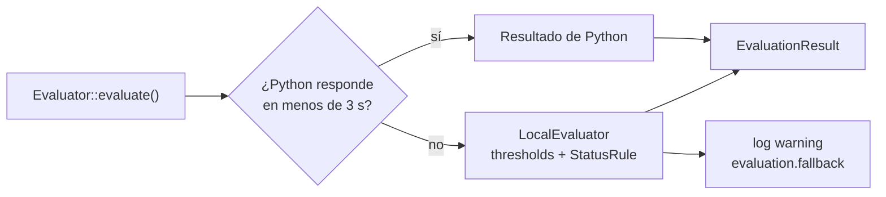

# 🚦 M2 · Motor de evaluación (semáforo + puntaje)

> [← Módulos](../README.md) · [Plan §3 M2](../../PLAN_ASTROHEALTH.md#-m2--motor-de-evaluación-semáforo--puntaje) · Anterior: [M1](../M1-registro/README.md) · Siguiente: [M3 Cuerpo](../M3-cuerpo/README.md)

| Backend | Frontend | Fase | Responsable | Depende de |
|---|---|:---:|:---:|---|
| `app/Modules/Evaluacion/` | `resources/js/modules/Evaluacion/` | 2 | P2 (Python + Laravel) · P4 (UI) | Ningún módulo. Usa Python (simulador) |

## 1. Para qué sirve

Es **el cerebro**: decide el color de cada medición, calcula el puntaje general de 0 a 100 y el estado de cada órgano, y detecta las tendencias. Lo calcula Python; si Python no responde, Laravel calcula **lo mismo** con su respaldo local. Es el **único** módulo que habla con Python.

## 2. En la demo

- `HealthScore`: un medidor circular que se anima de 0 al puntaje, con el color del estado.
- `StatusBadge`: el chip verde, amarillo o rojo que se ve en toda la app.
- Si alguien apaga Python en plena demo, la app sigue funcionando.

## 3. Datos

Es dueño de **`thresholds`** y **`assessments`** ([columnas](../../arquitectura/02-base-de-datos.md#m2--thresholds)).

### Umbrales (`ThresholdSeeder`)

Son los del [plan §2](../../PLAN_ASTROHEALTH.md#2-umbrales-de-referencia-para-el-motor-de-evaluación). Funcionan así: **dentro del rango verde → verde; dentro de la banda amarilla → amarillo; fuera → rojo.**

| Indicador | Verde | Banda amarilla | Rojo |
|---|---|---|---|
| `hr` | 60–100 | 50–120 | <50 o >120 |
| `bp_sys` | 90–119 | 90–139 | <90 o ≥140 |
| `bp_dia` | 60–79 | 60–89 | <60 o ≥90 |
| `glucose` | 70–99 | 60–125 | <60 o ≥126 |
| `temp` | 36.1–37.2 | 35.5–38.0 | <35.5 o >38.0 |
| `spo2` | 95–100 | 90–100 | <90 |
| `sleep` | 7–9 | 6–24 ¹ | <6 |
| `mood` | 4–5 | 3–5 | 1–2 |
| `exercise_min` ² | 90–600 | 60–600 | <60 |
| `radiation` ³ | 0 – base | 0 – 2× base | > 2× base |

¹ El plan no define más de 9 h de sueño: se toma como amarillo. ² No está en el plan: el simulador usa 90 min como mínimo. ³ La dosis base por entorno sale de `config/environments.php` ([M6](../M6-entorno/README.md#3-datos)). Los valores ¹ ² ³ son **supuestos para la demo**: se confirman antes de presentar.

Los cuatro entornos usan hoy los mismos umbrales, salvo la radiación. La tabla permite cambiarlos por entorno sin tocar el código.

> ⚠️ Son valores de referencia generales para la demo, **no criterio médico**. En la presentación se dice: *"umbrales configurables por los médicos de vuelo"*.

### Reglas de cálculo (`Domain/Reglas/`)

| Regla | Cálculo |
|---|---|
| `StatusRule` | Verde, amarillo o rojo según el umbral, como en la tabla de arriba |
| `ScoreRule` | Verde = 100, amarillo = 60, rojo = 20, por indicador (el último valor de cada uno). Promedio ponderado: `hr`, `bp_sys`, `bp_dia`, `spo2` y `radiation` pesan **×1.5**. Se redondea a un entero de 0 a 100 |
| `BodyStatusRule` | Cada zona toma **el peor** estado de sus indicadores. Una zona sin datos queda `null`, en gris |
| `TrendRule` | Regresión lineal sobre las **últimas 7** mediciones → `up`, `down` o `stable`. Si la distancia al **centro del rango verde** crece **3 mediciones seguidas** → `trend_alert: true`, y el indicador se muestra amarillo aunque su valor esté en verde |

Los pesos, el número de mediciones de la tendencia y el margen de "estable" van en `config/evaluation.php`.

## 4. API

### Laravel

| Método | Ruta | Qué hace |
|---|---|---|
| GET | `/api/v1/astronauts/{id}/assessment` | El último puntaje, el estado de cada órgano y el resumen |

```json
{
  "data": {
    "astronaut_id": 2,
    "score": 74,
    "status": "yellow",
    "body_status": { "heart": "red", "brain": "green", "lungs": "green", "immune": "green", "metabolism": "green", "bones": "yellow", "whole_body": "green", "eyes": null, "ear": null },
    "summary": "Corazón en estado crítico. Revisa la recomendación.",
    "evaluated_at": "2026-11-14T08:00:05Z"
  },
  "message": "ok"
}
```

El `status` general sale del puntaje: 80 o más → verde, de 50 a 79 → amarillo, menos de 50 → rojo.

### Python (lo usa solo este módulo)

| Endpoint | Entrada | Salida |
|---|---|---|
| `POST /evaluate` | `{indicator, value, environment}` | `{status, message}` |
| `POST /assess` | `{measurements[], environment}` | `{score, body_status, summary}` |
| `POST /trends` | `{indicator, values[]}` | `{direction, trend_alert}` |
| `GET /space-weather/now` | — | Riesgo de radiación de hoy |

## 5. Backend por capas

| Capa | Archivo | Qué hace |
|---|---|---|
| Contratos | `Contratos/Evaluator.php` | `evaluate(string $indicator, float $value, string $environment): EvaluationResult` · `assess(int $astronautId, array $latest, string $environment): AssessmentResult` (también lo guarda) · `thresholdFor(string $indicator, string $environment): Threshold` (para las bandas de M4) |
| Contratos | `Contratos/TrendAnalyzer.php` | `trend(string $indicator, array $values): TrendResult` |
| Contratos | `Contratos/SpaceWeather.php` | `now()` |
| Domain | `Domain/Enums/Status.php` · `TrendDirection.php` · `ErrorCode.php` | |
| Domain | `Domain/Reglas/StatusRule.php` · `ScoreRule.php` · `BodyStatusRule.php` · `TrendRule.php` | Las reglas puras de la [sección 3](#reglas-de-cálculo-domainreglas) |
| Domain | `Domain/ValueObjects/Threshold.php` | `greenMin`, `greenMax`, `yellowMin`, `yellowMax` |
| Application | `Application/EvaluationService.php` | El nombre viene del plan. Decide Python o el respaldo local y arma los resultados |
| Application | `Application/GetLatestAssessment.php` | Para el GET |
| Infrastructure | `Infrastructure/Clients/SimuladorClient.php` | `Http::baseUrl()->timeout()`. Lanza `PythonUnavailable` si hay un *timeout* o un 5xx |
| Infrastructure | `Infrastructure/Clients/PythonEvaluator.php` | Implementa `Evaluator` y `TrendAnalyzer`: primero Python y, si falla, `LocalEvaluator` |
| Infrastructure | `Infrastructure/Clients/LocalEvaluator.php` | El respaldo: `ThresholdRepository` + las reglas de `Domain` |
| Infrastructure | `Infrastructure/Repositorios/ThresholdRepository.php` | `for(indicator, environment)`, con caché |
| Infrastructure | `Infrastructure/Repositorios/AssessmentRepository.php` | `save()`, `latestFor()` |
| Http | `Http/Controllers/Api/AssessmentController.php` · `Http/Resources/AssessmentResource.php` | |
| Database | `Migrations/` · `Seeders/ThresholdSeeder.php` | |

## 6. Python y respaldo local



- **Mismo resultado:** una prueba recorre todos los indicadores con valores en cada borde (59, 60, 100, 101, 120, 121…) y compara `LocalEvaluator` con las respuestas de Python grabadas. Si no coinciden, alguno de los dos está mal.
- **Sin reintentos** en la petición del usuario: un reintento duplicaría la espera. Los reintentos solo se usan en el comando de importación.

## 7. Frontend

| Archivo | Qué hace |
|---|---|
| `Components/HealthScore.vue` | Anillo SVG animado de 0 al puntaje (con `stroke-dashoffset`), el número en el centro y el color de `status` |
| `Stores/useAssessmentStore.ts` | `load(astronautId)` y `current` |
| `Types/assessment.ts` | `Assessment`, `BodyStatus` |
| Global `components/StatusBadge.vue` | El chip reutilizable. Recibe `status` y un tamaño, y usa `lib/status.ts`. Lo usan todos los módulos |

## 8. Contratos y eventos

| Tipo | Nombre | Lo usa |
|---|---|---|
| Ofrece | `Evaluator` | M1 |
| Ofrece | `TrendAnalyzer` | M4 |
| Ofrece | `SpaceWeather` | M6 |

## 9. Códigos de error

| Código | HTTP | Cuándo |
|---|:---:|---|
| `EVALUATION_NO_DATA` | 404 | El astronauta todavía no tiene ninguna evaluación |
| `EVALUATION_THRESHOLD_MISSING` | 500 | Falta un umbral para ese indicador y entorno: es un error de los *seeders* |

## 10. Criterios de aceptación

| # | Dado | Cuando | Entonces |
|:---:|---|---|---|
| 1 | Los umbrales del plan | Se evalúan una FC de 59, una de 60, una de 100, una de 101 y una de 121 | amarillo, verde, verde, amarillo, rojo |
| 2 | Las últimas mediciones de un astronauta con el corazón en rojo y el resto en verde | Se evalúa | El puntaje coincide con la fórmula ponderada y `body_status.heart = red` |
| 3 | Python apagado | Se evalúa cualquier valor | Mismo resultado que con Python, y una línea `evaluation.fallback` en el *log* |
| 4 | Sueño de 7.5 → 7.1 → 6.8 → 6.5 (verde a amarillo) | Se pide la tendencia | `direction: down` y `trend_alert: true` |
| 5 | Una misión en Marte | Se evalúa una radiación de 1.5 mSv/día (base 0.6) | `red` (más de 2× la base) |
| 6 | Un astronauta sin mediciones | `GET /assessment` | 404 `EVALUATION_NO_DATA` |

## 11. Listo cuando

- [ ] Cada medición devuelve su color y el puntaje se actualiza.
- [ ] El respaldo local da los mismos colores que Python.
- [ ] `HealthScore` se anima y `StatusBadge` se usa en toda la app.
