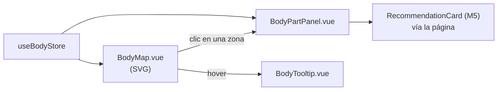

# 🧍 M3 · Cuerpo humano interactivo ⭐

> [← Módulos](../README.md) · [Plan §3 M3](../../PLAN_ASTROHEALTH.md#-m3--cuerpo-humano-interactivo-) · Anterior: [M2](../M2-evaluacion/README.md) · Siguiente: [M4 Dashboard](../M4-dashboard/README.md)

| Backend | Frontend | Fase | Responsable | Depende de |
|---|---|:---:|:---:|---|
| `app/Modules/Cuerpo/` | `resources/js/modules/Cuerpo/` | 3 | P3 | [M1](../M1-registro/README.md) `MeasurementQuery`, `IndicatorCatalog` |

## 1. Para qué sirve

Es **la estrella de la demo**. Muestra una figura humana en SVG en la que cada órgano se pinta con el color de su estado. Al hacer clic en un órgano, explica qué hace, cómo está, cómo lo afecta el espacio y qué hacer.

## 2. En la demo

> *"El corazón pulsa en amarillo; clic → explica el efecto de la microgravedad y qué hacer."* (25 s)

1. En la pantalla de **Inicio**, el cuerpo aparece con cada zona de su color.
2. Las zonas en amarillo o en rojo **pulsan suavemente**.
3. *Hover* → un *tooltip* con el nombre y el último valor.
4. Clic → el `BodyPartPanel` se desliza desde la derecha con 4 bloques: **función**, **estado actual**, **cómo lo afecta el espacio** y **qué hacer**.

## 3. Datos

Es dueño de **`body_parts`** ([columnas](../../arquitectura/02-base-de-datos.md#m3--body_parts)).

| `code` | Zona | Indicadores | Riesgo espacial (NASA HRP) |
|---|---|---|---|
| `heart` | Corazón | `hr`, `bp_sys`, `bp_dia` | Adaptaciones cardiovasculares en microgravedad |
| `brain` | Cerebro y mente | `sleep`, `mood` | Aislamiento, confinamiento y alteración del ritmo circadiano |
| `eyes` | Ojos | — (síntomas visuales) | SANS: síndrome neuro-ocular asociado al vuelo espacial |
| `lungs` | Pulmones | `spo2` | Hipoxia y ambiente cerrado |
| `bones` | Huesos y músculos | `exercise_min` | Pérdida ósea y muscular por la gravedad alterada |
| `ear` | Oído interno | — (mareo reportado) | Alteración vestibular por los cambios de gravedad |
| `immune` | Sistema inmune | `temp` | Alteración inmunitaria y reactivación de virus latentes |
| `metabolism` | Metabolismo | `glucose` | Cambios metabólicos en vuelo (datos reales de Inspiration4) |
| `whole_body` | Todo el cuerpo | `radiation` | Radiación espacial |

> `eyes` y `ear` no tienen indicador en el plan: se ven en **gris** (sin datos), pero su panel sí explica el riesgo. Las 9 zonas quedaron así por la [decisión D9](../../arquitectura/ARCHITECTURE.md#2-decisiones-del-proyecto).

Los textos (`function_text`, `space_risk_text`) se escriben en el *seeder*, cortos (2 o 3 frases), en español y citando la [NASA HRP](https://www.nasa.gov/hrp/risks/).

## 4. API

| Método | Ruta | Qué hace |
|---|---|---|
| GET | `/api/v1/body-parts` | Las 9 zonas, con su función, su riesgo y sus indicadores |
| GET | `/api/v1/astronauts/{id}/body-status` | El estado de cada zona y los últimos valores que lo explican |

**`GET /api/v1/astronauts/2/body-status`**

```json
{
  "data": {
    "heart": {
      "status": "red",
      "values": [
        { "indicator": "hr", "value": 88, "unit": "bpm", "status": "green", "measured_at": "2026-11-14T08:00:00Z" },
        { "indicator": "bp_sys", "value": 148, "unit": "mmHg", "status": "red", "measured_at": "2026-11-14T08:00:00Z" }
      ]
    },
    "eyes": { "status": null, "values": [] }
  },
  "message": "ok"
}
```

Cada zona toma **el peor** estado de sus indicadores. La regla es la misma de M2 (`BodyStatusRule`), pero aquí se aplica sobre los estados ya guardados, sin volver a evaluar.

## 5. Backend por capas

| Capa | Archivo | Qué hace |
|---|---|---|
| Domain | `Domain/Enums/BodyPartCode.php` | Los 9 códigos |
| Domain | `Domain/Reglas/WorstStatus.php` | `red` > `yellow` > `green` > `null` |
| Application | `Application/GetBodyStatus.php` | Pide las últimas mediciones (`MeasurementQuery` de M1), las agrupa por zona (`IndicatorCatalog`) y aplica `WorstStatus` |
| Application | `Application/ListBodyParts.php` | |
| Infrastructure | `Infrastructure/Models/BodyPart.php` · `Repositorios/BodyPart/FindBodyPartRepository.php` · `UpsertBodyPartRepository.php` | Buscar (con caché) · cargar el catálogo (seeder) |
| Http | `Http/Controllers/Api/ListBodyPartsController.php` · `ShowBodyStatusController.php` | Uno por acción |
| Http | `Http/Resources/BodyPartResource.php` · `BodyStatusResource.php` | |
| Database | `Migrations/` · `Seeders/BodyPartSeeder.php` | |

## 6. Frontend



| Archivo | Qué hace |
|---|---|
| `Components/BodyMap.vue` | La figura SVG **propia**, con un `<path>` por zona y su `data-zone`. Pinta `fill` con `var(--status-*)` y agrega la clase `pulse` si la zona está en amarillo o en rojo |
| `Components/BodyZone.vue` | Una zona: color, pulso, foco con el teclado (`tabindex`, `Enter` abre el panel) y `aria-label` del tipo "Corazón: crítico" |
| `Components/BodyTooltip.vue` | Nombre de la zona y su último valor |
| `Components/BodyPartPanel.vue` | Panel lateral deslizable con 4 secciones: función, estado y valores, riesgo espacial, qué hacer. El bloque "qué hacer" es un *slot*: la página le pone la `RecommendationCard` de M5 |
| `Stores/useBodyStore.ts` | `parts`, `status`, `selected`, `load(astronautId)`, `select(code)` |
| `Utils/zones.ts` | El orden de las zonas y su posición en el SVG para el *tooltip* |

**El pulso**, solo con CSS:

```css
.pulse { animation: pulse 1.6s ease-in-out infinite; transform-origin: center; }
@keyframes pulse { 50% { opacity: .65; transform: scale(1.04); } }
@media (prefers-reduced-motion: reduce) { .pulse { animation: none; } }
```

**El SVG:** se dibuja una figura propia y sencilla (silueta de frente con las zonas marcadas), en un solo archivo `.vue` y sin imágenes externas. Las zonas pequeñas, como los ojos y el oído, tienen un área de clic más grande que su dibujo.

## 7. Contratos y eventos

| Tipo | Nombre | Detalle |
|---|---|---|
| Usa | M1 `MeasurementQuery::latestPerIndicator()` | Los últimos valores con su estado |
| Usa | M1 `IndicatorCatalog::all()` | Qué indicador va a qué zona |

## 8. Códigos de error

| Código | HTTP | Cuándo |
|---|:---:|---|
| `NOT_FOUND` | 404 | El astronauta no existe |

## 9. Criterios de aceptación

| # | Dado | Cuando | Entonces |
|:---:|---|---|---|
| 1 | Una FC verde y una presión roja | Se pide el `body-status` | `heart.status = red`, con los dos valores |
| 2 | Un astronauta sin mediciones de sueño ni de ánimo | Se pide el `body-status` | `brain.status = null`, y en la pantalla la zona sale gris |
| 3 | El corazón en amarillo | Se abre el inicio | La zona del corazón pulsa. Con movimiento reducido, no pulsa |
| 4 | El cuerpo en pantalla | Clic en los pulmones | Se abre el panel con su función, su SpO₂ actual, su riesgo y qué hacer |
| 5 | Navegación con el teclado | `Tab` hasta el corazón y `Enter` | Se abre el mismo panel |
| 6 | Una medición nueva en rojo | Se guarda desde Registrar | Al volver al inicio, la zona ya cambió de color |

## 10. Listo cuando

- [ ] Al hacer clic en un órgano se ve su información.
- [ ] El color cambia según los datos reales.
- [ ] El pulso, el *tooltip* y el panel funcionan también con el teclado.


## Ficha del tripulante y notas clínicas (frontend con datos de prueba)

La **ficha** (`/tripulacion/{id}`, `CrewMember.vue`, `health.read.any`) junta todo de una persona: cuerpo 3D, tendencias, indicadores, tests, indicaciones del médico (M5) y, solo para el equipo médico, las **notas clínicas** (`Components/Notes/ClinicalNotes.vue`, permiso `clinical_notes.manage`: médico de vuelo y médico de la tripulación). Las notas son el expediente privado: tipo (evolución, impresión, plan, seguimiento), texto, autor y fecha; **no se editan ni se borran**. Una nota puede requerir seguimiento y queda pendiente hasta que se marca resuelta (con quién y cuándo). El astronauta y administración no las ven.

Rutas propuestas: `GET/POST /api/v1/astronauts/{id}/clinical-notes` y `PATCH /api/v1/clinical-notes/{id}/resolve`. ⚠️ Hoy en `Utils/notesMock.ts` (localStorage).
