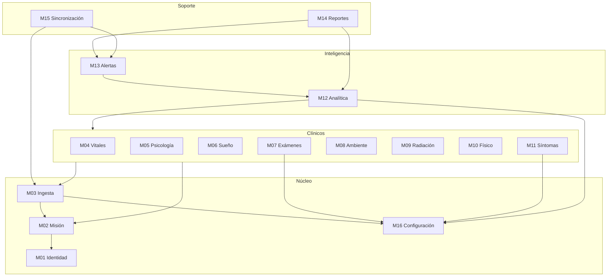

# Módulos de AstroHealth

> [← Volver al inicio](../README.md) · Arquitectura general: [02 · Módulos del sistema](../docs/propuesta/02-modulos-del-sistema.md) · Plan: [Plan de sprints](../scrum/plan-de-sprints.md)

> 🚀 **¿Primera vez aquí? Empiece por la [guía del proyecto y de la arquitectura](00-arquitectura/README.md):** de qué trata el proyecto, cómo están hechas las capas, cómo responden las APIs, cómo se reportan los errores y cómo trabajamos con Git y Jira.

Esta carpeta contiene **una ficha técnica por módulo**, dividida en sus tres capas. Es la referencia para implementar cada módulo (también para pedírselo a una IA: se le entrega el `README.md` del módulo y el documento de la capa que va a construir).

```
modulos/Mxx-nombre/
├── README.md            # Resumen: ficha, propósito, alcance, submódulos, capas e historias
├── backend/README.md    # Laravel: API, eventos, reglas de negocio, contratos, permisos, archivos PHP y pruebas Pest
├── frontend/README.md   # Inertia + Vue: páginas, props, componentes, comportamiento sin conexión, accesibilidad y Vitest
└── database/README.md   # MySQL: tablas, índices, relaciones, migraciones, seeders y volumen
```

El [simulador](simulador/README.md) es una herramienta de Python sin páginas ni tablas propias (escribe solo a través de la API), por eso tiene una única ficha.

Las fichas **amplían** los documentos de la propuesta; no los contradicen. Si una ficha y la propuesta difieren, manda la propuesta, y la ficha se corrige.

---

## Contenido

1. [Índice de módulos](#1-índice-de-módulos)
2. [Mapa de dependencias](#2-mapa-de-dependencias)
3. [Estructura interna de cada módulo](#3-estructura-interna-de-cada-módulo)
   - [Convenciones del frontend](#convenciones-del-frontend)
4. [Reglas de comunicación entre módulos](#4-reglas-de-comunicación-entre-módulos)
5. [Eventos de dominio](#5-eventos-de-dominio)
6. [Propiedad de las tablas](#6-propiedad-de-las-tablas)
7. [Convenciones de base de datos](#7-convenciones-de-base-de-datos)
8. [Catálogo de códigos de variables](#8-catálogo-de-códigos-de-variables)
9. [Brechas resueltas](#9-brechas-resueltas)

---

## 1. Índice de módulos

Cada módulo se reparte por capas según los **roles fijos** del equipo ([plan de sprints §1](../scrum/plan-de-sprints.md#roles-del-equipo)):

| Capa | Quién |
|---|---|
| **Backend** (Laravel y MySQL: `backend/README.md` y `database/README.md`) | Julieth |
| **Frontend** (Inertia, Vue y Tailwind: `frontend/README.md`) | Jhon y Gabriela |
| **Otros** | Miguel: simulador, QA, documentación y demo |

Cuando una capa del módulo la comparten dos personas, la tabla indica qué historias hace cada una. El reparto historia por historia está en el [plan de sprints](../scrum/plan-de-sprints.md).

| Código | Ficha | Carpeta Laravel | Épica | Sprints | Backend | Frontend | Otros |
|---|---|---|:---:|:---:|---|---|---|
| M01 | [Identidad y acceso](M01-identidad/README.md) | `app/Modules/Identidad` | EP-01 | 0, 1 | Julieth | Gabriela (HU-01.01 a HU-01.03) · Jhon (HU-01.04) | — |
| M02 | [Misión y tripulación](M02-mision/README.md) | `app/Modules/Mision` | EP-02 | 1 | Julieth | Gabriela (HU-02.01, HU-02.02) · Jhon (HU-02.03) | — |
| M03 | [Ingesta de datos](M03-ingesta/README.md) | `app/Modules/Ingesta` | EP-03 | 1, 2 | Julieth | Jhon (HU-03.03) | — |
| M04 | [Signos vitales](M04-signos-vitales/README.md) | `app/Modules/SignosVitales` | EP-04 | 2, 3, 4 | Julieth | Jhon | — |
| M05 | [Psicología y cognición](M05-psicologia/README.md) | `app/Modules/Psicologia` | EP-05 | 2, 3, 4 | Julieth | Gabriela | Miguel (simulación de HU-05.07) |
| M06 | [Sueño](M06-sueno/README.md) | `app/Modules/Sueno` | EP-06 | 2, 3 | Julieth | Jhon | — |
| M07 | [Exámenes médicos](M07-examenes/README.md) | `app/Modules/Examenes` | EP-07 | 2, 3 | Julieth | Gabriela | — |
| M08 | [Ambiente](M08-ambiente/README.md) | `app/Modules/Ambiente` | EP-08 | 2, 3 | Julieth | Gabriela | Miguel (simulación de HU-08.03) |
| M09 | [Radiación](M09-radiacion/README.md) | `app/Modules/Radiacion` | EP-09 | 2, 3 | Julieth | Gabriela | — |
| M10 | [Físico y metabólico](M10-fisico-metabolico/README.md) | `app/Modules/FisicoMetabolico` | EP-10 | 2, 3 | Julieth | Jhon | Miguel (simulación de HU-10.03 a HU-10.05) |
| M11 | [Síntomas](M11-sintomas/README.md) | `app/Modules/Sintomas` | EP-11 | 2 | Julieth | Jhon | — |
| M12 | [Analítica y línea base](M12-analitica/README.md) | `app/Modules/Analitica` | EP-12 | 3 | Julieth | Jhon (HU-12.01, HU-12.04) · Gabriela (HU-12.03) | — |
| M13 | [Alertas y casos clínicos](M13-alertas/README.md) | `app/Modules/Alertas` | EP-13 | 3, 4 | Julieth | Gabriela | Miguel (fuentes de los protocolos, HU-13.04) |
| M14 | [Reportes](M14-reportes/README.md) | `app/Modules/Reportes` | EP-14 | 3, 4 | Julieth | Jhon (HU-14.01, HU-14.02) · Gabriela (HU-14.03) | — |
| M15 | [Sincronización](M15-sincronizacion/README.md) | `app/Modules/Sincronizacion` | EP-15 | 2, 3, 4 | Julieth | Jhon (HU-15.04, HU-15.02) · Gabriela (HU-15.03) | — |
| M16 | [Configuración](M16-configuracion/README.md) | `app/Modules/Configuracion` | EP-16 | 1, 4 | Julieth | Gabriela (HU-16.01, HU-16.03) · Jhon (HU-16.02) | — |
| — | [Simulador de datos](simulador/README.md) | `simulador/astrohealth_sim` (Python) | EP-17 | 1, 2, 3 | — | — | Miguel (simulador) |

Las épicas EP-00 (fundaciones) y EP-18 (demo) no son módulos; están en el [plan de sprints](../scrum/plan-de-sprints.md). Las historias detalladas de EP-00 están en [scrum/fundaciones](../scrum/fundaciones/README.md).

---

## 2. Mapa de dependencias

Una flecha `A → B` significa "A usa un contrato o consume un evento de B".



---

## 3. Estructura interna de cada módulo

Todos los módulos siguen la estructura de [02 §4](../docs/propuesta/02-modulos-del-sistema.md#4-módulos-de-backend), con dos precisiones: el *ServiceProvider* del módulo ([03 §7](../docs/propuesta/03-propuesta-tecnologica.md#7-estructura-del-repositorio)) y la carpeta `Contratos/`, que contiene **lo único que otros módulos pueden usar**.

```
app/Modules/<Modulo>/
├── <Modulo>ServiceProvider.php   # Registra rutas, migraciones, listeners, contratos y reglas
├── routes.php                    # Rutas web (Inertia) y rutas API (/api/v1/<modulo>/...)
├── Contratos/                    # Interfaces públicas (lo único visible para otros módulos)
├── Http/
│   ├── Controllers/Web/          # Devuelven páginas Inertia
│   ├── Controllers/Api/          # Devuelven JSON
│   ├── Requests/                 # Form Requests (validación)
│   ├── Resources/                # Transformación a JSON / props de Inertia
│   └── Middleware/               # (Opcional) middleware del módulo
├── Policies/                     # (Opcional) Policies y Gates de autorización
├── Console/                      # (Opcional) comandos de Artisan del módulo
├── Resources/views/              # (Opcional) plantillas Blade de impresión (solo M14)
├── Application/                  # Casos de uso (servicios de aplicación)
├── Domain/
│   ├── Enums/                    # Enumeraciones respaldadas (string) de PHP
│   ├── Reglas/                   # Reglas de negocio puras (sin HTTP ni SQL)
│   ├── Eventos/                  # Eventos de dominio que publica el módulo
│   └── ValueObjects/
├── Infrastructure/
│   ├── Models/                   # Modelos Eloquent (solo de las tablas propias)
│   ├── Repositorios/             # Implementaciones de los contratos
│   └── Listeners/                # Reacciones a eventos de otros módulos
├── Database/
│   ├── Migrations/
│   └── Seeders/
└── Tests/
    ├── Unit/
    └── Feature/
```

Las páginas Vue viven en el frontend del módulo: `resources/js/modules/<Modulo>/Pages/<App>/…` (`Astronauta`, `Cmo`, `Tierra`, `Admin`), con sus componentes en `modules/<Modulo>/Components/` ([ARCHITECTURE §16](00-arquitectura/ARCHITECTURE.md#16-modularización-del-frontend)). Cada ficha indica qué páginas le pertenecen.

### Convenciones del frontend

Valen para todas las fichas `frontend/README.md`; cada ficha solo documenta lo propio del módulo.

| Elemento | Convención |
|---|---|
| *Layouts* | `Layouts/AstronautaLayout.vue` (F1: cabecera con `IndicadorSincronizacion`, `AlarmaCritica` y la insignia de alertas de `resumenAlertas`), `CmoLayout.vue` (F2: insignia de alertas en el menú), `TierraLayout.vue` (F3: muestra el estado del enlace), `AdminLayout.vue` (F4) |
| Componentes compartidos ([HU-00.03](../scrum/fundaciones/HU-00.03-libreria-de-componentes.md), con sus *props*) | `Semaforo.vue`, `TarjetaSigno.vue`, `InsigniaAlerta.vue`, `GraficaSerie.vue` (ECharts con banda de referencia y líneas de umbral), `EstadoVacio.vue`, `Cargando.vue` |
| *Props* compartidas (`HandleInertiaRequests`) | `auth: { user: { id, name, email, rol }, permisos: string[] }` (los *Gates* de [M01 backend §5](M01-identidad/backend/README.md#5-permisos) que cumple el usuario), `tripulante: { id, codigo } \| null`, `mision: { nombre, dia_mision, perfil_enlace }`, `nodo: 'nave' \| 'tierra'`, `alertasCriticas` (M13), `flash: { exito?, error?, tokenPwa?, descargarUrl? }` (`tokenPwa: { token, expira_en }` solo tras iniciar sesión, HU-15.04; `descargarUrl`, reporte recién generado de M14). En el Sprint 0, `tripulante` y `mision` valen `null` |
| Tipos | Se escriben en notación TypeScript (el *starter kit* lo trae). Si el equipo decide usar JavaScript, las tablas de *props* sirven como documentación |
| Formularios con conexión | `useForm` de Inertia; los errores `422` se muestran junto a cada campo |
| Capturas sin conexión | `crypto.randomUUID()` genera el `id` **antes** de guardar; luego `encolar(endpoint, cuerpo)` de `resources/js/offline/cola.ts` ([M15](M15-sincronizacion/frontend/README.md)). La pantalla confirma "Guardado en el dispositivo" y el indicador muestra el pendiente |
| Refresco | `usePoll(ms, { only: [...] })` de Inertia 2, solo con las *props* que cambian |
| Fechas | Llegan en ISO 8601 UTC; se muestran en UTC con el **día de misión** (`D12 · 14:05 UTC`) |
| Unidades | Las del catálogo (UCUM), con un formateador común **por código** (`/min` es "lpm" en la FC y "rpm" en la FR; `mm[Hg]` → "mmHg"; tabla en [M04](M04-signos-vitales/frontend/HU/README.md)) |
| Accesibilidad | El color **nunca** va solo (icono + texto); objetivos táctiles de 44 px como mínimo; foco visible; `aria-live="assertive"` para la alarma crítica y `polite` para los avisos; contraste AA |
| Idioma | Español; números con coma decimal (`Intl.NumberFormat('es-CO')`) |

---

## 4. Reglas de comunicación entre módulos

1. **Ningún módulo lee ni escribe las tablas de otro.** Si necesita datos ajenos, usa una interfaz de la carpeta `Contratos/` del dueño.
2. **Los módulos clínicos no llaman a Analítica ni a Alertas**: publican eventos, y quien esté interesado reacciona ([02 §6](../docs/propuesta/02-modulos-del-sistema.md#6-comunicación-entre-módulos)).
3. **Las reglas clínicas especializadas** (deterioro cognitivo en M05, correlación CO₂–cefalea en M08, detección de evento solar en M09) se escriben en el módulo clínico como clases que implementan `Analitica\Contratos\ReglaAnalitica`, y el motor de M12 las ejecuta. Así el conocimiento clínico vive en su módulo y la ejecución, la línea base y la explicación son comunes.
4. **Solo M13 crea alertas.** Los demás módulos producen hallazgos (M12) o eventos.
5. **Solo M15 habla con el otro nodo** (nave ↔ Tierra).
6. **Sincronización:** cada módulo cuyos datos viajan entre nodos implementa `Sincronizacion\Contratos\Importador` ([M15 backend §3.5](M15-sincronizacion/backend/README.md#35-importación-sin-bucles)). Todo evento de dominio lleva `importado` (verdadero si se construyó durante una importación); los *listeners* de M01, M12 y M15 ignoran los importados (salvo `UmbralModificado`, que M12 procesa siempre para invalidar su caché de umbrales), y en el nodo Tierra M12 no evalúa reglas. La marca va en el evento porque los *listeners* en cola se ejecutan en otro proceso, cuando la importación ya terminó.
7. **Nodo:** el código es el mismo en los dos nodos; `APP_NODO` (`nave` o `tierra`) activa o desactiva los comportamientos que indica cada ficha.
8. **Configuración por misión:** ningún valor clínico u operativo se escribe en el código; se lee de M16 (`ConsultaUmbrales`, `ParametrosMision`), que guarda una configuración por misión ([M16 §3.6](M16-configuracion/backend/README.md#36-configuración-por-misión)). Los números de las fichas son valores por defecto.

---

## 5. Eventos de dominio

Todos los eventos se publican **después** de confirmar la transacción en la base de datos (`ShouldDispatchAfterCommit`).

| Evento | Lo publica | Lo consumen | Contenido (*payload*) |
|---|---|---|---|
| `LoteIngerido` | M03 | M04, M09, M12, M15 | `lote_id`, `dispositivo_id`, `tripulante_id` (o `null`), `ubicacion` (o `null`), `codigos[]`, `desde`, `hasta`, `n_guardadas`, `n_artefactos`, `modo` (`vivo` o `historico`) |
| `ObservacionRegistrada` | M04, M06, M10, M11 | M12, M14 | `observacion_id` (el `id` del registro en la tabla del módulo que publica: prueba ortostática, noche, síntoma…; no es una fila de `observaciones`), `tripulante_id`, `codigo`, `valor`, `unidad`, `medido_en`, `contexto`, `modulo` |
| `TestCognitivoCompletado` | M05 | M12 | `sesion_id`, `tripulante_id`, `tipo`, `numero_sesion`, `metricas`, `completada_en` |
| `ResultadoExamenCargado` | M07 | M12, M14 | `resultado_id`, `tripulante_id`, `prueba_codigo`, `valor`, `unidad`, `fecha_muestra`, `interpretacion`, `delta_superado`, `tendencia_desfavorable` |
| `HallazgoDetectado` | M12 | M13 | `hallazgo_id`, `tripulante_id` (o `null` = toda la tripulación), `modulo_nave_id` (o `null`), `regla_codigo`, `familia`, `sistema`, `nivel`, `ocurrencia` (se vuelve a publicar con el mismo `hallazgo_id` en cada ventana de persistencia completada), `explicacion`, `detectado_en` |
| `AlertaCreada` / `AlertaEscalada` | M13 | M14, M15 | `alerta_id`, `tripulante_id`, `nivel` (y `nivel_anterior` si escala), `regla_codigo`, `explicacion` |
| `RecomendacionRecibida` | M15 | M13 | `recomendacion_id`, `tripulante_id` (o `null`), `texto`, `prioridad`, `recibida_en` |
| `UmbralModificado` | M16 | M12, M01 (auditoría), M15 | `umbral_id`, `mision_id`, `regla_codigo`, `variable_codigo` (M12 invalida con ellos la caché `umbrales:<mision>:<codigo>`), `origen` (`tierra` o `ajuste_temporal`), `modificado_por`, `modificado_en` |

> **Por qué `LoteIngerido`:** el simulador envía ~34.000 lecturas al día y el relleno histórico ~1 millón. Un evento por lectura saturaría la cola de cPanel. Por eso las lecturas de sensores se procesan **por lote**, y `ObservacionRegistrada` queda para los registros individuales que entran por formulario.

---

## 6. Propiedad de las tablas

Cada tabla tiene **un único módulo dueño**, que es el único que la migra y la escribe.

| Módulo | Tablas propias |
|---|---|
| M01 | `users` (del *starter kit*, con la columna `rol`), `auditoria` · usa `personal_access_tokens` de Sanctum |
| M02 | `misiones`, `tripulantes`, `dispositivos`, `modulos_nave` |
| M03 | `lotes_ingesta`, `observaciones` |
| M04 | `agregados_vitales`, `pruebas_ortostaticas`, `ventanas_ecg` |
| M05 | `sesiones_test`, `respuestas_item`, `respuestas_escala`, `programacion_tests` |
| M06 | `registros_sueno` |
| M07 | `resultados_examen`, `examenes_programados`, `documentos_examen` |
| M08 | — (sus series viven en `observaciones` de M03) |
| M09 | `dosis_diarias`, `dosis_carrera_previa` |
| M10 | `sesiones_ejercicio`, `registros_nutricion`, `pruebas_fuerza` |
| M11 | `sintomas_registrados`, `respuestas_mareo`, `fotos_sintoma` |
| M12 | `lineas_base`, `hallazgos` |
| M13 | `alertas`, `casos_clinicos`, `acciones`, `protocolos` |
| M14 | `reportes_generados` |
| M15 | `paquetes_sync`, `paquetes_recibidos`, `ventanas_enlace`, `recomendaciones` |
| M16 | `umbrales`, `catalogo_variables`, `catalogo_pruebas`, `catalogo_sintomas`, `parametros_mision` |

> La tabla `lineas_base` pertenece a M12, pero se crea en el **Sprint 1** dentro de HU-02.03 (línea base previa al vuelo), que la escribe a través del contrato `Analitica\Contratos\RegistroLineaBase`.

---

## 7. Convenciones de base de datos

| Elemento | Convención |
|---|---|
| Nombres | Tablas en plural y `snake_case` en español; columnas en `snake_case` |
| Claves primarias | `uuid` (`char(36)`, *trait* `HasUuids`) generado en el cliente cuando el registro nace fuera del servidor; excepción: `users` usa el `id` entero del *starter kit* |
| Fechas y horas | `datetime(3)` en **UTC** (precisión de milisegundos); las fechas sin hora (`fecha_muestra`, `noche`) usan `date` |
| Valores enumerados | Columnas `varchar` validadas con *enums* de PHP; **no** se usa `ENUM` de MySQL (facilita las migraciones) |
| Números clínicos | `decimal` con la precisión indicada en cada ficha; nunca `float` |
| Inmutabilidad | Las tablas de mediciones no tienen `updated_at`; una corrección es un registro nuevo con `anula_id` apuntando al anterior |
| Borrado | No hay borrado físico de datos clínicos |
| Índices | Toda consulta por tripulante y tiempo tiene índice `(tripulante_id, …, medido_en)` |
| Claves foráneas | `FOREIGN KEY` **solo entre tablas del mismo módulo**. Las referencias a tablas de otros módulos son **lógicas** (columna indexada sin restricción): mantienen los módulos independientes y, en el nodo Tierra, los datos llegan por sincronización sin un orden garantizado |
| Migraciones | Una por tabla, en `app/Modules/<Modulo>/Database/Migrations/`, con el prefijo de fecha de Laravel; se crean en el sprint de la historia que las introduce. Una migración fusionada no se edita: se crea otra |
| Archivos | Fuera de la base de datos, en el disco privado `storage/app/` (nunca en `public/`): ECG, reportes, fotos y PDF; la tabla guarda la ruta y el tamaño, y la descarga pasa por una ruta con permiso |
| Motor | **MySQL**: en local, el que trae XAMPP; en los nodos, el del cPanel. Conexión de Laravel `mysql`, InnoDB, `utf8mb4_unicode_ci` |
| Juego de caracteres | Toda base se crea (o se corrige) con `utf8mb4` y `utf8mb4_unicode_ci`; el servidor del cPanel trae `latin1` por defecto |

---

## 8. Catálogo de códigos de variables

Los códigos de las observaciones viven en `catalogo_variables` (M16). Se usan los **códigos LOINC verificados** en [03 §3.2](../docs/propuesta/03-propuesta-tecnologica.md#32-estándares-de-datos) y [04 §6.2](../docs/propuesta/04-manejo-de-datos.md#62-formato-de-carga-por-csv). Para las variables cuyo código LOINC no se ha verificado, se usa un **código local con prefijo `AH-`** (AstroHealth), que se sustituirá cuando se confirme el LOINC.

| Código | Variable | Unidad UCUM | Módulo | Rango físicamente posible (M03) |
|---|---|---|:---:|---|
| `8867-4` | Frecuencia cardiaca | `/min` | M04 | 20 – 250 |
| `59408-5` | SpO₂ | `%` | M04 | 50 – 100 |
| `9279-1` | Frecuencia respiratoria | `/min` | M04 | 4 – 60 |
| `8310-5` | Temperatura corporal | `Cel` | M04 | 30 – 43 |
| `8480-6` | PA sistólica | `mm[Hg]` | M04 | 50 – 260 |
| `8462-4` | PA diastólica | `mm[Hg]` | M04 | 30 – 160 |
| `AH-RMSSD` | VFC (RMSSD) | `ms` | M04 | 5 – 250 |
| `AH-ACTIVIDAD` | Actividad (acelerómetro) | `{cuentas}/min` | M04 | 0 – 20000 |
| `29463-7` | Masa corporal | `kg` | M10 | 30 – 200 |
| `AH-GLUCOSA` | Glucosa intersticial (monitor continuo) | `mg/dL` | M10 | 20 – 600 |
| `AH-PCO2` | Presión parcial de CO₂ del módulo | `mm[Hg]` | M08 | 0 – 20 |
| `AH-VOC` | Compuestos orgánicos volátiles | `mg/m3` | M08 | 0 – 100 |
| `AH-PM` | Partículas en suspensión | `ug/m3` | M08 | 0 – 1000 |
| `AH-RUIDO` | Nivel de ruido | `dB` | M08 | 0 – 140 |
| `AH-DOSIS-TASA` | Tasa de dosis de radiación | `mSv/d` | M09 | 0 – 1000 |

Los **códigos derivados** (ECG, prueba ortostática, métricas cognitivas, sueño, ejercicio y síntomas) y las **pruebas de laboratorio e imagen** están en [M16 backend §3.3 y §3.4](M16-configuracion/backend/README.md#33-catálogo-de-variables-sembrado).

> Los rangos físicamente posibles son **límites de validación técnica** (descartan lecturas imposibles, como una FC de 400 lpm), no umbrales clínicos.

---

## 9. Brechas resueltas

Al detallar los módulos aparecieron 8 funciones que la propuesta menciona pero que no tenían historia. Todas tienen ahora su historia en el [backlog](../docs/propuesta/05-estructura-scrum.md#4-backlog-por-épica) y en el [plan](../scrum/plan-de-sprints.md).

| # | Módulo | Función | Historia | Prioridad | Sprint | Decisión de diseño |
|:---:|---|---|---|:---:|:---:|---|
| 1 | M05 | Test de memoria de secuencias | HU-05.07 | Could | 2 | Entra en `ReglaDeterioroCognitivo` solo por rachas de z (métrica entera) |
| 2 | M10 | Nutrición e hidratación | HU-10.03 | Could | 2 | Solo registro y totales diarios; sin metas ni alertas (no hay valores con fuente) |
| 2 | M10 | Fuerza de prensión | HU-10.04 | Could | 2 | Cambio frente a la primera medición; sin alertas |
| 3 | M11 | Fotografía del síntoma | HU-11.03 | Could | 2 | Comprimida en el cliente (≤ 500 KB) y guardada en la cola offline |
| 4 | M14 | Reporte de misión | HU-14.03 | Should | 4 | PDF a demanda en cada nodo, con datos semanales; no se encola |
| 5 | M08 | Umbrales de VOC, partículas y ruido | HU-08.03 | Could | 3 | Reglas `AMB_*` **inactivas y sin valor** hasta que el médico de vuelo cargue el límite y su fuente |
| 6 | M10 | Glucosa | HU-10.05 | Could | 3 | Serie del CGM simulado; la regla `GLUCOSA` se activa con la fuente de la Fase 1 |
| 7 | M13 | Contenido clínico de los protocolos | HU-13.04 | Should | 4 | Cada paso cita su fuente; los protocolos sin validar muestran un aviso |
| 8 | M07 | PDF del laboratorio | HU-07.05 | Could | 2 | Un PDF (≤ 2 MB) por fecha de muestra; requiere conexión |

> **Validación clínica:** HU-13.04 deja el sistema listo para registrar la validación, pero validar los protocolos le corresponde a un profesional de la salud. Si no hay validación antes del evento, la demo muestra el aviso y lo explica.
