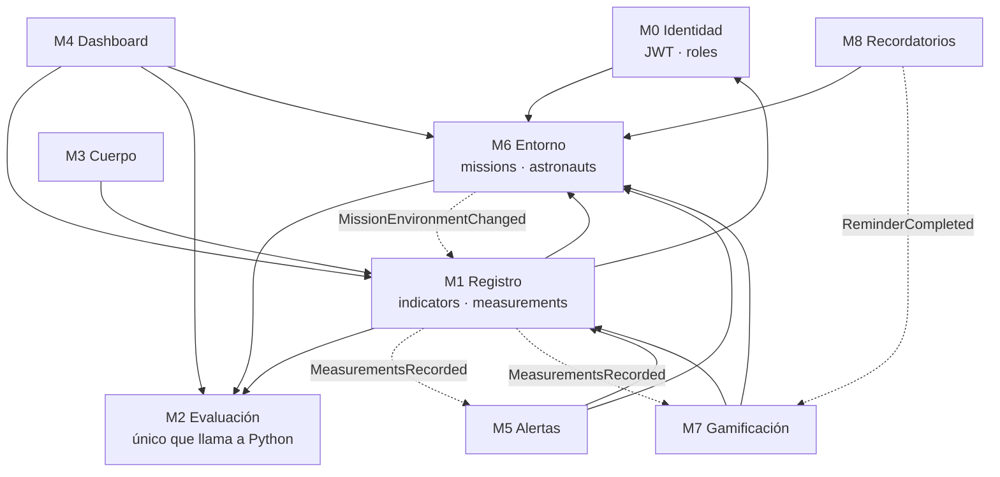

# 🧩 Los 8 módulos de AstroHealth

> [← Documentación](../README.md) · [Plan](../PLAN_ASTROHEALTH.md) · [Guía técnica](../arquitectura/README.md)

Cada módulo tiene una **ficha** con todo lo necesario para construirlo sin preguntar: qué se ve en la demo, sus tablas, sus rutas, los archivos por capa, sus componentes, sus contratos y eventos, los criterios de aceptación y las pruebas.

## 1. Índice

| | Módulo | Qué hace | Backend · Frontend | Fase | Responsable |
|:---:|---|---|---|:---:|:---:|
| 🔐 | [**M0 · Identidad y acceso**](../../astrohealth/docs/backend/M0-identidad/README.md) | Login JWT, roles (admin, médico de vuelo, astronauta, dispositivo) y las credenciales del simulador. Es técnico: su ficha es el documento del backend | `Identidad` | **1** | Backend |
| 🩺 | [**M1 · Registro de indicadores**](M1-registro/README.md) | Recibe las lecturas del simulador (ingesta) y las del astronauta; cada una queda guardada con su color | `Registro` | 2 | P1 · P4 |
| 🚦 | [**M2 · Motor de evaluación**](M2-evaluacion/README.md) | Semáforo, puntaje 0–100 y tendencias, con Python y respaldo local | `Evaluacion` | 2 | P2 |
| 🧍 | [**M3 · Cuerpo humano interactivo** ⭐](M3-cuerpo/README.md) | Figura SVG que se pinta según la salud de cada órgano | `Cuerpo` | 3 | P3 |
| 📈 | [**M4 · Dashboard**](M4-dashboard/README.md) | Gráficas de 7 y 30 días con bandas de color y tendencias | `Dashboard` | 3 | P4 |
| 🚨 | [**M5 · Recomendaciones y alertas a Tierra**](M5-alertas/README.md) | Qué hacer ante un valor malo y "enviar a Tierra" con el retraso real | `Alertas` | 4 | P1 · P3 |
| 🌍 | [**M6 · Entorno de misión**](M6-entorno/README.md) | ISS, tránsito, Luna o Marte: cambian los umbrales, los riesgos y el retraso | `Entorno` | 1 · 4 | P1 · P3 |
| 🏆 | [**M7 · Gamificación**](M7-gamificacion/README.md) | Puntos, niveles, rachas, insignias y ranking | `Gamificacion` | 5 | P1 · P4 |
| ⏰ | [**M8 · Recordatorios**](M8-recordatorios/README.md) | Rutina del día con avisos que suman puntos | `Recordatorios` | 5 | P1 · P4 |

> M6 aparece en la **fase 1** porque es dueño de `missions` y `astronauts`, que todos necesitan desde el principio. Su pantalla se hace en la fase 4.

## 2. Mapa de dependencias

Una flecha significa "usa un contrato de". Las líneas punteadas son eventos. **No hay dependencias en círculo.**

## 3. Contratos y eventos

| Módulo | Ofrece (contrato) | Publica (evento) | Escucha |
|---|---|---|---|
| M0 Identidad | `CurrentActor`, Gates de permisos | — | — |
| M1 Registro | `IndicatorCatalog`, `MeasurementQuery` | `MeasurementsRecorded` | `MissionEnvironmentChanged` → vuelve a evaluar las últimas mediciones |
| M2 Evaluación | `Evaluator`, `TrendAnalyzer`, `SpaceWeather` | — | — |
| M3 Cuerpo | — | — | — |
| M4 Dashboard | — | — | — |
| M5 Alertas | — | — | `MeasurementsRecorded` → alerta si está en rojo |
| M6 Entorno | `MissionQuery`, `CrewQuery` | `MissionEnvironmentChanged` | — |
| M7 Gamificación | — | — | `MeasurementsRecorded`, `ReminderCompleted` → puntos e insignias |
| M8 Recordatorios | — | `ReminderCompleted` | — |

## 4. Reparto y orden

Tomado del [plan §5 y §6](../PLAN_ASTROHEALTH.md#5-reparto-del-equipo).

| Fase | Qué | Quién | Termina cuando |
|:---:|---|---|---|
| **1** | Estructura, **M0 (JWT y roles)**, las tablas, los *seeders*, los umbrales y la ingesta del simulador | Backend + simulador | Login con JWT, `migrate:fresh --seed` y el simulador enviando lotes |
| **2** | M1 + M2 de punta a punta | Todos | Se registra un valor y vuelve con su color |
| **3** | M3 cuerpo + M4 dashboard | P3 + P4 | El cuerpo se pinta y se ven 30 días de gráficas |
| **4** | M5 alertas + M6 entorno | P1 + P3 | Un rojo dispara la alerta y el cambio de entorno cambia los riesgos |
| **5** | M7 gamificación + M8 recordatorios | P1 + P4 | Completar un recordatorio suma puntos y da insignias |
| **6** | Pulir la interfaz, las animaciones, el diseño responsivo y las pruebas | Todos | El [guion de la demo](../PLAN_ASTROHEALTH.md#7-guion-de-la-demo-2-minutos) sale sin errores |
| **7** | Video, diapositivas, README y despliegue | P4 + todos | [Checklist de entrega](../PLAN_ASTROHEALTH.md#8-checklist-final-de-entrega) completo |

> 🔒 **Regla de oro:** la fase 5 no empieza hasta que las fases 2–4 funcionen de punta a punta. Se dejan **al menos 4 horas** para la fase 7.

## 5. Cómo leer una ficha

Todas tienen las mismas secciones, en el mismo orden:

1. **Para qué sirve:** el objetivo en dos líneas.
2. **En la demo:** qué ven los jueces.
3. **Datos:** sus tablas.
4. **API:** sus rutas, con ejemplos.
5. **Backend por capas:** cada archivo, en qué capa va y qué hace.
6. **Frontend:** componentes, *store* y página.
7. **Contratos y eventos.**
8. **Códigos de error.**
9. **Criterios de aceptación:** *Dado / Cuando / Entonces*. Cada uno es una prueba.
10. **Listo cuando:** la casilla final del plan.
