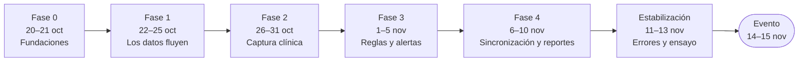

# Plan de sprints · AstroHealth

> [← Volver al inicio](../README.md) · Backlog completo y criterios de aceptación: [05 · Estructura Scrum](../docs/propuesta/05-estructura-scrum.md)

| | |
|---|---|
| **Periodo** | 20 de octubre – 13 de noviembre de 2026 (desarrollo hasta el martes 10; del 11 al 13, estabilización y ensayo) |
| **Evento** | 14 y 15 de noviembre de 2026 (NASA International Space Apps Challenge) |
| **Alcance** | Producto completo: 16 módulos, 4 aplicaciones, 9 escenarios de demo (E0–E8), 71 historias de usuario |
| **Forma de trabajo** | Fases cortas, desarrollo asistido por IA con revisión humana obligatoria, Git y Jira ([forma de trabajo](../modulos/00-arquitectura/07-forma-de-trabajo.md)) |
| **Stack** | Laravel · MySQL · Inertia.js + Vue 3 · Tailwind CSS v4 · Python (simulador) |

---

## Contenido

1. [Reglas del plan](#1-reglas-del-plan)
2. [Resumen de sprints](#2-resumen-de-sprints)
3. [Sprint 0 · Fundaciones](#3-sprint-0--fundaciones)
4. [Sprint 1 · Los datos fluyen](#4-sprint-1--los-datos-fluyen)
5. [Sprint 2 · Captura clínica](#5-sprint-2--captura-clínica)
6. [Sprint 3 · El sistema piensa y avisa](#6-sprint-3--el-sistema-piensa-y-avisa)
7. [Sprint 4 · Autonomía, reportes y demo](#7-sprint-4--autonomía-reportes-y-demo)
8. [Evento](#8-evento)
9. [Contratos compartidos](#9-contratos-compartidos)
10. [Cómo trabajar con IA sin introducir errores](#10-cómo-trabajar-con-ia-sin-introducir-errores)
11. [Plan de contingencia](#11-plan-de-contingencia)

---

## 1. Reglas del plan

1. **Cada historia está en un solo sprint**, y las 71 historias del backlog están asignadas.
2. **Orden lógico:** dentro de cada sprint, las historias aparecen en el orden en que deben empezarse. Ninguna historia aparece antes que aquellas de las que depende (columna *Depende de*).
3. **Primero los datos, después la inteligencia:** las pantallas que capturan y muestran datos (Sprints 1 y 2) van antes que las reglas y las alertas (Sprint 3). Las alertas van antes que la sincronización con la Tierra (Sprint 4).
4. **El gestor de alertas** (backend de M13: crear, deduplicar, priorizar) se entrega dentro de **HU-13.01**. Toda historia que crea alertas depende de ella.
5. **Un sprint está cerrado** solo si se cumplen todos los puntos de su *Criterio de cierre*. Lo que no se cumple pasa al inicio del sprint siguiente, antes que cualquier historia nueva.
6. Los **puntos** son estimaciones (Fibonacci) para medir la velocidad; se recalibran al cerrar el Sprint 1.
7. **Cada historia se reparte por capas según los roles fijos** (tabla siguiente): la columna *Backend* es de Julieth (Santiago solo en la infraestructura del Sprint 0: HU-00.01, HU-00.02 y HU-00.04), la columna *Frontend* es de Jhon o Gabriela y la columna *Otros* recoge los roles de Miguel. Un "—" indica que la historia no tiene trabajo en esa capa. Las tareas de cada capa se detallan en el *sprint planning*.

### Roles del equipo

| Integrante | Rol fijo | Qué hace en cada historia |
|---|---|---|
| **Julieth** | Backend | Laravel y MySQL de los 16 módulos (M01–M16), incluidos los reportes (M14) |
| **Santiago** | *Product Owner* · despliegue | Prioriza el backlog; repositorio, CI y cPanel (HU-00.01, HU-00.02 y HU-00.04) |
| **Gabriela** | Frontend | Inertia, Vue y Tailwind: administración (F4), psicología, exámenes, ambiente, radiación, alertas y casos clínicos, configuración, Centro médico Tierra (F3) |
| **Jhon** | Frontend | Inertia, Vue y Tailwind: librería de componentes, PWA y cola offline, vitales, sueño, síntomas, físico, tendencias, panel del enlace y reportes |
| **Miguel** | Simulador · QA · documentación · *Scrum Master* | Simulador en Python, plan de QA, contenido con fuentes y demo |

> El reparto de cada módulo por capa está en el [índice de módulos](../modulos/README.md#1-índice-de-módulos).

### Ritmo de trabajo: fases cortas

El calendario real es de **22 días de desarrollo** (martes 20 de octubre – martes 10 de noviembre), con **tres personas desarrollando** (Julieth en backend, Jhon y Gabriela en frontend). Por eso cada "sprint" de este plan es una **fase corta** de 2 a 6 días, y el Scrum se reduce a lo que ayuda a entregar:

| Se hace | Cuándo | Para qué |
|---|---|---|
| **Reunión de arranque** | Lunes 19 de octubre, en la noche | Explicar el proyecto, la [guía de arquitectura](../modulos/00-arquitectura/README.md), la [forma de trabajo](../modulos/00-arquitectura/07-forma-de-trabajo.md) (Git y Jira) y repartir la Fase 0 |
| **Reunión diaria** de 15 minutos (o por chat si no se puede) | Todos los días, a la misma hora | Qué terminé, qué sigo, qué me bloquea. Un bloqueo se resuelve ese mismo día |
| **Revisión de fase** de 30 minutos | Al cerrar cada fase | Se muestra funcionando lo terminado y se revisan los criterios de cierre de la fase |
| **Pruebas continuas** | Cada vez que una historia pasa a "En pruebas" en Jira | Quien no la hizo comprueba sus criterios de aceptación en el entorno de pruebas; lo que falla vuelve a "En progreso" el mismo día |

| Se salta o se reduce | Por qué |
|---|---|
| *Sprint planning* largo | Las historias ya están escritas, estimadas, ordenadas y asignadas en este plan y en las [fichas de los módulos](../modulos/README.md) |
| Refinamiento semanal | Solo uno, el **28 de octubre**, para revisar el enunciado oficial del reto |
| Retrospectiva formal | Se cambia por una pregunta en la revisión de fase: "¿qué nos frenó y qué cambiamos?" |
| Re-estimación de puntos | Los puntos solo sirven para ver si vamos a tiempo; no se recalculan |

**Si una fase no termina a tiempo**, lo pendiente pasa al inicio de la siguiente y se revisa el [plan de contingencia](#11-plan-de-contingencia). Las fechas del evento no se mueven.

---

## 2. Resumen de sprints

| Sprint | Fechas (2026) | Objetivo | Historias | Puntos | Escenarios que deben pasar al cierre |
|---|---|---|:---:|:---:|---|
| **0** | mar 20 – mié 21 oct | Base técnica lista | 6 | 19 | — |
| **1** | jue 22 – dom 25 oct | Los datos fluyen | 11 | 36 | — (E6 parcial: artefactos marcados) |
| **2** | lun 26 – sáb 31 oct | Captura clínica | 24 | 74 | E6 |
| **3** | dom 1 – jue 5 nov | El sistema piensa y avisa | 19 | 71 | E0, E2, E3, E4, E7, E8 |
| **4** | vie 6 – mar 10 nov | Autonomía, reportes y demo | 11 | 51 | E1 y E5 |
| **Estabilización** | mié 11 – vie 13 nov | Corregir errores y ensayar | — | — | **Los 9 escenarios** en un ensayo completo |
| **Evento** | sáb 14 – dom 15 nov | Presentación | — | — | Demo en vivo |
| | | **Total** | **71** | **251** | |

**Hitos fijos**

| Fecha | Hito |
|---|---|
| lun 19 oct (noche) | Reunión de arranque: proyecto, guía de arquitectura, Git y Jira |
| dom 25 oct (cierre del Sprint 1) | **Primera revisión de velocidad.** Si la Fase 1 no cerró, se activa ya el orden 1 del [plan de contingencia](#11-plan-de-contingencia) |
| mié 28 oct | Se publican los enunciados oficiales y los datos del reto. El refinamiento del Sprint 2 los revisa y ajusta el alcance si hace falta |
| sáb 31 oct (cierre del Sprint 2) | **Segunda revisión de velocidad:** si no alcanza, se aplica el siguiente orden del [plan de contingencia](#11-plan-de-contingencia) |
| mar 10 nov | Fin del desarrollo de historias |
| mié 11 nov | **Congelación del código.** Solo se corrigen errores |
| vie 13 nov | Ensayo general de la demo con los 9 escenarios |

---

## 3. Sprint 0 · Fundaciones

**Fechas:** martes 20 – miércoles 21 de octubre
**Objetivo:** cualquier integrante puede clonar el repositorio, iniciar sesión con su rol y ver el proyecto desplegado en los dos nodos.

| # | Historia | Título | Backend | Frontend | Otros | Pts | Depende de |
|:---:|---|---|---|---|---|:---:|---|
| 1 | [HU-00.01](fundaciones/HU-00.01-repositorio-y-estructura-de-modulos.md) | Repositorio con el *starter kit* (Vue + Inertia + Tailwind v4) y la estructura de módulos | Santiago | — | — | 3 | — |
| 2 | HU-00.02 | CI que ejecuta las pruebas en cada *pull request* | Santiago | — | — | 2 | HU-00.01 |
| 3 | [HU-00.03](fundaciones/HU-00.03-libreria-de-componentes.md) | Librería de componentes Vue compartidos | — | Jhon | — | 5 | HU-00.01 |
| 4 | HU-01.01 | Inicio de sesión con credenciales | Julieth | Gabriela | — | 3 | HU-00.01 |
| 5 | HU-01.02 | Asignación de roles | Julieth | Gabriela | — | 3 | HU-01.01 |
| 6 | HU-00.04 | Despliegue de los nodos nave y Tierra en cPanel | Santiago | — | — | 3 | HU-00.01 |

**En paralelo (sin historia):** Miguel crea el paquete `simulador/astrohealth_sim` vacío con `pytest` en CI y redacta el plan de QA; Julieth (backend) escribe los contratos de la [sección 9](#9-contratos-compartidos) como enumeraciones de PHP y Gabriela (frontend) como constantes de JavaScript.

**Entregables técnicos**
- `app/Modules/` con las 16 carpetas (M01–M16) y la estructura interna de [02 §4](../docs/propuesta/02-modulos-del-sistema.md#4-módulos-de-backend).
- Seis roles sembrados (`astronauta`, `cmo`, `medico_vuelo`, `ingeniero_biomedico`, `investigador`, `admin`) y un usuario de prueba por rol.
- Componentes base ([HU-00.03](fundaciones/HU-00.03-libreria-de-componentes.md)): `EstadoVacio`, `Cargando`, `Semaforo`, `TarjetaSigno`, `InsigniaAlerta` y `GraficaSerie`. El indicador de sincronización es de M15 (HU-15.04).
- Variable `APP_NODO` en `.env` (`nave` o `tierra`).

**Criterio de cierre**
- [ ] `php artisan migrate:fresh --seed` funciona en local y en los dos subdominios.
- [ ] Cada uno de los 6 usuarios de prueba inicia sesión y solo ve el menú de su rol.
- [ ] CI en verde: Pest, Vitest y pytest se ejecutan en cada *pull request*.
- [ ] En los dos subdominios, el cron ejecuta `schedule:run` cada minuto y la cola `database` procesa un trabajo de prueba (la prueba de carga de la ingesta se hace al cierre del Sprint 1, cuando existe el endpoint).

---

## 4. Sprint 1 · Los datos fluyen

**Fechas:** jueves 22 – domingo 25 de octubre
**Objetivo:** el simulador envía 30 días de misión de 4 tripulantes y los datos quedan guardados, validados y sin duplicados.

| # | Historia | Título | Backend | Frontend | Otros | Pts | Depende de |
|:---:|---|---|---|---|---|:---:|---|
| 1 | HU-02.01 | Crear una misión con su perfil de enlace | Julieth | Gabriela | — | 3 | HU-01.02 |
| 2 | HU-02.02 | Registrar tripulantes y dispositivos | Julieth | Gabriela | — | 3 | HU-02.01, HU-01.02 |
| 3 | HU-01.04 | Registro de auditoría de accesos | Julieth | Jhon | — | 3 | HU-01.01, HU-02.02 |
| 4 | HU-01.03 | Tokens de dispositivo | Julieth | Gabriela | — | 3 | HU-02.02 |
| 5 | HU-02.03 | Registrar la línea base previa al vuelo | Julieth | Jhon | — | 2 | HU-02.02 |
| 6 | HU-16.01 | Editar los umbrales de alerta | Julieth | Gabriela | — | 3 | HU-01.02 |
| 7 | HU-16.02 | Gestionar el catálogo de exámenes y sus rangos | Julieth | Jhon | — | 3 | HU-01.02 |
| 8 | HU-03.01 | Envío de lecturas por lotes con token | Julieth | — | — | 5 | HU-01.03, HU-02.02 |
| 9 | HU-03.02 | Rechazar lecturas imposibles y marcar las de baja calidad | Julieth | — | — | 3 | HU-03.01 |
| 10 | HU-17.01 | Generar el historial de una misión de N días | — | — | Miguel (simulador) | 5 | HU-03.01 |
| 11 | HU-17.04 | Generar series de ambiente y de radiación | — | — | Miguel (simulador) | 3 | HU-17.01 |

**Entregables técnicos**
- Tablas: `misiones`, `tripulantes`, `dispositivos`, `modulos_nave`, `lineas_base`, `lotes_ingesta`, `observaciones`, `umbrales`, `catalogo_variables`, `catalogo_pruebas`, `parametros_mision`, `auditoria`.
- `POST /api/v1/ingesta/lotes` con idempotencia por `lote_id` y por `id` de lectura ([04 §4.2](../docs/propuesta/04-manejo-de-datos.md#42-contrato-de-recepción-ejemplo)).
- Umbrales iniciales de [04 §8](../docs/propuesta/04-manejo-de-datos.md#8-configuración-inicial-de-umbrales) sembrados con su contexto de actividad.
- Simulador: comando `historico` con perfiles individuales, contexto de actividad en cada lectura, series de pCO₂ por módulo de la nave y tasa de dosis.

**Criterio de cierre**
- [ ] `python -m astrohealth_sim historico --dias 30 --tripulantes 4 --perfil leo --semilla 42` carga ~1 millón de observaciones ([03 §3.3](../docs/propuesta/03-propuesta-tecnologica.md#33-volumen-de-datos-y-decisión-de-muestreo)).
- [ ] Ejecutar el mismo comando una segunda vez **no inserta ninguna fila nueva** (todas las respuestas son `200 OK`).
- [ ] Una FC de 400 lpm se rechaza; una lectura con calidad < 0,5 se guarda marcada como artefacto.
- [ ] Un token de dispositivo no puede escribir datos de otro tripulante (`403`).
- [ ] Prueba de carga de la ingesta en cPanel hecha y anotada (200 lotes de 5.000 lecturas, `ingesta:prueba-carga`; [M03 backend §3.2](../modulos/M03-ingesta/backend/README.md#32-rendimiento-en-cpanel)). Si el relleno completo no cabe en 1 hora, se decide el plan alternativo (cargar en local e importar la base).
- [ ] El criterio de HU-17.01 sobre E0 ("ningún aviso ni alerta crítica") **se verifica al cierre del Sprint 3**, cuando existan las reglas.

---

## 5. Sprint 2 · Captura clínica

**Fechas:** lunes 26 – sábado 31 de octubre
**Objetivo:** el astronauta registra y consulta todos sus datos (también sin conexión). Todavía no hay alertas: este sprint captura y muestra.

| # | Historia | Título | Backend | Frontend | Otros | Pts | Depende de |
|:---:|---|---|---|---|---|:---:|---|
| 1 | HU-15.04 | La app funciona sin conexión y envía los registros al reconectar | Julieth | Jhon | — | 5 | HU-00.03, HU-01.01 |
| 2 | HU-17.02 | Emitir datos en tiempo real | — | — | Miguel (simulador) | 3 | HU-17.01 |
| 3 | HU-03.03 | Aviso cuando un sensor está mal colocado | Julieth | Jhon | — | 2 | HU-03.02 |
| 4 | HU-04.01 | Ver mis signos vitales actuales y su tendencia | Julieth | Jhon | — | 5 | HU-03.02 |
| 5 | HU-04.03 | Registrar una prueba ortostática | Julieth | Jhon | — | 3 | HU-04.01 |
| 6 | HU-06.01 | Ver cuánto y qué tan bien dormí | Julieth | Jhon | — | 3 | HU-03.02 |
| 7 | HU-06.03 | Registrar la medicación para dormir | Julieth | Jhon | — | 2 | HU-06.01 |
| 8 | HU-11.01 | Registrar un síntoma con su intensidad | Julieth | Jhon | — | 3 | HU-02.02, HU-15.04 |
| 9 | HU-11.02 | Cuestionario de mareo los primeros días | Julieth | Jhon | — | 2 | HU-11.01 |
| 10 | HU-11.03 | Adjuntar una fotografía a un síntoma | Julieth | Jhon | — | 3 | HU-11.01, HU-15.04 |
| 11 | HU-05.01 | Realizar un test de tiempo de reacción (PVT) | Julieth | Gabriela | — | 5 | HU-01.01, HU-02.02, HU-15.04 |
| 12 | HU-05.02 | Realizar un test de aritmética | Julieth | Gabriela | — | 3 | HU-05.01 |
| 13 | HU-05.07 | Realizar un test de memoria de secuencias | Julieth | Gabriela | Miguel (simulador) | 5 | HU-05.01 |
| 14 | HU-05.03 | Registrar ánimo, estrés y fatiga | Julieth | Gabriela | — | 2 | HU-02.02, HU-15.04 |
| 15 | HU-05.05 | Recordatorios de los tests programados | Julieth | Gabriela | — | 2 | HU-05.01 |
| 16 | HU-07.01 | Cargar los resultados de mis exámenes | Julieth | Gabriela | — | 5 | HU-16.02, HU-15.04 |
| 17 | HU-07.03 | Evolución de cada prueba en una gráfica con su rango | Julieth | Gabriela | — | 3 | HU-07.01 |
| 18 | HU-07.04 | Recordatorios de exámenes programados | Julieth | Gabriela | — | 2 | HU-07.01 |
| 19 | HU-07.05 | Adjuntar el PDF del laboratorio | Julieth | Gabriela | — | 2 | HU-07.01 |
| 20 | HU-08.01 | Ver el pCO₂ por módulo de la nave | Julieth | Gabriela | — | 3 | HU-17.04, HU-03.02 |
| 21 | HU-09.01 | Ver mi dosis acumulada frente al límite de carrera | Julieth | Gabriela | — | 3 | HU-17.04, HU-03.02 |
| 22 | HU-10.01 | Registrar mis sesiones de ejercicio | Julieth | Jhon | — | 3 | HU-02.02 |
| 23 | HU-10.03 | Registrar la nutrición y la hidratación | Julieth | Jhon | Miguel (simulador) | 3 | HU-02.02, HU-15.04 |
| 24 | HU-10.04 | Registrar la fuerza de prensión | Julieth | Jhon | Miguel (simulador) | 2 | HU-02.02, HU-15.04 |

**Entregables técnicos**
- Cola offline genérica (IndexedDB + Dexie) que cualquier pantalla de captura reutiliza; reintento al abrir la app y con el evento `online`.
- Endpoints: `/api/v1/psicologia/sesiones` (PVT, aritmética y memoria), `/api/v1/psicologia/escalas`, `/api/v1/sintomas`, `/api/v1/sintomas/{id}/foto`, `/api/v1/sueno/registros`, `/api/v1/examenes/resultados`, `/api/v1/fisico/ejercicio`, `/api/v1/fisico/nutricion`, `/api/v1/fisico/fuerza` (todos idempotentes por UUID).
- Adjuntos privados en `storage/app/privado/` (fotos ≤ 500 KB, PDF ≤ 2 MB) que viajan a la Tierra como paquetes `adjunto` de prioridad 3.
- Tablas nuevas: `fotos_sintoma`, `documentos_examen`, `registros_nutricion`, `pruebas_fuerza`.
- Páginas Inertia de F1 (astronauta) para vitales, sueño, síntomas (con foto), tests (PVT, aritmética y memoria), escalas, exámenes (con PDF), ejercicio, nutrición, fuerza y dosis; vista de pCO₂ en F2 (CMO).
- Agregados por hora y día (M04) para las gráficas.

**Criterio de cierre**
- [ ] Con la red desactivada en el navegador, se completa un PVT, se registra un síntoma y se carga un examen; al reactivarla, los tres llegan al servidor **una sola vez**.
- [ ] El PVT registra tiempos en milisegundos con `performance.now()` y calcula mediana, lapsos y falsas salidas (pruebas unitarias).
- [ ] La carga de un CSV con una fila errónea muestra la vista previa con el error antes de confirmar.
- [ ] Con la red desactivada, un síntoma con fotografía se registra; al reactivarla llegan el síntoma y la foto una sola vez.
- [ ] El test de memoria calcula la longitud máxima recordada (pruebas unitarias).
- [ ] **E6 pasa:** con el escenario de sensor suelto, las lecturas se marcan como artefacto y el astronauta ve el aviso para reacomodar el sensor.
- [ ] Refinamiento del 28 de octubre hecho: enunciado oficial revisado y alcance confirmado.

---

## 6. Sprint 3 · El sistema piensa y avisa

**Fechas:** domingo 1 – jueves 5 de noviembre
**Objetivo:** el sistema calcula líneas base, evalúa reglas según el contexto, explica cada hallazgo y genera alertas. La misión normal no genera falsas alarmas.

| # | Historia | Título | Backend | Frontend | Otros | Pts | Depende de |
|:---:|---|---|---|---|---|:---:|---|
| 1 | HU-17.03 | Inyectar los escenarios E0–E8 | — | — | Miguel (simulador) | 5 | HU-17.02 |
| 2 | HU-12.01 | Línea base de referencia por tripulante y variable | Julieth | Jhon | — | 5 | HU-02.03, HU-04.01, HU-06.01 |
| 3 | HU-12.02 | Evaluar umbrales según el contexto de actividad | Julieth | — | — | 5 | HU-12.01, HU-16.01 |
| 4 | HU-12.03 | Explicación de cada hallazgo | Julieth | Gabriela | — | 3 | HU-12.02 |
| 5 | HU-13.01 | Bandeja de alertas ordenada por gravedad (incluye el gestor de alertas) | Julieth | Gabriela | — | 5 | HU-12.02 |
| 6 | HU-13.02 | Confirmar o descartar una alerta | Julieth | Gabriela | — | 3 | HU-13.01 |
| 7 | HU-04.02 | Signos vitales de toda la tripulación con semáforo | Julieth | Jhon | — | 3 | HU-12.02 |
| 8 | HU-06.02 | Aviso por varias noches de mal sueño | Julieth | — | — | 2 | HU-06.01, HU-13.01 |
| 9 | HU-07.02 | Marcar valores fuera de rango | Julieth | Gabriela | — | 3 | HU-07.01, HU-13.01 |
| 10 | HU-05.04 | Detectar un deterioro cognitivo sostenido | Julieth | — | — | 8 | HU-05.01, HU-05.02, HU-12.01, HU-13.01 |
| 11 | HU-08.02 | Relacionar el CO₂ alto con las cefaleas | Julieth | — | — | 3 | HU-08.01, HU-11.01, HU-13.01 |
| 12 | HU-08.03 | Alertas por VOC, partículas y ruido con límites con fuente | Julieth | Gabriela | Miguel (simulador) | 5 | HU-08.01, HU-12.02, HU-13.01 |
| 13 | HU-09.02 | Alarma inmediata ante un evento solar | Julieth | Gabriela | — | 3 | HU-09.01, HU-13.01 |
| 14 | HU-12.04 | Tendencias de 7 y 30 días | Julieth | Jhon | — | 3 | HU-12.01 |
| 15 | HU-10.02 | Tendencia de la masa corporal | Julieth | Jhon | — | 2 | HU-10.01, HU-12.04 |
| 16 | HU-10.05 | Recibir la glucosa y evaluar su umbral | Julieth | Jhon | Miguel (simulador) | 3 | HU-03.02, HU-12.02, HU-13.01 |
| 17 | HU-14.02 | Exportar datos anonimizados en CSV | Julieth | Jhon | — | 3 | HU-01.02 |
| 18 | HU-13.03 | Caso clínico con protocolo guiado | Julieth | Gabriela | — | 5 | HU-13.02 |
| 19 | HU-15.01 | Encolar paquetes hacia la Tierra por prioridad | Julieth | — | — | 2 | HU-13.01 |

**Entregables técnicos**
- Eventos `ObservacionRegistrada`, `TestCognitivoCompletado`, `ResultadoExamenCargado`, `HallazgoDetectado` y `AlertaCreada` con sus *listeners* ([02 §6](../docs/propuesta/02-modulos-del-sistema.md#6-comunicación-entre-módulos)).
- Política de línea base de [04 §4.4](../docs/propuesta/04-manejo-de-datos.md#44-métodos-de-análisis-explicables): referencia fija, σ mínima, recálculo solo con autorización.
- Reglas de deterioro cognitivo exactamente como el pseudocódigo de [04 §5.5](../docs/propuesta/04-manejo-de-datos.md#55-pseudocódigo).
- Tablas: `hallazgos`, `alertas`, `casos_clinicos`, `acciones`, `protocolos`, `paquetes_sync`.
- Reglas `GLUCOSA` (fuente: Fase 1 §3) y `CO2_ALTO` (límite operativo de 3,0 mmHg) activas, y reglas `AMB_VOC`, `AMB_PM` y `AMB_RUIDO` sembradas **inactivas y sin valor** hasta que el médico de vuelo cargue el límite con su fuente.
- F2 (CMO): panel de tripulación con semáforo, bandeja de alertas y caso clínico.

**Criterio de cierre**
- [ ] **E0 pasa:** 30 días de misión normal (semilla 42) → **0 avisos y 0 alertas críticas**.
- [ ] **E4 pasa:** el aviso de deterioro cognitivo aparece en la sesión esperada, con contexto de sueño y fatiga.
- [ ] **E3 pasa:** pCO₂ de 4–5 mmHg + cefaleas → hallazgo de correlación por tripulante y aviso global `CO2_ALTO` del módulo, con la recomendación de ventilar.
- [ ] **E2 pasa:** la subida de la tasa de dosis genera la alarma crítica "ir al refugio" para toda la tripulación.
- [ ] **E7 pasa:** la Hb descendente genera el aviso de tendencia.
- [ ] **E8 pasa:** SpO₂ < 92 % → aviso → confirmación → crítico si baja de 90 %.
- [ ] Cada alerta muestra su explicación (regla, valor, línea base, contexto).
- [ ] Las alertas críticas se encolan con prioridad 1.
- [ ] Con la glucosa simulada activa, E0 sigue en 0 avisos; una regla `AMB_*` no se puede activar sin valor y fuente.

---

## 7. Sprint 4 · Autonomía, reportes y demo

**Fechas:** viernes 6 – martes 10 de noviembre. Después vienen la **estabilización** (miércoles 11 – viernes 13: congelación del código el miércoles 11, solo correcciones) y el ensayo general del viernes 13
**Objetivo:** la nave opera sin la Tierra y sincroniza sin pérdidas; el producto completo está listo para presentar.

| # | Historia | Título | Backend | Frontend | Otros | Pts | Depende de |
|:---:|---|---|---|---|---|:---:|---|
| 1 | HU-15.02 | Sincronizar sin pérdidas tras un corte de enlace | Julieth | Jhon | — | 8 | HU-15.01 |
| 2 | HU-15.03 | Enviar una recomendación a la nave | Julieth | Gabriela | — | 3 | HU-15.02 |
| 3 | HU-16.03 | Ajuste temporal de un umbral durante un apagón | Julieth | Gabriela | — | 3 | HU-16.01, HU-15.02 |
| 4 | HU-13.04 | Protocolos guiados con fuente y estado de validación clínica | Julieth | Gabriela | Miguel (fuentes de los pasos) | 3 | HU-13.03 |
| 5 | HU-04.04 | Ver el ECG de una ventana de tiempo | Julieth | Jhon | — | 3 | HU-04.01 |
| 6 | HU-04.05 | Detectar irregularidades del ritmo (arritmias) | Julieth | — | — | 5 | HU-04.04, HU-12.02, HU-13.01 |
| 7 | HU-05.06 | Ver la evolución psicológica de cada tripulante | Julieth | Gabriela | — | 3 | HU-05.04 |
| 8 | HU-14.01 | Reporte diario por tripulante | Julieth | Jhon | — | 5 | HU-12.03, HU-13.01 |
| 9 | HU-14.03 | Reporte de misión por tripulante | Julieth | Gabriela | — | 5 | HU-14.01, HU-12.04 |
| 10 | HU-18.01 | Guion de demo con los escenarios clave | — | — | Miguel (demo) | 5 | HU-17.03 |
| 11 | HU-18.02 | Material de la entrega (video, descripción, enlaces) | — | — | Miguel (demo, con todo el equipo) | 8 | HU-18.01 |

**Entregables técnicos**
- Tarea programada del enlace simulado (cron por minuto) con perfiles ISS, Luna y Marte, y ventanas sin enlace ([03 §5](../docs/propuesta/03-propuesta-tecnologica.md#5-arquitectura-de-despliegue)).
- Recepción idempotente en el nodo Tierra con acuse de recibo; F3 (Centro médico Tierra) con panel del enlace y envío de recomendaciones.
- Reportes PDF (diario y de misión) con `barryvdh/laravel-dompdf`.
- Protocolos guiados con la fuente de cada paso y su estado de validación clínica.
- Guion de demo de 5 minutos, video y textos de la entrega.

**Criterio de cierre**
- [ ] **E5 pasa:** 14 días sin enlace → la nave sigue operando; al volver el enlace llegan todos los paquetes en orden de prioridad (1 → 2 → 3), sin pérdidas ni duplicados.
- [ ] **E1 pasa:** el patrón irregular en el ECG genera la alerta crítica y abre el protocolo guiado.
- [ ] Con el perfil de Marte (12 min), el nodo Tierra no muestra un paquete antes de 12 minutos.
- [ ] **Ensayo general (vie 13):** los 9 escenarios (E0–E8) pasan seguidos en el entorno de demo: E0 y los escenarios de histórico en una base limpia con un solo comando ([simulador §5.1](../modulos/simulador/README.md#51-escenarios-en-histórico-siempre-en-una-base-limpia)), y E1, E2, E6 y E8 en vivo sobre esa misma base.
- [ ] Los reportes de misión de T2 (tras E4) y de T3 (tras E7, que es de un tripulante hombre) muestran las alertas del periodo y la evolución semanal del PVT (T2) y de la Hb (T3).
- [ ] Ningún paso de protocolo queda sin fuente; los protocolos sin validar muestran el aviso "pendiente de validación clínica".
- [ ] Video y material de la entrega terminados y revisados por todo el equipo.

---

## 8. Evento

| Día | Actividad |
|---|---|
| sáb 14 nov | Presentación y demo en vivo; solo correcciones críticas (rama `hotfix/*` con revisión) |
| dom 15 nov | Entrega oficial del proyecto en la plataforma del reto |
| desde lun 16 nov | Evaluación; el equipo vuelve al backlog de evolución (WebSockets, FHIR, ML, análisis de imágenes) |

---

## 9. Contratos compartidos

Estos nombres **no se cambian** sin actualizar este documento. Todo el código (y todo lo que genere la IA) debe usarlos tal cual.

### 9.1 Valores enumerados

| Concepto | Valores permitidos | Fuente |
|---|---|---|
| Rol | `astronauta`, `cmo`, `medico_vuelo`, `ingeniero_biomedico`, `investigador`, `admin` y `sistema` (solo los usuarios técnicos de los nodos; no inicia sesión) | [02 §7](../docs/propuesta/02-modulos-del-sistema.md#7-roles-y-permisos) |
| Nodo (`APP_NODO`) | `nave`, `tierra` | [03 §5](../docs/propuesta/03-propuesta-tecnologica.md#5-arquitectura-de-despliegue) |
| Perfil de enlace | `leo` (ISS y Artemis III), `luna`, `marte` | [02 §4](../docs/propuesta/02-modulos-del-sistema.md#m15--sincronización) |
| Contexto de la lectura | `reposo`, `ejercicio`, `sueno` | [04 §2](../docs/propuesta/04-manejo-de-datos.md#2-modelo-de-datos) |
| Origen de la lectura | `sensor`, `manual`, `simulador` | [04 §2](../docs/propuesta/04-manejo-de-datos.md#2-modelo-de-datos) |
| Nivel de alerta | `info`, `aviso`, `critico` | [04 §2](../docs/propuesta/04-manejo-de-datos.md#2-modelo-de-datos) |
| Estado de alerta | `abierta`, `confirmada`, `descartada`, `cerrada` | [04 §2](../docs/propuesta/04-manejo-de-datos.md#2-modelo-de-datos) |
| Tipo de test | `pvt`, `aritmetica`, `memoria` | [04 §2](../docs/propuesta/04-manejo-de-datos.md#2-modelo-de-datos) |
| Interpretación de examen | `bajo`, `normal`, `alto`, `critico` | [04 §2](../docs/propuesta/04-manejo-de-datos.md#2-modelo-de-datos) |
| Prioridad de paquete | `1` (alerta crítica), `2` (resumen), `3` (detalle) | [04 §2](../docs/propuesta/04-manejo-de-datos.md#2-modelo-de-datos) |
| Estado de paquete | `pendiente`, `enviado`, `entregado` | [04 §2](../docs/propuesta/04-manejo-de-datos.md#2-modelo-de-datos) |
| Escenario | `E0` … `E8` | [04 §7](../docs/propuesta/04-manejo-de-datos.md#7-escenarios-de-simulación) |

### 9.2 Reglas de datos

- Identificadores: **UUID generado en el cliente** para lecturas, sesiones, registros, alertas y paquetes.
- Fechas: **ISO 8601 en UTC**; el orden lo define el momento de la medición, no el de llegada.
- Unidades **UCUM** y códigos **LOINC** ([03 §3.2](../docs/propuesta/03-propuesta-tecnologica.md#32-estándares-de-datos)).
- Las observaciones son **inmutables**: se corrigen con un registro nuevo que anula el anterior.
- La API REST vive bajo `/api/v1/<modulo>/...`; las páginas Inertia, bajo `resources/js/modules/<Modulo>/Pages/<App>/` (`Astronauta`, `Cmo`, `Tierra`, `Admin`). Toda la arquitectura obligatoria está en [ARCHITECTURE.md](../modulos/00-arquitectura/ARCHITECTURE.md).

### 9.3 Eventos de dominio

`LoteIngerido` · `ObservacionRegistrada` · `TestCognitivoCompletado` · `ResultadoExamenCargado` · `HallazgoDetectado` · `AlertaCreada` · `AlertaEscalada` · `RecomendacionRecibida` · `UmbralModificado` ([02 §6](../docs/propuesta/02-modulos-del-sistema.md#6-comunicación-entre-módulos); contenido de cada evento en [módulos §5](../modulos/README.md#5-eventos-de-dominio)).

---

## 10. Cómo trabajar con IA sin introducir errores

| # | Regla | Por qué |
|:---:|---|---|
| 1 | **Una historia = una rama = un *pull request*** (`feature/HU-05.01-test-pvt`) | Cambios pequeños, fáciles de revisar |
| 2 | Cada solicitud a la IA incluye: la norma [ARCHITECTURE.md](../modulos/00-arquitectura/ARCHITECTURE.md) (si la solicitud la rompe, la IA responde `ARCHITECTURE VIOLATION` y propone una alternativa), la historia con sus criterios de aceptación, la [sección 9](#9-contratos-compartidos) completa, el `README.md` del [módulo](../modulos/README.md) con el documento de la capa que se construye (`backend`, `frontend` o `database`) y las secciones de `docs/propuesta` que la historia enlaza | La IA no inventa nombres ni reglas |
| 3 | **Primero las pruebas:** cada criterio *Dado / Cuando / Entonces* se convierte en una prueba (Pest, Vitest o pytest) antes de pedir la implementación | La prueba define qué es "correcto" |
| 4 | La IA **no cambia** migraciones ya fusionadas, contratos ni umbrales clínicos; si hace falta, se crea una migración nueva y se actualiza este documento | Evita romper lo que otros ya usan |
| 5 | **Revisión humana obligatoria:** otra persona lee el *diff* completo y ejecuta las pruebas antes de aprobar | La IA puede producir código que parece correcto y no lo es |
| 6 | Los valores clínicos (umbrales, rangos, fórmulas) se copian de `docs/propuesta/04`, **nunca** de la respuesta de la IA | Los números deben tener fuente |
| 7 | CI en verde es condición para fusionar; nadie fusiona su propio *pull request* | Calidad constante |
| 8 | Al cerrar cada sprint se ejecutan **todos** los escenarios que ya deberían pasar, no solo los nuevos | Detecta regresiones |

---

## 11. Plan de contingencia

El objetivo es entregarlo todo. Hay dos revisiones: el **domingo 25 de octubre** (cierre del Sprint 1) y el **sábado 31 de octubre** (cierre del Sprint 2). Si la velocidad indica que no alcanza, se simplifica en este orden, un paso por revisión, sin tocar el núcleo de la demo:

| Orden | Qué se recorta | Historias | Escenario afectado |
|:---:|---|---|---|
| 1 | Historias *Could* | HU-04.05, HU-05.07, HU-07.05, HU-08.03, HU-10.01, HU-10.02, HU-10.03, HU-10.04, HU-10.05, HU-11.03, HU-14.02 | E1 |
| 2 | Historias *Should* fuera del núcleo | HU-14.03, HU-14.01, HU-13.04, HU-09.01, HU-09.02, HU-13.03, HU-16.03, HU-05.06 | E2 |
| 3 | Resto de historias *Should* | HU-01.04, HU-03.03, HU-04.03, HU-04.04, HU-05.05, HU-06.03, HU-07.04, HU-11.02, HU-12.04 | — |
| — | **El núcleo no se recorta** | Vitales, psicología, sueño, exámenes, síntomas, ambiente, analítica, alertas y sincronización | E0, E3–E8 |

Lo recortado no se borra: vuelve al backlog de evolución para después del evento.
